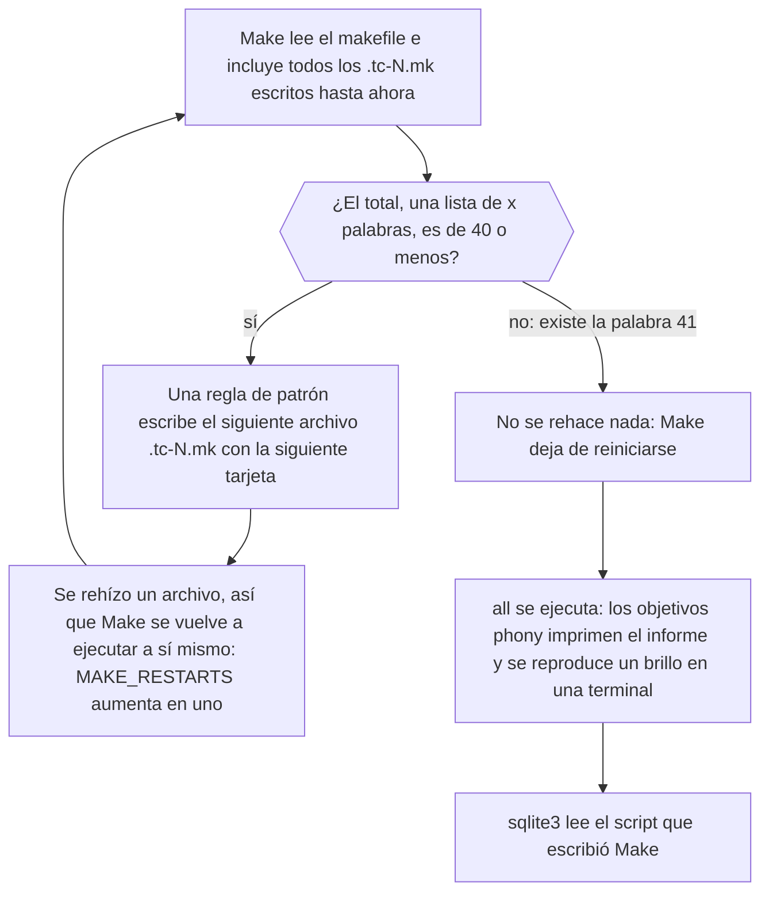
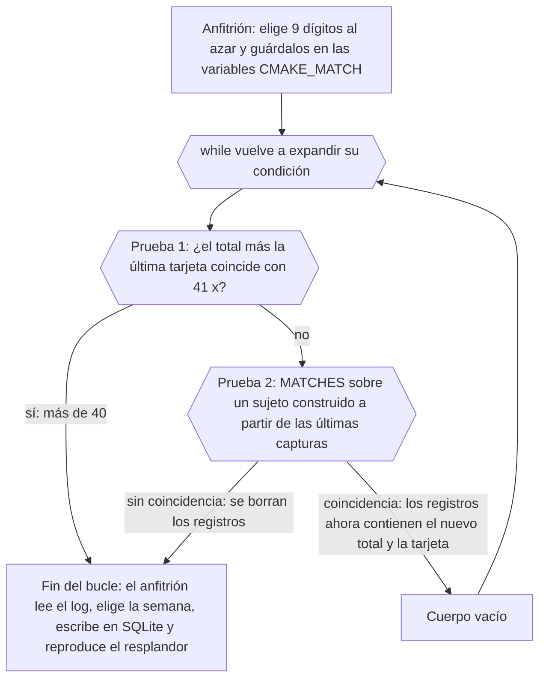

# Guía de estudio de Make y CMake

## Para qué sirve esta guía

Esta guía lee dos programas de herramientas de compilación que no tienen sentencia de bucle. En [`src/make-gnu`](../../../src/make-gnu/README.md), GNU Make *se reinicia a sí mismo* una vez por tarjeta. En [`src/cmake`](../../../src/cmake/README.md), un solo `while()` con cuerpo vacío ejecuta una máquina de registros dentro de su expresión de control. La pregunta es la siguiente. **Cuando decide la herramienta, y no el programa, qué se ejecuta a continuación, ¿dónde vive el estado del programa?**

Al terminar, deberías poder:

1. Explicar qué hace que GNU Make se vuelva a ejecutar a sí mismo, y por qué el sistema de archivos es el estado.
2. Explicar qué deja `MATCHES` en `CMAKE_MATCH_1` a `CMAKE_MATCH_9`, y por qué esas variables pueden actuar como registros.
3. Hacer la traza de cada programa con las mismas tres tarjetas, nombrando el estado antes y después de cada pasada.
4. Explicar por qué cada regla de parada es una *longitud* (41 palabras o 41 caracteres) y no una comparación.
5. Etiquetar cada comportamiento como garantizado, permitido por la implementación o aprovechado por accidente, y decir qué puede y qué no puede demostrar una comprobación de reproducibilidad.

**Límites del alcance.** Necesitas saber leer un Makefile y saber que `$(...)` expande una función o una variable. Necesitas saber que CMake ejecuta scripts con `cmake -P`. Esta guía no enseña la aritmética de calendario de la entrada de Make (que calcula una semana ISO sin intérprete de comandos (*shell*)). Tampoco enseña el resplandor animado ni la compatibilidad con Windows Terminal. Usa GNU Make y CMake 3.19 o posterior.

La página del libro es [Make y CMake](../../lenguajes/make-cmake.md). Para las ideas, consulta [Automatización de la compilación](../../informatica/05-lenguajes-formales-como-sustratos-de-computacion.md#build-automation), [Grafos de dependencias](../../informatica/06-estado-mas-alla-de-las-variables.md#dependency-graphs) e [Iteración de punto fijo](../../informatica/03-flujo-de-control-y-continuaciones.md#fixed-point-iteration).

## Antes de empezar

**Modelo de seguridad.** Cada entrada escribe datos ficticios marcados con **DEMO ONLY** en un archivo SQLite de trabajo. Make y CMake son programas que *ejecutan otros programas*. Ambos inician `sqlite3`. Make ejecuta además `mkdir` y `rm`. Lee el código fuente antes de ejecutarlo. Ejecútalo primero en el entorno aislado (*sandbox*):

```bash
sandbox/container/run-image.sh src/make-gnu
sandbox/container/run-image.sh src/cmake
```

Edita solo copias ([Ejecutar cosas de forma segura](../../exercises.md#running-things-safely)). La entrada de Make se niega a empezar si encuentra archivos `.tc-*.mk` sobrantes de una ejecución interrumpida: `make clean` los elimina.

**Regla de predicción.** Antes de cada ejecución, anota qué archivos existirán cuando empiece cada pasada, o qué guardará cada `CMAKE_MATCH_n` y qué esperarías ver si te equivocaras.

**Vocabulario.**

| Término | Significado aquí |
| --- | --- |
| Rehacer | El paso en que GNU Make pone al día el *propio makefile*. Si se rehízo, Make se vuelve a ejecutar a sí mismo. |
| `MAKE_RESTARTS` | Una variable que Make fija al número de veces que se ha vuelto a ejecutar a sí mismo. |
| Regla de patrón | Una regla con `%` que dice cómo hacer la compilación de cualquier archivo cuyo nombre coincida. |
| `CMAKE_MATCH_n` | Variables de CMake que guardan el grupo de captura *n* después de un `MATCHES` o un `string(REGEX ...)` que coincide. |
| Unario | Un número escrito como esa cantidad de copias de un solo símbolo. Ambos programas cuentan en `x`. |

## El reto compartido

La [especificación del reto](../../introduccion.md#what-the-challenge-does) pide tarjetas con una categoría y de 10 a 19 horas enteras. Las categorías se repiten en ciclo: `Meetings`, `Coding`, `Debugging` y `Learning`. Suma las horas de cada tarjeta al total acumulado. Detente cuando el total pasa de 40. Conserva la **primera tarjeta con la que el total pasa de 40**. Un total de exactamente 40 continúa. Cuatro tarjetas de 10 horas necesitan una quinta tarjeta, de la categoría `Meetings`. Las ejecuciones conformes tienen de 3 a 5 tarjetas y un total de 41 a 59 horas.

Ambos programas informan de un resultado de SQLite después del sorteo. La sonda de la regla de parada es una sentencia aparte: su fallo esperado deja las filas de las tarjetas in situ. Los dos programas escriben los números en unario. Así la regla de parada se vuelve una pregunta sobre la longitud, y es fácil equivocarse por uno en el límite. En Make la prueba es *"¿existe una palabra 41?"* (`$(word 41, ...)`, [L111](../../../src/make-gnu/Makefile#L111)). En CMake es *"¿el total coincide con 41 caracteres `x`?"* ([L41](../../../src/cmake/timecards.cmake#L41)). Un total de 40 no tiene palabra 41 y no coincide con 41 caracteres, así que ambos continúan.

## La máquina que hay que identificar

**Qué se repite.** En `make-gnu`, el *proceso completo de Make*: Make lee el makefile, incluye todos los archivos `.tc-N.mk` escritos hasta ahora y puede escribir uno más. En `cmake`, un `while()` con cuerpo vacío: solo su condición hace trabajo ([L41-54](../../../src/cmake/timecards.cmake#L41-L54)).

**Dónde vive el estado.** En `make-gnu`, el estado está en el conjunto de archivos que existen (`.tc-0.mk`, `.tc-1.mk` y así sucesivamente) y en `MAKE_RESTARTS`. Cada archivo guarda una tarjeta en dos asignaciones de variable, como `C0:=Meetings` y `H0:=15`.

En `cmake`, cinco variables guardan el estado ([L28-32](../../../src/cmake/timecards.cmake#L28-L32)). El programa no declara esas variables. Todos los números son series de `x`.

- `CMAKE_MATCH_1` guarda el total hasta ahora.
- `CMAKE_MATCH_2` guarda el dígito inspeccionado en la última pasada.
- `CMAKE_MATCH_3` guarda el resto de la cinta de dígitos aleatorios.
- `CMAKE_MATCH_4` guarda el log de las tarjetas terminadas.
- `CMAKE_MATCH_5` guarda las horas de la tarjeta añadida en la última pasada.

**Qué hace avanzar el paso siguiente.** En `make-gnu`, un archivo que se *escribe*. Un makefile que se ha rehecho obliga a Make a empezar de nuevo, y la regla de patrón `.tc-%.mk` escribe el siguiente archivo de tarjeta ([L110-111](../../../src/make-gnu/Makefile#L110-L111)). En `cmake`, `while()` vuelve a expandir su condición en cada pasada. La condición construye su siguiente cadena de texto sujeto y su patrón a partir de las capturas de la pasada anterior.

**Qué lo detiene.** En `make-gnu`, la regla *se niega a escribir un archivo*. Si existe una palabra 41, la receta se expande a nada, no aparece ningún archivo, Make no tiene nada que reiniciar y se ejecuta la meta predeterminada `all`. En `cmake`, la primera de las dos pruebas de la condición: `NOT` (el total más la última tarjeta coincide con 41 `x`). O falla el `MATCHES` principal.

**Qué confirma.** Ambos arman un script SQL y se lo entregan a `sqlite3`: Make escribe `.rows.sql` con `$(file ...)` y ejecuta `sqlite3 $(DB) <.rows.sql`; CMake hace lo mismo con `file(WRITE)` y `execute_process`. La última sentencia del script prueba la regla de parada *dentro de SQLite*: inserta `total <= 40` en una tabla cuya única columna tiene `CHECK(ok=1)`. Cuando la regla es correcta, la inserción termina en fallo y SQLite imprime en stderr un error de restricción con nombre. Ese mensaje es la regla de parada anunciándose, no un fallo del programa. Las filas de la terminal las imprime la herramienta, no SQLite.

<!-- diagram-source: src/make-gnu/README.md#program-flow -->



El bucle de Make es un ciclo a través del sistema de archivos: leer los archivos, escribir uno más, reiniciar. El estado es el conjunto de archivos que existen.

<!-- diagram-source: src/cmake/README.md#program-flow -->



El bucle de CMake es un ciclo a través de una sola expresión. Las cajas de prueba están en el orden en que las usa el código fuente. Ese orden no es decoración, como muestra la traza.

## Traza una ejecución

Los programas sacan horas aleatorias. Usa las horas **15, 19, 12** para la traza. Para comprobarla con el comportamiento real, se ejecutaron copias de trabajo en el entorno aislado con los dígitos aleatorios sustituidos por otros fijos y con sentencias de impresión añadidas.

### GNU Make

La copia de trabajo imprimió una línea al principio de cada proceso de Make. El reloj de Make se fijó con `NOW=1700000000`. La salida fue:

```text
pass K=0: files=[] HOURS=[] total=0 41st-word-exists=no
pass K=1: files=[.tc-0.mk] HOURS=[15] total=15 41st-word-exists=no
pass K=2: files=[.tc-0.mk .tc-1.mk] HOURS=[15 19] total=34 41st-word-exists=no
pass K=3: files=[.tc-0.mk .tc-1.mk .tc-2.mk] HOURS=[15 19 12] total=46 41st-word-exists=yes
# committed total=46 entries=3 DEMO ONLY
# make re-executed itself 3 times, once per card
```

| Pasada (`MAKE_RESTARTS`) | Archivos al empezar | Total | ¿Se activa la regla? | Qué pasa |
| --- | --- | ---: | --- | --- |
| 0 | ninguno | 0 | sí | Escribe `.tc-0.mk` con Meetings y 15 horas. Se rehízo un archivo, así que Make se reinicia. |
| 1 | `.tc-0.mk` | 15 | sí | Escribe `.tc-1.mk`, Coding, 19 horas. Reinicio. |
| 2 | `.tc-0.mk`, `.tc-1.mk` | 34 | sí | Escribe `.tc-2.mk`, Debugging, 12 horas. Reinicio. |
| 3 | los tres | 46 | **no**: existe la palabra 41 | No se escribe nada. No hay reinicio. La meta `all` se ejecuta e imprime el informe. |

La pasada 3 es la parada. La tarjeta que cruza el tope (12 horas, de `.tc-2.mk`) se escribió al final de la pasada 2, cuando el total era 34. La regla comprueba el total *antes* de escribir, así que no puede negarse a escribir la tarjeta que cruza el tope. Solo puede negarse a escribir la tarjeta *siguiente*. Es la misma forma que "conserva la primera tarjeta que pasa de 40", vista desde el otro lado.

### CMake

La copia de trabajo sustituyó la cinta aleatoria por los dígitos 5, 9, 2 (es decir, las horas 15, 19, 12) e imprimió los registros después de cada pasada. Más abajo, `CMAKE_MATCH_n` se abrevia de `M1` a `M5`.

```text
seed        : total(M1)=0  peeked(M2)=5  tape(M3)=92000000  log-length(M4)=0   last-card(M5)=0
after pass 1: total(M1)=0  peeked(M2)=9  tape(M3)=2000000   log-length(M4)=1   last-card(M5)=15
after pass 2: total(M1)=15 peeked(M2)=2  tape(M3)=000000    log-length(M4)=17  last-card(M5)=19
after pass 3: total(M1)=34 peeked(M2)=0  tape(M3)=00000     log-length(M4)=37  last-card(M5)=12
loop ended  : total(M1)=46 peeked(M2)=0  tape(M3)=0000      log-length(M4)=50  last-card(M5)=10
Meetings 15 15 / Coding 19 34 / Debugging 12 46
# an empty while() went round 3 times, once per card
```

(Las longitudes son el número de caracteres `x` o de guiones. Las líneas se reformatearon para ajustarlas al ancho.)

Léelo así. **Las horas de una tarjeta se buscan con una pasada de retraso.** El dígito 5 está en la semilla. La pasada 1 lo busca en la tabla dentro del sujeto (la fila `5:xxxxxxxxxxxxxxx`), encuentra 15 `x` y mira por adelantado el dígito siguiente, 9. La pasada 2 busca 9 y encuentra 19. La pasada 3 busca 2 y encuentra 12.

| Evaluación | Prueba 1: total + última tarjeta, ¿41 `x`? | Resultado de la prueba 2 | Estado después |
| --- | --- | --- | --- |
| 1 | 0 `x`: no, así que continúa | coincide; busca el dígito 5 | última tarjeta 15, total 0 |
| 2 | 15 `x`: no | coincide; busca el 9 | última tarjeta 19, total 15 |
| 3 | 34 `x`: no | coincide; busca el 2 | última tarjeta 12, total 34 |
| 4 | 46 `x`: **sí**, así que el bucle termina | *también se ejecutó* | el log ya guarda las tres tarjetas; la última tarjeta es una cuarta búsqueda sin usar (10) |

La última fila es la sorpresa, y por eso este programa se clasifica como aprovechado por accidente. La condición es `NOT (stop test) AND (main match)`. Cuando la prueba de parada dice que pares, el bucle termina, pero la *coincidencia principal se ejecutó igualmente en esa misma evaluación*, con los registros de la pasada 3. El log después de la pasada 3 tenía solo dos tarjetas (la longitud 37 es `-`, 15 `x`, `-`, 19 `x`, `-`). La tercera tarjeta, de 12 horas, pasa al log solo en la evaluación 4. El programa necesita que la coincidencia principal se ejecute cuando termina el bucle, porque así se registra la última tarjeta. El quinto registro guarda entonces una cuarta búsqueda (10 horas) que el anfitrión nunca informa, porque solo lee el log (`CMAKE_MATCH_4`). No encontré en la documentación de CMake ninguna promesa de que los dos operandos de `AND` se evalúen siempre, así que trátalo como observado, no como garantizado. El comentario del código fuente de la entrada y su README ahora registran esta dependencia.

**Exactamente 40.** Con las horas 10, 10, 10, 10, el total después de cuatro tarjetas es 40 `x`, que no coincide con 41 caracteres. El bucle continúa y se busca una quinta tarjeta.

## Compara los diseños ordinarios y los raros

La versión "ordinaria" de cada programa es la que los autores descartaron o escribieron primero. Para CMake es un bucle `while()` con `math(EXPR)` y `list(GET)`. El README dice que se descartó porque era "`RunEverything()` con acento de CMake". Para Make no hay versión ordinaria en el repositorio: Make no tiene bucle. La comparación de abajo es entre el trabajo *previsto* de la herramienta (un grafo de dependencias) y lo que estos programas le hacen hacer.

| Dimensión | Make como se diseñó | `make-gnu` | `cmake` |
| --- | --- | --- | --- |
| **Representación** | Un grafo: objetivos, prerrequisitos, recetas. | Los números son listas de `x`. El control es "apareció un archivo". | Los números son cadenas de texto de `x`. El control es una coincidencia de regex cuyas capturas alimentan la siguiente coincidencia. |
| **Observabilidad** | `make -n` muestra lo que se ejecutaría. | El estado son los archivos del directorio. `ls .tc-*.mk` y `$(info ...)` lo muestran. | El estado está oculto en variables que el programa nunca declara. Hay que imprimirlas (como hizo la ejecución de trabajo) para verlas. |
| **Pruebas** | Haz la compilación de un objetivo y compara la salida. | `check.sh` ejecuta Make 25 veces en un directorio vacío y exige que el directorio quede vacío después. | `check.sh` lo ejecuta 25 veces y muta el literal de 41 caracteres a 51; luego espera que los totales superen el máximo legal. |
| **Debugging** | Lee el grafo de dependencias. | Una ejecución interrumpida deja `.tc-*.mk` atrás y el siguiente `make` se niega a empezar. | Una condición que falla borra todos los registros: un error tipográfico en la prueba de parada puede dar un informe vacío, no un error. |
| **Portabilidad** | GNU Make y POSIX Make difieren en muchos detalles. | Usa extensiones de GNU (`$(file ...)`, `$(wordlist ...)`, `MAKE_RESTARTS`). Lee `/proc` para la entropía y el reloj, así que es específico de Linux. | Necesita CMake 3.19 o posterior. Su regex no tiene repetición contada, ni anticipación (*lookahead*), ni retrorreferencias. |
| **Costo** | Normal. | Make se reinicia una vez por tarjeta y la aritmética unaria es lenta en proporción a los números (la regla mide 60 000 palabras). | Es barato, pero un `(x?x?...)` de 40 ramas, tentador para "como máximo 40", retrocedería de forma exponencial al fallar. |

**Reproducibilidad.** Los programas dan dos respuestas distintas a la pregunta de qué depende del reloj. Make lee el reloj de `/proc` y deja anularlo (`NOW=1700000000`), así que la semana de la salida es una función pura de la anulación. CMake pregunta a `string(TIMESTAMP)`, que respeta `SOURCE_DATE_EPOCH`. Las *tarjetas* son aleatorias en ambos, así que una comprobación de reproducibilidad puede fijar la semana pero no los totales. Lo que demuestra la comprobación está limitado por lo que controla.

## Qué demuestran los ejercicios

| Ejercicio | Predice primero | Qué muestra la evidencia |
| --- | --- | --- |
| [B4. Make: quita la operación nula y anula el reloj](../../exercises.md#b4-make-remove-the-no-op-and-override-the-clock-verified), paso 1 | Borra el `@:` final de la receta. ¿Qué pasa? | La ejecución termina `# committed total=0 entries=0` y `make re-executed itself 0 times`. El archivo de la tarjeta se escribe mientras la línea de la receta se *expande*, pero Make solo se reinicia si *se ejecutó* un comando. Una receta que se expande a nada no es un rehacer. El `@:` es el único lugar donde el bucle necesita un intérprete de comandos. |
| B4, paso 2 | Ejecuta con `NOW=1700000000`. ¿Qué semana ISO esperas? | `2023-W46`, que coincide con `date -u -d @1700000000 +%G-W%V`. El reloj es una entrada de datos que puedes fijar. |
| [B5. CMake: muta el literal](../../exercises.md#b5-cmake-mutate-the-literal-verified) | Acorta el literal de 41 `x` a 31. ¿Cuál es la nueva regla de parada? | Detenerse en el primer total que pasa de 30. El verificador compartido pasa con el límite 30, y la comprobación propia de la entrada falla. El literal *es* la regla de parada. |
| B5, la pregunta del orden | ¿Por qué la prueba de parada debe ir primero en la condición de `while()`? | La coincidencia de la primera prueba borra o reescribe los registros de captura. La coincidencia principal debe ejecutarse al final para que sus capturas sean las que sobreviven. La traza de trabajo muestra la consecuencia: la coincidencia principal se ejecuta incluso en la última evaluación. |
| [C1. Lo raro junto a lo aburrido](../../exercises.md#c1-weird-next-to-boring-verified) | ¿Cuál es el estado de cada programa y quién puede leerlo? | El estado de Make son archivos, que se leen con `ls`. El de CMake son cinco variables ocultas, que solo se leen si las imprimes sin alterarlas (mira abajo). |

**Una trampa al instrumentar CMake.** La ejecución de trabajo imprimió primero los registros con una función auxiliar que llamaba a `string(REGEX REPLACE ...)`. Ese comando *también* escribe `CMAKE_MATCH_n`, así que borró los registros y el bucle terminó al instante, con cero tarjetas. Mirar este programa lo cambia, salvo que mires con comandos que no tocan los registros. `string(LENGTH ...)` no los toca, y es lo que usó la traza anterior.

## Modos de fallo, costos y límites

| Comportamiento | Etiqueta | Por qué |
| --- | --- | --- |
| Make se vuelve a ejecutar tras rehacer un makefile incluido, y `MAKE_RESTARTS` cuenta los reinicios | **permitido por la implementación** | Comportamiento documentado de GNU Make (mira "Remaking Makefiles" en el manual de GNU Make, enlazado abajo). Es una característica de GNU, no de POSIX. |
| Usar ese reinicio, provocado por un archivo que crea la regla, como un bucle | **aprovechado por accidente** | Es el ejemplo propio del libro para esta etiqueta. La característica existe para mantener al día los makefiles generados. Nadie prometió que sirviera para contar tarjetas. |
| Una receta que se expande a nada no cuenta como rehacer el archivo | **aprovechado por accidente** | El bucle lo necesita, y se observó en lugar de estar prometido. Se verificó en el ejercicio B4: borra `@:` y el reinicio nunca ocurre. |
| Un archivo que pasa de faltar a estar presente es un cambio inequívoco; un archivo reescrito puede parecer intacto en un sistema de archivos con marcas de tiempo gruesas | **permitido por la implementación** | El README registra que su primer diseño reescribía un solo archivo de estado y se reiniciaba solo una vez, en WSL. Un archivo por pasada evita el problema. |
| `MATCHES` fija `CMAKE_MATCH_n`, y `while()` vuelve a expandir su condición en cada pasada | **garantizado** por la documentación | Ambos están documentados. |
| Una coincidencia fallida borra todos los registros | **permitido por la implementación** | Observado, no prometido con esas palabras. |
| La coincidencia principal se ejecuta en la misma evaluación en la que la prueba de parada dice que pares | **aprovechado por accidente** | Observado en la traza de trabajo. El programa lo necesita para registrar la última tarjeta. No encontré ninguna promesa de ello en la documentación de CMake. |
| Leer `/proc/stat`, `/proc/uptime` y el uuid del núcleo con `$(file </...)` | **permitido por la implementación** | Solo en Linux. Es como la entrada de Make evita `$(shell)`. |

**Costos que conviene declarar.**

- **El estado está fuera del programa.** En Make, una ejecución interrumpida o fallida deja archivos atrás, y la siguiente ejecución los lee como tarjetas reales. La entrada se niega a empezar en lugar de fiarse de ellos. Es una *protección contra la contaminación de su propio estado de control*.
- **Make expande cada línea de una receta antes de ejecutar ninguna.** Por eso el informe debe ser una cadena de objetivos phony (`init`, `rows`, `footer`), para mantener en orden el encabezado y las filas de SQLite.
- **La salida de CMake no puede ocurrir dentro de una condición.** La impresión, el SQL y la semana ISO son CMake ordinario después del bucle. Es la concesión del "pequeño anfitrión que informa de un resultado".
- **Las pruebas que miran por dentro pueden romper la máquina.** Mira la trampa de arriba.
- **Dónde es legítima la técnica.** Que Make se reinicie a sí mismo es exactamente como funciona la generación automática de dependencias. Las capturas de regex de CMake sirven legítimamente para analizar versiones y rutas. La acrobacia usa las mismas características para hacer aritmética.

## Conexiones a lo largo del repositorio

- **El estado de control fuera de las variables.** [COBOL](cobol.md) lo guarda en un destino de salto y [Forth](forth.md) en una posición de análisis. Make lo guarda en archivos y CMake en capturas. [Tcl](tcl.md) lo guarda en un disparador de base de datos. La guía de concepto [Estado y control más allá de las variables](../conceptos/estado-y-control-mas-alla-de-las-variables.md) los alinea.
- **Reescribir hasta que nada cambie.** [m4](m4.md) reescanea su salida y [sed](motores-de-regex-y-sed.md) puede hacer un bucle con una rama. El reinicio de Make es la misma idea de punto fijo, con archivos en lugar de texto.
- **Una regex que es el programa.** [Motores de regex y sed](motores-de-regex-y-sed.md) pone el bucle dentro de una sola coincidencia. CMake deja que el bucle vuelva a expandir una regex en cada pasada.
- **Reproducibilidad.** [Portabilidad, abstracción y costo](../conceptos/portabilidad-abstraccion-y-costo.md) trata las compilaciones deterministas y lo que un reloj fijo demuestra y no demuestra.
- **En el libro.** [Make y CMake](../../lenguajes/make-cmake.md), [Automatización de la compilación](../../informatica/05-lenguajes-formales-como-sustratos-de-computacion.md#build-automation) y [Grafos de dependencias](../../informatica/06-estado-mas-alla-de-las-variables.md#dependency-graphs).

## Autoevaluación

Responde cada pregunta con tus propias palabras antes de leer el texto en cursiva. Di qué evidencia respaldaría cada respuesta.

1. **Traza.** En `make-gnu`, las horas son 11, 11, 11, 11 (total 44). ¿Cuántas veces se vuelve a ejecutar Make a sí mismo y en qué pasada se niega la regla a escribir? *(Cuatro veces. Las pasadas 0 a 3 escriben cada una un archivo de tarjeta. En la pasada 4 el total es 44, así que existe la palabra 41 y la regla no escribe nada. `MAKE_RESTARTS` vale 4 al final.)*
2. **Explica.** ¿Por qué borrar `@:` de la receta da `entries=0`? *(El `$(file ...)` que escribe la tarjeta se ejecuta mientras la línea de la receta se expande. Si la línea se expande a ningún comando, Make trata el archivo como no rehecho. Ningún archivo cuenta como rehecho, así que Make nunca se reinicia y la primera pasada informa cero tarjetas.)*
3. **Transfiere.** Supón que la condición de CMake se escribiera con la coincidencia principal primero y la prueba de parada después. Predice la salida. *(La ejecución informa cero tarjetas. Esto se comprobó en una copia de trabajo. La coincidencia principal fija los registros. Luego el `MATCHES` de la propia prueba de parada, que no tiene grupos de captura, falla con el total pequeño y los borra todos. La siguiente evaluación empieza con registros vacíos y el bucle termina. El primer orden existe para que la coincidencia cuyas capturas necesitas se ejecute al final.)*
4. **Evidencia.** Un revisor dice: "El bucle de Make necesita un intérprete de comandos exactamente una vez". Diseña una prueba que pueda fallar. ¿Cuál es el control negativo? *(Comprueba que los únicos comandos de las recetas son `mkdir`, `sqlite3`, `rm`, `sleep` y la operación nula `:`, que es lo que hace el `check.sh` de la entrada. Como control, añade un `$(shell date)` y espera que la comprobación falle. La afirmación es de la propia entrada y se clasifica como permitida por la implementación.)*

## Lecturas adicionales

- [Make (software)](https://en.wikipedia.org/wiki/Make_(software)) (Wikipedia): para qué sirve Make y cómo funcionan sus reglas de dependencia.
- [CMake](https://en.wikipedia.org/wiki/CMake) (Wikipedia): una orientación general. El manual de CMake describe las condiciones `if()` y `while()`. Pero su anfitrión no está en la lista de permitidos de este libro, así que léelo en tu copia instalada con `cmake --help-command while`.
- [Remaking Makefiles](https://www.gnu.org/software/make/manual/html_node/Remaking-Makefiles.html) (manual de GNU Make): la declaración oficial de que Make se vuelve a ejecutar tras rehacer un makefile incluido. Todo lo de la entrada de Make descansa en ella.
- [Compilaciones reproducibles](https://en.wikipedia.org/wiki/Reproducible_builds) (Wikipedia): por qué una compilación que lee el reloj necesita una anulación como `SOURCE_DATE_EPOCH`.
- [Iteración de punto fijo](../../informatica/03-flujo-de-control-y-continuaciones.md#fixed-point-iteration) y [Reproducibilidad y compilaciones deterministas](../../informatica/08-fugas-de-abstraccion-y-dependencia-de-la-implementacion.md#reproducibility-and-deterministic-builds) (este libro): las dos ideas en las que se apoyan estos programas.
