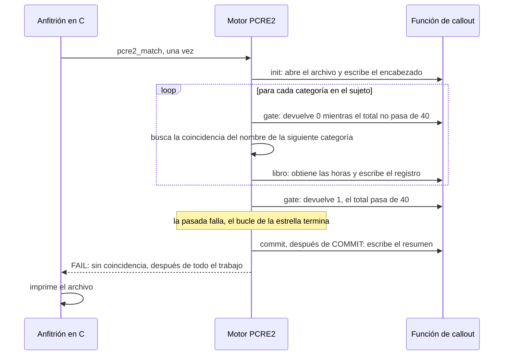
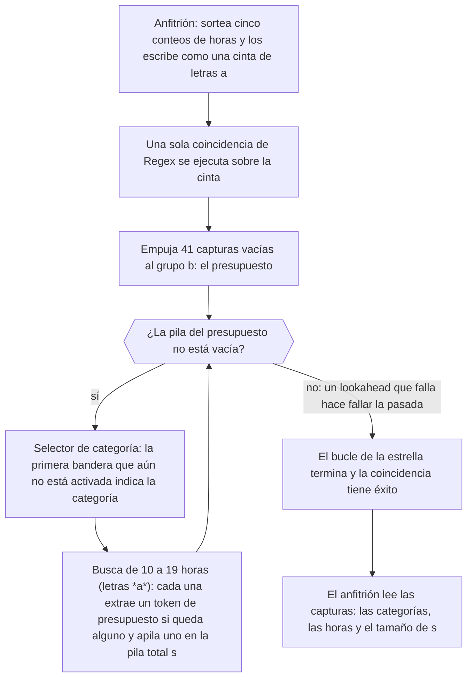
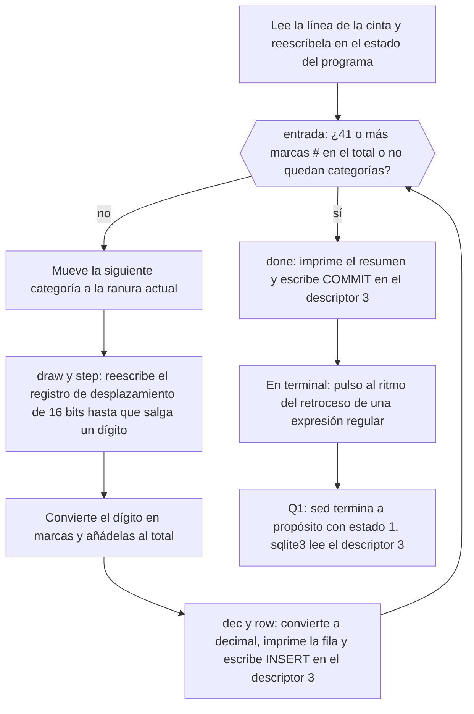

# Guía de estudio de motores de regex y sed

## Para qué sirve esta guía

Esta guía lee cinco programas. Cada uno usa como máquina completa un motor de expresiones regulares, o un editor de flujo construido sobre uno. Son [`regex-perl`](../../../src/regex-perl/README.md), [`regex-pcre2`](../../../src/regex-pcre2/README.md), [`regex-pcre2grep`](../../../src/regex-pcre2grep/README.md), [`regex-dotnet`](../../../src/regex-dotnet/README.md) y [`regex-sed`](../../../src/regex-sed/README.md). La pregunta es: **una coincidencia es una búsqueda y una sustitución es una reescritura. ¿Qué conserva, deshace y pierde cada motor cuando la búsqueda falla?**

Al terminar, deberías poder:

1. Explicar la diferencia entre *buscar* y *reescribir*. Buscar es una coincidencia que explora y abandona caminos. Reescribir es un bucle de sustituciones sobre una cadena de texto. Decir qué entradas son de cada tipo.
2. Decir qué sobrevive a una coincidencia fallida en cada motor. En Perl, el `local`. En PCRE2, el estado en C. En pcre2grep, las escrituras en la base de datos. En .NET, las capturas. En sed, el espacio de patrones.
3. Explicar qué hacen `(*COMMIT)`, `(*FAIL)` y el valor de retorno de un callout, y por qué importa el orden de las piezas.
4. Hacer la traza de PCRE2, .NET y sed en una ejecución fija y nombrar el estado en cada paso.
5. Explicar cómo un suministro finito de nombres de categoría fijó un techo oculto de cuatro tarjetas. Explicar qué le hizo eso a la regla de que un total de exactamente 40 continúa. Explicar cómo funcionan la corrección de cinco nombres y su prueba, y cómo un patrón con retroceso se vuelve un riesgo de denegación de servicio.
6. Etiquetar cada comportamiento como garantizado, permitido por la implementación o aprovechado por accidente.

**Límites del alcance.** Necesitas saber qué son un grupo de captura, un cuantificador voraz y una alternancia. La guía no enseña desde cero la sintaxis de las expresiones regulares, el SQL ni la animación de "pulso" en la terminal. Cubre Perl 5, PCRE2 10.x, pcre2grep con scripts de callout, .NET 10 y GNU sed. Para la teoría, consulta [Expresiones regulares](../../informatica/05-lenguajes-formales-como-sustratos-de-computacion.md#regular-expressions) y [Retroceso](../../informatica/07-efectos-errores-y-confirmacion.md#backtracking) en el libro. La página del lenguaje es [Expresiones regulares: cinco motores](../../lenguajes/regex.md).

## Antes de empezar

**Modelo de seguridad.** Cada entrada escribe datos ficticios marcados con **DEMO ONLY**. Esta familia es la más peligrosa de ejecutar sin leer. Un patrón de Perl ejecuta código de Perl e inicia `sqlite3`. Un callout de PCRE2 ejecuta código en C del anfitrión, y los callouts de `pcre2grep` inician programas. Lee primero el código fuente y ejecútalo primero en el entorno aislado (*sandbox*) que limita el acceso al sistema anfitrión:

```bash
sandbox/container/run-image.sh src/regex-pcre2
sandbox/container/run-image.sh src/regex-dotnet
sandbox/container/run-image.sh src/regex-sed
```

Edita solo copias ([Ejecutar cosas de forma segura](../../exercises.md#ejecutar-con-seguridad)). Dos advertencias que nacen de la experiencia. Primera: `regex-sed` escribe SQL en el descriptor de archivo 3. Ejecuta su script solo mediante el envoltorio de la entrada, o en el entorno aislado con `3>/dev/null`. Mientras se preparaba esta guía, un arnés que dejó cerrado el descriptor 3 hizo que el `w /dev/fd/3` del script abriera el *propio archivo del script* y lo sobrescribiera. Segunda: ejecuta cualquier experimento con sed o con regex en una copia desechable, nunca en tu copia de trabajo.

**Regla de predicción.** Antes de cada ejecución, anota qué estado guarda cada motor cuando termina la coincidencia y qué verías si la coincidencia fallara.

**Vocabulario.**

| Término | Significado aquí |
| --- | --- |
| Retroceso | Cuando un camino falla, el motor vuelve al último punto de elección y prueba la siguiente alternativa. |
| `(*COMMIT)` | Una vez que la coincidencia pasa este punto, el retroceso ya no puede reintentar antes de él. |
| `(*FAIL)` | Falla de inmediato. Aquí sirve para terminar una pasada o toda la coincidencia. |
| Callout | Un punto de un patrón de PCRE2 donde el motor llama a código del anfitrión. Su valor de retorno indica que continúe, que este camino falle o que se aborte. |
| Grupo de equilibrio | Un grupo de .NET que extrae de una pila de capturas y apila en otra. |
| Espacio de patrones | El búfer de trabajo de sed: una línea de texto. |

## El reto compartido

La [especificación del reto](../../introduccion.md#qué-hace-el-reto) pide tarjetas con una categoría y de 10 a 19 horas enteras. Las categorías se repiten en ciclo: `Meetings`, `Coding`, `Debugging` y `Learning`. Suma las horas de cada tarjeta al total acumulado. Detente cuando el total pasa de 40. Conserva la **primera tarjeta con la que el total pasa de 40**. Un total de exactamente 40 continúa. Cuatro tarjetas de 10 horas necesitan una quinta tarjeta, de la categoría `Meetings`. Las ejecuciones conformes tienen de 3 a 5 tarjetas y un total de 41 a 59 horas.

Las cinco entradas siguen la regla numérica, con tres rutas de almacenamiento que conviene distinguir. Las rutas de C y .NET escriben TSV, pcre2grep guarda mediante llamadas separadas a SQLite, y Perl y sed envían una transacción a SQLite. Esta familia una vez no pudo obedecer la regla numérica, y la forma en que se descubrió es instructiva. Cada entrada de regex recorría una *lista finita de cuatro nombres de categoría* (la cadena de texto de entrada, el armazón o la lista `cats:` de sed). Cuando se acababan los cuatro nombres, el bucle terminaba, fuera cual fuera el total. Así, una ejecución de cuatro tarjetas de 10 horas terminaba en exactamente 40 con cuatro filas. Eso tiene una probabilidad de una entre 10 000 por ejecución, así que las entradas pasaban sus propias comprobaciones, que aceptaban "cuatro entradas" como una parada legítima. El verificador compartido `lessons/tools/check-demo.sh` rechaza una ejecución así. Al ejecutarlo para forzar los sorteos mientras se escribía esta guía, quedó a la vista el problema (consulta la sección de traza). Ya está corregido: cada entrada tiene **cinco** nombres (`Meetings` se repite). Además, cada `check.sh` hace la compilación de una copia del programa cuyas tarjetas valen todas 10 horas. Esa copia exige una quinta tarjeta, `Meetings`, que termina en 50.

## La máquina que hay que identificar

Perl, PCRE2 y pcre2grep buscan y fallan a propósito después de hacer su trabajo mediante efectos secundarios. La búsqueda de .NET falla la *pasada* final y tiene éxito en conjunto, y devuelve sus capturas. Sed usa un bucle de sustituciones sobre una línea. El estado final te dice dónde buscar los resultados.

**Qué se repite.** En Perl, un cuantificador voraz, `(?: ... )*`, cuyo cuerpo es un bloque de código ([L7](../../../src/regex-perl/timecards.pl#L7)). En PCRE2, la misma forma con callouts: `(?:(?C"gate")(Meetings|Coding|Debugging|Learning)(?C"book"))*` ([L24-26](../../../src/regex-pcre2/timecards.c#L24-L26)). En pcre2grep, lo mismo, con callouts que ejecutan `sqlite3` ([L14-20](../../../src/regex-pcre2grep/timecards.sh#L14-L20)). En .NET, `(?: ... )*` sobre un patrón hecho solo de grupos de equilibrio ([L13](../../../src/regex-dotnet/Program.cs#L13)). En sed, un salto de vuelta a la etiqueta `:entry`, que hacen `b` y `t` detrás de direcciones regex ([timecards.sed](../../../src/regex-sed/timecards.sed)).

**Dónde vive el estado.** Perl: las variables de paquete `$::t` y `$::n`, asignadas con `local`. PCRE2: una estructura de C que comparten los callouts. pcre2grep: SQLite, que cada callout vuelve a leer. .NET: la *profundidad de la pila*, en las capturas del grupo `b` (el presupuesto) y del grupo `s` (el total). sed: una línea de texto. Los números son series de `#` (marcas de conteo). Los números aleatorios son una cadena de texto de 16 caracteres de 0 y 1. Incluso la dirección de retorno de una subrutina es texto.

**Qué hace avanzar el paso siguiente.** Perl y PCRE2: el motor llega a la siguiente pasada del cuantificador. pcre2grep: el estado de salida de un programa que ejecutó el callout. .NET: el motor encuentra de 10 a 19 letras `a` (horas por tarjeta), y cada una retira un token del presupuesto. sed: un salto `b` o `t` que vuelve a `:entry`.

**Qué lo detiene.** Perl: un bloque pospuesto que devuelve la siguiente categoría como *patrón*, o `(*FAIL)` cuando el total pasa de 40 o se acaban los nombres. PCRE2: `gate` devuelve 1 cuando el total pasa de 40. pcre2grep: SQLite se niega a insertar "el total es de 40 o menos" en una columna `CHECK(ok=1)`. Por eso `sqlite3` termina con estado distinto de cero, lo que permite vetar la rama. .NET: cuando la pila del presupuesto está vacía, la pasada llega a `(?!)`. sed: `/ tot:#{41}/b done`, que pregunta si aparecen 41 marcas de conteo.

**Qué confirma.** En Perl, la transacción se confirma antes de que la coincidencia devuelva falso. En el programa PCRE2 en C, un callout escribe el resumen TSV y cierra el archivo antes del mismo fallo deliberado. En pcre2grep, cada callout es su propio proceso `sqlite3`, así que cada sentencia se confirma de inmediato. No hay transacción externa. En .NET, *nada se confirma dentro de la coincidencia*: una regex no puede escribir. Tras una coincidencia correcta, el anfitrión lee las capturas y añade un informe TSV. Una coincidencia fallida no da tarjetas, pero el anfitrión escribe igualmente un informe de cero entradas y termina con estado 1. En sed, el SQL va al descriptor 3 para que lo lea `sqlite3`, con `BEGIN` y `COMMIT` en el flujo.

<!-- diagram-source: src/regex-pcre2/README.md#program-flow -->



El diagrama de PCRE2 es una conversación: el motor llama de vuelta a C en cada callout, y el valor de retorno es la decisión.

<!-- diagram-source: src/regex-dotnet/README.md#program-flow -->



El diagrama de .NET no tiene ninguna función de devolución de llamada (*callback*). La única salida es lo que el motor capturó.

<!-- diagram-source: src/regex-sed/README.md#program-flow -->



El diagrama de sed es un diagrama de flujo con un ciclo real, porque sed tiene un goto. Es una máquina de reescritura con un contador de programa, no una sola coincidencia.

## Traza una ejecución

Las entradas sortean horas al azar, y en esta familia no siempre controlas las horas. Para PCRE2 y .NET, la traza usa copias de trabajo con los sorteos aleatorios sustituidos por valores fijos. Se ejecutaron en el entorno aislado (PCRE2) o en local desde una carpeta temporal (.NET). Para sed, la entrada tiene una semilla. La semilla `1011001110100101` del README siempre da las mismas tarjetas, así que es una ejecución fija. Sus horas son 15, 14, 14 en lugar de 15, 19, 12. Se ejecutaron los tres para comprobar esta sección.

### PCRE2: la conversación de callouts

Con las horas 15, 19, 12 y una línea de salida añadida a stderr en cada callout, la ejecución imprimió:

```text
  gate:   total=0, returns 0
  book:   matched Meetings, hours=15, total now 15
  gate:   total=15, returns 0
  book:   matched Coding, hours=19, total now 34
  gate:   total=34, returns 0
  book:   matched Debugging, hours=12, total now 46
  gate:   total=46, returns 1
  commit: total=46 entries=3
pcre2_match returned -1 (no match)
```

| Callout | Estado antes | Retorno | Efecto |
| --- | --- | --- | --- |
| `init` | ninguno | 0 | abre el archivo y escribe el encabezado |
| `gate` | total 0 | 0 | continúa |
| `book` (Meetings) | total 0 | 0 | sortea 15, total 15, escribe la fila |
| `gate` | total 15 | 0 | continúa |
| `book` (Coding) | total 15 | 0 | sortea 19, total 34 |
| `gate` | total 34 | 0 | continúa |
| `book` (Debugging) | total 34 | 0 | sortea 12, total 46 |
| `gate` | total 46 | **1** | falla esta rama: el `*` termina |
| `commit` | total 46 | 0 | después de `(*COMMIT)`, escribe el resumen una vez |
| resultado de la coincidencia | ninguno | ninguno | `(*FAIL)`: `pcre2_match` devuelve -1 (sin coincidencia) |

La tarjeta que cruza el tope ya está registrada cuando se activa el gate. Esa es la regla "conserva la primera tarjeta que pasa de 40": el gate comprueba *antes* de cada categoría, así que rechaza la tarjeta *posterior* a la que cruza. La búsqueda no encontró coincidencia, y el archivo aún contiene tres filas y un resumen.

### .NET: la pila del presupuesto

La copia de trabajo sorteaba desde la línea de comandos en lugar de `Random`. Con los sorteos `15 19 12 17 11` imprimió tres filas y `# captured total=46 entries=3`. El cuarto y el quinto sorteo se ignoraron. La traza en términos de pilas:

| Paso | Pila del presupuesto `b` | Pila del total `s` | Qué hace el patrón |
| --- | --- | --- | --- |
| Inicio | 41 tokens | 0 | `(?:(?<b>)){41}` apila el presupuesto |
| Pasada 1: Meetings | 41, luego 26 | 15 | la pila `b` no está vacía, el selector toma Meetings, 15 letras `a` retiran cada una un `b` y apilan un `s` |
| Pasada 2: Coding | 26, luego 7 | 34 | 19 letras |
| Pasada 3: Debugging | 7, luego 0 | 46 | 12 letras: las primeras 7 retiran un token y las últimas 5 no retiran nada, porque la condición `(?(b)...)` encuentra la pila vacía |
| Prueba de la pasada 4 | 0 | 46 | `(?(b)...|(?!))` encuentra `b` vacío y toma `(?!)`, lo que hace fallar la pasada. El `*` termina y la coincidencia *tiene éxito* |

La tarjeta que cruza el tope puede rebasar el presupuesto a mitad de sus horas. Solo se rechaza la pasada siguiente. La [comprobación con cinta fija](../../../src/regex-dotnet/check.sh) ejecuta cinco decenas con el patrón original y luego la misma cinta con el patrón con `(?!)` añadido. En .NET SDK 10.0.401, la primera informa de 50 horas en cinco filas con estado de salida 0. El caso de fallo informa de cero horas y cero filas con estado de salida 1. Ambos informes se añaden a TSV.

**El límite: antes y después de la corrección.** Antes de la corrección, se ejecutaron copias de trabajo de PCRE2 y .NET con cuatro sorteos de 10 horas. Ambas se detuvieron con `total=40 entries=4`: después de `Learning` no había un quinto nombre de categoría, así que no podía empezar una quinta pasada, aunque 40 no pasa de 40. Para PCRE2, el verificador compartido lo confirmó:

```text
$ bash lessons/tools/check-demo.sh out.txt
FAIL: final total 40 does not pass 40
```

Lo mismo ocurría en la entrada de Perl (su bloque pospuesto devuelve `$::c[$::n] // '(*FAIL)'`, que falla cuando se agotan los nombres) y en sed (`/ cats: /b done`). La corrección añade un nombre en cada entrada. En PCRE2 y pcre2grep es `MeetingsCodingDebuggingLearningMeetings`, en la cadena de texto de entrada de uno y en la cinta del otro. En Perl es un quinto `Meetings` en el armazón y `@::c`. En .NET es una quinta entrada de la cinta y un grupo de banderas más (`f5`) en el selector. En sed es `cats:Meetings,Coding,Debugging,Learning,Meetings,`. Cada `check.sh` hace ahora la compilación de una variante en la que cada tarjeta vale 10 horas. Esa variante exige cinco filas (la cuarta `Learning`, la quinta `Meetings`, total 50). Las pruebas nuevas también se ejecutaron contra el código antiguo y cada una falló allí (`total=40 entries=4`), así que pueden fallar. Las cinco entradas las pasan ahora.

### sed: una línea, reescrita

Una cinta con `trace:1` activa una impresión del estado en cada cabecera del bucle y en las reescrituras intermedias. GNU sed 4.9 reprodujo la traza de abajo con la cinta fija del README con `trace:1` y el descriptor 3 redirigido a un archivo SQL aparte. Al ejecutar ese SQL en SQLite 3.45.1 se reprodujeron las tres filas de tarjetas. Estos son los estados de `:entry` sin su prefijo común:

```text
rng:1011001110100101 cats:Meetings,Coding,Debugging,Learning,Meetings, tot: n:
rng:0101101100111010 cats:Coding,Debugging,Learning,Meetings, tot:############### n:%
rng:0100101001011011 cats:Debugging,Learning,Meetings, tot:############################# n:%%
rng:0100010010100101 cats:Learning,Meetings, tot:########################################### n:%%%
```

| Cabecera del bucle | Total (marcas) | Categorías restantes | `/ tot:#{41}/` | Siguiente |
| --- | ---: | --- | --- | --- |
| 1 | 0 | cinco | sin coincidencia | toma Meetings, sortea 15 |
| 2 | 15 | cuatro | sin coincidencia | toma Coding, sortea 14 |
| 3 | 29 | tres | sin coincidencia | toma Debugging, sortea 14 |
| 4 | **43** | dos | **coincide** | `b done`: imprime el resumen, escribe `COMMIT` |

Las filas fueron `Meetings 15 15`, `Coding 14 29` y `Debugging 14 43`, con `# committed total=43 entries=3`. Cada viaje entre cabeceras del bucle reescribe el registro de desplazamiento para producir un dígito. Rechaza los sorteos de 10 a 15 (`/ rng:1(01|1)/b draw`) y convierte el dígito aceptado en marcas de conteo. El número de líneas de estado por tarjeta no es constante, porque un sorteo rechazado repite un paso. Learning y el segundo Meetings nunca se usaron: la regla de parada se activó antes. Si el total hubiera sido exactamente 40 en una cabecera posterior, `cats:` aún tendría un nombre, así que se sortearía otra tarjeta. Con cinco nombres, la lista solo puede terminar una ejecución después de cinco tarjetas, y cinco tarjetas de al menos 10 horas siempre pasan de 40.

## Compara los diseños ordinarios y los raros

En el repositorio no hay una versión ordinaria de esta familia: la forma "ordinaria" de hacer el reto es cualquier entrada en otro lenguaje. La comparación útil es entre los cinco diseños de regex.

| Dimensión | Perl | PCRE2 | pcre2grep | .NET | sed |
| --- | --- | --- | --- | --- | --- |
| **Representación** | Bloques de código en el patrón | Nombres de callout como códigos de operación | Scripts de callout que nombran programas | Grupos de equilibrio como pilas | Sustituciones sobre una línea |
| **Estado** | variables `local` | estructura de C | SQLite | profundidad de la pila | la línea |
| **Observabilidad** | Oculto en variables de paquete | `gdb`, o impresión en el despachador | registro de `sqlite3` | Solo las capturas finales | Toda la máquina es una línea imprimible (`TRACE=1`) |
| **Pruebas** | Ejecútalo y lee la base de datos | Compara el registro de callouts con el archivo TSV | Caja negra: el patrón y los estados de salida | Fija los sorteos y lee las capturas | La misma semilla da las mismas tarjetas, así que la salida se puede probar |
| **Portabilidad** | Funciones de bloques de código de Perl 5 | Necesita un PCRE2 compilado con callouts y sin JIT | Necesita una compilación del proyecto original con scripts de callout | Cualquier .NET | Solo GNU sed (intervalos `T`, `Q`, `--debug`, `-E`) |
| **Costo** | Barato | Optimizador desactivado para que los callouts sean honestos | Un proceso por callout | No es posible ningún efecto secundario | unos 137 comandos por tarjeta; una regex deliberadamente lenta como reloj |

Buscar y reescribir se diferencian de una manera que vale la pena decir. Una sola coincidencia siempre termina, porque la entrada de datos es fija y el motor prueba una cantidad acotada de caminos. Un bucle de sustituciones puede continuar indefinidamente. Por eso los sistemas de reescritura son universales y por eso la comprobación de sed necesita que la regla de parada sea real.

## Qué demuestran los ejercicios

| Ejercicio | Predice primero | Qué muestra la evidencia |
| --- | --- | --- |
| [B8. Regex: qué sobrevive a una coincidencia fallida](../../exercises.md#b8-regex-qué-sobrevive-a-una-coincidencia-fallida-verificado), .NET | Añade `(?!)` al patrón. ¿Qué puede seguir leyendo el anfitrión? | `match returned: false` y `total=0 entries=0`. Un `Match` de .NET fallido no expone ninguna captura. El anfitrión añade un informe sin filas de tarjetas y termina con estado 1. Se necesita una coincidencia correcta para devolver las tarjetas. |
| B8, pcre2grep | Cambia el primer `(?C{/usr/bin/sqlite3` por `(?C{sqlite3`. ¿Qué pasa? | No hay ninguna salida y el estado de salida es 0. `pcre2grep` usa `fork` y `execv`, que no buscan en `PATH`, así que un callout que no puede arrancar se ve igual que una rama vetada. |
| [B9. sed: observa una computación](../../exercises.md#b9-sed-observa-un-cálculo-verificado) | ¿Más o menos cuántas líneas de estado hay por tarjeta? | Muchas, pero no una cantidad constante, porque los sorteos rechazados repiten un paso. El último `tot:` tiene 41 o más `#`. |
| [C1. Lo raro junto a lo aburrido](../../exercises.md#c1-lo-raro-junto-a-lo-aburrido-verificado) | ¿Qué entrada depurarías primero? | La que tiene todo su estado imprimible: sed. |
| [A1. Lee las filas](../../exercises.md#a1-lee-las-filas-verificado) | Ejecuta `src/regex-dotnet`, cuyas filas no tienen columna de total acumulado. ¿Cuántas tarjetas hay? | Tienes que sumar tú mismo las horas. Aquí también era invisible el antiguo techo de cuatro tarjetas, porque el caso más raro, exactamente 40, casi nunca aparece. El `check.sh` de cada entrada de regex se encarga ahora de forzarlo. |

El ejercicio B8 pide tres oraciones que contrasten qué sobrevive a una coincidencia fallida. La versión que muestra que lo entendiste: los valores de `local` de Perl se restauran cuando el motor retrocede, pero las impresiones y las inserciones ya hechas siguen hechas. La estructura de C de PCRE2 nunca se rebobina. En .NET no sobrevive ninguna captura de tarjetas a una coincidencia fallida. El anfitrión aún puede añadir su informe vacío.

## Modos de fallo, costos y límites

| Comportamiento | Etiqueta | Por qué |
| --- | --- | --- |
| Perl ejecuta código `(?{ })` y `(??{ })` durante una coincidencia, y `local` se deshace con el retroceso | **garantizado** | Funciones de Perl documentadas. |
| PCRE2 llama a la función de callout en cada punto de callout, y un retorno positivo hace fallar el camino | **garantizado** | API documentada. |
| El optimizador no omitiría ni reordenaría callouts, con `PCRE2_NO_AUTO_POSSESS`, `PCRE2_NO_START_OPTIMIZE` y `PCRE2_NO_DOTSTAR_ANCHOR` y sin JIT | **permitido por la implementación** | El README probó el PCRE2 del sistema con esas banderas y no probó qué eliminaría el optimizador sin ellas. |
| Los scripts de callout de `pcre2grep` ejecutan programas, y sus estados de salida dirigen la coincidencia | **permitido por la implementación** | Una opción de compilación. El propio `pcre2grep` de Ubuntu se compila sin ella, así que el entorno aislado fija una compilación del proyecto original. |
| Los grupos de equilibrio de .NET restan una captura de un grupo con nombre y pueden añadir una captura a otro | **garantizado** dentro de la API de regex de .NET | Son construcciones de agrupación documentadas del motor de retroceso de .NET. El patrón exige esa función del motor. |
| Un `Match` de .NET fallido no expone ninguna captura | **garantizado** | Verificado en el ejercicio B8. |
| Los intervalos `T`, `Q`, `--debug`, `\x1b` y `-E` de sed | **permitido por la implementación** | Extensiones de GNU. El sed de BSD y de macOS no ejecutará el script. |
| El pulso de sed tarda unos 50 ms por fotograma porque una regex retrocede de forma catastrófica | **aprovechado por accidente** | El costo de un patrón que falla es un precipicio de rendimiento que nadie prometió, y varía con la CPU. El pulso se omite en las tuberías y en `check.sh`. |
| La cantidad de nombres de categoría limita la cantidad de tarjetas | **garantizado** por construcción, comprobado | Con cinco nombres, una ejecución tiene como máximo cinco tarjetas, que es exactamente el peor caso (cinco tarjetas de al menos 10 horas llegan a 50). Con cuatro nombres (antes de la corrección), el límite contradecía el reto compartido en una de cada 10 000 ejecuciones. |

**Costos que conviene declarar.**

- **ReDoS es el mismo mecanismo.** La entrada de sed usa el retroceso catastrófico como reloj. La guía de CMake señala que un patrón para "como máximo 40", escrito como 40 grupos opcionales, retrocedería de forma exponencial al fallar. En un servicio de producción, un patrón así sobre una entrada elegida por un atacante es un error de denegación de servicio. Consulta [Denegación de servicio mediante expresiones regulares](../../informatica/08-fugas-de-abstraccion-y-dependencia-de-la-implementacion.md#regular-expression-denial-of-service).
- **Un patrón que ejecuta código es un programa.** El ejemplo de modelo de amenazas del libro es exactamente esta entrada: si tu modelo de amenazas solo se preocupa por una regex lenta, actualízalo ([Modelo de amenazas](../../informatica/01-lectura-de-un-programa-adversarial.md#threat-model)).
- **Los callouts que ejecutan programas son ejecución de comandos.** El `check.sh` de la entrada solo permite `/usr/bin/sqlite3`, `/usr/bin/test` y `/bin/sleep`.
- **El rebobinado del estado difiere según el motor.** El código que es correcto bajo el `local` de Perl puede ser incorrecto en un lenguaje cuyo estado no se deshace.
- **Un anfitrión que solo informa sigue siendo un anfitrión.** .NET y CMake necesitan un anfitrión para sembrar la aleatoriedad y escribir archivos, porque una regex no puede hacer ninguna de las dos cosas.

## Conexiones a lo largo del repositorio

- **El bucle dentro de una sola coincidencia, en otra herramienta.** [Make y CMake](make-y-cmake.md): CMake permite que un `while()` vuelva a expandir una regex en cada pasada, así que sus capturas se vuelven registros.
- **Reescribir hasta que nada cambie.** [m4](m4.md) reescanea su propia salida, y el bucle de `b` y `t` de sed hace lo mismo sobre una línea. La guía de concepto [Lenguajes formales y máquinas raras](../conceptos/lenguajes-formales-y-maquinas-raras.md) pone la reescritura de cadenas de texto junto al algoritmo de Markov.
- **Una coincidencia fallida como información.** [Efectos, errores y confirmación](../conceptos/efectos-errores-y-confirmacion.md) compara lo que sobrevive a un fallo aquí con las transacciones, el estado de salida y el corte.
- **La autoridad viene del comando, no de los datos.** [tar](tar.md) muestra la misma preocupación desde otro lado: si leer los datos los ejecuta.
- **En el libro.** [Expresiones regulares: cinco motores](../../lenguajes/regex.md), [Expresiones regulares](../../informatica/05-lenguajes-formales-como-sustratos-de-computacion.md#regular-expressions), [Retroceso](../../informatica/07-efectos-errores-y-confirmacion.md#backtracking), [El corte](../../informatica/07-efectos-errores-y-confirmacion.md#the-cut-committing-to-a-choice) y [Algoritmos de Markov](../../informatica/02-que-cuenta-como-maquina.md#markov-algorithms).

## Autoevaluación

Responde cada pregunta con tus propias palabras antes de leer el texto en cursiva. Di qué evidencia respaldaría cada respuesta.

1. **Traza.** En la entrada de PCRE2, las horas son 13, 12, 14, 15. Lista los retornos de `gate` y el número de filas. *(El gate ve los totales 0, 13, 25 y 39 y devuelve 0 cada vez, así que se registran cuatro tarjetas. Un quinto gate ve 54 y devuelve 1, lo que termina el bucle. Cuatro filas, total 54, y la tarjeta que cruza el tope es la cuarta. Si el total hubiera sido exactamente 40 tras cuatro tarjetas, el quinto gate devolvería 0. Entonces se encontraría y registraría el quinto nombre de la cadena de entrada, `Meetings`: la corrección descrita arriba. Antes de ella, la cadena de entrada no tenía quinto nombre, y el bucle terminaba en 40.)*
2. **Explica.** ¿Por qué PCRE2 necesita `(*COMMIT)` antes del callout `commit`? *(El `(*FAIL)` final hace que el motor retroceda. Sin `(*COMMIT)` reintentaría bucles más cortos, y `commit` se ejecutaría más de una vez.)*
3. **Transfiere.** ¿Por qué la coincidencia de .NET debe tener éxito para informar de sus tarjetas, cuando la coincidencia de PCRE2 en C puede fallar a propósito? ¿Qué diferencia hay en dónde guarda cada una su salida? *(Los callouts de PCRE2 escriben el TSV antes del fallo final. El patrón de .NET entrega los datos de las tarjetas mediante capturas, y un `Match` fallido no entrega ninguna.)*
4. **Evidencia.** Un revisor dice: "Un total de exactamente 40 continúa hasta una quinta tarjeta en cada entrada de regex". Diseña una prueba que pueda fallar. ¿Cuál es el control negativo? *(Ejecuta cada entrada, o una copia con cada tarjeta de 10 horas, y comprueba que haya cinco filas que terminen en 50. Los archivos `check.sh` ahora hacen exactamente eso. El control negativo es la entrada tal como estaba antes de la corrección, que se detiene en cuatro filas y un total de 40. Ejecuta las comprobaciones nuevas contra el código antiguo para verlas fallar.)*

## Lecturas adicionales

- [Expresión regular](https://en.wikipedia.org/wiki/Regular_expression) (Wikipedia): los sentidos formal y práctico del término, y por qué los motores prácticos van más allá de la definición formal.
- [ReDoS](https://en.wikipedia.org/wiki/ReDoS) (Wikipedia): cómo el retroceso catastrófico se convierte en un ataque.
- [Denegación de servicio mediante expresiones regulares](https://owasp.org/www-community/attacks/Regular_expression_Denial_of_Service_-_ReDoS) (OWASP): ejemplos y defensas.
- [Algoritmo de Markov](https://en.wikipedia.org/wiki/Markov_algorithm) (Wikipedia): el modelo formal que hay detrás de la máquina de buscar y reemplazar de sed.
- [sed, un editor de flujo](https://www.gnu.org/software/sed/manual/sed.html) (Proyecto GNU): el manual de las extensiones de GNU que usa la entrada de sed.
