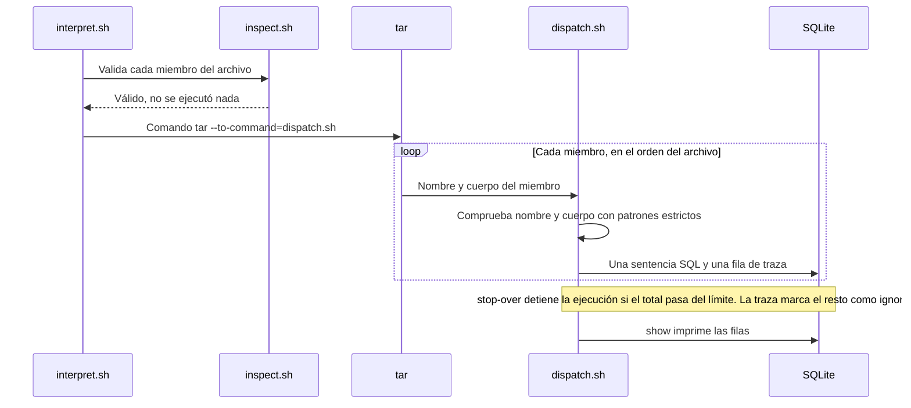
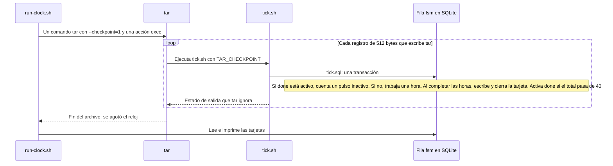

# Guía de estudio de tar

## Para qué sirve esta guía

Esta guía examina dos programas que usan `tar` de GNU como máquina. En [`src/tar-gnu`](../../../src/tar-gnu/README.md), un archivo es un programa serializado. La opción `tar --to-command` procesa sus miembros en orden. En [`src/tar-gnu-weird`](../../../src/tar-gnu-weird/README.md), el tamaño del archivo marca el reloj. Cada punto de control avanza una hora una máquina de estados. **¿Qué da efecto al archivo y qué lo hace seguro de leer?**

Al terminar, deberías poder:

1. Explicar la diferencia entre *leer* un archivo y *ejecutarlo*, y decir qué comando da efecto al archivo.
2. Explicar por qué el despachador no pasa ninguna parte de un miembro a un intérprete de comandos (*shell*). Explicar también qué añade el inspector.
3. Hacer la traza de ambos programas con las mismas tres tarjetas: los miembros en orden en uno, los pulsos de los puntos de control en el otro.
4. Explicar por qué el número de pulsos del programa raro lo fija la disposición del archivo y no su contenido.
5. Explicar por qué una función de devolución de llamada (*callback*) que falla, o un archivo corto, detiene el reloj en vez de fallar con ruido.
6. Etiquetar cada comportamiento como garantizado, permitido por la implementación o aprovechado por accidente.

**Límites del alcance.** Necesitas saber que tar escribe un flujo de bloques de 512 bytes y que GNU tar tiene opciones para funciones de devolución de llamada. La guía no enseña el formato de cabecera ustar, el SQL ni el simulador en awk que prueba la entrada rara. Usa GNU tar 1.34 o 1.35. BSD tar y macOS tar no tienen `--to-command`. La página del libro es [tar](../../lenguajes/tar.md). Para ver las ideas, consulta [Serialización, deserialización y pickling de objetos](../../informatica/06-estado-mas-alla-de-las-variables.md#serialization-deserialization-and-object-pickling), [Capacidad y autoridad](../../informatica/01-lectura-de-un-programa-adversarial.md#capability-and-authority) y [Relojes lógicos y orden de los eventos](../../informatica/03-flujo-de-control-y-continuaciones.md#logical-clocks-and-event-ordering).

## Antes de empezar

**Modelo de seguridad.** Cada entrada escribe datos ficticios de **DEMO ONLY** en un archivo SQLite desechable. Un archivo que lleva un programa es justo lo que no debes ejecutar sin leer, y `tar-gnu` se construye en torno a esa regla. *Leer* y *ejecutar* son comandos distintos. Ejecutar exige una bandera explícita. Lee el código fuente antes de ejecutarlo, y ejecútalo primero en el entorno aislado (*sandbox*) que limita el acceso al sistema anfitrión:

```bash
sandbox/container/run-image.sh src/tar-gnu
sandbox/container/run-image.sh src/tar-gnu-weird
```

Edita solo copias ([Ejecutar cosas de forma segura](../../exercises.md#ejecutar-con-seguridad)). Puedes escribir un archivo con las horas que elijas: `sh build-archive.sh --seed 7 --hours "15 19 12 10 10" program.tar`. La entrada rara acepta `--seed N`; la semilla 1105 da las horas 15, 19, 12.

**Regla de predicción.** Antes de cada ejecución, anota qué miembros se leerán, cuáles se ejecutarán y cuántos pulsos recibirá el reloj.

**Vocabulario.**

| Término | Significado aquí |
| --- | --- |
| Miembro | Un solo archivo guardado dentro del archivo tar. Aquí un miembro es una *instrucción*. |
| `--to-command` | Una opción de GNU tar que envía el contenido de cada miembro a un comando en lugar de escribir un archivo. |
| Registro | La unidad que tar escribe cada vez. Con `-b 1` son 512 bytes. |
| Punto de control | Una función de devolución de llamada que tar puede ejecutar cada N registros, pensada para mostrar el progreso. |
| Despachador | El único programa que da sentido al nombre de un miembro. |

## El reto compartido

La [especificación del reto](../../introduccion.md#qué-hace-el-reto) pide tarjetas con una categoría y de 10 a 19 horas enteras. Las categorías se repiten en ciclo: `Meetings`, `Coding`, `Debugging` y `Learning`. Suma las horas de cada tarjeta al total acumulado. Detente cuando el total pasa de 40. Conserva la **primera tarjeta con la que el total pasa de 40**. Un total de exactamente 40 continúa. Cuatro tarjetas de 10 horas necesitan una quinta tarjeta, de la categoría `Meetings`. Las ejecuciones conformes tienen de 3 a 5 tarjetas y un total de 41 a 59 horas.

Las dos entradas de tar informan desde SQLite. El programa del archivo despacha operaciones de miembros, y el programa de puntos de control confirma cada pulso. En `tar-gnu`, el archivo tiene cinco espacios para tarjetas (Meetings, Coding, Debugging, Learning, Meetings). Cada uno va seguido de un miembro `stop-over` que lleva `limit=40` y significa "detente si el total *pasa de* 40". Exactamente 40 no pasa de 40, así que se ejecuta el espacio siguiente. En `tar-gnu-weird`, una tarjeta se cierra en el pulso cuyo número es igual al total acumulado, y `done` se activa cuando `total > 40`. Una ejecución necesita entre 41 y 59 pulsos.

## La máquina que hay que identificar

**Qué se repite.** En `tar-gnu`, tar recorre los miembros en el orden del archivo y llama al despachador una vez por miembro (`tar --to-command`, [interpret.sh](../../../src/tar-gnu/interpret.sh)). En `tar-gnu-weird`, es tar otra vez. Actúa mediante sus *puntos de control*: una función de devolución de llamada por cada registro de 512 bytes escrito, con un solo comando `tar` ([README](../../../src/tar-gnu-weird/README.md#el-reloj)).

**Dónde vive el estado.** En `tar-gnu`, vive en el propio archivo (las instrucciones, las horas de las tarjetas, el límite). También vive en SQLite: el total acumulado y una bandera `halted` en la fila `runs`, más una tabla de traza. En `tar-gnu-weird`, vive en *una fila* de una tabla llamada `fsm`. Guarda la semilla del generador, el número de tarjeta, las horas trabajadas, la meta, el total y una bandera `done`.

**Qué hace avanzar el paso siguiente.** En `tar-gnu`, el miembro siguiente del archivo. En `tar-gnu-weird`, el punto de control siguiente. Nada más lo mueve: si tar no escribiera registros, no pasarían horas.

**Qué lo detiene.** En `tar-gnu`, un miembro `stop-over`, que activa `halted` cuando el total pasa de su límite. Desde ese punto, la traza anota los miembros posteriores como `ignored: halted`. En `tar-gnu-weird`, la bandera `done`, que activa la transición que cierra la tarjeta que cruza el tope. tar *no* se detiene: los pulsos restantes solo cuentan como inactivos.

**Qué confirma.** En `tar-gnu`, el despachador ejecuta una sentencia SQL por miembro, y `show` imprime las filas. En `tar-gnu-weird`, cada pulso es una transacción de SQLite; el lanzador lee e imprime las tarjetas cuando tar termina. En ambos, quien decide ejecutar es el operador, no el archivo: el archivo no lleva ninguna autoridad.

<!-- diagram-source: src/tar-gnu/README.md#program-flow -->



El primer diagrama muestra el orden de los miembros como orden de ejecución, con un inspector pasivo delante.

<!-- diagram-source: src/tar-gnu-weird/README.md#program-flow -->



El segundo muestra una función de devolución de llamada que tar invoca por cada registro. El programa no llama al bucle de tar. tar llama al programa.

## Traza una ejecución

**`tar-gnu`: los miembros, en orden.** Una copia desechable construyó un archivo con `--hours "15 19 12 10 10"`, lo listó con `tar -tvf` a secas, lo leyó con el inspector y lo ejecutó con `interpret.sh --execute`. El inspector imprimió cada miembro decodificado:

```text
seq  member         decoded
1    000.begin      format=tarprog/1 seed=7 label=DEMO ONLY
2    010.card       category=Meetings hours=15
3    011.stop-over  limit=40
4    020.card       category=Coding hours=19
5    021.stop-over  limit=40
6    030.card       category=Debugging hours=12
7    031.stop-over  limit=40
8    040.card       category=Learning hours=10
9    041.stop-over  limit=40
10   050.card       category=Meetings hours=10
11   051.stop-over  limit=40
12   990.show       (empty)
# 12 member(s); 0 the interpreter would refuse
```

y la ejecución imprimió `Meetings 15 15`, `Coding 19 34`, `Debugging 12 46` y luego `# committed total=46 entries=3 DEMO ONLY`.

| Miembro | Significado | Total después | ¿Detenido? |
| --- | --- | ---: | --- |
| `000.begin` | inicia una ejecución | 0 | no |
| `010.card` | Meetings, 15 | 15 | no |
| `011.stop-over` | detiene si el total > 40 | 15 | no |
| `020.card` | Coding, 19 | 34 | no |
| `021.stop-over` | detiene si el total > 40 | 34 | no |
| `030.card` | Debugging, 12 | 46 | no |
| `031.stop-over` | detiene si el total > 40 | 46 | **sí** |
| `040.card` ... `051.stop-over` | se anotan como `ignored: halted` | 46 | sí |
| `990.show` | imprime las filas | 46 | sí |

tar sigue *leyendo* los miembros posteriores a la detención y se los entrega al despachador, que los anota como ignorados. Un programa detenido no detiene a tar. Detiene al despachador: ya no actúa.

**`tar-gnu-weird`: los pulsos.** Con `--seed 1105` el programa imprimió `Meetings 15 15`, `Coding 19 34`, `Debugging 12 46` y la línea final `# clock: last tick 64, idle ticks after the stop 18, tape 32768 bytes`. La disposición predeterminada es de 64 registros, así que hay 64 pulsos.

| Pulsos | Qué hace la máquina | Estado |
| --- | --- | --- |
| de 1 a 15 | trabaja una hora por pulso en la tarjeta 1 (Meetings), meta 15 | las horas trabajadas suben a 15 |
| 15 | las horas trabajadas igualan la meta: escribe la tarjeta 1, la cierra y sortea la duración siguiente (19) | total 15, done no |
| de 16 a 34 | trabaja la tarjeta 2 (Coding) | las horas trabajadas suben a 19 |
| 34 | escribe la tarjeta 2 | total 34 |
| de 35 a 46 | trabaja la tarjeta 3 (Debugging), meta 12 | las horas trabajadas suben a 12 |
| 46 | escribe la tarjeta 3; el total 46 pasa de 40, así que se activa `done` | total 46, **done** |
| de 47 a 64 | cada pulso solo incrementa `idle` | 18 pulsos inactivos |

Cada tarjeta se cierra en el pulso cuyo número es su total acumulado: 15, 34, 46. La regla de parada se ejecuta *después* de escribir la tarjeta, así que se conserva la tarjeta que cruza el tope. 64 menos 46 son los 18 pulsos inactivos.

**Exactamente 40.** En `tar-gnu`, cuatro tarjetas de 10 llegan a 40, `stop-over` no detiene la ejecución y se ejecuta el quinto espacio (otra vez Meetings). En `tar-gnu-weird`, la tarjeta 4 se cierra en el pulso 40 y `done` sigue sin activarse (40 no pasa de 40). Así, la tarjeta 5 empieza y se cierra en un pulso de 50 o más, que los 64 pulsos predeterminados cubren.

## Compara los diseños ordinarios y los raros

Las dos entradas son un uso ordinario y una acrobacia de la misma herramienta, y usan partes *distintas* de tar.

| Dimensión | `tar-gnu` | `tar-gnu-weird` |
| --- | --- | --- |
| **Representación** | El programa es el contenido del archivo: los nombres de los miembros son códigos de operación y los cuerpos son operandos. | El programa es `tick.sql`; el archivo es un flujo de ceros cuyo tamaño es el reloj. |
| **Observabilidad** | `tar -tvf` lista el programa. `inspect.sh` lo decodifica sin ejecutar nada. | El estado es una fila de SQLite. `check.sh` tiene una simulación en awk que lo predice. |
| **Pruebas** | El inspector y una lista fija de `--hours` hacen determinista la ejecución. | La prueba *predice* las tarjetas para 65 combinaciones de disposiciones y las compara. |
| **Debugging** | Lee la tabla de traza: `ok` o `ignored: halted` para cada miembro. | Un pulso que falla deja a tar ejecutándose y a la máquina sin moverse: la ejecución termina con `the clock ran out` y estado de salida 3. |
| **Portabilidad** | Solo GNU tar: `--to-command` no existe en BSD tar ni en macOS tar. | Solo GNU tar, y el número de registros que escribe un comando se *midió* en las versiones 1.34 y 1.35. |
| **Costo** | Un proceso del intérprete de comandos por miembro. | Un arranque de `sqlite3` por pulso: unas décimas de segundo para 64 pulsos. |

La primera trata de lo que **significa** una disposición. La segunda trata de **cuándo** ocurren las cosas. En la primera, tar es un analizador sintáctico que además llama a tu código. En la segunda, tar es una fuente de eventos: un programa escrito como función de devolución de llamada, sin bucle propio.

## Qué demuestran los ejercicios

| Ejercicio | Predice primero | Qué muestra la evidencia |
| --- | --- | --- |
| [B16. tar: lee el programa y luego ejecútalo](../../exercises.md#b16-tar-lee-el-programa-y-luego-ejecútalo-verificado), paso 1 | `--hours "12 12 12 12 12"`: ¿cuántas tarjetas se ejecutan y qué espacio se lee y se ignora? | Cuatro tarjetas (12, 24, 36, 48), y el quinto espacio se lee y se ignora. |
| B16, paso 2 | Cambia `limit=40` en `021.stop-over` a `limit=20` y empaquétalo otra vez en el mismo orden. | Dos tarjetas (12, 24). El límite está en el archivo, así que editar un miembro cambió la regla de parada, y `dispatch.sh` no cambió. La traza muestra `ok` y luego `ignored: halted`. |
| B16, paso 3 | Añade un miembro `025.exec` que no está en el conjunto de instrucciones. | El inspector imprime `REFUSE (unknown record type)` y sale con 4, `interpret.sh` no ejecuta nada y no aparece ningún archivo `pwned`. `tar -xf` a secas tampoco lo crearía: el nombre de un miembro no es un comando. |
| [B17. tar, más raro: predice el reloj](../../exercises.md#b17-tar-más-raro-predice-el-reloj-verificado), paso 1 | `--seed 42 --ticks 45` y después `46`. | Con 45 pulsos la tercera tarjeta no termina: dos tarjetas, `the clock ran out` y salida 3. Con 46, tres tarjetas y salida 0. |
| B17, pasos 2 y 3 | `--interval 2` con 92 y 91 pulsos; `--blocking 4`. | 92 registros dan 46 pulsos y terminan. 91 dan 45 y se atascan. `-b 4` con 260 bloques da 65 registros y 65 pulsos, así que 19 son inactivos. |
| B17, paso 4 | ¿Qué hay en la cinta? | Casi todo ceros, más una cabecera de 512 bytes. La carga útil no importa. Su *tamaño* es el reloj. |

La respuesta de una línea de B16 es la lección. El *inspector* analizó el programa y el *intérprete* lo ejecutó. La frontera de confianza fue la decisión del operador de usar `--execute`, no algo del archivo.

## Modos de fallo, costos y límites

| Comportamiento | Etiqueta | Por qué |
| --- | --- | --- |
| `tar --to-command` envía cada miembro a un comando, en el orden del archivo | **permitido por la implementación** | Una función documentada de GNU tar, ausente en tar POSIX y en BSD tar. |
| `tar -xf` a secas escribe archivos y no ejecuta su contenido | **garantizado** | Un archivo son datos. Solo el comando que añade el operador da efecto a los miembros. |
| `--checkpoint=N` y `--checkpoint-action=exec=` con `TAR_CHECKPOINT` | **permitido por la implementación** | Funciones documentadas de GNU tar. Un punto de control cuenta *registros*. |
| Cuántos registros escribe un comando para un conjunto dado de miembros | **permitido por la implementación** | Medido en tar 1.34 y 1.35, con números idénticos, pero deducido de la observación. |
| Crear un archivo de 21 bloques da 21 pulsos, pero *listarlo* da 10 | **aprovechado por accidente** (conocimiento) | El modo cambia la cuenta porque tar omite los datos que no necesita leer. Nadie lo promete. La entrada solo usa la creación, la regla más simple. |
| El estado de salida de la función de devolución de llamada se ignora | **aprovechado por accidente** | Un comando que termina con 7 deja el estado de tar en 0 en todas las versiones probadas. La entrada no depende de eso: hace inofensivos los pulsos extra y hace que un pulso fallido sea solo inactivo. |
| tar sigue escribiendo después de la regla de parada | **permitido por la implementación** | No se puede ordenar a tar que se detenga, así que la máquina tiene una bandera `done`. |
| Leer un archivo con el inspector no ejecuta nada | **garantizado** por diseño, y probado | `inspect.sh` solo analiza. `check.sh` verifica los rechazos. |

**Costos que declarar.**

- **La autoridad está en el comando, no en los datos.** Todo lo inseguro aquí sería una *decisión del operador*: elegir `--to-command`, elegir `--execute`. Consulta [Capacidad y autoridad](../../informatica/01-lectura-de-un-programa-adversarial.md#capability-and-authority).
- **El despachador es una frontera de confianza.** Los nombres y los cuerpos se comparan con patrones estrictos antes de que se ejecute cualquier SQL, y ninguna parte de un miembro llega a un intérprete de comandos. Un patrón relajado convertiría el archivo en un vector de inyección.
- **Un reloj sin parada.** La máquina rara no puede detener a tar. Por eso una disposición demasiado corta atasca la ejecución a media tarjeta, y una demasiado larga queda inactiva. La ejecución necesita de 41 a 59 pulsos, y el valor predeterminado es 64.
- **Planificar con un indicador de progreso.** Los puntos de control se diseñaron para mostrar el progreso. Esto es un truco que depende de contar registros.
- **Dónde esto es legítimo.** Serializar trabajo como archivo y ejecutarlo con un comando explícito y revisable es como funcionan muchas herramientas de compilación e instalación. Un planificador hecho con puntos de control es una acrobacia.

## Conexiones a lo largo del repositorio

- **El orden del documento como programa.** `tar-gnu` es el ejemplo del repositorio de datos que se leen en orden y a los que el lector da sentido. [XAML en la guía de C#](csharp-linq-xaml-y-adaptaciones.md) es la misma preocupación en un archivo de marcado: un analizador sintáctico que ejecuta lo que analiza. La guía de concepto [Lectura de programas adversariales](../conceptos/lectura-de-programas-adversariales.md) usa ambos.
- **Una función de devolución de llamada invertida.** `tar-gnu-weird` es un programa al que llama su entorno, como los callouts de PCRE2 en [Motores de regex y sed](motores-de-regex-y-sed.md) y los escuchadores de eventos de [JavaScript](javascript.md). La guía de concepto [Eventos, funciones de devolución de llamada y control reactivo](../conceptos/eventos-retrollamadas-y-control-reactivo.md) compara quién es dueño del turno siguiente.
- **Una máquina de estados en una fila.** [Tcl](tcl.md) también guarda su estado en filas de una tabla. La guía de concepto [Estado y control más allá de las variables](../conceptos/estado-y-control-mas-alla-de-las-variables.md) las compara.
- **La predicción como prueba.** `check.sh` contiene una segunda implementación de la máquina y compara las dos. La guía de concepto [Portabilidad, abstracción y costo](../conceptos/portabilidad-abstraccion-y-costo.md) lo usa para preguntar qué demuestra una observación.
- **En el libro.** [tar](../../lenguajes/tar.md), [Serialización, deserialización y pickling de objetos](../../informatica/06-estado-mas-alla-de-las-variables.md#serialization-deserialization-and-object-pickling), [Relojes lógicos y orden de los eventos](../../informatica/03-flujo-de-control-y-continuaciones.md#logical-clocks-and-event-ordering) y [Capacidad y autoridad](../../informatica/01-lectura-de-un-programa-adversarial.md#capability-and-authority).

## Autoevaluación

Responde cada pregunta con tus propias palabras antes de leer el texto en cursiva. Di qué evidencia respaldaría cada respuesta.

1. **Traza.** `tar-gnu` se construye con las horas 11, 11, 11, 11, 10 (totales 11, 22, 33, 44). ¿Qué miembros se ejecutan y cuáles se ignoran? *(Las primeras cuatro tarjetas se ejecutan. Tras la tarjeta 4, `041.stop-over` ve 44 y detiene la ejecución. `050.card` y `051.stop-over` se leen y se anotan como `ignored: halted`. `990.show` imprime cuatro filas.)*
2. **Explica.** ¿Por qué `tar-gnu-weird` sigue dando pulsos cuando la ejecución ya terminó? *(tar escribe todos sus registros y ejecuta la función de devolución de llamada por cada uno. No se puede ordenar a tar que se detenga, así que la bandera `done` de la máquina hace que los pulsos posteriores solo cuenten como inactivos.)*
3. **Transfiere.** En `tar-gnu`, el límite vive en el archivo. En otra entrada vive en una regex, en una línea de cinta o en una declaración de datos. ¿Cuál es más fácil de cambiar para quien puede editar datos pero no código, y qué implica eso para la revisión? *(El archivo y la cinta de Ex: ambos son datos. Revisar los *datos* es entonces tan importante como revisar el código, así que un cambio en el límite debe ser visible para el revisor.)*
4. **Evidencia.** El README dice: "El estado de salida 7 de la función de devolución de llamada deja el estado de tar en 0". Diseña una prueba que pueda fallar. ¿Qué etiqueta se aplica a la afirmación? *(Ejecuta una copia cuya acción `exec` sea `sh -c 'exit 7'` y comprueba el estado de salida de tar. El control negativo es una ejecución en la que falla el propio tar, por ejemplo con un archivo ilegible, que debe dar un estado distinto de cero. La afirmación describe solo las versiones probadas, así que es aprovechada por accidente.)*

## Lecturas adicionales

- [Tar (informática)](https://en.wikipedia.org/wiki/Tar_(computing)) (Wikipedia): el formato, sus bloques y su historia.
- [GNU tar: Puntos de control](https://www.gnu.org/software/tar/manual/html_node/checkpoints.html) (Proyecto GNU): la descripción oficial de `--checkpoint`, `--checkpoint-action` y `TAR_CHECKPOINT`. El comportamiento de los puntos de control en el que se apoya esta guía está documentado aquí, pero cuántos registros escribe un comando se midió y no se promete.
- [Serialización](https://en.wikipedia.org/wiki/Serialization) (Wikipedia): por qué los datos que se escriben y se vuelven a leer pueden convertirse en un programa.
- [Capacidad y autoridad](../../informatica/01-lectura-de-un-programa-adversarial.md#capability-and-authority) (este libro): por qué la autoridad viene del comando que ejecuta un programa, no de los datos que lee.
