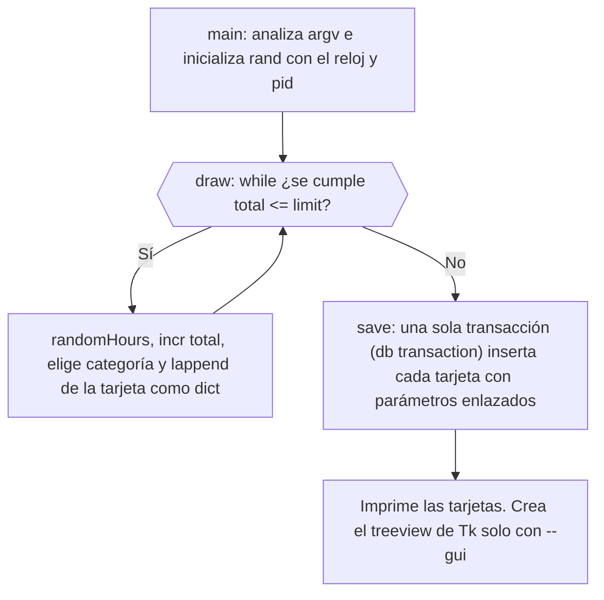
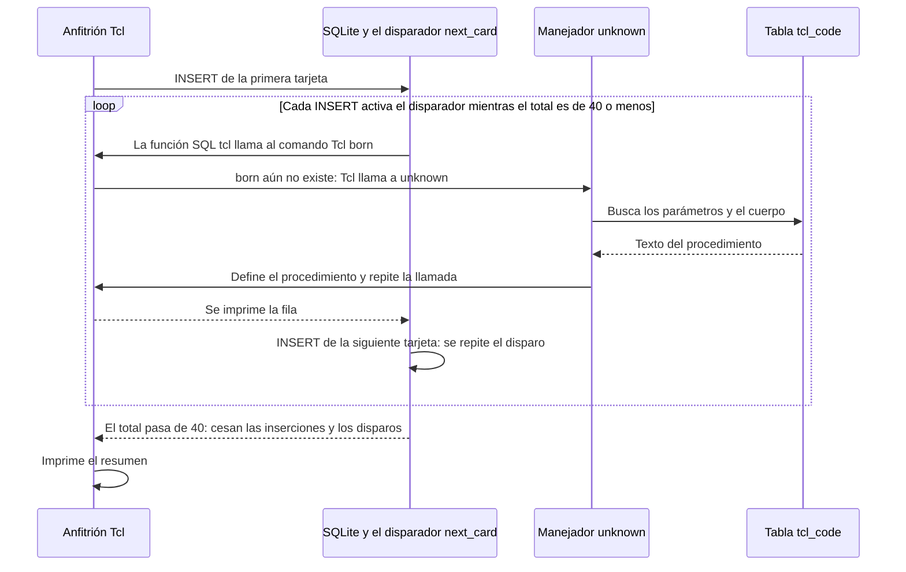
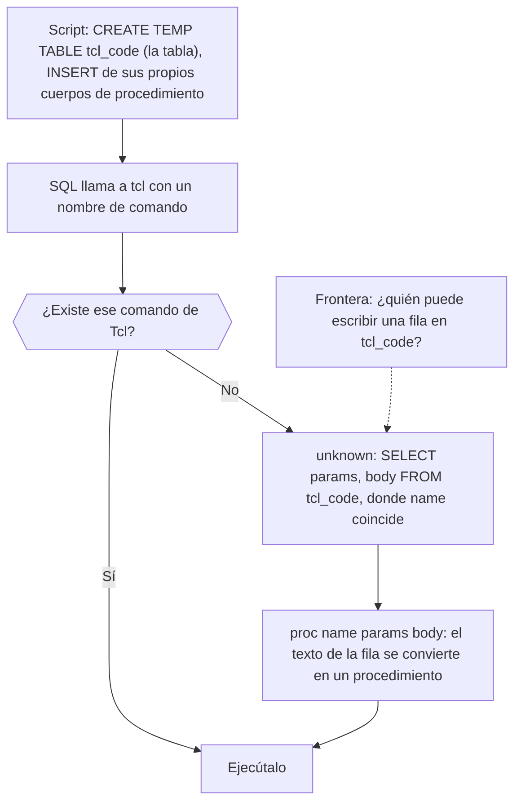

# Guía de estudio de Tcl

## Para qué sirve esta guía

Esta guía lee dos programas en Tcl. Uno es [`src/tcl`](../../../src/tcl/README.md), un bucle `while` ordinario dentro de un procedimiento. El otro es [`src/tcl-weird`](../../../src/tcl-weird/README.md), donde el programa son *filas de una tabla de SQLite* y un solo `INSERT` lo pone en marcha. El programa raro no define ningún bucle de Tcl ni ningún procedimiento de Tcl que reparta o imprima una tarjeta. El bucle es un disparador recursivo de SQLite, y el código vive como texto que el manejador `unknown` de Tcl recupera a demanda. La pregunta es: **si el código es solo una cadena de texto, ¿quién puede escribirla y qué motor decide lo que se ejecuta después?**

Al terminar, deberías poder:

1. Explicar el modelo de comandos de Tcl: todo es un comando cuyos argumentos son cadenas de texto, y un comando desconocido va a `unknown`.
2. Explicar cómo trabajan juntos los tres ganchos de `tcl-weird`. Son una función SQL que llama a Tcl, un manejador `unknown` que define procedimientos con filas de la tabla y un disparador que inserta la tarjeta siguiente.
3. Hacer la traza de ambos programas a través de las mismas tres tarjetas, nombrando qué motor actúa en cada paso.
4. Explicar por qué `PRAGMA recursive_triggers = ON` es el bucle y qué es el `WHERE` del disparador.
5. Nombrar la frontera de confianza de este diseño y explicar por qué se sostiene aquí.
6. Etiquetar cada comportamiento como garantizado, permitido por la implementación o aprovechado por accidente.

**Límites del alcance.** Necesitas saber leer Tcl (las llaves agrupan, los corchetes sustituyen, `$` lee una variable) y SQL básico. La guía no enseña Tk (la ventana opcional también se construye con filas de tabla) ni el planificador de consultas de SQLite. Usa Tcl 8.6 con el paquete `sqlite3`. La página del libro es [Tcl](../../lenguajes/tcl.md). Para ver las ideas, consulta [Disparadores de base de datos](../../informatica/06-estado-mas-alla-de-las-variables.md#database-triggers), [Ejecución de código arbitrario](../../informatica/01-lectura-de-un-programa-adversarial.md#arbitrary-code-execution) y [Homoiconicidad: código como datos](../../informatica/06-estado-mas-alla-de-las-variables.md#homoiconicity-code-as-data).

## Antes de empezar

**Modelo de seguridad.** Cada entrada escribe datos ficticios marcados con **DEMO ONLY** en un archivo SQLite desechable. `tcl-weird` ejecuta *texto de una tabla como código*. Eso es seguro aquí solo porque el programa construye la tabla él mismo, en memoria, en el mismo archivo. Lee el código fuente antes de ejecutarlo, y ejecútalo primero en el entorno aislado (*sandbox*) que limita el acceso al sistema anfitrión:

```bash
sandbox/container/run-image.sh src/tcl
sandbox/container/run-image.sh src/tcl-weird
```

Edita solo copias ([Ejecutar cosas de forma segura](../../exercises.md#ejecutar-con-seguridad)). Cuando editas `tcl-weird`, editas un programa en Tcl *dentro de una cadena de texto SQL dentro de un script de Tcl*. Por eso las llaves se anidan y nada se sustituye hasta que se ejecuta el texto.

**Regla de predicción.** Antes de cada ejecución, anota qué motor (Tcl o SQLite) actúa en cada paso y qué imprime cada uno. En este programa los motores se pasan el control el uno al otro.

**Vocabulario.**

| Término | Significado aquí |
| --- | --- |
| Comando | Una palabra de Tcl seguida de argumentos. Incluso `if` y `while` son comandos. |
| `unknown` | El comando al que llama Tcl cuando no existe un comando con ese nombre. |
| Disparador | Código SQL que SQLite ejecuta automáticamente cuando se inserta, actualiza o borra una fila. |
| Disparador recursivo | Un disparador cuya acción lo activa de nuevo. SQLite lo permite solo con `PRAGMA recursive_triggers = ON`. |
| `TEMP` | Una tabla o un disparador que vive solo mientras dura esta conexión con la base de datos. |

## El reto compartido

La [especificación del reto](../../introduccion.md#qué-hace-el-reto) pide tarjetas con una categoría y de 10 a 19 horas enteras. Las categorías se repiten en ciclo: `Meetings`, `Coding`, `Debugging` y `Learning`. Suma las horas de cada tarjeta al total acumulado. Detente cuando el total pasa de 40. Conserva la **primera tarjeta con la que el total pasa de 40**. Un total de exactamente 40 continúa. Cuatro tarjetas de 10 horas necesitan una quinta tarjeta, de la categoría `Meetings`. Las ejecuciones conformes tienen de 3 a 5 tarjetas y un total de 41 a 59 horas.

Las dos entradas de Tcl guardan las tarjetas en una transacción de SQLite e imprimen un resumen. Tcl escribe la frontera de dos maneras. En `tcl`, `while {$total <= $limit}` ([L40](../../../src/tcl/timecards.tcl#L40)): se cumple con 40, así que el bucle se repite. En `tcl-weird`, el disparador inserta la tarjeta siguiente `WHERE NEW.running_total <= 40` ([L113](../../../src/tcl-weird/timecards.tcl#L113)). Se inserta una tarjeta solo si el total de la tarjeta *anterior* era de 40 o menos. Por eso la tarjeta que cruza el tope es la última que se inserta.

## La máquina que hay que identificar

**Qué se repite.** En `tcl`, un bucle `while` en el procedimiento `draw`. En `tcl-weird`, un disparador: insertar una tarjeta activa `next_card`, que inserta otra tarjeta, que vuelve a activar `next_card` ([L104-114](../../../src/tcl-weird/timecards.tcl#L104-L114)). SQLite hace la repetición.

**Dónde vive el estado.** En `tcl`, en variables locales (`total`, `cards`). En `tcl-weird`, en *la tabla*. El número de tarjeta no es un contador. La categoría se busca como `count(*)` de las filas que ya tiene la ejecución más uno, y el total viaja en el `running_total` de la fila insertada. El paso siguiente lee la fila que lo causó, `NEW`.

**Qué hace avanzar el paso siguiente.** En `tcl`, el bucle. En `tcl-weird`, el final del propio `INSERT` del disparador, que activa el disparador para la fila nueva.

**Qué lo detiene.** En `tcl`, la condición del bucle. En `tcl-weird`, el `WHERE NEW.running_total <= 40` del disparador: cuando es falso, el `INSERT ... SELECT` no devuelve filas, así que no se inserta nada y la cadena termina.

**Qué confirma.** En `tcl`, `save` escribe la lista terminada en un solo `db transaction`. En `tcl-weird`, toda la cadena de inserciones disparadas se ejecuta dentro de un solo `db transaction` que envuelve el `INSERT` inicial ([L129-137](../../../src/tcl-weird/timecards.tcl#L129-L137)). El procedimiento `born` *imprime* las filas a medida que se inserta cada tarjeta, así que una fila puede imprimirse antes de que la transacción se confirme.

<!-- diagram-source: src/tcl/README.md#program-flow -->



El primer diagrama es un bucle ordinario dentro de un procedimiento.

<!-- diagram-source: src/tcl-weird/README.md#program-flow -->



El segundo es el disparador de SQLite activándose a sí mismo, con una llamada de vuelta a Tcl en cada paso. El diagrama siguiente añade lo que omite el diagrama de origen: de dónde *viene* el código y quién puede escribirlo.

<!-- diagram-new: authority-boundary - shows where the Tcl text comes from and which party may write it, which the source diagram omits -->



## Traza una ejecución

Los programas sortean horas al azar. Para esta traza, usa las horas **15, 19, 12**. La traza sale de una copia de trabajo de `tcl-weird` que se ejecutó en el entorno aislado. En la copia, la cadena de texto SQL de la fila `hours` contenía una búsqueda en una lista fija. Las filas `hours` y `born` escribían cada una en la salida de error estándar. Las líneas de registro aparecen primero en esta salida.

```text
# DEMO ONLY run <id>
  (hours proc: handing out 15)
  (born: card of 15 hours, total 15)
  (hours proc: handing out 19)
  (born: card of 19 hours, total 34)
  (hours proc: handing out 12)
  (born: card of 12 hours, total 46)
Meetings	15	15	DEMO ONLY
Coding	19	34	DEMO ONLY
Debugging	12	46	DEMO ONLY
# committed total=46 entries=3 DEMO ONLY
# every proc that ran was fetched from SQLite by unknown: born category hours init runid week
```

(Se quitó la columna de la semana ISO. La salida estándar y la salida de error estándar son flujos separados. Por eso su orden relativo en una captura de la terminal no es el orden de los eventos. El *orden de las líneas de registro entre sí* sí es el orden de los eventos.)

| Paso | Actúa el motor | Qué ocurre | Estado después |
| --- | --- | --- | --- |
| 0 | Tcl | `db eval {SELECT tcl('init')}`: `unknown` recupera `init` de la tabla y lo ejecuta | procedimientos definidos: `init` |
| 1 | SQLite | Un `UPDATE draw SET h = tcl('hours')` sortea las horas y las guarda en la tabla TEMP de una fila: Tcl le pide a `unknown` el valor `hours` y obtiene 15. El `INSERT ... SELECT` inicial lee `h` de `draw` dos veces, como las horas y como el total | fila de la tarjeta 1: 15 horas, total 15 |
| 2 | Disparador de SQLite | `AFTER INSERT` activa `next_card`. Llama a `born` (imprime la tarjeta 1) y luego `UPDATE draw` sortea las horas siguientes (19), bajo la condición `WHERE 15 <= 40`: verdadera | se inserta la tarjeta 2 |
| 3 | Disparador de SQLite | Se activa de nuevo con la tarjeta 2 (19 horas, total 34). `born` la imprime. El `UPDATE` protegido por la condición sortea 12. `34 <= 40`: verdadera | se inserta la tarjeta 3 |
| 4 | Disparador de SQLite | Se activa con la tarjeta 3 (12 horas, total 46). `born` la imprime. `46 <= 40`: **falsa**, así que el `UPDATE` no sortea nada y el `INSERT ... SELECT` no produce ninguna fila | la cadena termina |
| 5 | Tcl | La transacción se confirma. Tcl ejecuta un `SELECT count(*), max(running_total)` e imprime el resumen | 3 entradas, total 46 |

Los procedimientos recuperados de la tabla fueron `born`, `category`, `hours`, `init`, `runid` y `week`: exactamente los que se *llamaron*. La tabla contenía más texto del que se ejecutó.

**`tcl` a secas.** El bucle ejecuta `randomHours`, suma a `total`, agrega un dict y comprueba `$total <= $limit`. La comprobación va después del sorteo en el orden del programa y antes del sorteo siguiente. Por eso se conserva la tarjeta que cruza el tope ([L32-34](../../../src/tcl/timecards.tcl#L32-L34)). Con 15, 19, 12 los totales son 15, 34 y 46. Luego el bucle sale.

**Exactamente 40.** Con cuatro tarjetas de 10 horas, la cuarta tarjeta tiene total 40, `40 <= 40` es verdadera y el disparador inserta una quinta. El ejercicio B12, paso 2, muestra cinco filas con 10, 20, 30, 40, 50.

## Compara los diseños ordinarios y los raros

| Dimensión | `tcl` | `tcl-weird` |
| --- | --- | --- |
| **Representación** | Un procedimiento con un bucle y una lista de dicts. | Filas. El programa son datos en `tcl_code`, el bucle es un disparador y la ventana (con `--gui`) también son filas. |
| **Observabilidad** | Imprime `$cards`. | Tienes que leer la tabla y el disparador. Los procedimientos que reparten e imprimen tarjetas no existen hasta que algo los llama. |
| **Pruebas** | Llama a `timecards::draw`. | Ejecuta todo. La regla de parada es un `WHERE` dentro de un disparador y no se puede probar sola. |
| **Debugging** | Trazas de pila normales de Tcl. | Un error de Tcl dentro de una función SQL se informa a través de SQLite. La pila mezcla `unknown`, `uplevel` y `db eval`. |
| **Portabilidad** | Tcl 8.6 y el paquete `sqlite3`. | Lo mismo, más la semántica de los disparadores y de la recursión de SQLite. Además, la regla de SQLite según la cual el nombre simple de tabla en un disparador TEMP se resuelve a la tabla de `main`. |
| **Costo** | Un bucle. | Un disparo del disparador por tarjeta, con una función de devolución de llamada de Tcl en cada uno. La profundidad de recursión está limitada (1000 de forma predeterminada). El reto necesita de 3 a 5. |

La diferencia que hay que recordar: `tcl` tiene *un* motor y `tcl-weird` tiene *dos*. Son SQLite y Tcl. Cada uno llama al otro. El control pasa de uno a otro, y ninguno tiene la imagen completa.

## Qué demuestran los ejercicios

| Ejercicio | Predice primero | Qué muestra la evidencia |
| --- | --- | --- |
| [B12. Tcl: edita el programa en la base de datos](../../exercises.md#b12-tcl-edita-el-programa-en-la-base-de-datos-verificado), paso 1 | Pon `recursive_triggers` en `OFF`. ¿Cuántas filas se imprimen? ¿Cuántas cuenta el resumen? | Se imprime una fila y el resumen dice `entries=2`. El disparador se activó una vez y la tarjeta 2 se insertó y se contó. Pero una inserción hecha por un disparador no vuelve a activarlo a menos que la recursión esté habilitada. El pragma *es* el bucle. |
| B12, paso 2 | Cambia el cuerpo de la fila `hours` a `expr {10}`. | Exactamente cinco filas, con totales 10, 20, 30, 40, 50. El verificador compartido las acepta. La ejecución no se detiene en 40, porque un total de exactamente 40 continúa. Editaste texto dentro de una cadena de texto SQL, no un procedimiento de Tcl. |
| B12, los tres ganchos | Nómbralos. ¿Cuál cambiaste en el paso 2? | Una función SQL que llama a Tcl, el manejador `unknown` y el disparador. El paso 2 cambió *los datos que sirve `unknown`*. |
| [C1. Lo raro junto a lo aburrido](../../exercises.md#c1-lo-raro-junto-a-lo-aburrido-verificado) | ¿En qué programa puedes ver la regla en un solo lugar? | `tcl`: la condición `while`. `tcl-weird`: el `WHERE` en un disparador, a tres capas de profundidad. |
| [F. Demuestra una afirmación del README](../../exercises.md#f-demuestra-una-afirmación-del-readme-verificada) | El README dice que las horas de cada tarjeta se sortean una sola vez. ¿Puedes comprobarlo? | Sí: cuenta las llamadas al procedimiento `hours` (lo hace el `check.sh` de la entrada) y compáralas con el número de tarjetas. El control negativo es una variante que llama a `tcl('hours')` en los dos lugares: la cuenta pasa a ser el doble del número de tarjetas y la comprobación falla. Esto reemplazó una dependencia anterior del orden de evaluación de SQLite. |

## Modos de fallo, costos y límites

| Comportamiento | Etiqueta | Por qué |
| --- | --- | --- |
| Tcl llama a `unknown` para un comando que no existe | **garantizado** | Un gancho documentado de Tcl. |
| Los argumentos de un comando son cadenas de texto, y el código se puede construir y ejecutar como texto | **garantizado** | El modelo central de Tcl. |
| Un disparador de SQLite se activa por cada fila insertada. Las inserciones del propio disparador activan disparadores solo con `recursive_triggers` activado | **garantizado** | Comportamiento documentado de SQLite. Verificado por el paso 1 de B12. |
| La cadena de disparadores debe caber en el límite de profundidad configurado de SQLite | **permitido por la implementación** | SQLite documenta un máximo predeterminado de 1,000. Una compilación o conexión concreta puede fijar otro límite. Esta entrada solo necesita de 3 a 5 pasos. |
| Las mismas horas aparecen como `h` y dentro de `NEW.running_total + h` | **garantizado** por diseño (tras la corrección) | Las horas se escriben en la tabla TEMP de una fila `draw` y se leen de ella dos veces. Antes de la corrección venían de una subconsulta. SQLite evaluaba su función una vez por fila por casualidad, algo que no promete para las funciones no deterministas (**aprovechado por accidente**). El `check.sh` de la entrada ahora cuenta las llamadas al procedimiento `hours`: una por tarjeta. |
| Las tablas y los disparadores `TEMP` desaparecen con la conexión | **garantizado** | Está documentado. Mantiene el programa fuera del archivo en disco. |
| `INSERT INTO main.demo_timecards` se rechaza dentro de un disparador, así que el cuerpo del disparador usa el nombre simple | **permitido por la implementación** | La regla de SQLite sobre los nombres calificados en los disparadores. El disparador `TEMP` resuelve el nombre simple a la única tabla de `main`. |
| Tk mantiene vivo `tclsh` después de que termina el script | **permitido por la implementación** | Por qué el script termina con `destroy .`. |

**La frontera de confianza.** `unknown` ejecuta el texto que haya en la tabla. En `tcl-weird` la tabla la construye el propio programa, en memoria, como tabla `TEMP` que se llena con literales del script. Nadie más puede escribir en ella. Esa es toda la defensa. Si la tabla fuera una tabla normal en el archivo en disco, cualquiera que pudiera editar la base de datos podría hacer que el programa ejecute su Tcl. Es la misma lección que los ejemplos de modelo de amenazas del libro: trata como código todo lo que se lee como código. Consulta [Ejecución de código arbitrario](../../informatica/01-lectura-de-un-programa-adversarial.md#arbitrary-code-execution).

**Costos que declarar.**

- **Dos motores, dos pilas.** Un error en un procedimiento muestra una traza que mezcla marcos de Tcl y de SQLite.
- **El orden de evaluación pertenece a SQLite, así que el programa no depende de él.** Una versión anterior usaba una subconsulta y se apoyaba en una llamada de función por fila. Ahora sortea primero las horas en la tabla TEMP de una fila `draw`. Además, `check.sh` cuenta las llamadas (una por tarjeta). La comprobación también se ejecutó contra una variante que llama dos veces a la función. Allí falló.
- **Flujo de control oculto.** Leer el script de nivel superior no te dice casi nada de lo que se ejecuta. El bucle está en una sentencia `CREATE TRIGGER`.
- **Dónde la técnica es legítima.** Los disparadores son la forma en que las bases de datos hacen cumplir reglas y llevan pistas de auditoría. `unknown` es la forma en que Tcl implementa la carga automática. Poner ambos a trabajar como bucle es una acrobacia.

## Conexiones a lo largo del repositorio

- **Una regla que activa el paso siguiente.** El disparador es la misma idea que la declaración de nivel `88` en [COBOL](cobol.md) y la combinación `or` en [Common Lisp](common-lisp.md). El paso siguiente sale de una *regla declarada*, no de una sentencia que puedas ver en orden. La guía de concepto [Estado y control más allá de las variables](../conceptos/estado-y-control-mas-alla-de-las-variables.md) las compara.
- **Código como datos, en otros lenguajes.** [APL](apl.md) escribe sus propias funciones como texto con `⎕FX`. Tcl las recupera de una tabla. [XAML en la guía de C#](csharp-linq-xaml-y-adaptaciones.md) ejecuta métodos mientras analiza el marcado.
- **Una frontera que debes defender.** [Lectura de programas adversariales](../conceptos/lectura-de-programas-adversariales.md) usa esta entrada y las de XAML y tar como sus ejemplos principales de "datos que también son código".
- **Transacciones y confirmación.** Toda la cadena de disparadores se ejecuta en un solo `db transaction`, como en [Efectos, errores y confirmación](../conceptos/efectos-errores-y-confirmacion.md), mientras que la impresión no se revierte.
- **En el libro.** [Tcl](../../lenguajes/tcl.md), [Disparadores de base de datos](../../informatica/06-estado-mas-alla-de-las-variables.md#database-triggers) y [Ejecución de código arbitrario](../../informatica/01-lectura-de-un-programa-adversarial.md#arbitrary-code-execution).

## Autoevaluación

Responde cada pregunta con tus propias palabras antes de leer el texto en cursiva. Di qué evidencia respaldaría cada respuesta.

1. **Traza.** En `tcl-weird`, las horas son 12, 14, 13, 11 (totales 12, 26, 39, 50). Para cada tarjeta, di si el disparador inserta una tarjeta siguiente. *(Tras la tarjeta 1 (total 12): sí. Tras la tarjeta 2 (26): sí. Tras la tarjeta 3 (39): sí. Tras la tarjeta 4 (50): no, porque `50 <= 40` es falso. Cuatro tarjetas. La cuarta es la que cruza el tope.)*
2. **Explica.** ¿Por qué `PRAGMA recursive_triggers = OFF` da exactamente una fila impresa y `entries=2`? *(El `INSERT` inicial activa el disparador una vez. El disparador imprime la tarjeta 1 e inserta la tarjeta 2. Pero la inserción propia de un disparador no lo activa de nuevo, así que la tarjeta 2 nunca se imprime. El resumen cuenta las dos filas.)*
3. **Transfiere.** En una base de datos relacional que uses, ¿qué característica haría el papel del disparador como bucle y qué limitaría la profundidad? *(Un disparador recursivo o una expresión de tabla común recursiva. En ambos casos el motor limita la profundidad de la recursión.)*
4. **Evidencia.** Un revisor dice: "Todo procedimiento que `tcl-weird` ejecuta viene de la tabla". Diseña una prueba que pueda fallar. *(Comprueba que la lista de procedimientos recuperados que se imprime al final contiene `born`, `category`, `hours`, `init`, `runid` y `week`. Comprueba también que ninguno está definido por un `proc` en el script. El control negativo es definir uno de ellos en el script: entonces debería faltar en la lista recuperada, porque `unknown` nunca se llama para él.)*

## Lecturas adicionales

- [Tcl](https://en.wikipedia.org/wiki/Tcl) (Wikipedia): el lenguaje y por qué "todo es una cadena de texto" lo define.
- [Disparador de base de datos](https://en.wikipedia.org/wiki/Database_trigger) (Wikipedia): para qué sirven los disparadores y dónde causan sorpresas.
- [Inyección de código](https://owasp.org/www-community/attacks/Code_Injection) (OWASP): el riesgo general cuando el texto se convierte en código, que `unknown` vuelve concreto.
- [Disparadores de base de datos](../../informatica/06-estado-mas-alla-de-las-variables.md#database-triggers) y [Ejecución de código arbitrario](../../informatica/01-lectura-de-un-programa-adversarial.md#arbitrary-code-execution) (este libro): los conceptos detrás de esta entrada.
