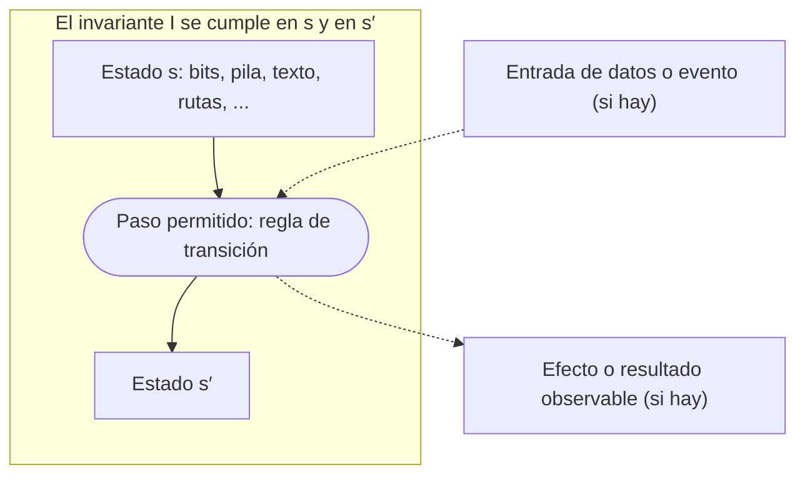
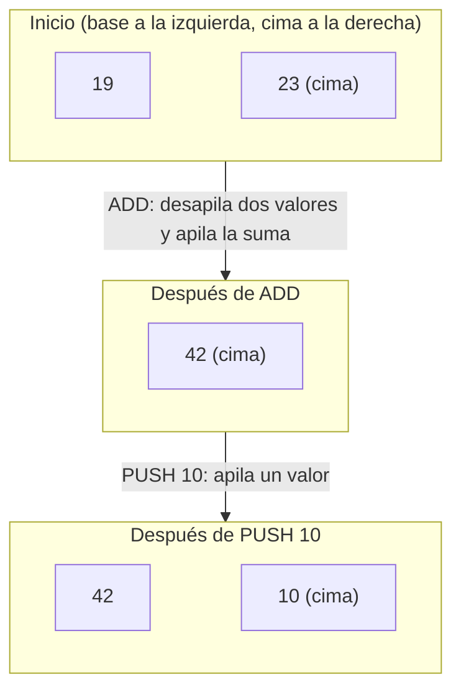
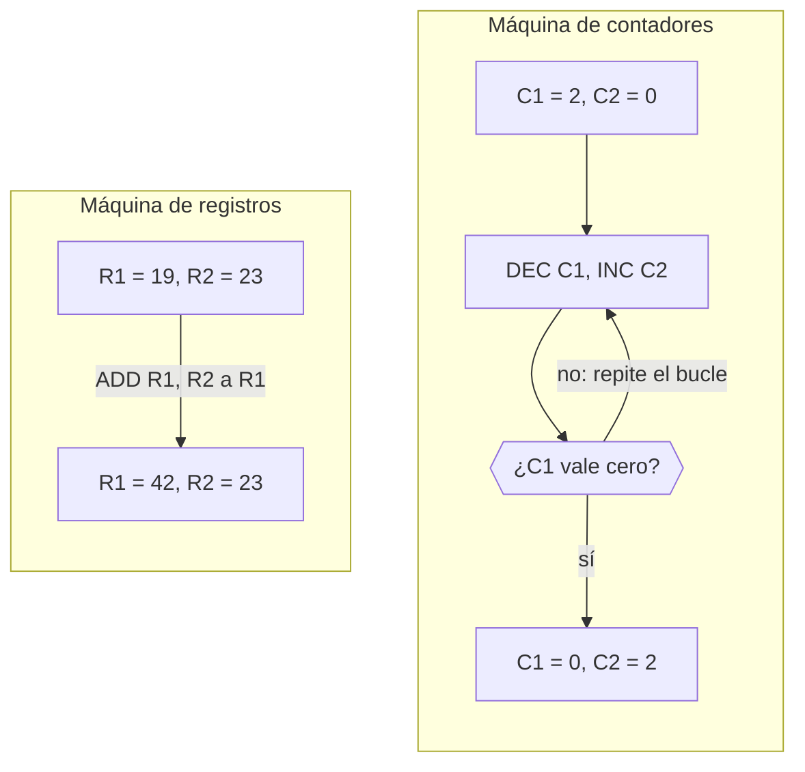
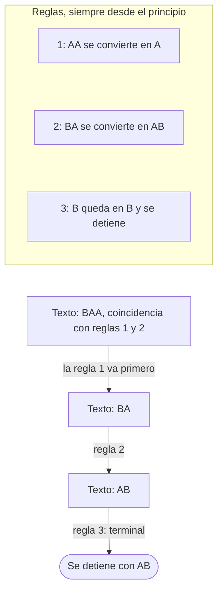
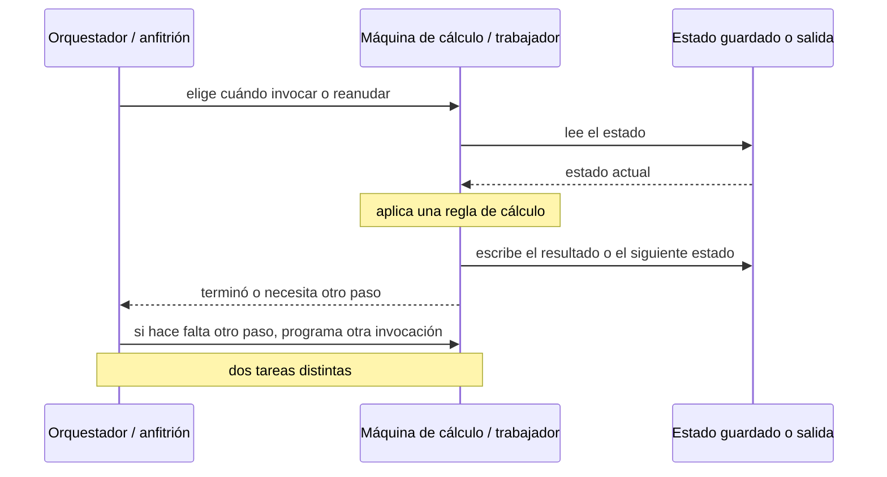

<!-- GENERADO por lessons/book/build.py a partir de lessons/cs-source/ y del frontmatter de las entradas. No lo edites; edita las fuentes y ejecuta build.py. -->

# ¿Qué cuenta como máquina?

Para una lectura avanzada con trazas y experimentos, consulta la [guía de estudio sobre el estado y el control más allá de las variables](../guias-de-estudio/conceptos/estado-y-control-mas-alla-de-las-variables.md).

Antes de decir que un motor de expresiones regulares, una herramienta de compilación o un archivo de marcado "computa", tienes que decir qué es una máquina. La respuesta es más sencilla de lo que quizá imaginas. Una máquina tiene un **estado**, un conjunto de **pasos** permitidos y una forma de **representar** sus valores. También tiene hechos que se mantienen durante la ejecución (**invariantes**). Si puedes nombrar esos cuatro elementos, ya identificaste la máquina.

La imagen muestra las cuatro partes sin nombrar ningún componente físico: el estado y su representación, un paso permitido y el invariante que se cumple antes y después del paso. La pila de capturas de un motor de expresiones regulares, un grafo de dependencias de Make y un búfer de editor encajan en esta plantilla. La plantilla no exige un número finito de estados, una entrada de datos y una salida explícitas ni instrucciones de máquina.

El primer objetivo de este libro es precisamente que adquieras ese hábito: *identifica la máquina que se esconde en el lenguaje*. Una máquina de pila, una máquina de registros y un sistema de reescritura pueden computar lo mismo, pero guardan su memoria en lugares distintos. Los conceptos de este capítulo te dan el vocabulario: sistemas de transición, semántica operacional (estado, un paso a la vez), máquinas de Turing, algoritmos de Márkov y completitud de Turing. Hay otra pregunta: ¿qué parte de un diseño *computa* y qué parte solo decide qué se ejecuta después ([Cálculo frente a orquestación](02-que-cuenta-como-maquina.md#cálculo-frente-a-orquestación))? El capítulo "Estado más allá de las variables" retoma la pregunta que más importa en este repositorio: ¿dónde vive el estado?

## Modelos de cómputo

Un modelo de cómputo describe con precisión qué significa "computar": en qué consiste un paso y qué memoria existe. No puedes demostrar nada sobre "una computadora" en términos generales. Por eso necesitas reglas sencillas que te permitan razonar. Entonces puedes preguntar "¿qué puede calcular este modelo y con qué rapidez?". Algunos modelos conocidos son la máquina de Turing, el cálculo lambda, las máquinas de registros y los sistemas de reescritura de cadenas de texto. En este capítulo seguimos un hábito sencillo: **nombra la máquina**. Cuando un motor de expresiones regulares, una herramienta de compilación o un archivo de marcado empiece a computar, pregunta en qué clase de máquina se ha convertido.

- **Úsalo cuando:** quieras explicar qué es en realidad un sistema insólito o argumentar que puede o no puede hacer algo.
- **Evítalo cuando:** necesites describir hardware real. Una máquina de Turing tiene una cinta infinita. Tu computadora portátil no.

**Lee más:**

- [Modelo de cómputo](https://en.wikipedia.org/wiki/Model_of_computation) (Wikipedia)
- [Máquina abstracta](https://en.wikipedia.org/wiki/Abstract_machine) (Wikipedia)
- [Tesis de Church–Turing](https://en.wikipedia.org/wiki/Church%E2%80%93Turing_thesis) (Wikipedia)

**En este repositorio:**

**Se aplica a toda entrada que nombra su máquina** (40 de 40; mira la [tabla de máquinas](../objetivos.md)). Cada una de estas entradas indica en sus campos machine y state qué clase de máquina es en realidad y dónde vive su estado. Ese es el hábito que enseña este concepto.

## Sistemas de transición y máquinas de estados

Un sistema de transición es la máquina más simple: un conjunto de *estados* y un conjunto de *movimientos* permitidos entre ellos. Una máquina de estados finitos es el caso con un número fijo y pequeño de estados. Existe porque las máquinas pequeñas se pueden comprobar por completo: puedes listar cada estado y cada movimiento. Los analizadores sintácticos, los protocolos de red, los flujos de interfaz de usuario y el interior de los motores de expresiones regulares se construyen así. Cada entrada de este repositorio se puede dibujar como un sistema de transición si haces dos preguntas: ¿cuál es el estado?, ¿cuál es un paso?

- **Úsalo cuando:** el comportamiento dependa del historial de forma acotada, como en "¿qué vi antes?"
- **Evítalo cuando:** el estado no tenga límite. Una máquina finita no puede contar paréntesis que coinciden a cualquier profundidad. Para eso necesitas una pila (mira [Máquinas de pila](02-que-cuenta-como-maquina.md#máquinas-de-pila)). Ten cuidado también con la *explosión de estados*: el número de estados puede crecer más rápido de lo que puedes dibujarlos.

**Más información:**

- [Sistema de transición](https://en.wikipedia.org/wiki/Transition_system) (Wikipedia)
- [Máquina de estados finitos](https://en.wikipedia.org/wiki/Finite-state_machine) (Wikipedia)

**En este repositorio:**

| Entrada | Lenguaje | Cómo se relaciona | Qué enseña |
| --- | --- | --- | --- |
| [`ed-weird`](../../src/ed-weird/README.md) | ed, SQLite | demuestra | Que un editor de líneas es una máquina de reescritura: las líneas son los datos, las direcciones son el programa y una sustitución fallida dentro de un comando global es un "si". |
| [`find-gnu`](../../src/find-gnu/README.md) | find, SQLite | demuestra | Que los extras de GNU para find (profundidad de ruta, marcas de tiempo de los archivos, expresiones regulares y un perfilador integrado) pueden reemplazar una tabla entera de ramas, y que el optimizador de find no tiene nada que reordenar cuando cada rama termina en un efecto secundario. |
| [`find-posix`](../../src/find-posix/README.md) | find, SQLite | demuestra | Que un recorrido de directorios puede ser un bucle y un programa: find cava el árbol que está recorriendo, y la ruta al directorio actual es toda la máquina. |
| [`javascript-events`](../../src/javascript-events/README.md) | JavaScript, SQLite | demuestra | Que un programa puede ser un conjunto de escuchadores de eventos, cada uno con una sola tarea pequeña que termina emitiendo el evento que espera el siguiente; y que emit() llama a sus escuchadores de inmediato, así que solo un límite de planificación explícito da un turno al bucle de eventos. |
| [`tar-gnu`](../../src/tar-gnu/README.md) | GNU tar, SQLite | demuestra | Que un archivo tar puede ser un programa serializado: tar lee los miembros en orden y solo el comando que indica el operador les da un efecto. |
| [`tar-gnu-weird`](../../src/tar-gnu-weird/README.md) | GNU tar, SQLite | demuestra | Que la disposición física de un archivo puede marcar el ritmo de un programa: los puntos de control de tar son un reloj y cada pulso hace avanzar un paso a una máquina de estados. |

## Cómo representar el estado

Todo estado debe quedar escrito en algún medio. Un número puede ser marcas de conteo (unario), cifras (decimales o binarias) o incluso un solo entero enorme que codifica todo un programa (numeración de Gödel). La elección de *representación* determina qué resulta fácil. Las marcas de conteo son fáciles de reescribir con buscar y reemplazar, pero ocupan mucho. En [`regex-sed`](../../src/regex-sed/README.md) todo el estado del programa es una línea de texto. Los números son filas de marcas que las sustituciones alargan y acortan. Las cláusulas `PIC` de COBOL también son una representación: la máscara de un campo determina su tamaño, redondeo y rango.

- **Úsala cuando:** tu medio no tenga números o variables y debas decidir cómo se representa "una cuenta".
- **Evita el sistema unario para números grandes:** un millón requiere un millón de marcas.

**Lee más:**

- [Sistema de numeración unario](https://en.wikipedia.org/wiki/Unary_numeral_system) (Wikipedia)
- [Numeración de Gödel](https://en.wikipedia.org/wiki/G%C3%B6del_numbering) (Wikipedia)

**En este repositorio:**

| Entrada | Lenguaje | Cómo se relaciona | Qué enseña |
| --- | --- | --- | --- |
| [`cobol`](../../src/cobol/README.md) | COBOL | demuestra | Que una regla de parada se puede declarar como datos, y que la imagen de un número puede encargarse de tu redondeo. |
| [`ed-weird`](../../src/ed-weird/README.md) | ed, SQLite | demuestra | Que un editor de líneas es una máquina de reescritura: las líneas son los datos, las direcciones son el programa y una sustitución fallida dentro de un comando global es un "si". |
| [`ex-weird`](../../src/ex-weird/README.md) | Ex, SQLite | demuestra | Que los registros de un editor pueden contener un programa: una línea de texto se copia en un registro y se ejecuta con @, y las marcas y las direcciones de línea del propio editor hacen la aritmética. |
| [`find-gnu`](../../src/find-gnu/README.md) | find, SQLite | demuestra | Que los extras de GNU para find (profundidad de ruta, marcas de tiempo de los archivos, expresiones regulares y un perfilador integrado) pueden reemplazar una tabla entera de ramas, y que el optimizador de find no tiene nada que reordenar cuando cada rama termina en un efecto secundario. |
| [`find-posix`](../../src/find-posix/README.md) | find, SQLite | demuestra | Que un recorrido de directorios puede ser un bucle y un programa: find cava el árbol que está recorriendo, y la ruta al directorio actual es toda la máquina. |
| [`regex-sed`](../../src/regex-sed/README.md) | GNU sed, Regular expressions | demuestra | Que un programa puede ser una línea de texto que las sustituciones reescriben hasta que ninguna se aplique: un algoritmo de Markov, con una expresión regular de retroceso catastrófico como reloj. |
| [`tar-gnu`](../../src/tar-gnu/README.md) | GNU tar, SQLite | demuestra | Que un archivo tar puede ser un programa serializado: tar lee los miembros en orden y solo el comando que indica el operador les da un efecto. |
| [`tar-gnu-weird`](../../src/tar-gnu-weird/README.md) | GNU tar, SQLite | demuestra | Que la disposición física de un archivo puede marcar el ritmo de un programa: los puntos de control de tar son un reloj y cada pulso hace avanzar un paso a una máquina de estados. |

## Invariantes

Una invariante es un hecho que sigue siendo cierto en cada paso. No puedes probar todos los estados posibles de un programa. Pero *sí* puedes demostrar dos cosas: el hecho es cierto al inicio y cada paso lo mantiene cierto. Entonces lo es para siempre. En este repositorio, una regla de la base de datos como `CHECK(demo_only=1)` es una invariante de los datos. No puede existir una fila ajena a la demostración. Cada `check.sh` intenta romper la invariante para demostrar que la regla se cumple. Las invariantes de bucle funcionan igual: "el total hasta ahora equivale a la suma de las tarjetas que ya sacaste".

- **Úsala cuando:** diseñes un bucle, un esquema de datos, un algoritmo concurrente o una aserción.
- **Evítala cuando:** no puedas comprobar la afirmación o sea demasiado débil para servir.

**Lee más:**

- [Invariante (informática)](https://en.wikipedia.org/wiki/Invariant_(computer_science)) (Wikipedia)
- [Invariante de bucle](https://en.wikipedia.org/wiki/Loop_invariant) (Wikipedia)

**En este repositorio:**

| Entrada | Lenguaje | Cómo se relaciona | Qué enseña |
| --- | --- | --- | --- |
| [`javascript`](../../src/javascript/README.md) | JavaScript, SQLite | demuestra | Que una sentencia for consta de tres expresiones y un cuerpo vacío, y que el orden de evaluación propio de JavaScript, la veracidad de los valores y el operador coma bastan para ejecutar un programa completo a partir de las tres cláusulas. |
| [`javascript-events`](../../src/javascript-events/README.md) | JavaScript, SQLite | demuestra | Que un programa puede ser un conjunto de escuchadores de eventos, cada uno con una sola tarea pequeña que termina emitiendo el evento que espera el siguiente; y que emit() llama a sus escuchadores de inmediato, así que solo un límite de planificación explícito da un turno al bucle de eventos. |
| [`javascript-weird`](../../src/javascript-weird/README.md) | JavaScript, SQLite | demuestra | Que una clausura es una máquina de estados: una función más las variables junto a las que se creó, que un iterador hace avanzar un paso a la vez, con reduce como el único pliegue que no puede detenerse. |
| [`tar-gnu-weird`](../../src/tar-gnu-weird/README.md) | GNU tar, SQLite | demuestra | Que la disposición física de un archivo puede marcar el ritmo de un programa: los puntos de control de tar son un reloj y cada pulso hace avanzar un paso a una máquina de estados. |

## Observabilidad

La observabilidad mide cuánto puedes saber del interior de un sistema desde fuera, por sus salidas, registros y trazas. Existe porque no puedes arreglar lo que no ves. Por eso varias entradas tienen una opción para activar la traza. Por ejemplo, `TRACE=1 ./timecards.sh` en [`regex-sed`](../../src/regex-sed/README.md) imprime todo el estado del programa en cada paso. Pero mirar puede cambiar lo que miras. En un lenguaje con evaluación perezosa, imprimir un valor *fuerza* su evaluación. Así, el mero hecho de mirar provoca el cálculo. Los programadores llaman *heisenbug* al bicho que desaparece cuando vas a verlo.

- **Úsala cuando:** diseñes algo que luego tendrás que depurar. Registra los cambios de estado además de los errores.
- **Evítala cuando:** la observación pueda dejar secretos registrados. Ten en cuenta el costo y cualquier efecto de observar.

**Lee más:**

- [Observabilidad (software)](https://en.wikipedia.org/wiki/Observability_(software)) (Wikipedia)
- [Heisenbug](https://en.wikipedia.org/wiki/Heisenbug) (Wikipedia)

**En este repositorio:**

| Entrada | Lenguaje | Cómo se relaciona | Qué enseña |
| --- | --- | --- | --- |
| [`find-gnu`](../../src/find-gnu/README.md) | find, SQLite | demuestra | Que los extras de GNU para find (profundidad de ruta, marcas de tiempo de los archivos, expresiones regulares y un perfilador integrado) pueden reemplazar una tabla entera de ramas, y que el optimizador de find no tiene nada que reordenar cuando cada rama termina en un efecto secundario. |
| [`javascript-events`](../../src/javascript-events/README.md) | JavaScript, SQLite | demuestra | Que un programa puede ser un conjunto de escuchadores de eventos, cada uno con una sola tarea pequeña que termina emitiendo el evento que espera el siguiente; y que emit() llama a sus escuchadores de inmediato, así que solo un límite de planificación explícito da un turno al bucle de eventos. |
| [`tar-gnu`](../../src/tar-gnu/README.md) | GNU tar, SQLite | demuestra | Que un archivo tar puede ser un programa serializado: tar lee los miembros en orden y solo el comando que indica el operador les da un efecto. |
| [`tar-gnu-weird`](../../src/tar-gnu-weird/README.md) | GNU tar, SQLite | demuestra | Que la disposición física de un archivo puede marcar el ritmo de un programa: los puntos de control de tar son un reloj y cada pulso hace avanzar un paso a una máquina de estados. |

## Máquinas de pila

Una máquina de pila guarda sus valores de trabajo en una pila. Una instrucción toma sus entradas de la cima y deja allí su resultado. No hay registros con nombre. Existe porque las instrucciones pueden ser diminutas (`+` no necesita operandos) y un compilador puede generarlas con facilidad. Por eso la JVM, el IL de .NET, WebAssembly, PostScript y Forth usan la idea. En [`forth-weird`](../../src/forth-weird/README.md) la pila de datos es la *única* memoria: el programa no tiene ningún `variable`.

Lee el dibujo de arriba abajo. `ADD` no dice dónde están sus entradas: desapila los dos valores de la cima y apila un resultado. Una máquina de pila real también tiene otra memoria (la JVM tiene variables locales y un montículo, por ejemplo). La pila solo guarda los valores que necesita la siguiente instrucción.

- **Úsala cuando:** construyas una máquina virtual pequeña o un intérprete, o quieras código compacto.
- **Evítala cuando:** necesites acceso aleatorio a muchos valores. El código que reordena la pila con `dup`, `swap` y `rot` pronto se vuelve ilegible.

**Lee más:**

- [Máquina de pila](https://en.wikipedia.org/wiki/Stack_machine) (Wikipedia)
- [Notación polaca inversa](https://en.wikipedia.org/wiki/Reverse_Polish_notation) (Wikipedia)
- [Forth (lenguaje de programación)](https://en.wikipedia.org/wiki/Forth_(programming_language)) (Wikipedia)

**En este repositorio:**

| Entrada | Lenguaje | Cómo se relaciona | Qué enseña |
| --- | --- | --- | --- |
| [`forth`](../../src/forth/README.md) | Forth | demuestra | Que un lenguaje de pila necesita un `begin ... until` y una tubería para ser un programa completo. |
| [`forth-weird`](../../src/forth-weird/README.md) | Forth | demuestra | Que la posición de análisis del intérprete de texto es un contador de programa si lo permites, y que la pila de datos puede ser la única memoria de un programa. |

## Máquinas de registros y máquinas de contadores

Una máquina de registros guarda sus valores en unas pocas casillas numeradas que se llaman registros. Los procesadores reales son máquinas de registros. La versión más pequeña, una *máquina de contadores*, solo tiene dos operaciones: sumar uno a un registro o restarle uno y saltar si el resultado es cero. Sirve para razonar. Es lo bastante simple como para demostrar sus propiedades y lo bastante potente como para calcular cualquier cosa (bastan dos contadores). Varias entradas son máquinas de registros disfrazadas. En CMake, de `CMAKE_MATCH_1` a `CMAKE_MATCH_5` son los registros de [`cmake`](../../src/cmake/README.md). Los grupos de equilibrio de .NET en [`regex-dotnet`](../../src/regex-dotnet/README.md) forman un contador.

A la izquierda, la instrucción nombra sus celdas (`R1` y `R2`). A la derecha, la máquina tiene dos contadores y tres acciones: contar hacia abajo, contar hacia arriba y comprobar si el valor es cero. Pasar la cuenta de `C1` a `C2` requiere una vuelta del bucle por unidad. Por eso una máquina de contadores es lenta a propósito. Muestra con qué poca maquinaria basta.

- **Úsala cuando:** quieras explicar qué *es* un sistema insólito al identificar sus registros.
- **Evítala como estilo de programación:** es un modelo para razonar, no una forma de escribir programas.

**Lee más:**

- [Máquina de registros](https://en.wikipedia.org/wiki/Register_machine) (Wikipedia)
- [Máquina de contadores](https://en.wikipedia.org/wiki/Counter_machine) (Wikipedia)

**En este repositorio:**

| Entrada | Lenguaje | Cómo se relaciona | Qué enseña |
| --- | --- | --- | --- |
| [`cmake`](../../src/cmake/README.md) | CMake | demuestra | Que `while()` y una regex pueden formar una pequeña máquina de registros. |
| [`ex-weird`](../../src/ex-weird/README.md) | Ex, SQLite | demuestra | Que los registros de un editor pueden contener un programa: una línea de texto se copia en un registro y se ejecuta con @, y las marcas y las direcciones de línea del propio editor hacen la aritmética. |
| [`forth-weird`](../../src/forth-weird/README.md) | Forth | demuestra | Que la posición de análisis del intérprete de texto es un contador de programa si lo permites, y que la pila de datos puede ser la única memoria de un programa. |
| [`regex-dotnet`](../../src/regex-dotnet/README.md) | C#, Regular expressions | demuestra | Que una expresión regular puede usar una pila para contar. |

## Máquinas de Turing

Una máquina de Turing tiene una cinta sin fin de celdas, un cabezal que lee y escribe una celda a la vez y una tabla corta de reglas. Alan Turing la describió en 1936 para definir con exactitud qué es un "algoritmo". Con ella demostró que algunas preguntas no tienen ningún algoritmo, como el problema de la parada: "¿este programa se detiene alguna vez?" Nadie escribe software para una máquina de Turing. Importa por un argumento: si un sistema puede *simular* una, puede calcular todo lo que se puede calcular.

- **Úsala cuando:** quieras argumentar que una notación es un computador completo, o entender por qué algunos problemas no se pueden resolver.
- **Evítala cuando:** necesites predecir la velocidad de un equipo real. Las máquinas reales no recorren una cinta.

**Más información:**

- [Máquina de Turing](https://en.wikipedia.org/wiki/Turing_machine) (Wikipedia)
- [Problema de la parada](https://en.wikipedia.org/wiki/Halting_problem) (Wikipedia)
- [Tesis de Church-Turing](https://en.wikipedia.org/wiki/Church%E2%80%93Turing_thesis) (Wikipedia)

**En este repositorio:**

| Entrada | Lenguaje | Cómo se relaciona | Qué enseña |
| --- | --- | --- | --- |
| [`m4`](../../src/m4/README.md) | m4 | analogía | Que un procesador de macros es un lenguaje de programación: no tiene sentencia de bucle ni variable, solo texto que se analiza de nuevo. |
| [`regex-sed`](../../src/regex-sed/README.md) | GNU sed, Regular expressions | analogía | Que un programa puede ser una línea de texto que las sustituciones reescriben hasta que ninguna se aplique: un algoritmo de Markov, con una expresión regular de retroceso catastrófico como reloj. |

## Algoritmos de Markov

Un algoritmo de Markov es una lista ordenada de reglas de búsqueda y reemplazo. Busca la primera regla cuyo patrón aparezca en el texto. Reemplaza esa coincidencia y vuelve al principio de la lista. Detente cuando no se aplique ninguna regla o una regla diga "detente". El matemático ruso Andréi Márkov hijo lo describió en la década de 1950. Puede calcular todo lo que puede calcular una máquina de Turing. Su propósito es mostrar que *reescribir texto es computar*. [`regex-sed`](../../src/regex-sed/README.md) es justo eso: una línea de texto y un script de sustituciones que la reescriben hasta que no hay coincidencia. Toda la memoria cabe en esa línea.

Lo que decide es el orden de las reglas, no la posición en el texto. `BAA` tiene coincidencias con las reglas 1 y 2 y gana la regla 1 porque es la primera. Tras cada reescritura, la búsqueda de una regla vuelve a empezar por la regla 1. La ejecución termina cuando se aplica una regla terminal (aquí, la regla 3) o cuando no hay coincidencia con ninguna regla. Otros sistemas de reescritura, como los de [Reescritura de términos y de cadenas de texto](05-lenguajes-formales-como-sustratos-de-computacion.md#reescritura-de-términos-y-de-cadenas-de-texto), no siempre eligen las reglas así.

- **Úsalo cuando:** transformes o normalices texto o quieras enseñar que un programa puede ser "solo reglas".
- **Evítalo en programas grandes:** el orden de las reglas *es* el flujo de control. Cuesta razonar sobre él y cuesta predecir la velocidad.

**Lee más:**

- [Algoritmo de Markov](https://en.wikipedia.org/wiki/Markov_algorithm) (Wikipedia)
- [Reescritura de términos y de cadenas de texto](05-lenguajes-formales-como-sustratos-de-computacion.md#reescritura-de-términos-y-de-cadenas-de-texto) en "Los lenguajes formales como sustratos de cómputo"

**En este repositorio:**

| Entrada | Lenguaje | Cómo se relaciona | Qué enseña |
| --- | --- | --- | --- |
| [`ed-weird`](../../src/ed-weird/README.md) | ed, SQLite | demuestra | Que un editor de líneas es una máquina de reescritura: las líneas son los datos, las direcciones son el programa y una sustitución fallida dentro de un comando global es un "si". |
| [`regex-sed`](../../src/regex-sed/README.md) | GNU sed, Regular expressions | demuestra | Que un programa puede ser una línea de texto que las sustituciones reescriben hasta que ninguna se aplique: un algoritmo de Markov, con una expresión regular de retroceso catastrófico como reloj. |

## Completitud de Turing

Un sistema es Turing completo si puede simular cualquier máquina de Turing (con memoria ilimitada). En palabras sencillas: puede calcular lo que calcula un computador de propósito general. A la gente le gusta encontrar esta propiedad en lugares sorprendentes: Make, sed, m4, hojas de cálculo, incluso software de diapositivas. Ese es el espíritu de este repositorio. Pero la propiedad tiene un precio. Si una notación es Turing completa, no puedes decidir en general qué harán sus programas (teorema de Rice). Por eso la gente de seguridad prefiere entradas de datos que *no* sean potentes. Mira [Seguridad basada en teoría de lenguajes](05-lenguajes-formales-como-sustratos-de-computacion.md#seguridad-basada-en-teoría-de-lenguajes). La comunidad web llama a esto la *regla del menor poder*: elige el lenguaje menos potente que resuelva el problema.

- **Úsala cuando:** quieras conocer el techo de una notación, o explicar por qué un "lenguaje de configuración" puede ejecutarse para siempre.
- **Evita usarla como elogio:** "es Turing completo" es tantas veces una advertencia como un cumplido.

**Más información:**

- [Completitud de Turing](https://en.wikipedia.org/wiki/Turing_completeness) (Wikipedia)
- [Teorema de Rice](https://en.wikipedia.org/wiki/Rice%27s_theorem) (Wikipedia)
- [Regla del menor poder](https://en.wikipedia.org/wiki/Rule_of_least_power) (Wikipedia)

**En este repositorio:**

| Entrada | Lenguaje | Cómo se relaciona | Qué enseña |
| --- | --- | --- | --- |
| [`m4`](../../src/m4/README.md) | m4 | demuestra | Que un procesador de macros es un lenguaje de programación: no tiene sentencia de bucle ni variable, solo texto que se analiza de nuevo. |
| [`make-gnu`](../../src/make-gnu/README.md) | GNU Make | demuestra | Que GNU Make puede hacer aritmética y bucles con su propia sintaxis, sin un intérprete de comandos para ninguno de los dos. Un intérprete de comandos es el programa que recibe y ejecuta los comandos que escribes. |
| [`regex-sed`](../../src/regex-sed/README.md) | GNU sed, Regular expressions | demuestra | Que un programa puede ser una línea de texto que las sustituciones reescriben hasta que ninguna se aplique: un algoritmo de Markov, con una expresión regular de retroceso catastrófico como reloj. |

## Semántica operacional

La **semántica operacional** explica qué significa un programa al decir cómo se ejecuta: cuál es el *estado* de una máquina y qué efecto tiene *un paso* en él. Así, un lenguaje es un conjunto de reglas como "en este estado, esta construcción lleva la máquina a ese otro estado". Es la forma más directa de responder "¿qué hace esto en realidad?". Es lo que haces cuando lees un programa una transición a la vez.

Puedes describir así cada entrada que nombra su máquina. Tres lo hacen en su propia página. [`tar-gnu-weird`](../../src/tar-gnu-weird/README.md) tiene una fila de registros (las horas trabajadas, el objetivo, el total, la semilla y una bandera de fin). Tiene una transición que se ejecuta una vez por cada punto de control de tar. [`javascript`](../../src/javascript/README.md) consta de las tres cláusulas de un `for`: inicializa una vez y después sigue con prueba, cuerpo, actualización, prueba, cuerpo, actualización. Su README sigue la traza de una tarjeta a través de esos pasos. [`ex-weird`](../../src/ex-weird/README.md) tiene como estado las marcas y los registros. Cada línea de comandos cambia ese estado.

- **Úsala cuando:** debas explicar o comprobar con exactitud qué hace una construcción extraña. Escribe el estado y el paso. Después ejecútalo a mano.
- **Evítala cuando:** necesites comparar programas por lo que calculan y no por cómo lo calculan. En ese caso, usa una semántica que ignore los pasos.

**Lee más:**

- [Semántica operacional](https://en.wikipedia.org/wiki/Operational_semantics) (Wikipedia)
- [Sistema de transiciones](https://en.wikipedia.org/wiki/Transition_system) (Wikipedia)

**En este repositorio:**

| Entrada | Lenguaje | Cómo se relaciona | Qué enseña |
| --- | --- | --- | --- |
| [`ex-weird`](../../src/ex-weird/README.md) | Ex, SQLite | demuestra | Que los registros de un editor pueden contener un programa: una línea de texto se copia en un registro y se ejecuta con @, y las marcas y las direcciones de línea del propio editor hacen la aritmética. |
| [`javascript`](../../src/javascript/README.md) | JavaScript, SQLite | demuestra | Que una sentencia for consta de tres expresiones y un cuerpo vacío, y que el orden de evaluación propio de JavaScript, la veracidad de los valores y el operador coma bastan para ejecutar un programa completo a partir de las tres cláusulas. |
| [`tar-gnu-weird`](../../src/tar-gnu-weird/README.md) | GNU tar, SQLite | demuestra | Que la disposición física de un archivo puede marcar el ritmo de un programa: los puntos de control de tar son un reloj y cada pulso hace avanzar un paso a una máquina de estados. |

## Cálculo frente a orquestación

En cada programa se esconden dos tareas. El **cálculo** produce valores nuevos: la suma, la decisión de detenerse o la siguiente tarjeta. La **orquestación** decide qué se ejecuta después y en qué orden: el bucle, las funciones de devolución de llamada (*callbacks*) o el despacho. Cuando una entrada dice "el motor de expresiones regulares hace el trabajo" o "tar es el bucle", pregunta a cuál de las dos tareas se refiere.

Las entradas responden de distintas maneras:

- En [`tar-gnu`](../../src/tar-gnu/README.md), tar *orquesta*: recorre los miembros en orden. Un despachador pequeño *calcula*: le da sentido a cada uno de los cinco tipos de registro. Los datos del programa (los dados, el orden y el límite) están en el archivo.
- En [`tar-gnu-weird`](../../src/tar-gnu-weird/README.md), tar solo aporta el *tiempo*: un pulso por registro. Una sola transacción SQL calcula todo lo demás.
- En [`ed-weird`](../../src/ed-weird/README.md) y [`ex-weird`](../../src/ex-weird/README.md), un lanzador se ocupa de los *extremos* (cinco dígitos al azar y una escritura en la base de datos). El editor hace los cálculos y ordena los pasos.
- En [`regex-pcre2`](../../src/regex-pcre2/README.md), el motor de expresiones regulares orquesta mediante coincidencias y retrocesos. Un despachador de C sin cuerpo calcula qué significa cada callout. [`xaml`](../../src/xaml/README.md) deja que el analizador sintáctico orqueste: el orden del documento determina el orden de ejecución.
- En [`javascript-weird`](../../src/javascript-weird/README.md), el consumidor orquesta (pide la siguiente tarjeta) y tres clausuras calculan. Las partes impuras, como la base de datos, el reloj y la pantalla, quedan en el borde.

Nombrar esa división te dice dónde puede estar un bicho, qué probar y de qué tomaría control un atacante. También aclara el truco. Si la parte "rara" solo orquesta mientras un programa común calcula, lo único que cambia es el disfraz.

El anfitrión decide *cuándo* y el trabajador decide *cuál es el siguiente valor*. En [`tar-gnu-weird`](../../src/tar-gnu-weird/README.md), los puntos de control de tar hacen de anfitrión y una transacción SQL hace de trabajador. En [`tar-gnu`](../../src/tar-gnu/README.md), tar recorre el archivo y un despachador le da sentido a cada registro. La imagen muestra dos *papeles*. Un componente de software puede cumplir ambos. Un orquestador también puede calcular.

- **Usa la distinción cuando:** revises un diseño inusual o escribas una prueba que deba demostrar que una herramienta específica hace el trabajo de interés.
- **Evita la distinción cuando:** las dos tareas sean la misma, como en una expresión pura. No inventes una separación.

**Lee más:**

- [Separación de responsabilidades](https://en.wikipedia.org/wiki/Separation_of_concerns) (Wikipedia)
- [Orquestación (informática)](https://en.wikipedia.org/wiki/Orchestration_(computing)) (Wikipedia)

**En este repositorio:**

| Entrada | Lenguaje | Cómo se relaciona | Qué enseña |
| --- | --- | --- | --- |
| [`ed-weird`](../../src/ed-weird/README.md) | ed, SQLite | demuestra | Que un editor de líneas es una máquina de reescritura: las líneas son los datos, las direcciones son el programa y una sustitución fallida dentro de un comando global es un "si". |
| [`ex-weird`](../../src/ex-weird/README.md) | Ex, SQLite | demuestra | Que los registros de un editor pueden contener un programa: una línea de texto se copia en un registro y se ejecuta con @, y las marcas y las direcciones de línea del propio editor hacen la aritmética. |
| [`javascript-weird`](../../src/javascript-weird/README.md) | JavaScript, SQLite | demuestra | Que una clausura es una máquina de estados: una función más las variables junto a las que se creó, que un iterador hace avanzar un paso a la vez, con reduce como el único pliegue que no puede detenerse. |
| [`regex-pcre2`](../../src/regex-pcre2/README.md) | C, PCRE2, Regular expressions | demuestra | Que los callouts de regex pueden servir como un conjunto diminuto de instrucciones. |
| [`tar-gnu`](../../src/tar-gnu/README.md) | GNU tar, SQLite | demuestra | Que un archivo tar puede ser un programa serializado: tar lee los miembros en orden y solo el comando que indica el operador les da un efecto. |
| [`tar-gnu-weird`](../../src/tar-gnu-weird/README.md) | GNU tar, SQLite | demuestra | Que la disposición física de un archivo puede marcar el ritmo de un programa: los puntos de control de tar son un reloj y cada pulso hace avanzar un paso a una máquina de estados. |
| [`xaml`](../../src/xaml/README.md) | XAML, C# | demuestra | Que un analizador sintáctico de marcado puede ejecutar un programa mientras describe una interfaz de usuario. |
