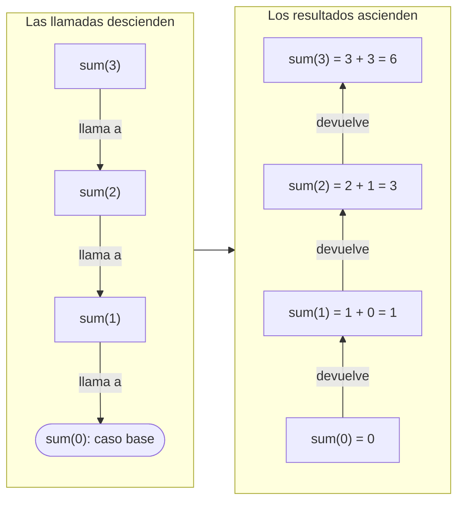
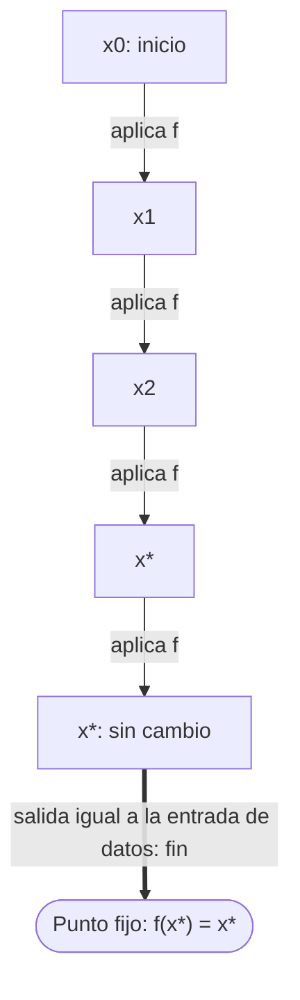
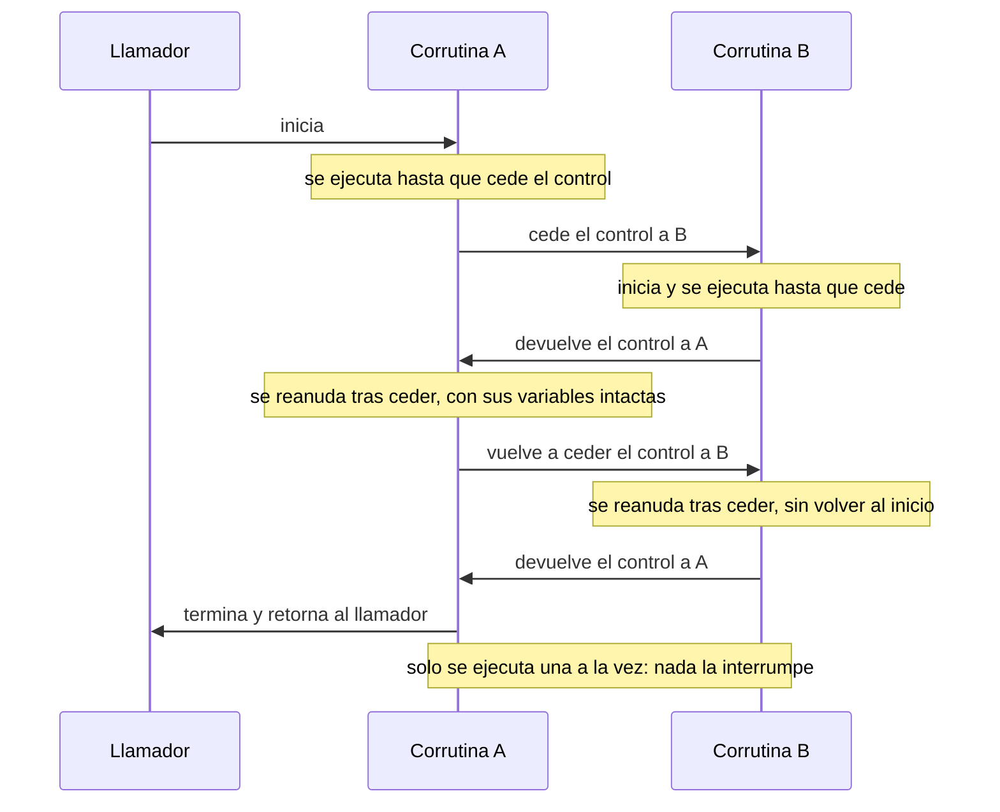

<!-- GENERADO por lessons/book/build.py a partir de lessons/cs-source/ y del frontmatter de las entradas. No lo edites; edita las fuentes y ejecuta build.py. -->

# Flujo de control y continuaciones

Para una lectura avanzada con trazas y experimentos, consulta la [guía de estudio sobre el estado y el control más allá de las variables](../guias-de-estudio/conceptos/estado-y-control-mas-alla-de-las-variables.md).

"¿Qué se ejecuta después?" es una de las dos preguntas básicas sobre cualquier programa. (La otra es "¿qué recuerda?", en el capítulo "Estado más allá de las variables".) La mayoría de los lenguajes la responden con un contador de programa y una pila de llamadas. La mayoría de los programadores no vuelve a pensar en ella. Las entradas de este libro guardan el control en otro lugar, de modo que puedes verlo con claridad.

En COBOL, el control reside en el destino de un `GO TO` que `ALTER` puede cambiar. En Forth, reside en la posición de lectura del intérprete, `>in`, que el programa puede mover hacia atrás. En GNU Make, reside en el conjunto de archivos que existen. La compilación se reinicia cuando se vuelve a generar un makefile. En XAML, reside en el orden de los elementos del documento. Cada mecanismo es una *continuación* disfrazada: el resto del cómputo se guarda en algo distinto de un marco de pila. Este capítulo te da el vocabulario: programación estructurada, recursión, puntos fijos, corrutinas, continuaciones y código automodificable. Termina con una idea sobre *cuándo* se ejecuta el código: los relojes lógicos, que miden el tiempo contando eventos. Las entradas de tar la usan. En otro capítulo de esta parte verás los eventos, las funciones de devolución de llamada (*callback*) y el bucle de eventos, donde otro componente invoca tu código.

## Flujo de control

El flujo de control es el orden en que se ejecutan los pasos de un programa. Los pasos pueden ejecutarse en secuencia, tomar una rama, repetirse, llamar y retornar o saltar. Es una idea aparte porque "¿qué pasa después?" es una pregunta distinta de "¿cuáles son los datos?". La mayoría de los lenguajes sueldan el flujo de control a dos piezas: el *contador de programa* y la *pila de llamadas*. Las entradas de este repositorio lo sueltan y lo guardan en otro sitio. En COBOL vive en el destino de un `GO TO`. En Forth vive en la posición de lectura del intérprete de texto. En Make vive en qué archivos existen. Verlo cambiar de sitio es la mejor forma de entender que puedes nombrarlo.

- **Úsalo cuando:** te preguntes, sobre cualquier programa, "¿dónde vive lo que decide qué se ejecuta después?".
- **Evítalo cuando:** el mecanismo oculte el flujo de control a las herramientas de depuración. Un depurador muestra la pila de llamadas. No muestra una línea de texto reescrita.

**Lee más:**

- [Flujo de control](https://en.wikipedia.org/wiki/Control_flow) (Wikipedia)
- [Grafo de flujo de control](https://en.wikipedia.org/wiki/Control-flow_graph) (Wikipedia)

**En este repositorio:**

| Entrada | Lenguaje | Cómo se relaciona | Qué enseña |
| --- | --- | --- | --- |
| [`apl-weird`](../../src/apl-weird/README.md) | APL | demuestra | Que `⎕CR`, `⎕FX` y la compresión vuelven opcionales el "if" y el "bucle", y que una función puede ser su propia sucesora. |
| [`awk`](../../src/awk/README.md) | AWK | demuestra | Que AWK portable puede construir registros a partir de campos y enviar su salida por una tubería, con arreglos y variables locales de parámetro para el estado. |
| [`awk-weird`](../../src/awk-weird/README.md) | AWK | demuestra | Que una expresión regular como separador de registros convierte un flujo de bytes aleatorios en dados, y que el bucle principal implícito de awk más un patrón es un programa completo. |
| [`cmake`](../../src/cmake/README.md) | CMake | demuestra | Que `while()` y una regex pueden formar una pequeña máquina de registros. |
| [`cobol`](../../src/cobol/README.md) | COBOL | demuestra | Que una regla de parada se puede declarar como datos, y que la imagen de un número puede encargarse de tu redondeo. |
| [`cobol-weird`](../../src/cobol-weird/README.md) | COBOL | demuestra | Que un programa puede reescribir su propio flujo de control y que la programación estructurada facilita trazar esos cambios. |
| [`find-gnu`](../../src/find-gnu/README.md) | find, SQLite | demuestra | Que los extras de GNU para find (profundidad de ruta, marcas de tiempo de los archivos, expresiones regulares y un perfilador integrado) pueden reemplazar una tabla entera de ramas, y que el optimizador de find no tiene nada que reordenar cuando cada rama termina en un efecto secundario. |
| [`find-posix`](../../src/find-posix/README.md) | find, SQLite | demuestra | Que un recorrido de directorios puede ser un bucle y un programa: find cava el árbol que está recorriendo, y la ruta al directorio actual es toda la máquina. |
| [`forth`](../../src/forth/README.md) | Forth | demuestra | Que un lenguaje de pila necesita un `begin ... until` y una tubería para ser un programa completo. |
| [`forth-weird`](../../src/forth-weird/README.md) | Forth | demuestra | Que la posición de análisis del intérprete de texto es un contador de programa si lo permites, y que la pila de datos puede ser la única memoria de un programa. |
| [`GoChallenge1`](../../src/GoChallenge1/README.md) | Go | demuestra | Que un solo `for` de tres partes con un cuerpo vacío puede ejecutar todo el programa en Go. |
| [`haskell-weird`](../../src/haskell-weird/README.md) | Haskell | demuestra | Que leer una lista perezosa puede dirigir un programa cuando forzar cada elemento tiene un efecto secundario. |
| [`JavaChallenge1`](../../src/JavaChallenge1/README.md) | Java | demuestra | Que un `for (init; condition; update) { }` de Java puede conservar la forma del programa original en C#. |
| [`javascript`](../../src/javascript/README.md) | JavaScript, SQLite | demuestra | Que una sentencia for consta de tres expresiones y un cuerpo vacío, y que el orden de evaluación propio de JavaScript, la veracidad de los valores y el operador coma bastan para ejecutar un programa completo a partir de las tres cláusulas. |
| [`javascript-events`](../../src/javascript-events/README.md) | JavaScript, SQLite | demuestra | Que un programa puede ser un conjunto de escuchadores de eventos, cada uno con una sola tarea pequeña que termina emitiendo el evento que espera el siguiente; y que emit() llama a sus escuchadores de inmediato, así que solo un límite de planificación explícito da un turno al bucle de eventos. |
| [`LinqChallenge1`](../../src/LinqChallenge1/README.md) | C#, LINQ | demuestra | Que una cadena de métodos de LINQ puede expresar el programa completo. |
| [`lisp`](../../src/lisp/README.md) | Common Lisp | demuestra | Que `LOOP` de Common Lisp puede expresar un algoritmo completo como cláusulas para contar, tomar valores, sumar, recolectar y parar. |
| [`lisp-weird`](../../src/lisp-weird/README.md) | Common Lisp | demuestra | Que la combinación de métodos de CLOS es una estructura de control: una jerarquía de clases es un bucle y `or` es una regla de parada. |
| [`make-gnu`](../../src/make-gnu/README.md) | GNU Make | demuestra | Que GNU Make puede hacer aritmética y bucles con su propia sintaxis, sin un intérprete de comandos para ninguno de los dos. Un intérprete de comandos es el programa que recibe y ejecuta los comandos que escribes. |
| [`ModernChallenge1`](../../src/ModernChallenge1/README.md) | C# | demuestra | Que una sentencia `for` con el cuerpo vacío puede controlar XAML en tiempo de ejecución, LINQ to Objects, EF Core y la animación de WPF. |
| [`tcl-weird`](../../src/tcl-weird/README.md) | Tcl, SQLite | demuestra | Que el código Tcl se compone solo de cadenas de texto. Por eso puede residir en una base de datos, recuperarse, definirse y ejecutarse bajo demanda. Los disparadores de SQLite determinan el flujo de control. |

## Goto y programación estructurada

`GOTO` salta a cualquier otro lugar del programa. En 1966 Böhm y Jacopini demostraron que nunca lo *necesitas*: la secuencia, la selección y los bucles bastan para cualquier cómputo. En 1968 Edsger Dijkstra escribió la famosa carta *Consideraciones sobre el daño que causa la sentencia Go To*. La programación estructurada se impuso porque puedes razonar sobre un bloque con una sola entrada y una sola salida. `ALTER` de COBOL va en la dirección contraria: cambia el destino de un `GO TO` *mientras el programa se ejecuta*. [`cobol-weird`](../../src/cobol-weird/README.md) lo usa como bucle. Más tarde retiraron esa sentencia del estándar de COBOL. GnuCOBOL todavía la ejecuta.

- **Usa `goto` cuando:** haya una razón de peso, como una única salida limpia para manejar errores en C o su uso en código generado y máquinas de estados.
- **Evítalo cuando:** un destino calculado o modificado durante la ejecución dificulte la lectura del código.

**Lee más:**

- [Goto](https://en.wikipedia.org/wiki/Goto) (Wikipedia)
- [Teorema de la programación estructurada](https://en.wikipedia.org/wiki/Structured_program_theorem) (Wikipedia)
- [Considerado perjudicial](https://en.wikipedia.org/wiki/Considered_harmful) (Wikipedia)

**En este repositorio:**

| Entrada | Lenguaje | Cómo se relaciona | Qué enseña |
| --- | --- | --- | --- |
| [`cobol-weird`](../../src/cobol-weird/README.md) | COBOL | demuestra | Que un programa puede reescribir su propio flujo de control y que la programación estructurada facilita trazar esos cambios. |

## El contador de programa

El contador de programa es un registro que guarda la dirección de la siguiente instrucción. Tras cada paso avanza una posición, salvo que un salto le asigne otra. Existe porque una máquina necesita saber "¿dónde estoy?". Todo intérprete tiene uno, aunque lleve otro nombre. En [`forth-weird`](../../src/forth-weird/README.md) ese papel lo cumple `>in`, la posición de lectura del intérprete de texto en la línea actual. El programa *mueve `>in` hacia atrás* para repetirse. En [`cobol-weird`](../../src/cobol-weird/README.md) es el destino de un `GO TO`.

- **Usa esta idea cuando:** depures o escribas un intérprete, un depurador o una máquina virtual. En esos casos tiene sentido consultar el valor que responde a "¿dónde estoy?".
- **Evítalo cuando:** el código común de una aplicación necesite acceder directamente al contador.

**Lee más:**

- [Contador de programa](https://en.wikipedia.org/wiki/Program_counter) (Wikipedia)
- [Intérprete (informática)](https://en.wikipedia.org/wiki/Interpreter_(computing)) (Wikipedia)

**En este repositorio:**

| Entrada | Lenguaje | Cómo se relaciona | Qué enseña |
| --- | --- | --- | --- |
| [`cobol-weird`](../../src/cobol-weird/README.md) | COBOL | demuestra | Que un programa puede reescribir su propio flujo de control y que la programación estructurada facilita trazar esos cambios. |
| [`ex-weird`](../../src/ex-weird/README.md) | Ex, SQLite | demuestra | Que los registros de un editor pueden contener un programa: una línea de texto se copia en un registro y se ejecuta con @, y las marcas y las direcciones de línea del propio editor hacen la aritmética. |
| [`forth-weird`](../../src/forth-weird/README.md) | Forth | demuestra | Que la posición de análisis del intérprete de texto es un contador de programa si lo permites, y que la pila de datos puede ser la única memoria de un programa. |

## Recursión

Una definición recursiva se usa a sí misma. Una función se llama a sí misma con una instancia más pequeña del problema, hasta que el problema es tan pequeño que la respuesta es obvia. La recursión existe porque muchas estructuras tienen elementos anidados: árboles, carpetas, gramáticas, expresiones aritméticas. Los bucles y la recursión son igual de potentes, y los lenguajes funcionales usan recursión en lugar de bucles. Varias entradas de aquí son recursivas sin parecerlo. En [`m4`](../../src/m4/README.md), el texto de reemplazo de una macro invoca la misma macro. El procesador examina ese texto de nuevo y se forma un bucle. En [`tcl-weird`](../../src/tcl-weird/README.md), un disparador de base de datos inserta una fila, lo que activa de nuevo el mismo disparador. La regla de parada es una consulta que no encuentra nada.

Al descender, cada llamada pasa una instancia más pequeña del problema a la siguiente. `sum(0)` alcanza el caso base: es la única llamada que responde sin volver a llamar. Sin un caso base alcanzable, la recursión no termina por sí sola. Al ascender, cada llamada termina el trabajo que tenía pendiente. [La pila de llamadas](06-estado-mas-alla-de-las-variables.md#la-pila-de-llamadas) muestra dónde se guardan esas llamadas en espera.

- **Úsala cuando:** los datos están anidados o el problema se divide en copias más pequeñas de sí mismo.
- **Evítala cuando:** la profundidad puede crecer sin límite y el lenguaje no optimiza las llamadas de cola. La *pila* (*stack*) puede agotarse. Identifica siempre la regla de parada y qué ocurre si no se cumple.

**Lee más:**

- [Recursión (informática)](https://en.wikipedia.org/wiki/Recursion_(computer_science)) (Wikipedia)
- [Llamada de cola](https://en.wikipedia.org/wiki/Tail_call) (Wikipedia)
- [Recursión](https://developer.mozilla.org/en-US/docs/Glossary/Recursion) (glosario de MDN)

**En este repositorio:**

| Entrada | Lenguaje | Cómo se relaciona | Qué enseña |
| --- | --- | --- | --- |
| [`find-gnu`](../../src/find-gnu/README.md) | find, SQLite | demuestra | Que los extras de GNU para find (profundidad de ruta, marcas de tiempo de los archivos, expresiones regulares y un perfilador integrado) pueden reemplazar una tabla entera de ramas, y que el optimizador de find no tiene nada que reordenar cuando cada rama termina en un efecto secundario. |
| [`find-posix`](../../src/find-posix/README.md) | find, SQLite | demuestra | Que un recorrido de directorios puede ser un bucle y un programa: find cava el árbol que está recorriendo, y la ruta al directorio actual es toda la máquina. |
| [`m4`](../../src/m4/README.md) | m4 | demuestra | Que un procesador de macros es un lenguaje de programación: no tiene sentencia de bucle ni variable, solo texto que se analiza de nuevo. |
| [`tcl-weird`](../../src/tcl-weird/README.md) | Tcl, SQLite | demuestra | Que el código Tcl se compone solo de cadenas de texto. Por eso puede residir en una base de datos, recuperarse, definirse y ejecutarse bajo demanda. Los disparadores de SQLite determinan el flujo de control. |

## Iteración de punto fijo

Un *punto fijo* de una función es un valor que la función deja intacto: f(x) = x. La iteración de punto fijo encuentra uno al aplicar la función una y otra vez hasta que nada cambia. Sirve porque muchos problemas se resumen en "sigue hasta que se estabilice": balancear una ecuación, calcular una clausura matemática o simplificar una expresión. El repositorio está lleno de casos. [`regex-sed`](../../src/regex-sed/README.md) aplica sustituciones hasta que ninguna coincide. [`make-gnu`](../../src/make-gnu/README.md) vuelve a generar su propio makefile hasta que está al día. El optimizador de un compilador hace lo mismo: recorre el código hasta que ya no encuentra mejoras.

Cada pasada aplica la misma función `f`. La ejecución se detiene cuando una pasada devuelve su propia entrada de datos, de modo que `f(x*) = x*`. El valor `x` no tiene que ser un número. Puede ser una línea de texto (como en [`regex-sed`](../../src/regex-sed/README.md)), un makefile o un fragmento de código. Un programa real también necesita un límite por si los valores nunca se estabilizan.

- **Úsala cuando:** cada paso sea una mejora clara y "sin cambios" sea una señal clara para detenerse.
- **Evítala cuando:** el proceso quizá nunca se estabilice. Puede rebotar sin fin entre dos estados. Añade siempre un límite, que puede ser de tiempo. El entorno aislado (*sandbox*), que limita el acceso al sistema anfitrión, da a cada `check.sh` un límite de tiempo.

**Lee más:**

- [Iteración de punto fijo](https://en.wikipedia.org/wiki/Fixed-point_iteration) (Wikipedia)
- [Punto fijo (matemáticas)](https://en.wikipedia.org/wiki/Fixed_point_(mathematics)) (Wikipedia)

**En este repositorio:**

| Entrada | Lenguaje | Cómo se relaciona | Qué enseña |
| --- | --- | --- | --- |
| [`m4`](../../src/m4/README.md) | m4 | demuestra | Que un procesador de macros es un lenguaje de programación: no tiene sentencia de bucle ni variable, solo texto que se analiza de nuevo. |
| [`make-gnu`](../../src/make-gnu/README.md) | GNU Make | demuestra | Que GNU Make puede hacer aritmética y bucles con su propia sintaxis, sin un intérprete de comandos para ninguno de los dos. Un intérprete de comandos es el programa que recibe y ejecuta los comandos que escribes. |
| [`regex-sed`](../../src/regex-sed/README.md) | GNU sed, Regular expressions | demuestra | Que un programa puede ser una línea de texto que las sustituciones reescriben hasta que ninguna se aplique: un algoritmo de Markov, con una expresión regular de retroceso catastrófico como reloj. |

## Corrutinas

Una corrutina es una función que puede pausarse a mitad de su ejecución y reanudarse después con sus variables locales intactas. Las funciones comunes se ejecutan de principio a fin. Una corrutina puede entregar un valor a quien la llamó, esperar y seguir cuando se lo pidan. Sirve para productores y consumidores, para generadores y para la multitarea cooperativa (`async`/`await` se basa en esta idea). Varias entradas son corrutinas disfrazadas. Un iterador de Rust hecho con `successors`, un `generateSequence` de Kotlin y el `iter(step, False)` de Python producen el siguiente valor solo cuando el bucle lo pide.

El control cambia solo cuando una corrutina lo cede, así que solo se ejecuta una rutina a la vez. Esa es la diferencia con los hilos. Nada interrumpe a una corrutina para quitarle el control y nada se ejecuta en paralelo. Una corrutina que se reanuda sigue después de su último `yield`, con sus variables locales tal como las dejó. Una llamada común volvería a empezar desde el principio.

- **Úsala cuando:** proceses un flujo o quieras que dos partes del código se turnen sin hilos.
- **Evítala cuando:** necesites paralelismo real o los muchos puntos de pausa dificulten seguir el programa.

**Lee más:**

- [Corrutina](https://en.wikipedia.org/wiki/Coroutine) (Wikipedia)
- [Iteradores y generadores](04-evaluacion-y-demanda.md#iteradores-y-generadores) en "Evaluación y demanda"

**En este repositorio:**

| Entrada | Lenguaje | Cómo se relaciona | Qué enseña |
| --- | --- | --- | --- |
| [`javascript-events`](../../src/javascript-events/README.md) | JavaScript, SQLite | contraejemplo | Que un programa puede ser un conjunto de escuchadores de eventos, cada uno con una sola tarea pequeña que termina emitiendo el evento que espera el siguiente; y que emit() llama a sus escuchadores de inmediato, así que solo un límite de planificación explícito da un turno al bucle de eventos. |
| [`javascript-weird`](../../src/javascript-weird/README.md) | JavaScript, SQLite | analogía | Que una clausura es una máquina de estados: una función más las variables junto a las que se creó, que un iterador hace avanzar un paso a la vez, con reduce como el único pliegue que no puede detenerse. |
| [`KotlinChallenge1`](../../src/KotlinChallenge1/README.md) | Kotlin | analogía | Que Kotlin puede usar `generateSequence` como el bucle, y termina cuando el generador devuelve null. |
| [`PythonChallenge1`](../../src/PythonChallenge1/README.md) | Python | analogía | Que Python puede controlar un programa completo con `iter(step, False)`, que llama a `step` hasta que devuelve `False`. |
| [`RustChallenge1`](../../src/RustChallenge1/README.md) | Rust | analogía | Que los iteradores y las clausuras (*closures*, funciones que capturan variables de su entorno) pueden expresar el flujo de control de un programa completo en Rust. |

## Continuaciones

Una continuación es "el resto del cálculo" a partir de un punto, tratado como un valor. Si pudieras pausar un programa y preguntar "¿qué harás después?", la respuesta sería la continuación. En el *estilo de paso de continuaciones*, cada función recibe un argumento extra: una función que indica qué hacer con el resultado. Existe porque permite expresar la salida anticipada, las excepciones, los generadores, el retroceso y `async`/`await` con llamadas a funciones comunes. Basta con que "¿qué sigue?" sea un valor. Las entradas de aquí eligen a propósito "¿qué sigue?". El `ALTER` de COBOL reescribe la respuesta. El `>in` de Forth la rebobina. El reinicio de Make es "el resto de la compilación, otra vez".

```mermaid
flowchart TB
    accTitle: Una continuación identifica lo que falta por calcular. Una llamada común solo retorna a quien la hizo
    accDescr: Dos paneles en paralelo. En una llamada común, quien llama hace A y luego llama a B. B termina y devuelve el control a quien lo llamó, que hace C. La pila de quien llama guarda el punto de retorno. Con una continuación explícita, el programa hace A y captura K, el valor que representa lo que sigue. Ejecuta otra cosa, invoca K más tarde y luego hace C. K aparece en un cuadro aparte porque es un valor que representa el control pendiente.
    subgraph CONT["Continuación explícita"]
        A2["Haz A"] --> CAP[("captura K: lo que sigue")] --> OTH["ejecuta otra cosa"] --> RES["invoca K"] --> C2["Haz C"]
    end
    subgraph CALL["Llamada y retorno comunes"]
        A1["Quien llama: haz A"] --> B1["llama a B: el punto de retorno queda en la pila"] --> B2["B termina"] --> C1["Quien llama: haz C"]
    end
```

A la izquierda, el punto de retorno queda oculto en la pila de quien llama. La función llamada no puede nombrarlo. A la derecha es un valor, `K`, que se puede guardar, pasar y usar después (o nunca). El destino mutable de `GO TO` en COBOL, `>in` en Forth y el estado de reinicio de Make son *analogías* del control guardado fuera de la pila de llamadas. Ninguno captura una continuación de primera clase. Una función de devolución de llamada (*callback*) común o una clausura (*closure*) tampoco lo son.

- **Úsala cuando:** escribas un compilador, una biblioteca asíncrona o un marco de trabajo web con funciones de devolución de llamada.
- **Evítala cuando:** programes a mano en un lenguaje sin llamadas de cola. El código se vuelve una serie de funciones de devolución de llamada anidadas. La pila crece.

**Lee más:**

- [Continuación](https://en.wikipedia.org/wiki/Continuation) (Wikipedia)
- [Estilo de paso de continuaciones](https://en.wikipedia.org/wiki/Continuation-passing_style) (Wikipedia)
- [Llamada con la continuación actual](https://en.wikipedia.org/wiki/Call-with-current-continuation) (Wikipedia)

**En este repositorio:**

| Entrada | Lenguaje | Cómo se relaciona | Qué enseña |
| --- | --- | --- | --- |
| [`cobol-weird`](../../src/cobol-weird/README.md) | COBOL | analogía | Que un programa puede reescribir su propio flujo de control y que la programación estructurada facilita trazar esos cambios. |
| [`forth-weird`](../../src/forth-weird/README.md) | Forth | analogía | Que la posición de análisis del intérprete de texto es un contador de programa si lo permites, y que la pila de datos puede ser la única memoria de un programa. |
| [`javascript-weird`](../../src/javascript-weird/README.md) | JavaScript, SQLite | contraejemplo | Que una clausura es una máquina de estados: una función más las variables junto a las que se creó, que un iterador hace avanzar un paso a la vez, con reduce como el único pliegue que no puede detenerse. |
| [`make-gnu`](../../src/make-gnu/README.md) | GNU Make | analogía | Que GNU Make puede hacer aritmética y bucles con su propia sintaxis, sin un intérprete de comandos para ninguno de los dos. Un intérprete de comandos es el programa que recibe y ejecuta los comandos que escribes. |
| [`tar-gnu`](../../src/tar-gnu/README.md) | GNU tar, SQLite | contraejemplo | Que un archivo tar puede ser un programa serializado: tar lee los miembros en orden y solo el comando que indica el operador les da un efecto. |

## Código automodificable

El código automodificable cambia sus propias instrucciones mientras se ejecuta. Las primeras computadoras lo hacían para ahorrar memoria, que era escasa. Hoy la idea sigue viva en los compiladores en tiempo de ejecución, los cargadores de programas y el software malicioso que se oculta. En este repositorio es una forma de trasladar el flujo de control al texto del programa. [`apl-weird`](../../src/apl-weird/README.md) lee el código fuente de una función con `⎕CR`, lo reescribe y define la nueva versión con `⎕FX`. [`cobol-weird`](../../src/cobol-weird/README.md) cambia un `GO TO` con `ALTER`. [`tcl-weird`](../../src/tcl-weird/README.md) guarda el código fuente del procedimiento en una tabla de la base de datos y lo define bajo demanda.

- **Úsalo cuando:** generes código con un límite claro: escribe el texto, compílalo y ejecútalo. Eso hacen los compiladores JIT (compilación justo a tiempo) y los generadores de código.
- **Evítalo en los programas escritos a mano.** Los depuradores, las cachés y las herramientas de seguridad suponen que el código no cambia (algunos sistemas prohíben que una zona de memoria sea escribible y ejecutable a la vez).

**Lee más:**

- [Código automodificable](https://en.wikipedia.org/wiki/Self-modifying_code) (Wikipedia)
- [Compilación en tiempo de ejecución](https://en.wikipedia.org/wiki/Just-in-time_compilation) (Wikipedia)

**En este repositorio:**

| Entrada | Lenguaje | Cómo se relaciona | Qué enseña |
| --- | --- | --- | --- |
| [`apl-weird`](../../src/apl-weird/README.md) | APL | demuestra | Que `⎕CR`, `⎕FX` y la compresión vuelven opcionales el "if" y el "bucle", y que una función puede ser su propia sucesora. |
| [`cobol-weird`](../../src/cobol-weird/README.md) | COBOL | demuestra | Que un programa puede reescribir su propio flujo de control y que la programación estructurada facilita trazar esos cambios. |
| [`ex-weird`](../../src/ex-weird/README.md) | Ex, SQLite | demuestra | Que los registros de un editor pueden contener un programa: una línea de texto se copia en un registro y se ejecuta con @, y las marcas y las direcciones de línea del propio editor hacen la aritmética. |

## Relojes lógicos y orden de los eventos

Un **reloj lógico** cuenta *eventos* en vez de segundos. Responde "¿qué ocurrió antes que qué?" y "¿cuántos pasos han pasado?" sin preguntar cuánto duró nada. Los sistemas distribuidos usan relojes lógicos porque los relojes reales de distintas máquinas discrepan. Un programa también puede usar uno en una sola máquina para que su comportamiento no dependa de la velocidad.

En [`tar-gnu-weird`](../../src/tar-gnu-weird/README.md), un punto de control de tar equivale a una hora de trabajo. El reloj es el número de registros que tar ha escrito. `check.sh` predice el resultado de una ejecución solo a partir de la disposición del archivo. Da igual si la máquina es más rápida o más lenta. Un archivo más largo da más pulsos y uno más corto atasca el programa. Otro intervalo entre puntos de control cambia el recuento y la comprobación calcula de antemano ese cambio. Hay un detalle que es fácil pasar por alto. `TAR_CHECKPOINT` cuenta *registros* (con `--checkpoint=2` lee 2, 4, 6), mientras que la máquina cuenta *llamadas*. Son dos relojes y la entrada dice cuál usa. [`make-gnu`](../../src/make-gnu/README.md) tiene un contador similar. `MAKE_RESTARTS` cuenta rondas de compilación en vez de tiempo.

- **Úsalo cuando:** necesites ordenar eventos, repetir una ejecución con el mismo resultado o probar la temporización sin esperar.
- **Evítalo cuando:** necesites la duración real. Un reloj lógico no te puede decir cuánto duró algo.

**Lee más:**

- [Reloj lógico](https://en.wikipedia.org/wiki/Logical_clock) (Wikipedia)
- [Marca de tiempo de Lamport](https://en.wikipedia.org/wiki/Lamport_timestamp) (Wikipedia)

**En este repositorio:**

| Entrada | Lenguaje | Cómo se relaciona | Qué enseña |
| --- | --- | --- | --- |
| [`make-gnu`](../../src/make-gnu/README.md) | GNU Make | analogía | Que GNU Make puede hacer aritmética y bucles con su propia sintaxis, sin un intérprete de comandos para ninguno de los dos. Un intérprete de comandos es el programa que recibe y ejecuta los comandos que escribes. |
| [`tar-gnu-weird`](../../src/tar-gnu-weird/README.md) | GNU tar, SQLite | demuestra | Que la disposición física de un archivo puede marcar el ritmo de un programa: los puntos de control de tar son un reloj y cada pulso hace avanzar un paso a una máquina de estados. |
