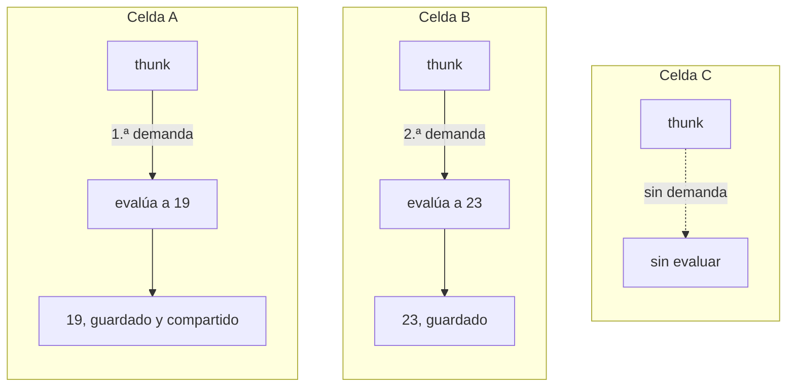
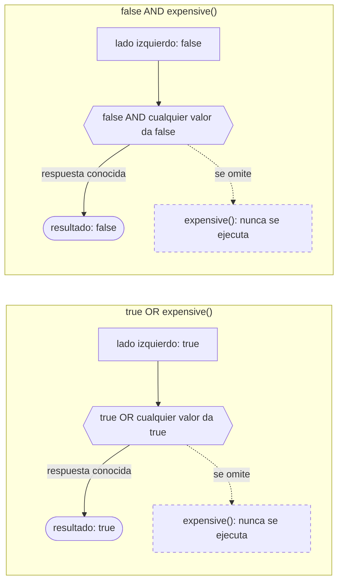
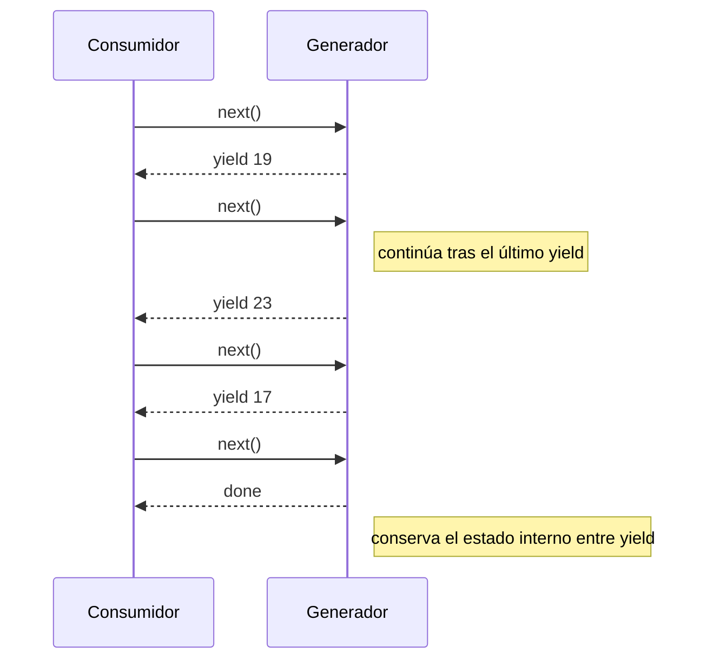
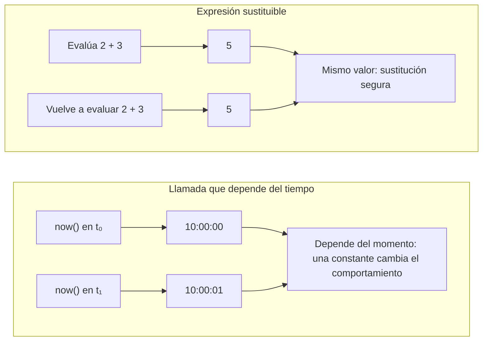
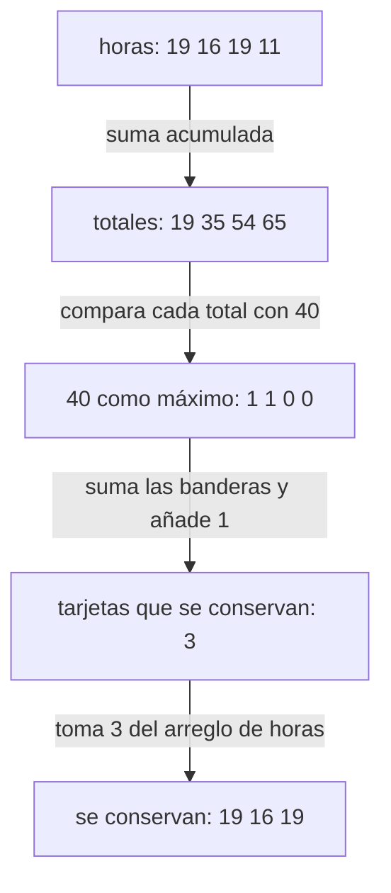
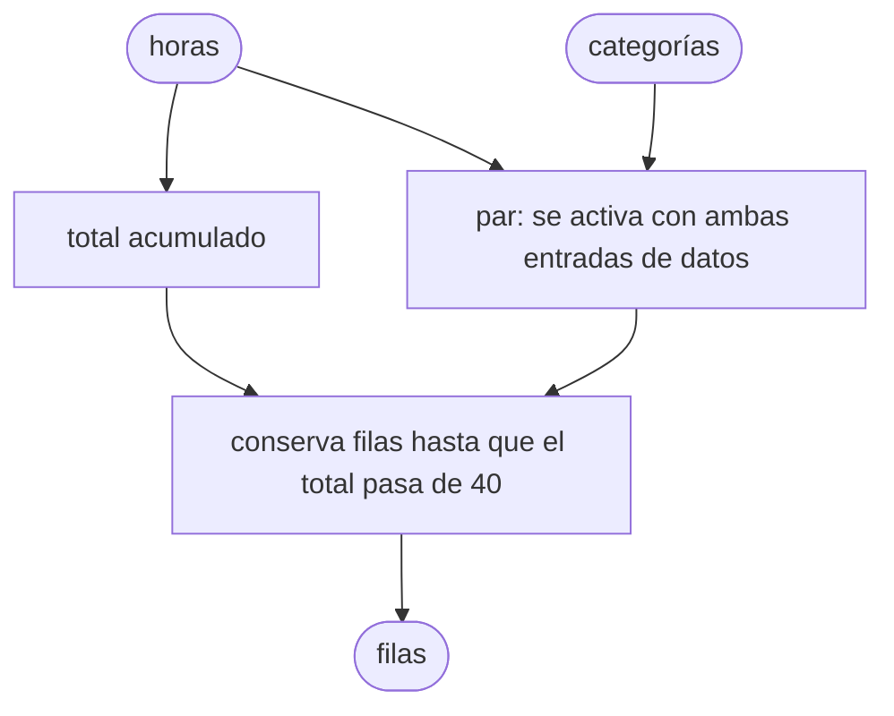

<!-- GENERADO por lessons/book/build.py a partir de lessons/cs-source/ y del frontmatter de las entradas. No lo edites; edita las fuentes y ejecuta build.py. -->

# Evaluación y demanda

Para una lectura avanzada con trazas y experimentos, consulta la [guía de estudio sobre evaluación, demanda y pereza](../guias-de-estudio/conceptos/evaluacion-demanda-y-pereza.md).

¿Cuándo se calcula un valor: cuando lo escribes, cuando lo necesitas por primera vez o cada vez que lo pides? Esa es la pregunta de la **estrategia de evaluación**. El código puede verse igual en distintos lenguajes y dar respuestas distintas.

Haskell usa evaluación perezosa: un solo `span` sobre una lista infinita basta como regla de parada porque solo se calcula la parte necesaria. LINQ usa ejecución diferida: una canalización no hace nada hasta que alguien la enumera. APL usa evaluación inmediata y trabaja con arreglos enteros a la vez. Por eso, sortea más números de los que necesita y recorta el resultado. Cuando hay efectos, la elección deja de ser un detalle. Si una lista perezosa realiza operaciones de entrada de datos y salida, *leer la lista* es lo que hace el trabajo. Este capítulo explica el vocabulario: estrategias y cortocircuitos, iteradores y generadores, funciones de primera clase y de orden superior, funtores y `map`. También abarca monoides y pliegues (y por qué `reduce` no puede detenerse antes del final) y el flujo de datos. La tabla final reúne las estrategias de todas las entradas.

```mermaid
flowchart TB
    accTitle: Pedir el mismo prefijo puede implicar distinto trabajo
    accDescr: Tres filas muestran a un consumidor que pide solo los dos primeros elementos de una secuencia de cinco. En la fila de evaluación inmediata, primero se calculan los cinco valores, del 1 al 5. El consumidor toma 1 y 2. Los valores del 3 al 5 se calcularon y quedaron sin usar. En la fila de evaluación perezosa por necesidad se crean thunks, cálculos suspendidos que se evalúan cuando se fuerzan. El consumidor pide el valor 1, que se evalúa y se guarda. Luego pide el 2, que también se evalúa y se guarda. Los valores del 3 al 5 nunca se evalúan. En la fila de la canalización diferida, al definirla no se hace ningún cálculo. Al enumerarla, se calculan y se entregan los valores 1 y 2. Enumerarla de nuevo puede repetir el trabajo porque la ejecución diferida no memoiza resultados automáticamente.
    subgraph DEFER["Diferida, como en LINQ"]
        D1["Definir: aún sin cálculo"] --> D2["Enumerar: 1, 2"] --> D3["Volver a enumerar: puede recalcular"]
    end
    subgraph LAZY["Perezosa, por necesidad"]
        L1["Crear thunks"] --> L2["Demanda del 1: guardar"] --> L3["Demanda del 2: guardar"] --> L4["Del 3 al 5: sin ejecución"]
    end
    subgraph EAGER["Inmediata, como en un arreglo"]
        E1["Construir"] --> E2["Calcular del 1 al 5"] --> E3["El consumidor toma 1, 2"] --> E4["Del 3 al 5: sin usar"]
    end
    classDef unused stroke-dasharray: 5 3
    class E4,L4,D3 unused
```

Los valores del 1 al 5 son solo una muestra. La llamada por necesidad de Haskell *recuerda* un valor evaluado. En cambio, una canalización enumerable diferida suele recalcularlo cada vez que la enumeras. APL suele evaluar un arreglo entero, así que se parece más a la fila de evaluación inmediata. La imagen compara estrategias sin reproducir la traza exacta de ninguna entrada.

| Entrada | Nombre | Evaluación |
| --- | --- | --- |
| [`apl`](../../src/apl/README.md) | APL | eager |
| [`apl-weird`](../../src/apl-weird/README.md) | APL | eager |
| [`awk`](../../src/awk/README.md) | AWK | eager |
| [`awk-weird`](../../src/awk-weird/README.md) | AWK | eager |
| [`ModernChallenge1`](../../src/ModernChallenge1/README.md) | C# `for` | eager |
| [`cmake`](../../src/cmake/README.md) | CMake | eager |
| [`cobol`](../../src/cobol/README.md) | COBOL | eager |
| [`cobol-weird`](../../src/cobol-weird/README.md) | COBOL | eager |
| [`lisp`](../../src/lisp/README.md) | Common Lisp | eager |
| [`lisp-weird`](../../src/lisp-weird/README.md) | Common Lisp | eager |
| [`ex-weird`](../../src/ex-weird/README.md) | Ex | eager |
| [`forth`](../../src/forth/README.md) | Forth | eager |
| [`forth-weird`](../../src/forth-weird/README.md) | Forth | eager |
| [`tar-gnu`](../../src/tar-gnu/README.md) | GNU tar | eager |
| [`tar-gnu-weird`](../../src/tar-gnu-weird/README.md) | GNU tar | eager |
| [`GoChallenge1`](../../src/GoChallenge1/README.md) | Go | eager |
| [`JavaChallenge1`](../../src/JavaChallenge1/README.md) | Java | eager |
| [`javascript`](../../src/javascript/README.md) | JavaScript | eager |
| [`javascript-events`](../../src/javascript-events/README.md) | JavaScript | eager |
| [`tcl`](../../src/tcl/README.md) | Tcl | eager |
| [`tcl-weird`](../../src/tcl-weird/README.md) | Tcl | eager |
| [`haskell`](../../src/haskell/README.md) | Haskell | lazy |
| [`haskell-weird`](../../src/haskell-weird/README.md) | Haskell | lazy |
| [`javascript-weird`](../../src/javascript-weird/README.md) | JavaScript | lazy |
| [`KotlinChallenge1`](../../src/KotlinChallenge1/README.md) | Kotlin | lazy |
| [`PythonChallenge1`](../../src/PythonChallenge1/README.md) | Python | lazy |
| [`RustChallenge1`](../../src/RustChallenge1/README.md) | Rust | lazy |
| [`LinqChallenge1`](../../src/LinqChallenge1/README.md) | LINQ | deferred |
| [`LinqChallenge2`](../../src/LinqChallenge2/README.md) | LINQ | deferred |
| [`ed-weird`](../../src/ed-weird/README.md) | ed | rewriting |
| [`regex-sed`](../../src/regex-sed/README.md) | GNU sed | rewriting |
| [`m4`](../../src/m4/README.md) | m4 | rewriting |
| [`regex-pcre2`](../../src/regex-pcre2/README.md) | PCRE2 | search |
| [`regex-pcre2grep`](../../src/regex-pcre2grep/README.md) | pcre2grep | search |
| [`regex-perl`](../../src/regex-perl/README.md) | Perl | search |
| [`regex-dotnet`](../../src/regex-dotnet/README.md) | Regex de .NET | search |
| [`find-gnu`](../../src/find-gnu/README.md) | GNU find | declarative |
| [`make-gnu`](../../src/make-gnu/README.md) | GNU Make | declarative |
| [`find-posix`](../../src/find-posix/README.md) | POSIX find | declarative |
| [`xaml`](../../src/xaml/README.md) | XAML | declarative |

## Estrategias de evaluación

Una estrategia de evaluación responde a una pregunta: ¿*cuándo* se calcula un argumento? ¿Antes de la llamada (llamada por valor, también llamada evaluación inmediata)? ¿La primera vez que hace falta, para luego guardar el resultado (llamada por necesidad, también llamada evaluación perezosa)? ¿Cada vez que se usa (llamada por nombre)? La respuesta cambia el significado de un programa en cuanto hay efectos o datos infinitos. `f(g(x))` se ve igual en todos los lenguajes. Su comportamiento cambia. Todo este capítulo trata esa diferencia: [`haskell`](../../src/haskell/README.md) usa evaluación perezosa, [`apl`](../../src/apl/README.md) usa evaluación inmediata y LINQ usa ejecución *diferida*.

- **Úsala cuando:** leas un lenguaje que no conoces. Averigua primero cuál es su estrategia predeterminada.
- **Evita suponer** que tus hábitos de un lenguaje se aplican en otro.

**Lee más:**

- [Estrategia de evaluación](https://en.wikipedia.org/wiki/Evaluation_strategy) (Wikipedia)
- [Llamada por necesidad](https://en.wikipedia.org/wiki/Call-by-need) (Wikipedia)
- [Llamada por nombre](https://en.wikipedia.org/wiki/Call-by-name) (Wikipedia)

**En este repositorio:**

| Entrada | Lenguaje | Cómo se relaciona | Qué enseña |
| --- | --- | --- | --- |
| [`haskell`](../../src/haskell/README.md) | Haskell | demuestra | Que una lista perezosa y un solo `span` son toda la regla de parada. |
| [`haskell-weird`](../../src/haskell-weird/README.md) | Haskell | demuestra | Que leer una lista perezosa puede dirigir un programa cuando forzar cada elemento tiene un efecto secundario. |
| [`PythonChallenge1`](../../src/PythonChallenge1/README.md) | Python | demuestra | Que Python puede controlar un programa completo con `iter(step, False)`, que llama a `step` hasta que devuelve `False`. |

## Evaluación inmediata

La evaluación inmediata calcula un valor en cuanto el código lo pide. Es la opción predeterminada en la mayoría de los lenguajes. Su ventaja es la sencillez: el costo y el orden son fáciles de predecir y los efectos ocurren justo donde los escribiste. [`apl`](../../src/apl/README.md) evalúa de inmediato en un sentido fuerte: cada primitiva trabaja sobre un arreglo entero a la vez. La entrada saca cinco números, un límite que nunca se queda corto aunque a menudo necesite menos. "Saca de sobra y recorta" sustituye al bucle que decide cuándo parar.

- **Úsala cuando:** necesites un orden predecible de los efectos o sepas con certeza que se usará el resultado.
- **Evítala cuando:** el trabajo pueda desperdiciarse o la fuente sea enorme o infinita.

**Lee más:**

- [Evaluación inmediata](https://en.wikipedia.org/wiki/Eager_evaluation) (Wikipedia)
- [Evaluación perezosa](04-evaluacion-y-demanda.md#evaluación-perezosa), la idea opuesta

**En este repositorio:**

| Entrada | Lenguaje | Cómo se relaciona | Qué enseña |
| --- | --- | --- | --- |
| [`apl`](../../src/apl/README.md) | APL | demuestra | Que cinco tiradas y un *take-while* pueden reemplazar un bucle. |
| [`apl-weird`](../../src/apl-weird/README.md) | APL | demuestra | Que `⎕CR`, `⎕FX` y la compresión vuelven opcionales el "if" y el "bucle", y que una función puede ser su propia sucesora. |
| [`javascript`](../../src/javascript/README.md) | JavaScript, SQLite | demuestra | Que una sentencia for consta de tres expresiones y un cuerpo vacío, y que el orden de evaluación propio de JavaScript, la veracidad de los valores y el operador coma bastan para ejecutar un programa completo a partir de las tres cláusulas. |
| [`javascript-weird`](../../src/javascript-weird/README.md) | JavaScript, SQLite | demuestra | Que una clausura es una máquina de estados: una función más las variables junto a las que se creó, que un iterador hace avanzar un paso a la vez, con reduce como el único pliegue que no puede detenerse. |
| [`ModernChallenge1`](../../src/ModernChallenge1/README.md) | C# | demuestra | Que una sentencia `for` con el cuerpo vacío puede controlar XAML en tiempo de ejecución, LINQ to Objects, EF Core y la animación de WPF. |

## Evaluación perezosa

La evaluación perezosa aplaza un cálculo hasta que se necesita su resultado. Entonces guarda la respuesta. El cálculo pendiente se llama *thunk*. Así puedes describir la respuesta *entera* y tomar solo lo que quieres. En [`haskell`](../../src/haskell/README.md), un solo `span` sobre una lista perezosa infinita es toda la regla de parada. El precio es que cuesta responder "¿cuándo se ejecuta esto?". En [`haskell-weird`](../../src/haskell-weird/README.md), los elementos de la lista realizan operaciones de entrada de datos y salida. Así que el trabajo se hace al *leer la lista*. Leer demasiado pronto o demasiado tarde cambia el resultado.

Un thunk promete calcular un valor. La demanda de una celda ejecuta una vez su thunk y guarda el valor. Así que otra demanda de `A` no tiene costo. Nadie pide la celda `C` y su cálculo nunca se hace. Guardar el valor es parte de la evaluación perezosa en sentido estricto. Una canalización que solo aplaza el trabajo, como un generador, puede volver a calcular el mismo valor en cada pasada. Consulta [Iteradores y generadores](04-evaluacion-y-demanda.md#iteradores-y-generadores).

- **Úsala cuando:** el código sea puro (sin efectos), quieras secuencias infinitas o quizá no necesites ciertos resultados.
- **Evítala cuando:** haya efectos o importe el uso de memoria. Una pila de thunks sin evaluar puede usar mucha memoria (una *fuga de espacio*).

**Lee más:**

- [Evaluación perezosa](https://en.wikipedia.org/wiki/Lazy_evaluation) (Wikipedia)
- [Thunk](https://en.wikipedia.org/wiki/Thunk) (Wikipedia)
- [Reducción de grafos](https://en.wikipedia.org/wiki/Graph_reduction) (Wikipedia)

**En este repositorio:**

| Entrada | Lenguaje | Cómo se relaciona | Qué enseña |
| --- | --- | --- | --- |
| [`haskell`](../../src/haskell/README.md) | Haskell | demuestra | Que una lista perezosa y un solo `span` son toda la regla de parada. |
| [`haskell-weird`](../../src/haskell-weird/README.md) | Haskell | demuestra | Que leer una lista perezosa puede dirigir un programa cuando forzar cada elemento tiene un efecto secundario. |
| [`javascript-weird`](../../src/javascript-weird/README.md) | JavaScript, SQLite | demuestra | Que una clausura es una máquina de estados: una función más las variables junto a las que se creó, que un iterador hace avanzar un paso a la vez, con reduce como el único pliegue que no puede detenerse. |
| [`KotlinChallenge1`](../../src/KotlinChallenge1/README.md) | Kotlin | demuestra | Que Kotlin puede usar `generateSequence` como el bucle, y termina cuando el generador devuelve null. |
| [`LinqChallenge1`](../../src/LinqChallenge1/README.md) | C#, LINQ | demuestra | Que una cadena de métodos de LINQ puede expresar el programa completo. |
| [`LinqChallenge2`](../../src/LinqChallenge2/README.md) | C#, LINQ | demuestra | Que la sintaxis de consulta de C# puede expresar el cálculo y ordenar sus efectos. |
| [`m4`](../../src/m4/README.md) | m4 | demuestra | Que un procesador de macros es un lenguaje de programación: no tiene sentencia de bucle ni variable, solo texto que se analiza de nuevo. |
| [`RustChallenge1`](../../src/RustChallenge1/README.md) | Rust | demuestra | Que los iteradores y las clausuras (*closures*, funciones que capturan variables de su entorno) pueden expresar el flujo de control de un programa completo en Rust. |

## Evaluación de cortocircuito

La evaluación de cortocircuito significa que `and` y `or` paran en cuanto se conoce la respuesta. En `a && b`, si `a` es falso, `b` nunca se ejecuta. Sirve para ganar velocidad y para un hábito muy útil: comprueba la condición de protección antes de actuar (`x != null && x.length > 0`). La misma idea puede convertirse en un bucle. En [`lisp-weird`](../../src/lisp-weird/README.md) la combinación de métodos `or` llama a los métodos uno tras otro y se detiene en el primero que devuelve un valor verdadero. La jerarquía de clases se convierte en el bucle y `or` en la regla de parada.

En ambos paneles, el operando izquierdo determina la respuesta y el derecho se omite. Nada de lo que haría llega a ocurrir, ya sea una consulta lenta, una escritura o la impresión de una línea. Por eso `x != null && x.length > 0` es seguro. También significa que un efecto en el operando derecho no está asegurado. Consulta [Efectos secundarios](07-efectos-errores-y-confirmacion.md#efectos-secundarios).

- **Úsala cuando:** protejas una operación arriesgada o elijas la primera respuesta válida.
- **Evítala cuando:** esperes que un efecto del segundo operando ocurra siempre. Puede no ocurrir y no habrá aviso.

**Lee más:**

- [Evaluación de cortocircuito](https://en.wikipedia.org/wiki/Short-circuit_evaluation) (Wikipedia)
- [Sistema de objetos de Common Lisp](https://en.wikipedia.org/wiki/Common_Lisp_Object_System) (Wikipedia)
- [AND lógico (`&&`)](https://developer.mozilla.org/en-US/docs/Web/JavaScript/Reference/Operators/Logical_AND) (MDN), que explica el cortocircuito en palabras sencillas

**En este repositorio:**

| Entrada | Lenguaje | Cómo se relaciona | Qué enseña |
| --- | --- | --- | --- |
| [`find-gnu`](../../src/find-gnu/README.md) | find, SQLite | demuestra | Que los extras de GNU para find (profundidad de ruta, marcas de tiempo de los archivos, expresiones regulares y un perfilador integrado) pueden reemplazar una tabla entera de ramas, y que el optimizador de find no tiene nada que reordenar cuando cada rama termina en un efecto secundario. |
| [`find-posix`](../../src/find-posix/README.md) | find, SQLite | demuestra | Que un recorrido de directorios puede ser un bucle y un programa: find cava el árbol que está recorriendo, y la ruta al directorio actual es toda la máquina. |
| [`javascript`](../../src/javascript/README.md) | JavaScript, SQLite | demuestra | Que una sentencia for consta de tres expresiones y un cuerpo vacío, y que el orden de evaluación propio de JavaScript, la veracidad de los valores y el operador coma bastan para ejecutar un programa completo a partir de las tres cláusulas. |
| [`javascript-weird`](../../src/javascript-weird/README.md) | JavaScript, SQLite | demuestra | Que una clausura es una máquina de estados: una función más las variables junto a las que se creó, que un iterador hace avanzar un paso a la vez, con reduce como el único pliegue que no puede detenerse. |
| [`lisp-weird`](../../src/lisp-weird/README.md) | Common Lisp | demuestra | Que la combinación de métodos de CLOS es una estructura de control: una jerarquía de clases es un bucle y `or` es una regla de parada. |

## Ejecución diferida

Con la ejecución diferida describes ahora una consulta o una canalización. La consulta o la canalización se ejecuta más tarde, cuando alguien pide los resultados. En LINQ de C#, `Where` y `Select` no hacen ningún trabajo por sí solos. El trabajo ocurre cuando `foreach`, `ToList` o `Aggregate` lee la secuencia. Así puedes combinar canalizaciones con poco costo y un proveedor (como Entity Framework) puede traducir la consulta completa a SQL. Sí que hay sorpresas. La consulta se ejecuta *de nuevo* en cada lectura. Sus efectos ocurren tarde y para entonces una variable que captura puede haber cambiado. [`LinqChallenge1`](../../src/LinqChallenge1/README.md) y [`LinqChallenge2`](../../src/LinqChallenge2/README.md) ponen efectos dentro de la canalización a propósito. Un operador final de evaluación inmediata fuerza su ejecución.

- **Úsala cuando:** armes consultas y transformaciones sin efectos.
- **Evítala cuando:** una etapa tenga efectos secundarios. Decide quién fuerza la ejecución de la canalización y cuándo.

**Lee más:**

- [Consulta integrada en el lenguaje](https://en.wikipedia.org/wiki/Language_Integrated_Query) (Wikipedia)
- [Evaluación perezosa](https://en.wikipedia.org/wiki/Lazy_evaluation) (Wikipedia)
- [Iterador](https://en.wikipedia.org/wiki/Iterator) (Wikipedia)

**En este repositorio:**

| Entrada | Lenguaje | Cómo se relaciona | Qué enseña |
| --- | --- | --- | --- |
| [`javascript-events`](../../src/javascript-events/README.md) | JavaScript, SQLite | demuestra | Que un programa puede ser un conjunto de escuchadores de eventos, cada uno con una sola tarea pequeña que termina emitiendo el evento que espera el siguiente; y que emit() llama a sus escuchadores de inmediato, así que solo un límite de planificación explícito da un turno al bucle de eventos. |
| [`javascript-weird`](../../src/javascript-weird/README.md) | JavaScript, SQLite | demuestra | Que una clausura es una máquina de estados: una función más las variables junto a las que se creó, que un iterador hace avanzar un paso a la vez, con reduce como el único pliegue que no puede detenerse. |
| [`LinqChallenge1`](../../src/LinqChallenge1/README.md) | C#, LINQ | demuestra | Que una cadena de métodos de LINQ puede expresar el programa completo. |
| [`LinqChallenge2`](../../src/LinqChallenge2/README.md) | C#, LINQ | demuestra | Que la sintaxis de consulta de C# puede expresar el cálculo y ordenar sus efectos. |
| [`ModernChallenge1`](../../src/ModernChallenge1/README.md) | C# | demuestra | Que una sentencia `for` con el cuerpo vacío puede controlar XAML en tiempo de ejecución, LINQ to Objects, EF Core y la animación de WPF. |

## Iteradores y generadores

Un *iterador* es un objeto que responde a "dame el siguiente". Un *generador* es una función que escribes como código secuencial común y que entrega valores de uno en uno con `yield`. Ambos permiten manejar secuencias demasiado grandes para almacenarlas o que no tienen fin. También separan el código que produce los valores del que los usa. Cuatro entradas se basan en la idea: `successors` de Rust, `generateSequence` de Kotlin, `iter(step, False)` de Python y las listas perezosas de Haskell. En cada una, el bucle "se detiene" porque el consumidor deja de pedir. JavaScript detalla la idea en el **protocolo de iteración**: un iterable tiene un método `[Symbol.iterator]()` que devuelve un objeto con un método `next()`. `next()` devuelve `{ value, done }`. [`javascript-weird`](../../src/javascript-weird/README.md) escribe uno a mano con una clausura (*closure*), una función que conserva acceso a su entorno. Un consumidor como `toArray()` o `take(1)` decide cuántos valores llegan a existir. También muestra la trampa del único recorrido: en una segunda pasada por el mismo iterador ya no queda nada.

El consumidor pide y el generador responde. Esto es *demanda* (*pull*): nada se ejecuta hasta que alguien llama a `next()`. El generador solo trabaja lo suficiente para llegar al siguiente `yield`. Un diseño por envío, como el que usa una función de devolución de llamada (*callback*), dibujaría las flechas al revés (consulta [Funciones de devolución de llamada](10-eventos-retrollamadas-y-flujo-de-control-reactivo.md#funciones-de-devolución-de-llamada)). El consumidor también puede detenerse antes si no vuelve a pedir.

- **Úsalos cuando:** manejes un flujo de datos o describas una serie sin límite y tomes su parte inicial.
- **Evítalos cuando:** el iterador tenga efectos ocultos o quien lo llama espere reutilizar un iterador de un solo recorrido.

**Lee más:**

- [Iterador](https://en.wikipedia.org/wiki/Iterator) (Wikipedia)
- [Generador (programación)](https://en.wikipedia.org/wiki/Generator_(computer_programming)) (Wikipedia)
- [Flujo (informática)](https://en.wikipedia.org/wiki/Stream_(computing)) (Wikipedia)
- [Iteradores y generadores](https://developer.mozilla.org/en-US/docs/Web/JavaScript/Guide/Iterators_and_generators) (MDN), un tutorial claro sobre la idea

**En este repositorio:**

| Entrada | Lenguaje | Cómo se relaciona | Qué enseña |
| --- | --- | --- | --- |
| [`haskell`](../../src/haskell/README.md) | Haskell | demuestra | Que una lista perezosa y un solo `span` son toda la regla de parada. |
| [`javascript-weird`](../../src/javascript-weird/README.md) | JavaScript, SQLite | demuestra | Que una clausura es una máquina de estados: una función más las variables junto a las que se creó, que un iterador hace avanzar un paso a la vez, con reduce como el único pliegue que no puede detenerse. |
| [`KotlinChallenge1`](../../src/KotlinChallenge1/README.md) | Kotlin | demuestra | Que Kotlin puede usar `generateSequence` como el bucle, y termina cuando el generador devuelve null. |
| [`PythonChallenge1`](../../src/PythonChallenge1/README.md) | Python | demuestra | Que Python puede controlar un programa completo con `iter(step, False)`, que llama a `step` hasta que devuelve `False`. |
| [`RustChallenge1`](../../src/RustChallenge1/README.md) | Rust | demuestra | Que los iteradores y las clausuras (*closures*, funciones que capturan variables de su entorno) pueden expresar el flujo de control de un programa completo en Rust. |

## Transparencia referencial

Una expresión es referencialmente transparente si puedes reemplazarla por su valor y el programa no cambia. `2 + 3` lo es. `readLine()` no lo es, porque da una respuesta distinta cada vez. Esta es la regla de las funciones *puras*: son fáciles de probar, guardar en caché, ejecutar en paralelo y reordenar. Los efectos rompen esta propiedad. De eso se trata [`haskell-weird`](../../src/haskell-weird/README.md): oculta la entrada de datos y la salida dentro de una lista que parece contener solo datos. Cuando se permita romper la regla, el código debe decirlo bien claro.

Puedes sustituir el lado izquierdo por `5` en cualquier parte. No puedes hacer lo mismo con el lado derecho: el valor de la llamada depende de *cuándo* se ejecuta y las horas del ejemplo son ilustrativas. Esto trata de la transparencia referencial, que aquí equivale a la repetibilidad. No trata de [Idempotencia](07-efectos-errores-y-confirmacion.md#idempotencia). Una función que lee el reloj no cambia nada, así que no es "no idempotente". Solo le falta repetibilidad. [Idempotencia](07-efectos-errores-y-confirmacion.md#idempotencia) trata de lo que una operación le hace al estado.

- **Úsala cuando:** sea posible. Mantén un núcleo puro grande y lleva los efectos a los bordes.
- **Evita fingir transparencia:** los números aleatorios, los relojes, los archivos y las redes no son transparentes.

**Lee más:**

- [Transparencia referencial](https://en.wikipedia.org/wiki/Referential_transparency) (Wikipedia)
- [Función pura](https://en.wikipedia.org/wiki/Pure_function) (Wikipedia)
- [Programación funcional](https://en.wikipedia.org/wiki/Functional_programming) (Wikipedia)

**En este repositorio:**

| Entrada | Lenguaje | Cómo se relaciona | Qué enseña |
| --- | --- | --- | --- |
| [`apl`](../../src/apl/README.md) | APL | demuestra | Que cinco tiradas y un *take-while* pueden reemplazar un bucle. |
| [`haskell`](../../src/haskell/README.md) | Haskell | demuestra | Que una lista perezosa y un solo `span` son toda la regla de parada. |
| [`haskell-weird`](../../src/haskell-weird/README.md) | Haskell | demuestra | Que leer una lista perezosa puede dirigir un programa cuando forzar cada elemento tiene un efecto secundario. |
| [`javascript-weird`](../../src/javascript-weird/README.md) | JavaScript, SQLite | demuestra | Que una clausura es una máquina de estados: una función más las variables junto a las que se creó, que un iterador hace avanzar un paso a la vez, con reduce como el único pliegue que no puede detenerse. |

## Programación con arreglos

La programación con arreglos aplica una operación a todo un arreglo de una vez. Los escalares se extienden para ajustarse al arreglo y los bucles explícitos casi desaparecen. Kenneth Iverson inventó APL para esto en los años 1960 y la idea sigue viva en J, K, R, MATLAB y NumPy. Existe porque acorta el código y porque el hardware puede procesar muchos elementos a la vez (SIMD y GPU). [`apl`](../../src/apl/README.md) muestra el estilo. Cinco extracciones al azar, una suma acumulada `+\` y una selección que se detiene cuando deja de cumplirse la condición sustituyen al bucle. Describe la respuesta completa y luego recórtala.

Lee la imagen de arriba abajo. Cada paso es una operación sobre un arreglo completo. Ningún paso es un bucle. La comparación da una bandera para cada total, todas a la vez. Cada bandera indica si el total cumple la condición. Cuenta las banderas con valor 1 y añade uno. Ese es el número de tarjetas que se conservan, porque también se guarda la tarjeta con la que el total pasa de 40. [`apl`](../../src/apl/README.md) funciona así. Estos números solo son un ejemplo. La idea no depende de los símbolos de APL.

- **Úsala cuando:** trabajes con números, tablas y señales.
- **Evítala cuando:** el algoritmo deba avanzar un paso tras otro o los arreglos intermedios no quepan en memoria. Recuerda también que una notación densa es difícil para un equipo que no la sabe leer.

**Lee más:**

- [Programación con arreglos](https://en.wikipedia.org/wiki/Array_programming) (Wikipedia)
- [APL (lenguaje de programación)](https://en.wikipedia.org/wiki/APL_(programming_language)) (Wikipedia)
- [Kenneth E. Iverson](https://en.wikipedia.org/wiki/Kenneth_E._Iverson) (Wikipedia)
- [Una instrucción, múltiples datos](https://en.wikipedia.org/wiki/Single_instruction,_multiple_data) (Wikipedia)

**En este repositorio:**

| Entrada | Lenguaje | Cómo se relaciona | Qué enseña |
| --- | --- | --- | --- |
| [`apl`](../../src/apl/README.md) | APL | demuestra | Que cinco tiradas y un *take-while* pueden reemplazar un bucle. |
| [`apl-weird`](../../src/apl-weird/README.md) | APL | demuestra | Que `⎕CR`, `⎕FX` y la compresión vuelven opcionales el "if" y el "bucle", y que una función puede ser su propia sucesora. |

## Funciones de primera clase y de orden superior

Un lenguaje tiene **funciones de primera clase** cuando una función es un valor. Puedes guardarla, pasarla como argumento, devolverla desde otra función y almacenarla en una estructura de datos. Una **función de orden superior** recibe una función, devuelve una función o hace ambas cosas. `map`, `filter` y `reduce` reciben funciones. Una función que construye otra ya configurada, como una fábrica de contadores, devuelve una función.

La idea existe porque permite separar *qué hacer con cada elemento* de *cómo recorrer los elementos*. El recorrido puede usar evaluación perezosa o inmediata, ir en paralelo o detenerse antes. El código que dice qué hacer queda igual. [`haskell`](../../src/haskell/README.md) describe las tarjetas con `zipWith3` y `scanl1`. [`LinqChallenge1`](../../src/LinqChallenge1/README.md) encadena `Select` y `Aggregate`. [`RustChallenge1`](../../src/RustChallenge1/README.md) dirige un bucle con iteradores y clausuras (*closure*), funciones que conservan acceso a su entorno. [`javascript-weird`](../../src/javascript-weird/README.md) sigue la misma forma de principio a fin: una canalización de llamadas a `map` que reciben clausuras y que termina con `toArray`, seguida de un `reduce` sobre la lista completa.

El precio es que hay que leer el código de otro modo. Cuando el recorrido queda oculto en una llamada de biblioteca, no ves en qué orden ni cuántas veces se ejecutan las funciones de devolución de llamada (*callback*). Tampoco ves si el recorrido se detiene antes de terminar. Eso importa cuando la función de devolución de llamada tiene un efecto. `reduce` no puede detenerse antes, pero `some` sí. El `map` perezoso de un iterador procesa un valor a la vez. El `map` de un arreglo termina cada etapa antes de que empiece la siguiente ([`javascript-weird`](../../src/javascript-weird/README.md) muestra ambos órdenes).

- **Úsalas cuando:** el trabajo de cada elemento sea independiente del recorrido o quieras reutilizar un recorrido con muchas funciones de devolución de llamada.
- **Evítalas cuando:** la función de devolución de llamada tenga efectos ocultos y el orden importe. Anota el orden o usa un bucle sencillo y explica por qué.

**Lee más:**

- [Función de primera clase](https://en.wikipedia.org/wiki/First-class_function) (Wikipedia)
- [Función de orden superior](https://en.wikipedia.org/wiki/Higher-order_function) (Wikipedia)
- [Funciones](https://developer.mozilla.org/en-US/docs/Web/JavaScript/Guide/Functions) (MDN)

**En este repositorio:**

| Entrada | Lenguaje | Cómo se relaciona | Qué enseña |
| --- | --- | --- | --- |
| [`haskell`](../../src/haskell/README.md) | Haskell | demuestra | Que una lista perezosa y un solo `span` son toda la regla de parada. |
| [`javascript`](../../src/javascript/README.md) | JavaScript, SQLite | demuestra | Que una sentencia for consta de tres expresiones y un cuerpo vacío, y que el orden de evaluación propio de JavaScript, la veracidad de los valores y el operador coma bastan para ejecutar un programa completo a partir de las tres cláusulas. |
| [`javascript-weird`](../../src/javascript-weird/README.md) | JavaScript, SQLite | demuestra | Que una clausura es una máquina de estados: una función más las variables junto a las que se creó, que un iterador hace avanzar un paso a la vez, con reduce como el único pliegue que no puede detenerse. |
| [`LinqChallenge1`](../../src/LinqChallenge1/README.md) | C#, LINQ | demuestra | Que una cadena de métodos de LINQ puede expresar el programa completo. |
| [`RustChallenge1`](../../src/RustChallenge1/README.md) | Rust | demuestra | Que los iteradores y las clausuras (*closures*, funciones que capturan variables de su entorno) pueden expresar el flujo de control de un programa completo en Rust. |

## Funtores y mapeo

Un **funtor** es un tipo de contenedor con un `map` que aplica una función a los valores que contiene *sin cambiar la forma del contenedor*. Para que sea un funtor, `map` debe cumplir dos leyes:

- **Identidad:** `map(id, xs) = xs`. Aplicar una función que no cambia nada deja todo igual.
- **Composición:** `map(g ∘ f, xs) = map(g, map(f, xs))`. Aplicar dos funciones en una pasada equivale a aplicarlas una tras otra.

En Haskell las listas, `Maybe` y las funciones mismas son funtores (`fmap`). `Array.prototype.map` de JavaScript, `Select` de LINQ y un `Sequence.map` de Kotlin *parecen* funcionar así. Que cada uno cumpla las leyes depende de lo que haga la función. Si la función tiene un efecto secundario o lee un contador, la segunda ley falla en la práctica: los efectos ocurren en distinto orden. `[1,2,3].map(f).map(g)` ejecuta `f` tres veces y luego `g` tres veces. Una secuencia perezosa los intercala: `f(1), g(1), f(2), g(2), …`. Con funciones puras no puedes ver la diferencia. Con efectos sí. [`javascript-weird`](../../src/javascript-weird/README.md) guarda una fila dentro de un `map`. Así, el orden de evaluación perezosa define el programa y su script de comprobación muestra ambos órdenes.

La evaluación perezosa también varía. `map` de Python y un `Select` de LINQ son perezosos y no ejecutan nada hasta que alguien lo pide. `Array.prototype.map` de JavaScript usa evaluación inmediata y construye todo el resultado de una vez. `fmap` de Haskell aplicado a una lista vuelve a ser perezoso. El tipo de `map` es el mismo en todos los casos. La *evaluación* cambia.

- **Úsalo cuando:** quieras cambiar cada valor de una estructura y conservar la estructura. También cuando quieras una regla para saber cuándo puedes intercambiar dos canalizaciones.
- **Evítalo cuando:** la función tenga efectos. Usa un bucle o una operación que tenga en cuenta los efectos. Dilo para que el lector sepa que el orden importa.

**Lee más:**

- [Funtor](https://en.wikipedia.org/wiki/Functor) (Wikipedia)
- [`Array.prototype.map()`](https://developer.mozilla.org/en-US/docs/Web/JavaScript/Reference/Global_Objects/Array/map) (MDN)

**En este repositorio:**

| Entrada | Lenguaje | Cómo se relaciona | Qué enseña |
| --- | --- | --- | --- |
| [`javascript-weird`](../../src/javascript-weird/README.md) | JavaScript, SQLite | demuestra | Que una clausura es una máquina de estados: una función más las variables junto a las que se creó, que un iterador hace avanzar un paso a la vez, con reduce como el único pliegue que no puede detenerse. |
| [`LinqChallenge1`](../../src/LinqChallenge1/README.md) | C#, LINQ | analogía | Que una cadena de métodos de LINQ puede expresar el programa completo. |

## Monoides y plegados

Un **monoide** es un tipo con una operación de combinación *asociativa* y un valor *neutro*. Los enteros con `+` y `0` forman un monoide. También lo forman las cadenas de texto con la concatenación y `""`. Un **plegado** (también llamado `reduce` o `Aggregate`) reduce una lista a un solo valor. Parte de un valor inicial y combina los elementos uno por uno.

Si la operación es asociativa, da igual cómo agrupes los elementos: `(a + b) + c = a + (b + c)`. Eso permite repartir un plegado entre hilos o reanudarlo desde un resultado parcial. Si hay un valor neutro, el plegado de una lista vacía tiene un resultado razonable: el valor inicial.

Un **barrido** (`scanl` en Haskell) es un plegado que conserva cada resultado parcial: `scanl (+) 0 [10,12,15]` es `[0,10,22,37]`. Un total acumulado es un barrido. [`haskell`](../../src/haskell/README.md) usa `scanl1` para obtener cada total acumulado de las horas de las tarjetas. Luego usa `span` para tomar tarjetas hasta la que hace que el total pase de 40. Un plegado solo da el último total y no puede indicar dónde detenerse. En JavaScript, `reduce` es un plegado. No puede detenerse antes por sí solo, porque debe recorrer todo el arreglo (no tiene `break`). Para detenerse hace falta `some`, `find`, un generador u otra herramienta. [`javascript-weird`](../../src/javascript-weird/README.md) muestra cada opción.

Una operación asociativa difiere de una conmutativa. `"ab" + "c"` no es `"c" + "ab"`. Los plegados sobre monoides no conmutativos dependen del orden.

- **Úsalo cuando:** acumules un resultado y quieras saber si puedes dividirlo, combinarlo o reiniciar el cálculo.
- **Evítalo cuando:** necesites el primer elemento que pase una prueba. Un plegado que no se puede detener antes de tiempo hace trabajo de más o hace demasiado trabajo que no sirve.

**Lee más:**

- [Monoide](https://en.wikipedia.org/wiki/Monoid) (Wikipedia)
- [Plegado (función de orden superior)](https://en.wikipedia.org/wiki/Fold_(higher-order_function)) (Wikipedia)
- [Suma acumulada](https://en.wikipedia.org/wiki/Prefix_sum) (Wikipedia)
- [`Array.prototype.reduce()`](https://developer.mozilla.org/en-US/docs/Web/JavaScript/Reference/Global_Objects/Array/reduce) (MDN)

**En este repositorio:**

| Entrada | Lenguaje | Cómo se relaciona | Qué enseña |
| --- | --- | --- | --- |
| [`haskell`](../../src/haskell/README.md) | Haskell | demuestra | Que una lista perezosa y un solo `span` son toda la regla de parada. |
| [`javascript`](../../src/javascript/README.md) | JavaScript, SQLite | demuestra | Que una sentencia for consta de tres expresiones y un cuerpo vacío, y que el orden de evaluación propio de JavaScript, la veracidad de los valores y el operador coma bastan para ejecutar un programa completo a partir de las tres cláusulas. |
| [`javascript-weird`](../../src/javascript-weird/README.md) | JavaScript, SQLite | demuestra | Que una clausura es una máquina de estados: una función más las variables junto a las que se creó, que un iterador hace avanzar un paso a la vez, con reduce como el único pliegue que no puede detenerse. |
| [`LinqChallenge1`](../../src/LinqChallenge1/README.md) | C#, LINQ | demuestra | Que una cadena de métodos de LINQ puede expresar el programa completo. |
| [`lisp`](../../src/lisp/README.md) | Common Lisp | analogía | Que `LOOP` de Common Lisp puede expresar un algoritmo completo como cláusulas para contar, tomar valores, sumar, recolectar y parar. |

## Programación por flujo de datos

En la **programación por flujo de datos** describes cómo fluyen los valores de un paso al siguiente. Los datos determinan el orden de ejecución: un paso se ejecuta cuando su entrada de datos está lista o cuando alguien pide su salida. Una hoja de cálculo es el ejemplo conocido. Una consulta de LINQ y una canalización de iteradores son ejemplos pequeños. El programa es un grafo de pasos. La máquina decide cuándo ejecutar cada uno.

Cada flecha es una dependencia de datos: el nodo en la punta necesita un valor del nodo en la base. El nodo `pair` tiene dos entradas de datos y solo puede activarse cuando llegan ambas. El dibujo no dice qué nodo llama primero un programa. La llegada de valores lo decide. [Grafos de dependencias](06-estado-mas-alla-de-las-variables.md#grafos-de-dependencias) también dibuja flechas entre elementos, pero allí indican qué rehacer después de un cambio.

Esto importa aquí porque varias entradas trasladan el control de las sentencias a un grafo de este tipo. En [`LinqChallenge1`](../../src/LinqChallenge1/README.md) y [`LinqChallenge2`](../../src/LinqChallenge2/README.md) una consulta describe las tarjetas y el operador final las pide. En [`javascript-weird`](../../src/javascript-weird/README.md) la canalización `Iterator.from(...).map(...).map(...).toArray()` es una cadena de pasos. Cada tarjeta pasa por todos antes de que se pida la siguiente. [`make-gnu`](../../src/make-gnu/README.md) tiene una forma parecida: un grafo de dependencias decide qué se ejecuta y en qué orden. Eso es *dependencia*, algo distinto del flujo de datos. Aquí sirve de analogía.

- **Úsala cuando:** el problema sea una serie de transformaciones y quieras que las dependencias determinen el orden.
- **Evítala cuando:** los pasos tengan efectos cuyo orden importe. El grafo de flujo de datos oculta el orden y un efecto que depende de él se convierte en un bicho.

**Lee más:**

- [Programación por flujo de datos](https://en.wikipedia.org/wiki/Dataflow_programming) (Wikipedia)
- [Canalización (software)](https://en.wikipedia.org/wiki/Pipeline_(software)) (Wikipedia)

**En este repositorio:**

| Entrada | Lenguaje | Cómo se relaciona | Qué enseña |
| --- | --- | --- | --- |
| [`javascript-weird`](../../src/javascript-weird/README.md) | JavaScript, SQLite | demuestra | Que una clausura es una máquina de estados: una función más las variables junto a las que se creó, que un iterador hace avanzar un paso a la vez, con reduce como el único pliegue que no puede detenerse. |
| [`LinqChallenge1`](../../src/LinqChallenge1/README.md) | C#, LINQ | demuestra | Que una cadena de métodos de LINQ puede expresar el programa completo. |
| [`LinqChallenge2`](../../src/LinqChallenge2/README.md) | C#, LINQ | demuestra | Que la sintaxis de consulta de C# puede expresar el cálculo y ordenar sus efectos. |
| [`make-gnu`](../../src/make-gnu/README.md) | GNU Make | analogía | Que GNU Make puede hacer aritmética y bucles con su propia sintaxis, sin un intérprete de comandos para ninguno de los dos. Un intérprete de comandos es el programa que recibe y ejecuta los comandos que escribes. |
