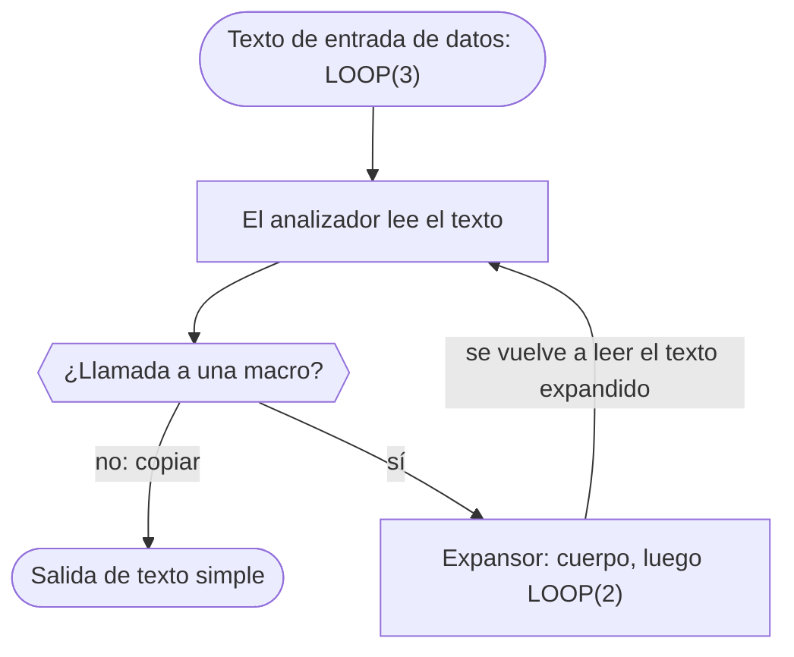
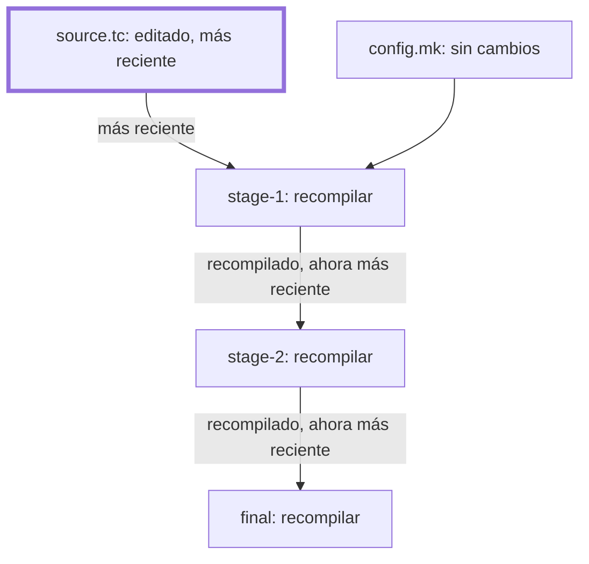

<!-- GENERADO por lessons/book/build.py a partir de lessons/cs-source/ y del frontmatter de las entradas. No lo edites; edita las fuentes y ejecuta build.py. -->

# Los lenguajes formales como sustratos de cómputo

Para una lectura avanzada con trazas y experimentos, consulta la [guía de estudio sobre lenguajes formales y máquinas raras](../guias-de-estudio/conceptos/lenguajes-formales-y-maquinas-raras.md) (*weird machines*, cómputos que surgen cuando una notación permite más de lo previsto).

Un lenguaje formal es una notación con reglas estrictas que una máquina puede procesar. En este repositorio se repite la misma sorpresa: una notación diseñada para *una* tarea resulta ser una computadora. Las expresiones regulares se diseñaron para buscar coincidencias en texto. Los motores de Perl, PCRE2 y .NET las convierten en máquinas de búsqueda, una pila y un contador. `sed` es un sistema de reescritura. Make y CMake se diseñaron para ordenar compilaciones y se convirtieron en un bucle que se reinicia y en una máquina de registros. XAML se diseñó para describir una interfaz de usuario y su analizador sintáctico ejecuta métodos.

Este capítulo explica la teoría: la jerarquía de Chomsky (¿qué potencia necesita una máquina para procesar una notación?), el análisis sintáctico, la reescritura, las macros y los lenguajes declarativos. También explica los intérpretes y las máquinas virtuales (una representación más algo que le da comportamiento). Incluye la teoría de categorías, de la cual una pequeña parte sirve para decir con exactitud qué conserva una canalización. Termina con dos ideas de seguridad que explican por qué esto importa fuera del libro. Si un lenguaje de entrada de datos tiene más poder del que sus autores creían, leer los datos de entrada equivale a ejecutar un programa. Consulta [seguridad basada en teoría de lenguajes](#seguridad-basada-en-teoría-de-lenguajes) y [máquinas raras](#máquinas-raras).

## La jerarquía de Chomsky

En 1956 Noam Chomsky ordenó los lenguajes formales en cuatro clases según su potencia: regulares, libres de contexto, sensibles al contexto y sin restricciones. Cada clase necesita una máquina más potente que la anterior. En orden, son un autómata finito, un autómata con pila (una máquina finita más una pila), una máquina de Turing acotada y una sin límites. La jerarquía responde una pregunta práctica: *¿cuánta máquina necesita esta notación?* Una expresión regular clásica no puede comprobar si los corchetes están balanceados, porque para eso necesita una pila. Los motores reales de expresiones regulares van más allá de la clase clásica. Los grupos de balanceo de .NET en [`regex-dotnet`](../../src/regex-dotnet/README.md) le dan al motor una pila de capturas. Esa es exactamente la potencia adicional.

- **Úsala cuando:** elijas una herramienta de análisis sintáctico o te preguntes si basta un patrón.
- **Evita usarla cuando:** necesites hacer el análisis sintáctico de formatos anidados como HTML con una expresión regular simple.

**Lee más:**

- [Jerarquía de Chomsky](https://en.wikipedia.org/wiki/Chomsky_hierarchy) (Wikipedia)
- [Lenguaje formal](https://en.wikipedia.org/wiki/Formal_language) (Wikipedia)
- [Autómata con pila](https://en.wikipedia.org/wiki/Pushdown_automaton) (Wikipedia)

**En este repositorio:**

| Entrada | Lenguaje | Cómo se relaciona | Qué enseña |
| --- | --- | --- | --- |
| [`regex-dotnet`](../../src/regex-dotnet/README.md) | C#, Regular expressions | demuestra | Que una expresión regular puede usar una pila para contar. |

## Expresiones regulares

Una expresión regular es un patrón compacto para un conjunto de cadenas de texto. Stephen Kleene describió la idea en la década de 1950. Ken Thompson la incorporó a los editores de texto. De allí llegó a `grep`, `sed`, `awk` y a todos los lenguajes modernos. Existe porque buscar texto es una de las tareas más comunes. Los motores modernos de expresiones regulares añaden funciones como las referencias hacia atrás, las comprobaciones de contexto y las llamadas a código (*callouts*). La mayoría funciona por *retroceso*: prueba un camino y, si falla, retrocede y prueba otro. Ese diseño le da potencia al motor y hace que algunos patrones sean muy lentos. Este repositorio usa cinco motores como cinco computadoras distintas. Consulta [la lección sobre expresiones regulares](../lenguajes/regex.md).

- **Úsalas cuando:** separes texto en unidades, valides un formato simple o busques en registros.
- **Evítalas cuando:** los datos estén anidados o un atacante elija la entrada de datos y el motor use retroceso (consulta [Denegación de servicio mediante expresiones regulares](08-fugas-de-abstraccion-y-dependencia-de-la-implementacion.md#denegación-de-servicio-mediante-expresiones-regulares)).

**Lee más:**

- [Expresión regular](https://en.wikipedia.org/wiki/Regular_expression) (Wikipedia)
- [Construcción de Thompson](https://en.wikipedia.org/wiki/Thompson%27s_construction) (Wikipedia)
- [Estrella de Kleene](https://en.wikipedia.org/wiki/Kleene_star) (Wikipedia)
- [Expresiones regulares](https://developer.mozilla.org/en-US/docs/Web/JavaScript/Guide/Regular_expressions) (MDN), una guía práctica de la notación

**En este repositorio:**

| Entrada | Lenguaje | Cómo se relaciona | Qué enseña |
| --- | --- | --- | --- |
| [`awk`](../../src/awk/README.md) | AWK | demuestra | Que AWK portable puede construir registros a partir de campos y enviar su salida por una tubería, con arreglos y variables locales de parámetro para el estado. |
| [`awk-weird`](../../src/awk-weird/README.md) | AWK | demuestra | Que una expresión regular como separador de registros convierte un flujo de bytes aleatorios en dados, y que el bucle principal implícito de awk más un patrón es un programa completo. |
| [`cmake`](../../src/cmake/README.md) | CMake | demuestra | Que `while()` y una regex pueden formar una pequeña máquina de registros. |
| [`ed-weird`](../../src/ed-weird/README.md) | ed, SQLite | demuestra | Que un editor de líneas es una máquina de reescritura: las líneas son los datos, las direcciones son el programa y una sustitución fallida dentro de un comando global es un "si". |
| [`find-gnu`](../../src/find-gnu/README.md) | find, SQLite | demuestra | Que los extras de GNU para find (profundidad de ruta, marcas de tiempo de los archivos, expresiones regulares y un perfilador integrado) pueden reemplazar una tabla entera de ramas, y que el optimizador de find no tiene nada que reordenar cuando cada rama termina en un efecto secundario. |
| [`regex-dotnet`](../../src/regex-dotnet/README.md) | C#, Regular expressions | demuestra | Que una expresión regular puede usar una pila para contar. |
| [`regex-pcre2`](../../src/regex-pcre2/README.md) | C, PCRE2, Regular expressions | demuestra | Que los callouts de regex pueden servir como un conjunto diminuto de instrucciones. |
| [`regex-pcre2grep`](../../src/regex-pcre2grep/README.md) | PCRE2, Regular expressions | demuestra | Que los códigos de salida de un programa pueden dirigir el flujo de control. |
| [`regex-perl`](../../src/regex-perl/README.md) | Perl, Regular expressions | demuestra | Que Perl puede ejecutar código durante una coincidencia de una expresión regular. |
| [`regex-sed`](../../src/regex-sed/README.md) | GNU sed, Regular expressions | demuestra | Que un programa puede ser una línea de texto que las sustituciones reescriben hasta que ninguna se aplique: un algoritmo de Markov, con una expresión regular de retroceso catastrófico como reloj. |

## Análisis sintáctico

El análisis sintáctico convierte texto en una estructura según una gramática. Existe porque los programas y los datos llegan como texto plano pero la computadora necesita un árbol. Hay analizadores sintácticos de *descenso recursivo* escritos a mano y otros que se generan. Toda herramienta de XML, JSON o de un lenguaje de programación tiene uno. JSON ilustra cómo se documenta con exactitud la gramática de un formato (RFC 8259). En el análisis sintáctico también se vuelve peligrosa la entrada de datos: ahí está el primer código que toca datos no confiables. Dos entradas muestran analizadores que hacen más que leer. En [`forth-weird`](../../src/forth-weird/README.md), el intérprete de texto analiza una palabra y la ejecuta enseguida. Así, el programa puede cambiar la posición de lectura del intérprete. En [`xaml`](../../src/xaml/README.md), el analizador sintáctico crea objetos *y llama a métodos* mientras lee el archivo.

- **Úsalo cuando:** aceptes una entrada de datos estructurados. Usa un verdadero analizador sintáctico y una gramática real.
- **Evita los atajos con `split` o una expresión regular:** pueden pasar por alto una estructura anidada. Mantén los efectos separados del análisis sintáctico.

**Lee más:**

- [Análisis sintáctico](https://en.wikipedia.org/wiki/Parsing) (Wikipedia)
- [Analizador sintáctico de descenso recursivo](https://en.wikipedia.org/wiki/Recursive_descent_parser) (Wikipedia)
- [RFC 8259: el formato JSON](https://www.rfc-editor.org/rfc/rfc8259), una gramática breve y precisa

**En este repositorio:**

| Entrada | Lenguaje | Cómo se relaciona | Qué enseña |
| --- | --- | --- | --- |
| [`forth-weird`](../../src/forth-weird/README.md) | Forth | demuestra | Que la posición de análisis del intérprete de texto es un contador de programa si lo permites, y que la pila de datos puede ser la única memoria de un programa. |
| [`regex-dotnet`](../../src/regex-dotnet/README.md) | C#, Regular expressions | demuestra | Que una expresión regular puede usar una pila para contar. |
| [`tar-gnu`](../../src/tar-gnu/README.md) | GNU tar, SQLite | demuestra | Que un archivo tar puede ser un programa serializado: tar lee los miembros en orden y solo el comando que indica el operador les da un efecto. |
| [`xaml`](../../src/xaml/README.md) | XAML, C# | demuestra | Que un analizador sintáctico de marcado puede ejecutar un programa mientras describe una interfaz de usuario. |

## Reescritura de términos y de cadenas de texto

Reescribir significa reemplazar partes de una estructura según unas reglas, una y otra vez, hasta que ya no se aplica ninguna. Un *término* es un árbol, como una expresión aritmética. Una *cadena de texto* es el caso especial en que la estructura es una línea de texto. Existe porque muchos tipos de cómputo son en realidad simplificación: el álgebra, el cálculo lambda, un compilador que optimiza, un filtro de texto que corrige la ortografía. Importan dos propiedades. ¿Siempre se detiene (*terminación*)? ¿Todos los órdenes de reescritura dan la misma respuesta (*confluencia*)? En este repositorio [`regex-sed`](../../src/regex-sed/README.md) y [`m4`](../../src/m4/README.md) son sistemas de reescritura, y la respuesta es simplemente el texto que queda.

- **Úsalo cuando:** simplifiques, normalices o traduzcas estructuras con reglas claras.
- **Evítalo cuando:** el orden de las reglas importe pero no esté escrito, o cuando la terminación no sea evidente.

**Más información:**

- [Reescritura](https://en.wikipedia.org/wiki/Rewriting) (Wikipedia)
- [Confluencia (reescritura abstracta)](https://en.wikipedia.org/wiki/Confluence_(abstract_rewriting)) (Wikipedia)
- [Algoritmos de Markov](02-que-cuenta-como-maquina.md#algoritmos-de-markov) en "¿Qué cuenta como una máquina?"

**En este repositorio:**

| Entrada | Lenguaje | Cómo se relaciona | Qué enseña |
| --- | --- | --- | --- |
| [`ed-weird`](../../src/ed-weird/README.md) | ed, SQLite | demuestra | Que un editor de líneas es una máquina de reescritura: las líneas son los datos, las direcciones son el programa y una sustitución fallida dentro de un comando global es un "si". |
| [`m4`](../../src/m4/README.md) | m4 | demuestra | Que un procesador de macros es un lenguaje de programación: no tiene sentencia de bucle ni variable, solo texto que se analiza de nuevo. |
| [`regex-sed`](../../src/regex-sed/README.md) | GNU sed, Regular expressions | demuestra | Que un programa puede ser una línea de texto que las sustituciones reescriben hasta que ninguna se aplique: un algoritmo de Markov, con una expresión regular de retroceso catastrófico como reloj. |

## Macros y expansión de texto

Una macro es un nombre que se sustituye por texto o código *antes* de que lo vea el lenguaje propiamente dicho. El preprocesador de C es el ejemplo más conocido. m4 es un procesador de macros de propósito general. Las macros de Lisp tratan el código como datos, en vez de texto. Permiten crear abstracciones fuera del alcance de las funciones: plantillas repetitivas, sintaxis nueva y código generado durante la compilación. [`m4`](../../src/m4/README.md) no tiene sentencias de bucle ni variables. Arma un bucle con una macro que aparece en su propio texto de reemplazo. Así, el analizador vuelve a leer la salida. [`lisp-weird`](../../src/lisp-weird/README.md) usa una macro `defcard` para escribir cinco clases y métodos similares durante la compilación.



La flecha importante es la que vuelve atrás. El expansor no se limita a imprimir el texto de reemplazo. Lo devuelve al analizador, que también expande cualquier llamada a una macro que aparezca en ese texto. Aquí `LOOP(3)` deja `LOOP(2)`. El proceso termina cuando el reemplazo queda sin llamadas a macros. [`m4`](../../src/m4/README.md) funciona así. Otros sistemas de macros quizá no vuelvan a leer su propia salida.

- **Úsalas cuando:** generes código repetitivo o definas un lenguaje pequeño sobre otro mayor.
- **Evítalas cuando:** baste una función común. Cuesta depurar los bichos de las macros y las macros de texto pueden capturar nombres por accidente. Las macros *higiénicas* al estilo de Lisp reducen ese peligro.

**Lee más:**

- [Macro (informática)](https://en.wikipedia.org/wiki/Macro_(computer_science)) (Wikipedia)
- [M4 (lenguaje de programación)](https://en.wikipedia.org/wiki/M4_(computer_language)) (Wikipedia)
- [Macro higiénica](https://en.wikipedia.org/wiki/Hygienic_macro) (Wikipedia)

**En este repositorio:**

| Entrada | Lenguaje | Cómo se relaciona | Qué enseña |
| --- | --- | --- | --- |
| [`lisp`](../../src/lisp/README.md) | Common Lisp | demuestra | Que `LOOP` de Common Lisp puede expresar un algoritmo completo como cláusulas para contar, tomar valores, sumar, recolectar y parar. |
| [`lisp-weird`](../../src/lisp-weird/README.md) | Common Lisp | demuestra | Que la combinación de métodos de CLOS es una estructura de control: una jerarquía de clases es un bucle y `or` es una regla de parada. |
| [`m4`](../../src/m4/README.md) | m4 | demuestra | Que un procesador de macros es un lenguaje de programación: no tiene sentencia de bucle ni variable, solo texto que se analiza de nuevo. |

## Programación declarativa

La programación declarativa dice *qué* quieres, no *cómo* obtenerlo. SQL, HTML, CSS, Make, las expresiones regulares y la columna de patrones de AWK son declarativos. Una herramienta que conoce la meta puede elegir el método: una base de datos elige el plan de consulta y `make` elige el orden de compilación. La trampa es creer que "declarativo" significa "inofensivo". Cuando una notación declarativa puede nombrar una función y pasarle argumentos, está a un paso de ser un programa. Sirven de ejemplo `ObjectDataProvider` de XAML y `include` de Make. [`xaml`](../../src/xaml/README.md) y [`make-gnu`](../../src/make-gnu/README.md) muestran adónde lleva ese paso.

- **Úsala cuando:** la tarea sea una consulta, una configuración o una compilación. Deja que la herramienta optimice.
- **Evítala cuando:** no puedas controlar qué puede llamar un archivo no confiable. Comprueba qué llamadas tiene permitidas.

**Lee más:**

- [Programación declarativa](https://en.wikipedia.org/wiki/Declarative_programming) (Wikipedia)
- [Regla de la menor potencia](https://en.wikipedia.org/wiki/Rule_of_least_power) (Wikipedia)

**En este repositorio:**

| Entrada | Lenguaje | Cómo se relaciona | Qué enseña |
| --- | --- | --- | --- |
| [`awk`](../../src/awk/README.md) | AWK | demuestra | Que AWK portable puede construir registros a partir de campos y enviar su salida por una tubería, con arreglos y variables locales de parámetro para el estado. |
| [`awk-weird`](../../src/awk-weird/README.md) | AWK | demuestra | Que una expresión regular como separador de registros convierte un flujo de bytes aleatorios en dados, y que el bucle principal implícito de awk más un patrón es un programa completo. |
| [`cobol`](../../src/cobol/README.md) | COBOL | demuestra | Que una regla de parada se puede declarar como datos, y que la imagen de un número puede encargarse de tu redondeo. |
| [`LinqChallenge2`](../../src/LinqChallenge2/README.md) | C#, LINQ | demuestra | Que la sintaxis de consulta de C# puede expresar el cálculo y ordenar sus efectos. |
| [`make-gnu`](../../src/make-gnu/README.md) | GNU Make | demuestra | Que GNU Make puede hacer aritmética y bucles con su propia sintaxis, sin un intérprete de comandos para ninguno de los dos. Un intérprete de comandos es el programa que recibe y ejecuta los comandos que escribes. |
| [`xaml`](../../src/xaml/README.md) | XAML, C# | demuestra | Que un analizador sintáctico de marcado puede ejecutar un programa mientras describe una interfaz de usuario. |

## Lenguajes específicos de dominio

Un lenguaje específico de dominio (DSL) es un lenguaje pequeño para una clase de tarea. SQL sirve para consultas, las expresiones regulares para patrones, Make para compilaciones, AWK para registros y la sintaxis de consultas de LINQ para colecciones. Una herramienta que habla con el vocabulario del problema es más breve, más fácil de leer y a menudo más segura que el código de propósito general. Hay un peligro clásico. Los usuarios piden variables, luego condiciones y después bucles. Sin querer, el DSL acaba convertido en un lenguaje de propósito general, con menos herramientas y peores mensajes de error. Quienes programan lo llaman el *efecto de plataforma interna*. La mayoría de las entradas de aquí son DSL que cruzaron esa línea. Por eso fue divertido escribirlas.

- **Úsalos cuando:** el dominio tenga un vocabulario estable y lo usen muchas personas.
- **Evítalos cuando:** una biblioteca en un lenguaje común haga lo mismo. Si tu DSL necesita bucles, vuelve a considerar la posibilidad de integrarlo en un lenguaje de propósito general.

**Lee más:**

- [Lenguaje específico de dominio](https://en.wikipedia.org/wiki/Domain-specific_language) (Wikipedia)
- [Efecto de plataforma interna](https://en.wikipedia.org/wiki/Inner-platform_effect) (Wikipedia)

**En este repositorio:**

| Entrada | Lenguaje | Cómo se relaciona | Qué enseña |
| --- | --- | --- | --- |
| [`awk`](../../src/awk/README.md) | AWK | demuestra | Que AWK portable puede construir registros a partir de campos y enviar su salida por una tubería, con arreglos y variables locales de parámetro para el estado. |
| [`cmake`](../../src/cmake/README.md) | CMake | demuestra | Que `while()` y una regex pueden formar una pequeña máquina de registros. |
| [`find-gnu`](../../src/find-gnu/README.md) | find, SQLite | demuestra | Que los extras de GNU para find (profundidad de ruta, marcas de tiempo de los archivos, expresiones regulares y un perfilador integrado) pueden reemplazar una tabla entera de ramas, y que el optimizador de find no tiene nada que reordenar cuando cada rama termina en un efecto secundario. |
| [`find-posix`](../../src/find-posix/README.md) | find, SQLite | demuestra | Que un recorrido de directorios puede ser un bucle y un programa: find cava el árbol que está recorriendo, y la ruta al directorio actual es toda la máquina. |
| [`LinqChallenge2`](../../src/LinqChallenge2/README.md) | C#, LINQ | demuestra | Que la sintaxis de consulta de C# puede expresar el cálculo y ordenar sus efectos. |
| [`lisp`](../../src/lisp/README.md) | Common Lisp | demuestra | Que `LOOP` de Common Lisp puede expresar un algoritmo completo como cláusulas para contar, tomar valores, sumar, recolectar y parar. |
| [`regex-pcre2`](../../src/regex-pcre2/README.md) | C, PCRE2, Regular expressions | demuestra | Que los callouts de regex pueden servir como un conjunto diminuto de instrucciones. |
| [`tar-gnu`](../../src/tar-gnu/README.md) | GNU tar, SQLite | demuestra | Que un archivo tar puede ser un programa serializado: tar lee los miembros en orden y solo el comando que indica el operador les da un efecto. |

## Lenguajes de marcado

Un lenguaje de marcado es texto con anotaciones que describen su estructura: HTML, XML, Markdown y XAML. Permite que personas y herramientas compartan un mismo documento y que el contenido quede separado de la presentación. XAML describe un árbol de objetos de interfaz de usuario y un cargador crea los objetos. Un formato que puede nombrar *tipos* y *métodos* entraña un peligro. En ese caso, cargar un archivo significa ejecutar código que eligió su autor. Esa es la idea detrás de muchos ataques de deserialización. Es justo lo que hace [`xaml`](../../src/xaml/README.md) a propósito. Todo el comportamiento del programa está en un solo archivo de marcado y se ejecuta durante su análisis sintáctico.

- **Úsalo cuando:** describas documentos o datos que deban leer tanto las personas como las herramientas.
- **Evítalo cuando:** un documento no confiable pueda elegir tipos arbitrarios o llamar a métodos arbitrarios. Usa una lista de elementos permitidos.

**Lee más:**

- [Lenguaje de marcado](https://en.wikipedia.org/wiki/Markup_language) (Wikipedia)
- [XAML](https://en.wikipedia.org/wiki/XAML) (Wikipedia)
- [Ataque de entidad externa XML](https://en.wikipedia.org/wiki/XML_external_entity_attack) (Wikipedia)
- [Guía rápida de deserialización](https://cheatsheetseries.owasp.org/cheatsheets/Deserialization_Cheat_Sheet.html) (OWASP), sobre cómo cargar datos con seguridad

**En este repositorio:**

| Entrada | Lenguaje | Cómo se relaciona | Qué enseña |
| --- | --- | --- | --- |
| [`ModernChallenge1`](../../src/ModernChallenge1/README.md) | C# | demuestra | Que una sentencia `for` con el cuerpo vacío puede controlar XAML en tiempo de ejecución, LINQ to Objects, EF Core y la animación de WPF. |
| [`xaml`](../../src/xaml/README.md) | XAML, C# | demuestra | Que un analizador sintáctico de marcado puede ejecutar un programa mientras describe una interfaz de usuario. |

## Automatización de la compilación

Las herramientas de automatización de la compilación solo reconstruyen lo que cambió y siguen el orden de las dependencias. El ejemplo clásico es Make, creado en Bell Labs en 1976. CMake y Gradle son ejemplos modernos. Existen porque compilar todo cada vez es lento y porque compilar en el orden equivocado da mal resultado. El estado de una compilación son *archivos*: cuáles existen y cuáles son más recientes que sus dependencias. Eso convierte a una herramienta de compilación en una computadora extraña. [`make-gnu`](../../src/make-gnu/README.md) cuenta con archivos que crea de uno en uno en cada vuelta. Para repetir el bucle, hace que Make vuelva a leer un makefile generado. [`cmake`](../../src/cmake/README.md) forma un bucle con un `while()` cuya expresión regular deja los resultados en variables.



La herramienta compara las fechas de los archivos siguiendo las flechas. `source.tc` es más reciente que `stage-1`, así que `stage-1` queda obsoleto y se recompila. Así se vuelve más reciente que `stage-2` y el proceso sigue por la cadena. `config.mk` no cambió, así que no hay trabajo por hacer ahí. La herramienta decide qué ejecutar y en qué orden. No pasa valores de un paso al siguiente como lo hace [Programación por flujo de datos](04-evaluacion-y-demanda.md#programación-por-flujo-de-datos). Algunas entradas convierten este mecanismo de decisión en un bucle. [`make-gnu`](../../src/make-gnu/README.md) vuelve a crear un makefile generado y luego empieza de nuevo el recorrido.

- **Úsala cuando:** compiles, empaquetes o generes archivos a partir de otros archivos.
- **Evita usarla como computadora de propósito general.** Las marcas de tiempo pueden tener poca resolución (WSL y algunos sistemas de archivos). Una compilación que depende de estado oculto no es reproducible.

**Lee más:**

- [Automatización de la compilación](https://en.wikipedia.org/wiki/Build_automation) (Wikipedia)
- [Make (programa)](https://en.wikipedia.org/wiki/Make_(software)) (Wikipedia)
- [Compilaciones reproducibles](https://en.wikipedia.org/wiki/Reproducible_builds) (Wikipedia), la idea detrás de la compilación determinista de este libro

**En este repositorio:**

| Entrada | Lenguaje | Cómo se relaciona | Qué enseña |
| --- | --- | --- | --- |
| [`cmake`](../../src/cmake/README.md) | CMake | demuestra | Que `while()` y una regex pueden formar una pequeña máquina de registros. |
| [`make-gnu`](../../src/make-gnu/README.md) | GNU Make | demuestra | Que GNU Make puede hacer aritmética y bucles con su propia sintaxis, sin un intérprete de comandos para ninguno de los dos. Un intérprete de comandos es el programa que recibe y ejecuta los comandos que escribes. |

## Seguridad basada en teoría de lenguajes

La seguridad basada en teoría de lenguajes (LangSec) es una forma de pensar en la seguridad. Cada formato de entrada de datos es un lenguaje formal: el código que lo lee es el encargado de reconocerlo. Muchos ataques funcionan porque dos analizadores sintácticos leen los mismos bytes de forma distinta. Otros funcionan porque el lenguaje de entrada es tan potente que nadie puede decir qué hará. De ahí el consejo: mantén los formatos simples (consulta [Completitud de Turing](02-que-cuenta-como-maquina.md#completitud-de-turing)) y termina todo el análisis sintáctico *antes* de actuar. Usa un solo analizador sintáctico bien probado. Este enfoque también critica el viejo "principio de robustez", *sé flexible con lo que aceptas*, porque la flexibilidad da más significados a los mismos bytes. El IETF también ha vuelto a examinar ese principio.

- **Úsala cuando:** diseñes un formato de archivo, un protocolo o una API o revises código que lee una entrada de datos.
- **Evítala cuando:** el diseño exija aceptar una entrada de datos "casi válida" o mezclar el análisis sintáctico con el procesamiento.

**Lee más:**

- [Seguridad basada en teoría de lenguajes](https://en.wikipedia.org/wiki/Language-theoretic_security) (Wikipedia)
- [Principio de robustez](https://en.wikipedia.org/wiki/Robustness_principle) (Wikipedia)
- [RFC 9413: Cómo mantener protocolos robustos](https://www.rfc-editor.org/rfc/rfc9413), la visión moderna del principio según el IETF

**En este repositorio:**

| Entrada | Lenguaje | Cómo se relaciona | Qué enseña |
| --- | --- | --- | --- |
| [`tar-gnu`](../../src/tar-gnu/README.md) | GNU tar, SQLite | demuestra | Que un archivo tar puede ser un programa serializado: tar lee los miembros en orden y solo el comando que indica el operador les da un efecto. |
| [`xaml`](../../src/xaml/README.md) | XAML, C# | demuestra | Que un analizador sintáctico de marcado puede ejecutar un programa mientras describe una interfaz de usuario. |

## Máquinas raras

"Máquina rara" (*weird machine*) es un término de la investigación en seguridad. Un programa tiene la máquina que sus autores quisieron, y también tiene *otra* máquina, hecha con las mismas piezas, que un atacante puede manejar con una entrada de datos preparada. En la programación orientada al retorno, por ejemplo, un atacante encadena trozos pequeños de código existente para formar un programa nuevo. El término existe para explicar por qué "solo debía analizar un archivo" no es un argumento de seguridad. Cada entrada de este repositorio es una máquina rara hecha a propósito, en un lugar seguro: un motor de expresiones regulares que cuenta, un analizador sintáctico que hace bucles, una herramienta de compilación que se reinicia. Cada una plantea al revés la pregunta de la lección: *¿qué hará este programa según la entrada de datos que reciba?*

- **Úsalo cuando:** revises una superficie de ataque, y cuando quieras entender cómo calcula una función "inofensiva".
- **Evita construirlas en producción.** Si debes hacerlo, describe la máquina en el README, como hacen las entradas de aquí.

**Más información:**

- [Máquina rara](https://en.wikipedia.org/wiki/Weird_machine) (Wikipedia)
- [Programación orientada al retorno](https://en.wikipedia.org/wiki/Return-oriented_programming) (Wikipedia)
- [Seguridad basada en teoría de lenguajes](05-lenguajes-formales-como-sustratos-de-computacion.md#seguridad-basada-en-teoría-de-lenguajes)

**En este repositorio:**

| Entrada | Lenguaje | Cómo se relaciona | Qué enseña |
| --- | --- | --- | --- |
| [`ed-weird`](../../src/ed-weird/README.md) | ed, SQLite | demuestra | Que un editor de líneas es una máquina de reescritura: las líneas son los datos, las direcciones son el programa y una sustitución fallida dentro de un comando global es un "si". |
| [`ex-weird`](../../src/ex-weird/README.md) | Ex, SQLite | demuestra | Que los registros de un editor pueden contener un programa: una línea de texto se copia en un registro y se ejecuta con @, y las marcas y las direcciones de línea del propio editor hacen la aritmética. |
| [`find-gnu`](../../src/find-gnu/README.md) | find, SQLite | demuestra | Que los extras de GNU para find (profundidad de ruta, marcas de tiempo de los archivos, expresiones regulares y un perfilador integrado) pueden reemplazar una tabla entera de ramas, y que el optimizador de find no tiene nada que reordenar cuando cada rama termina en un efecto secundario. |
| [`find-posix`](../../src/find-posix/README.md) | find, SQLite | demuestra | Que un recorrido de directorios puede ser un bucle y un programa: find cava el árbol que está recorriendo, y la ruta al directorio actual es toda la máquina. |
| [`xaml`](../../src/xaml/README.md) | XAML, C# | demuestra | Que un analizador sintáctico de marcado puede ejecutar un programa mientras describe una interfaz de usuario. |

## Teoría de categorías

La teoría de categorías estudia la matemática de las **cosas y las flechas entre ellas** y cómo se componen esas flechas. Una **categoría** tiene *objetos* y *morfismos* (flechas). Cada morfismo va de un objeto a otro. Se cumplen dos reglas:

1. **Identidad.** Cada objeto tiene una flecha hacia sí mismo que no cambia nada: `id`.
2. **Composición.** Si `f : A → B` y `g : B → C`, entonces existe `g ∘ f : A → C`. La composición es asociativa: `h ∘ (g ∘ f) = (h ∘ g) ∘ f`. Y `f ∘ id = f = id ∘ f`.

En programación, la categoría habitual tiene *tipos* como objetos y *funciones* como flechas. Las reglas dicen algo que ya usas. Puedes encadenar funciones y agrupar la cadena con paréntesis donde quieras. Una función que devuelve su entrada de datos no cambia nada.

```haskell
-- Haskell: composition is a function, and the laws are things you can test.
(show . (+ 1)) 41          -- "42"
(id . show) 42 == show 42   -- True: identity
```

```python
# Python: the same idea. compose(g, f)(x) is g(f(x)).
compose = lambda g, f: lambda x: g(f(x))
assert compose(str, lambda n: n + 1)(41) == "42"
```

El vocabulario viene con tres advertencias sinceras:

- **Sirve para mirar, no para etiquetar.** Puedes *describir* muchas canalizaciones como flechas entre tipos. Eso no convierte a cada operador de LINQ, cada `map` o cada `INSERT ... SELECT` en parte formal de una categoría. Una afirmación como "esto es un funtor" trae consigo leyes que se deben cumplir.
- **La sintaxis no es la estructura.** Dos operaciones llamadas `map` pueden diferir en el grado de evaluación perezosa, en el orden de sus efectos y en lo que hacen con una entrada de datos vacía. Mismo nombre, misma forma, distinto comportamiento. Las leyes deciden y los nombres no.
- **Un viaje de ida y vuelta no implica un isomorfismo.** Un *isomorfismo* es un par de flechas `f` y `g` con `g ∘ f = id` y `f ∘ g = id`. Un codificador y un decodificador (consulta [Serialización, deserialización y pickling de objetos](06-estado-mas-alla-de-las-variables.md#serialización-deserialización-y-pickling-de-objetos)) forman uno solo si se cumplen ambas leyes. Muchos códecs solo cumplen la segunda ley para algunos valores.

Este libro usa las ideas donde una entrada les da algo concreto a lo que aferrarse. [`haskell`](../../src/haskell/README.md) compone funciones puras pequeñas. [`LinqChallenge1`](../../src/LinqChallenge1/README.md) encadena operadores de consulta. Las páginas siguientes, [Funtores y mapeo](04-evaluacion-y-demanda.md#funtores-y-mapeo) y [Monoides y plegados](04-evaluacion-y-demanda.md#monoides-y-plegados), nombran dos leyes que permiten reorganizar esas cadenas con seguridad.

- **Úsala cuando:** quieras decir con precisión qué conserva una canalización. También cuando dos diseños se parezcan y necesites saber si se comportan igual.
- **Evítala cuando:** el vocabulario sustituya a la explicación. Si una frase sencilla dice lo mismo, escribe esa frase.

**Lee más:**

- [Teoría de categorías](https://en.wikipedia.org/wiki/Category_theory) (Wikipedia)
- [Categoría (matemáticas)](https://en.wikipedia.org/wiki/Category_(mathematics)) (Wikipedia)
- [Composición de funciones](https://en.wikipedia.org/wiki/Function_composition) (Wikipedia)
- [Isomorfismo](https://en.wikipedia.org/wiki/Isomorphism) (Wikipedia)

**En este repositorio:**

| Entrada | Lenguaje | Cómo se relaciona | Qué enseña |
| --- | --- | --- | --- |
| [`haskell`](../../src/haskell/README.md) | Haskell | analogía | Que una lista perezosa y un solo `span` son toda la regla de parada. |
| [`javascript-weird`](../../src/javascript-weird/README.md) | JavaScript, SQLite | analogía | Que una clausura es una máquina de estados: una función más las variables junto a las que se creó, que un iterador hace avanzar un paso a la vez, con reduce como el único pliegue que no puede detenerse. |
| [`LinqChallenge1`](../../src/LinqChallenge1/README.md) | C#, LINQ | analogía | Que una cadena de métodos de LINQ puede expresar el programa completo. |

## Intérpretes y máquinas virtuales

Un **intérprete** lee un programa como datos y hace lo que este indica, paso a paso. Una **máquina virtual** es un intérprete para un conjunto pequeño y fijo de instrucciones. Ambos se valen del mismo truco: una *representación* (texto, registros o bytes) junto con un *programa que le da comportamiento*. Quita el intérprete y solo quedan los datos.

Varias entradas son intérpretes a pequeña escala. En [`tar-gnu`](../../src/tar-gnu/README.md), el programa está formado por los miembros de un archivo tar. Un despachador de unas 80 líneas da sentido a cuatro tipos de registro. Comprueba cada registro contra una gramática estricta y rechaza los que no reconoce. En [`tcl-weird`](../../src/tcl-weird/README.md), el código fuente Tcl se guarda en filas de SQLite. Una versión redefinida del comando `unknown` lo recupera y lo ejecuta. En [`xaml`](../../src/xaml/README.md), el analizador sintáctico que carga el documento es el intérprete que lo ejecuta. En [`regex-pcre2`](../../src/regex-pcre2/README.md), las cadenas de texto de los callouts son códigos de operación y una función de C sin cuerpo actúa como despachador. En [`ex-weird`](../../src/ex-weird/README.md), Ex es el intérprete y un registro de texto es el programa. El propio programa lo reescribe y lo vuelve a ejecutar. En cada caso, hazte la misma pregunta. ¿Cuál es la representación, cuál es el intérprete y quién decidió ejecutar la primera con el segundo?

- **Úsalos cuando:** sea más fácil modificar un programa como datos que como código o quieras que otros escriban en un lenguaje pequeño y seguro.
- **Evítalos cuando:** los datos vengan de alguien en quien no confías y el intérprete sea de propósito general. Una gramática estricta y un conjunto fijo de instrucciones impiden que un formato de datos se convierta en una vía de entrada.

**Lee más:**

- [Intérprete (informática)](https://en.wikipedia.org/wiki/Interpreter_(computing)) (Wikipedia)
- [Máquina virtual](https://en.wikipedia.org/wiki/Virtual_machine) (Wikipedia)

**En este repositorio:**

| Entrada | Lenguaje | Cómo se relaciona | Qué enseña |
| --- | --- | --- | --- |
| [`ex-weird`](../../src/ex-weird/README.md) | Ex, SQLite | demuestra | Que los registros de un editor pueden contener un programa: una línea de texto se copia en un registro y se ejecuta con @, y las marcas y las direcciones de línea del propio editor hacen la aritmética. |
| [`regex-pcre2`](../../src/regex-pcre2/README.md) | C, PCRE2, Regular expressions | demuestra | Que los callouts de regex pueden servir como un conjunto diminuto de instrucciones. |
| [`tar-gnu`](../../src/tar-gnu/README.md) | GNU tar, SQLite | demuestra | Que un archivo tar puede ser un programa serializado: tar lee los miembros en orden y solo el comando que indica el operador les da un efecto. |
| [`tcl-weird`](../../src/tcl-weird/README.md) | Tcl, SQLite | demuestra | Que el código Tcl se compone solo de cadenas de texto. Por eso puede residir en una base de datos, recuperarse, definirse y ejecutarse bajo demanda. Los disparadores de SQLite determinan el flujo de control. |
| [`xaml`](../../src/xaml/README.md) | XAML, C# | demuestra | Que un analizador sintáctico de marcado puede ejecutar un programa mientras describe una interfaz de usuario. |
