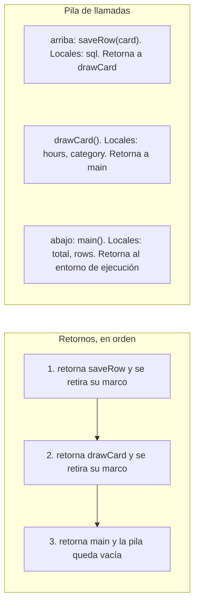
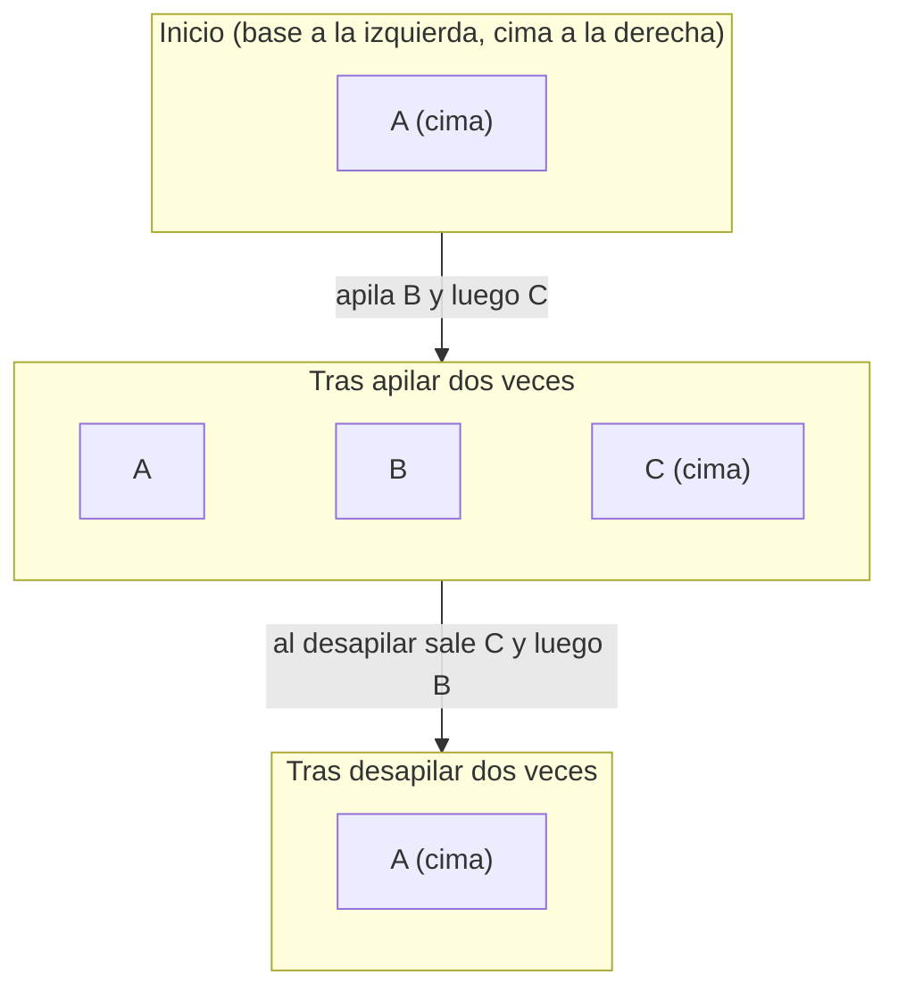
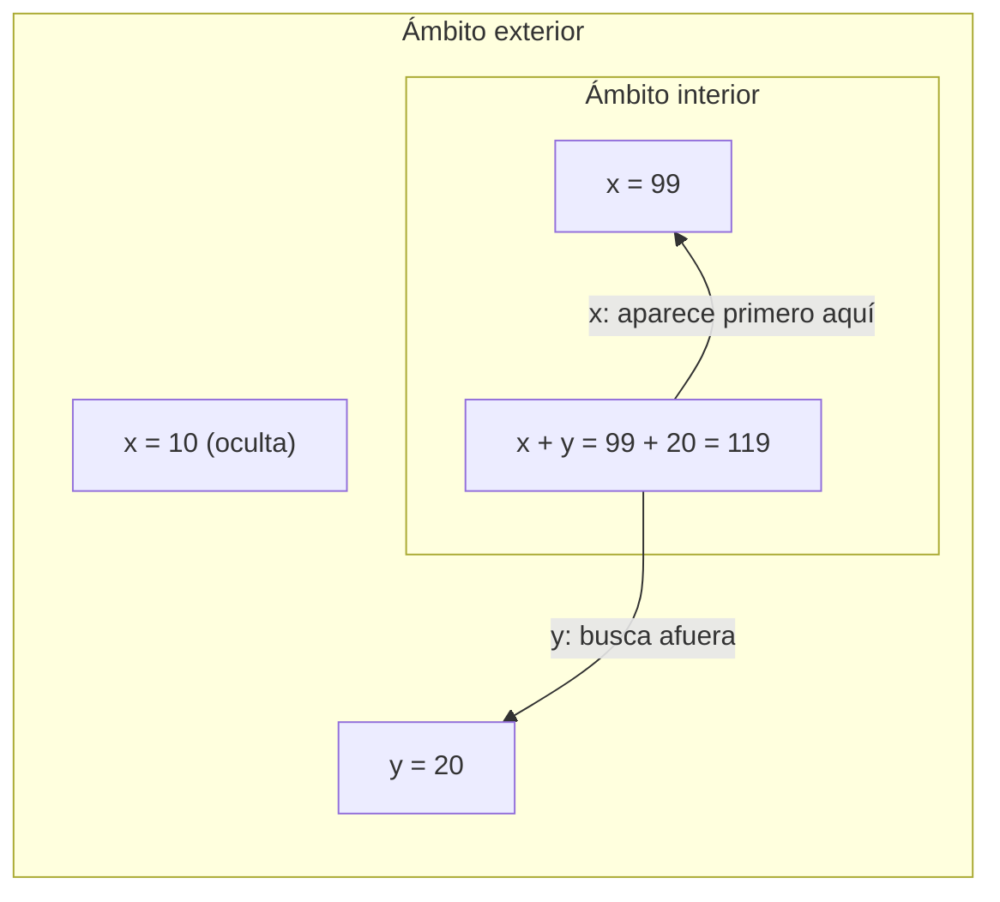
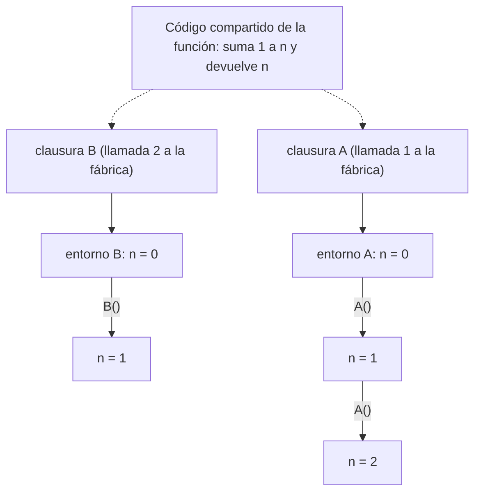
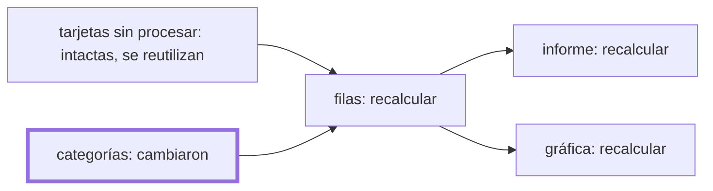
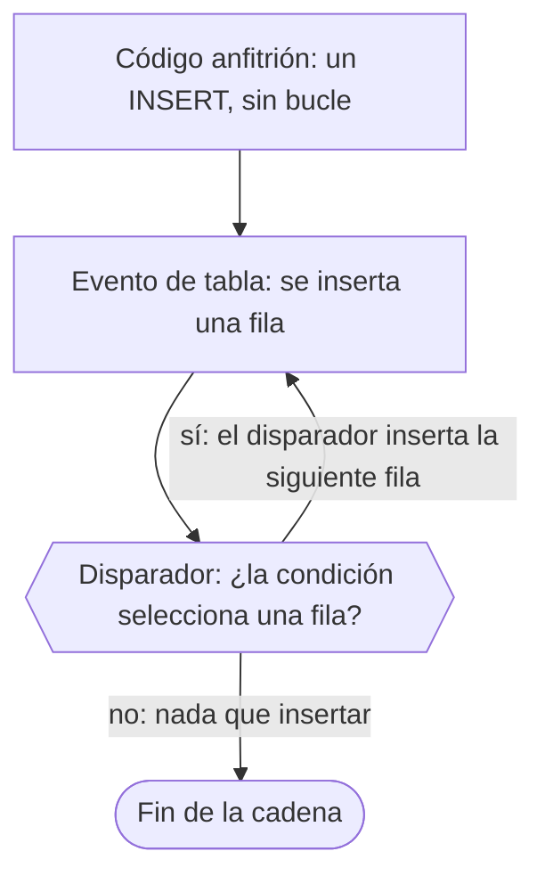
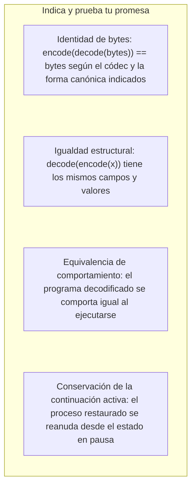

<!-- GENERADO por lessons/book/build.py a partir de lessons/cs-source/ y del frontmatter de las entradas. No lo edites; edita las fuentes y ejecuta build.py. -->

# Estado más allá de las variables

Para una lectura avanzada con trazas y experimentos, consulta la [guía de estudio sobre el estado y el control más allá de las variables](../guias-de-estudio/conceptos/estado-y-control-mas-alla-de-las-variables.md).

Si un lenguaje no tiene variables o si no se te permite usarlas, ¿dónde puede guardar un programa lo que recuerda? Este capítulo reúne las respuestas. Una pila de marcas. Una línea de texto que las sustituciones reescriben. Qué archivos existen en el disco. Las capturas que deja una expresión regular. El texto fuente de las funciones. Una tabla temporal de procedimientos. La profundidad de recursión de un disparador. Un montón de caracteres `x`.

Ninguno de estos mecanismos parece un "estado" como lo parece una variable, pero todos lo son. En los conceptos que siguen verás dónde puede esconderse: en la pila de llamadas, en la pila como estructura de datos, en el ámbito y en la vinculación. También en las clausuras (*closure*, una función junto con su entorno), en el código como datos, en la reflexión, en los grafos de dependencias y en los disparadores de bases de datos. También en la serialización: cómo escribir un programa o un estado como bytes y qué hace falta para volver a leerlo y ejecutarlo. El primer concepto es el propio estado. La lección es un hábito: para cada programa, pregunta *¿dónde vive?* Encontrarás una tabla con las respuestas de las entradas en [Por objetivo](../objetivos.md).

## Estado

El estado es todo lo que un programa recuerda entre un paso y otro. Sin él, no se podría calcular nada. La pregunta interesante es *dónde vive*: en variables, en una pila, en el montón, en un archivo, en una base de datos, en una variable de entorno o en la red. El primer objetivo de este libro es hacer esa pregunta sobre cada programa. Las respuestas aquí sorprenden. El estado vive en el destino de un `GO TO`, en una línea de texto, en los archivos que existen en el disco, en las capturas de una expresión regular, en el texto de las funciones, en el flujo de entrada y en la profundidad de la recursión de los disparadores. Mira la tabla en [Por objetivo](../objetivos.md).

- **Úsalo cuando:** quieras un estado explícito, pequeño y cercano al lugar donde se usa.
- **Evita el estado oculto y el estado global.** Es difícil de probar, de compartir y de razonar.

**Más información:**

- [Estado (informática)](https://en.wikipedia.org/wiki/State_(computer_science)) (Wikipedia)
- [Sistema de archivos](https://en.wikipedia.org/wiki/File_system) (Wikipedia), donde la entrada de Make guarda su estado
- [Variable global](https://en.wikipedia.org/wiki/Global_variable) (Wikipedia)

**En este repositorio:**

| Entrada | Lenguaje | Cómo se relaciona | Qué enseña |
| --- | --- | --- | --- |
| [`apl-weird`](../../src/apl-weird/README.md) | APL | demuestra | Que `⎕CR`, `⎕FX` y la compresión vuelven opcionales el "if" y el "bucle", y que una función puede ser su propia sucesora. |
| [`awk-weird`](../../src/awk-weird/README.md) | AWK | demuestra | Que una expresión regular como separador de registros convierte un flujo de bytes aleatorios en dados, y que el bucle principal implícito de awk más un patrón es un programa completo. |
| [`cmake`](../../src/cmake/README.md) | CMake | demuestra | Que `while()` y una regex pueden formar una pequeña máquina de registros. |
| [`cobol-weird`](../../src/cobol-weird/README.md) | COBOL | demuestra | Que un programa puede reescribir su propio flujo de control y que la programación estructurada facilita trazar esos cambios. |
| [`ed-weird`](../../src/ed-weird/README.md) | ed, SQLite | demuestra | Que un editor de líneas es una máquina de reescritura: las líneas son los datos, las direcciones son el programa y una sustitución fallida dentro de un comando global es un "si". |
| [`ex-weird`](../../src/ex-weird/README.md) | Ex, SQLite | demuestra | Que los registros de un editor pueden contener un programa: una línea de texto se copia en un registro y se ejecuta con @, y las marcas y las direcciones de línea del propio editor hacen la aritmética. |
| [`forth-weird`](../../src/forth-weird/README.md) | Forth | demuestra | Que la posición de análisis del intérprete de texto es un contador de programa si lo permites, y que la pila de datos puede ser la única memoria de un programa. |
| [`haskell-weird`](../../src/haskell-weird/README.md) | Haskell | demuestra | Que leer una lista perezosa puede dirigir un programa cuando forzar cada elemento tiene un efecto secundario. |
| [`javascript`](../../src/javascript/README.md) | JavaScript, SQLite | demuestra | Que una sentencia for consta de tres expresiones y un cuerpo vacío, y que el orden de evaluación propio de JavaScript, la veracidad de los valores y el operador coma bastan para ejecutar un programa completo a partir de las tres cláusulas. |
| [`javascript-events`](../../src/javascript-events/README.md) | JavaScript, SQLite | demuestra | Que un programa puede ser un conjunto de escuchadores de eventos, cada uno con una sola tarea pequeña que termina emitiendo el evento que espera el siguiente; y que emit() llama a sus escuchadores de inmediato, así que solo un límite de planificación explícito da un turno al bucle de eventos. |
| [`javascript-weird`](../../src/javascript-weird/README.md) | JavaScript, SQLite | demuestra | Que una clausura es una máquina de estados: una función más las variables junto a las que se creó, que un iterador hace avanzar un paso a la vez, con reduce como el único pliegue que no puede detenerse. |
| [`lisp-weird`](../../src/lisp-weird/README.md) | Common Lisp | demuestra | Que la combinación de métodos de CLOS es una estructura de control: una jerarquía de clases es un bucle y `or` es una regla de parada. |
| [`m4`](../../src/m4/README.md) | m4 | demuestra | Que un procesador de macros es un lenguaje de programación: no tiene sentencia de bucle ni variable, solo texto que se analiza de nuevo. |
| [`make-gnu`](../../src/make-gnu/README.md) | GNU Make | demuestra | Que GNU Make puede hacer aritmética y bucles con su propia sintaxis, sin un intérprete de comandos para ninguno de los dos. Un intérprete de comandos es el programa que recibe y ejecuta los comandos que escribes. |
| [`regex-dotnet`](../../src/regex-dotnet/README.md) | C#, Regular expressions | demuestra | Que una expresión regular puede usar una pila para contar. |
| [`regex-pcre2`](../../src/regex-pcre2/README.md) | C, PCRE2, Regular expressions | demuestra | Que los callouts de regex pueden servir como un conjunto diminuto de instrucciones. |
| [`regex-perl`](../../src/regex-perl/README.md) | Perl, Regular expressions | demuestra | Que Perl puede ejecutar código durante una coincidencia de una expresión regular. |
| [`regex-sed`](../../src/regex-sed/README.md) | GNU sed, Regular expressions | demuestra | Que un programa puede ser una línea de texto que las sustituciones reescriben hasta que ninguna se aplique: un algoritmo de Markov, con una expresión regular de retroceso catastrófico como reloj. |
| [`tar-gnu-weird`](../../src/tar-gnu-weird/README.md) | GNU tar, SQLite | demuestra | Que la disposición física de un archivo puede marcar el ritmo de un programa: los puntos de control de tar son un reloj y cada pulso hace avanzar un paso a una máquina de estados. |
| [`tcl-weird`](../../src/tcl-weird/README.md) | Tcl, SQLite | demuestra | Que el código Tcl se compone solo de cadenas de texto. Por eso puede residir en una base de datos, recuperarse, definirse y ejecutarse bajo demanda. Los disparadores de SQLite determinan el flujo de control. |
| [`xaml`](../../src/xaml/README.md) | XAML, C# | demuestra | Que un analizador sintáctico de marcado puede ejecutar un programa mientras describe una interfaz de usuario. |

## La pila de llamadas

La pila de llamadas es una pila de *marcos*. Cada llamada a una función que sigue activa tiene un marco. Este guarda su dirección de retorno y sus variables locales. Así una función puede llamar a otra y la recursión funciona. Para la mayoría de los programadores, la pila de llamadas *es* la respuesta a "¿en qué parte del programa estoy?". Varias entradas prescinden de ella o la esquivan. Un script de sed no hace llamadas. m4 y Make repiten al volver a leer texto. En [`tcl-weird`](../../src/tcl-weird/README.md), el límite a la recursión de disparadores lo impone la base de datos y no una pila que puedas ver.



Cada llamada activa tiene su propio marco y el marco más reciente queda arriba. Cuando `saveRow` retorna, se retira su marco. La ejecución sigue en la dirección de retorno que guardaba el marco, dentro de `drawCard`. Los nombres son ejemplos. La estructura exacta de un marco varía entre lenguajes y procesadores. Consulta [La pila como estructura de datos](06-estado-mas-alla-de-las-variables.md#la-pila-como-estructura-de-datos) para ver la idea general de una pila.

- **Úsala cuando:** leas una traza de pila o razones sobre la profundidad de la recursión.
- **Evítala cuando:** la profundidad de la recursión no tenga límite. Un desbordamiento de pila termina el programa. En lenguajes sin garantías de seguridad, puede abrir una brecha de seguridad.

**Lee más:**

- [Pila de llamadas](https://en.wikipedia.org/wiki/Call_stack) (Wikipedia)
- [Desbordamiento de búfer en la pila](https://en.wikipedia.org/wiki/Stack_buffer_overflow) (Wikipedia)
- [Llamada de cola](https://en.wikipedia.org/wiki/Tail_call) (Wikipedia)

**En este repositorio:**

| Entrada | Lenguaje | Cómo se relaciona | Qué enseña |
| --- | --- | --- | --- |
| [`find-gnu`](../../src/find-gnu/README.md) | find, SQLite | demuestra | Que los extras de GNU para find (profundidad de ruta, marcas de tiempo de los archivos, expresiones regulares y un perfilador integrado) pueden reemplazar una tabla entera de ramas, y que el optimizador de find no tiene nada que reordenar cuando cada rama termina en un efecto secundario. |
| [`find-posix`](../../src/find-posix/README.md) | find, SQLite | demuestra | Que un recorrido de directorios puede ser un bucle y un programa: find cava el árbol que está recorriendo, y la ruta al directorio actual es toda la máquina. |
| [`javascript-events`](../../src/javascript-events/README.md) | JavaScript, SQLite | demuestra | Que un programa puede ser un conjunto de escuchadores de eventos, cada uno con una sola tarea pequeña que termina emitiendo el evento que espera el siguiente; y que emit() llama a sus escuchadores de inmediato, así que solo un límite de planificación explícito da un turno al bucle de eventos. |

## La pila como estructura de datos

Una pila es un montón donde solo agregas y retiras elementos por la cima: el último en entrar es el primero en salir. Sirve cuando hay anidamiento: deshacer acciones, evaluar expresiones, emparejar delimitadores y aplicar retroceso. En este repositorio la pila aparece en dos lugares insólitos. En [`forth-weird`](../../src/forth-weird/README.md) la pila de datos es la única memoria. En [`regex-dotnet`](../../src/regex-dotnet/README.md) los *grupos de equilibrio* apilan una captura al ver una marca de apertura y la desapilan al ver una de cierre. Una pila de marcas sirve de contador, así que una expresión regular puede comparar dos recuentos.



Solo puedes acceder a la cima. Apilar agrega un elemento en la cima y desapilar lo retira de allí. Así, el último en entrar es el primero en salir. [La pila de llamadas](06-estado-mas-alla-de-las-variables.md#la-pila-de-llamadas) usa esta estructura con marcos como elementos. Las listas para deshacer acciones, la comprobación de pares de delimitadores y la pila de datos de [`forth-weird`](../../src/forth-weird/README.md) son otros usos.

- **Úsala cuando:** el problema tenga elementos anidados o debas deshacer acciones en orden inverso.
- **Evítala cuando:** necesites acceso aleatorio o que el primero en entrar sea el primero en salir. Usa un arreglo o una cola.

**Lee más:**

- [Pila (tipo abstracto de datos)](https://en.wikipedia.org/wiki/Stack_(abstract_data_type)) (Wikipedia)
- [Autómata de pila](https://en.wikipedia.org/wiki/Pushdown_automaton) (Wikipedia)

**En este repositorio:**

| Entrada | Lenguaje | Cómo se relaciona | Qué enseña |
| --- | --- | --- | --- |
| [`forth`](../../src/forth/README.md) | Forth | demuestra | Que un lenguaje de pila necesita un `begin ... until` y una tubería para ser un programa completo. |
| [`forth-weird`](../../src/forth-weird/README.md) | Forth | demuestra | Que la posición de análisis del intérprete de texto es un contador de programa si lo permites, y que la pila de datos puede ser la única memoria de un programa. |
| [`regex-dotnet`](../../src/regex-dotnet/README.md) | C#, Regular expressions | demuestra | Que una expresión regular puede usar una pila para contar. |

## Ámbito y enlace de nombres

El *ámbito* es la parte de un programa donde un nombre es visible. El *enlace* es la asociación entre un nombre y un valor. La mayoría de los lenguajes usa el ámbito *léxico*: el significado de un nombre depende de dónde está escrito. Algunos usan el ámbito *dinámico*: el nombre significa lo que le asignó el invocador más reciente. El ámbito dinámico puede ser útil y también peligroso. En [`apl-weird`](../../src/apl-weird/README.md) permitiría que una función reescrita sobrescribiera las variables de su función padre. Por eso cada encabezado generado vuelve a declarar sus variables locales. En Tcl, `uplevel` ejecuta código en el ámbito de otro marco de pila. [`tcl-weird`](../../src/tcl-weird/README.md) usa `uplevel #0`, que indica el ámbito global. En m4 y Make todos los nombres son globales.



La búsqueda de un nombre empieza en el ámbito más interno y sigue hacia afuera. Aquí la búsqueda encuentra `x` de inmediato en el ámbito interior. Ese enlace *oculta* el `x = 10` exterior. El nombre `y` no tiene enlace en el ámbito interior, así que la búsqueda sigue hacia afuera. El ámbito decide dónde buscar y el enlace es lo que la búsqueda encuentra. El dibujo muestra el ámbito léxico: los recuadros representan cómo se anida el texto fuente.

- **Usa el ámbito léxico** casi siempre. Te permite leer una función sin saber quién la llama.
- **Evítalo cuando:** un nombre necesite un ámbito dinámico o global sin un motivo deliberado y documentado.

**Lee más:**

- [Ámbito (programación informática)](https://en.wikipedia.org/wiki/Scope_(computer_programming)) (Wikipedia)
- [Enlace de nombres](https://en.wikipedia.org/wiki/Name_binding) (Wikipedia)
- [Clausura (programación informática)](https://en.wikipedia.org/wiki/Closure_(computer_programming)) (Wikipedia)
- [Ámbito](https://developer.mozilla.org/en-US/docs/Glossary/Scope) (glosario de MDN)

**En este repositorio:**

| Entrada | Lenguaje | Cómo se relaciona | Qué enseña |
| --- | --- | --- | --- |
| [`apl-weird`](../../src/apl-weird/README.md) | APL | demuestra | Que `⎕CR`, `⎕FX` y la compresión vuelven opcionales el "if" y el "bucle", y que una función puede ser su propia sucesora. |
| [`javascript`](../../src/javascript/README.md) | JavaScript, SQLite | demuestra | Que una sentencia for consta de tres expresiones y un cuerpo vacío, y que el orden de evaluación propio de JavaScript, la veracidad de los valores y el operador coma bastan para ejecutar un programa completo a partir de las tres cláusulas. |
| [`javascript-weird`](../../src/javascript-weird/README.md) | JavaScript, SQLite | demuestra | Que una clausura es una máquina de estados: una función más las variables junto a las que se creó, que un iterador hace avanzar un paso a la vez, con reduce como el único pliegue que no puede detenerse. |
| [`lisp-weird`](../../src/lisp-weird/README.md) | Common Lisp | demuestra | Que la combinación de métodos de CLOS es una estructura de control: una jerarquía de clases es un bucle y `or` es una regla de parada. |
| [`m4`](../../src/m4/README.md) | m4 | demuestra | Que un procesador de macros es un lenguaje de programación: no tiene sentencia de bucle ni variable, solo texto que se analiza de nuevo. |
| [`tcl`](../../src/tcl/README.md) | Tcl | demuestra | Que el Tcl idiomático agrupa los procedimientos en un espacio de nombres y usa diccionarios para los registros. Usa `expr` entre llaves y `db eval` para enlazar variables Tcl en SQL. |
| [`tcl-weird`](../../src/tcl-weird/README.md) | Tcl, SQLite | demuestra | Que el código Tcl se compone solo de cadenas de texto. Por eso puede residir en una base de datos, recuperarse, definirse y ejecutarse bajo demanda. Los disparadores de SQLite determinan el flujo de control. |

## Clausuras y entornos léxicos

Una **clausura** (*closure*) es una función junto con las variables que tenía a su alrededor al crearse. Esas variables son su **entorno léxico**: los nombres que estaban en el ámbito donde se escribió la función. La función las mantiene vivas después de que termina el código que las creó. Por eso una función puede recordar un conteo, un total o una semilla entre llamadas y nada más puede acceder a esos datos.

```js
const counter = () => { let n = 0; return () => ++n; };   // `n` lives on, inside the returned function
const next = counter(); next(); next();                   // 1, then 2
```



Cada cuadro debajo de una clausura es su *propio* entorno. Al crear la clausura, el número no se copia al código. El marco de la llamada a la fábrica puede retirarse y la variable capturada sigue viva mientras se pueda acceder a la clausura. Son dos llamadas distintas a la fábrica. Dos funciones creadas en *una sola* llamada a la fábrica que capturaran la misma variable la compartirían, como se explica abajo.

Sé preciso en tres puntos:

- **Una clausura captura variables, no valores.** Dos clausuras que capturan la misma variable la comparten. Si una la cambia, la otra ve el cambio. Cada llamada a una fábrica como `counter()` crea una variable *nueva*, así que dos contadores nunca comparten estado. Las lambdas de C# se comportan igual.
- **La sintaxis lambda no es una clausura.** `x => x + 1` no usa ninguna variable externa, así que no hay nada interesante que capturar. Una función flecha que actualiza una variable que sobrevive a la llamada sí es una clausura que importa.
- **Una clausura no es una continuación.** Puedes volver a llamarla y ejecutará el paso *siguiente*. No puedes entregarle "el resto del cálculo", reanudarla a mitad de algo ni volver atrás. Consulta [Continuaciones](03-flujo-de-control-y-continuaciones.md#continuaciones). `this` tampoco es una variable capturada. Un método que usa `this.n` pierde su `n` cuando lo separas de su objeto, mientras que una clausura conserva su variable.

El entorno vive mientras se pueda acceder a la función. Cuando nada apunta a la función, el motor puede recuperar su memoria y la de sus variables. [`javascript-weird`](../../src/javascript-weird/README.md) arma todo su algoritmo con tres clausuras: una fuente de números con semilla, una máquina de tarjetas y un iterador que la envuelve. Su script de comprobación demuestra cada afirmación de esta página, incluida la del tiempo de vida, con un `WeakRef` y una recolección de basura forzada. [`javascript`](../../src/javascript/README.md) usa una clausura que captura la semilla de sus números aleatorios. [`RustChallenge1`](../../src/RustChallenge1/README.md) y [`ModernChallenge1`](../../src/ModernChallenge1/README.md) usan clausuras (y una lambda de C#) para llevar trabajo a lugares que esperan un valor.

- **Úsala cuando:** necesites estado privado sin una clase, una función que configuras una vez y llamas muchas veces o una función de devolución de llamada (*callback*) que deba recordar algo.
- **Evítala cuando:** el estado oculto haga difícil probar o leer el programa. Las variables capturadas no aparecen en el depurador como los campos. Una cadena larga de clausuras es difícil de seguir.

**Lee más:**

- [Clausura (programación)](https://en.wikipedia.org/wiki/Closure_(computer_programming)) (Wikipedia)
- [Ámbito (ciencias de la computación)](https://en.wikipedia.org/wiki/Scope_(computer_science)) (Wikipedia)
- [Clausuras](https://developer.mozilla.org/en-US/docs/Web/JavaScript/Guide/Closures) (MDN)

**En este repositorio:**

| Entrada | Lenguaje | Cómo se relaciona | Qué enseña |
| --- | --- | --- | --- |
| [`JavaChallenge1`](../../src/JavaChallenge1/README.md) | Java | analogía | Que un `for (init; condition; update) { }` de Java puede conservar la forma del programa original en C#. |
| [`javascript`](../../src/javascript/README.md) | JavaScript, SQLite | demuestra | Que una sentencia for consta de tres expresiones y un cuerpo vacío, y que el orden de evaluación propio de JavaScript, la veracidad de los valores y el operador coma bastan para ejecutar un programa completo a partir de las tres cláusulas. |
| [`javascript-weird`](../../src/javascript-weird/README.md) | JavaScript, SQLite | demuestra | Que una clausura es una máquina de estados: una función más las variables junto a las que se creó, que un iterador hace avanzar un paso a la vez, con reduce como el único pliegue que no puede detenerse. |
| [`ModernChallenge1`](../../src/ModernChallenge1/README.md) | C# | demuestra | Que una sentencia `for` con el cuerpo vacío puede controlar XAML en tiempo de ejecución, LINQ to Objects, EF Core y la animación de WPF. |
| [`RustChallenge1`](../../src/RustChallenge1/README.md) | Rust | demuestra | Que los iteradores y las clausuras (*closures*, funciones que capturan variables de su entorno) pueden expresar el flujo de control de un programa completo en Rust. |

## Homoiconicidad: código como datos

Un lenguaje es *homoicónico* cuando sus programas se escriben en sus propias estructuras de datos. En Lisp el código es una lista, así que una macro es solo un programa que construye una lista. Tcl toma otro camino con "todo es una cadena de texto". APL trata una función como una matriz de caracteres. En Forth el programa es un flujo de palabras que el intérprete puede leer. La idea simplifica la metaprogramación: si el código es dato, puedes inspeccionarlo, crearlo y cambiarlo con tus herramientas de siempre. [`apl-weird`](../../src/apl-weird/README.md) lee su propio código fuente con `⎕CR`, lo reescribe y define la copia con `⎕FX`.

- **Úsala cuando:** escribas macros, transformadores de código o lenguajes pequeños.
- **Evítala cuando:** las herramientas deban entender tu código sin ejecutarlo. A los analizadores estáticos y las herramientas de refactorización les cuesta seguir el código que construye código.

**Lee más:**

- [Homoiconicidad](https://en.wikipedia.org/wiki/Homoiconicity) (Wikipedia)
- [Lisp (lenguaje de programación)](https://en.wikipedia.org/wiki/Lisp_(programming_language)) (Wikipedia)
- [Metaprogramación](https://en.wikipedia.org/wiki/Metaprogramming) (Wikipedia)

**En este repositorio:**

| Entrada | Lenguaje | Cómo se relaciona | Qué enseña |
| --- | --- | --- | --- |
| [`apl-weird`](../../src/apl-weird/README.md) | APL | demuestra | Que `⎕CR`, `⎕FX` y la compresión vuelven opcionales el "if" y el "bucle", y que una función puede ser su propia sucesora. |
| [`ex-weird`](../../src/ex-weird/README.md) | Ex, SQLite | demuestra | Que los registros de un editor pueden contener un programa: una línea de texto se copia en un registro y se ejecuta con @, y las marcas y las direcciones de línea del propio editor hacen la aritmética. |
| [`lisp`](../../src/lisp/README.md) | Common Lisp | demuestra | Que `LOOP` de Common Lisp puede expresar un algoritmo completo como cláusulas para contar, tomar valores, sumar, recolectar y parar. |
| [`lisp-weird`](../../src/lisp-weird/README.md) | Common Lisp | demuestra | Que la combinación de métodos de CLOS es una estructura de control: una jerarquía de clases es un bucle y `or` es una regla de parada. |
| [`tcl-weird`](../../src/tcl-weird/README.md) | Tcl, SQLite | demuestra | Que el código Tcl se compone solo de cadenas de texto. Por eso puede residir en una base de datos, recuperarse, definirse y ejecutarse bajo demanda. Los disparadores de SQLite determinan el flujo de control. |

## Reflexión y metaprogramación

La *reflexión* permite que un programa examine o cambie su propia estructura mientras se ejecuta. Puede buscar un tipo por su nombre, listar métodos y llamar a uno. La *metaprogramación* permite que un programa escriba o transforme programas. Existen porque los marcos de trabajo las necesitan. Los serializadores, los ejecutores de pruebas, la inyección de dependencias y los sistemas de complementos encuentran código que nunca han visto. XAML funciona por reflexión: un nombre de tipo en el marcado se convierte en un objeto. El protocolo de metaobjetos de Common Lisp permite que [`lisp-weird`](../../src/lisp-weird/README.md) consulte qué métodos se aplican a una llamada. El costo es que las herramientas y los optimizadores no pueden ver qué ocurre por dentro. Un nombre que proviene de los datos puede dar pie a un ataque.

- **Úsalas cuando:** debas buscar código por nombre en los límites de un marco de trabajo.
- **Evítalas en la lógica de negocio.** Si los nombres vienen de fuera, acepta solo los de una lista explícita.

**Lee más:**

- [Programación reflexiva](https://en.wikipedia.org/wiki/Reflective_programming) (Wikipedia)
- [Metaprogramación](https://en.wikipedia.org/wiki/Metaprogramming) (Wikipedia)
- [Metaobjeto](https://en.wikipedia.org/wiki/Metaobject) (Wikipedia)

**En este repositorio:**

| Entrada | Lenguaje | Cómo se relaciona | Qué enseña |
| --- | --- | --- | --- |
| [`apl-weird`](../../src/apl-weird/README.md) | APL | demuestra | Que `⎕CR`, `⎕FX` y la compresión vuelven opcionales el "if" y el "bucle", y que una función puede ser su propia sucesora. |
| [`ex-weird`](../../src/ex-weird/README.md) | Ex, SQLite | demuestra | Que los registros de un editor pueden contener un programa: una línea de texto se copia en un registro y se ejecuta con @, y las marcas y las direcciones de línea del propio editor hacen la aritmética. |
| [`forth-weird`](../../src/forth-weird/README.md) | Forth | demuestra | Que la posición de análisis del intérprete de texto es un contador de programa si lo permites, y que la pila de datos puede ser la única memoria de un programa. |
| [`lisp-weird`](../../src/lisp-weird/README.md) | Common Lisp | demuestra | Que la combinación de métodos de CLOS es una estructura de control: una jerarquía de clases es un bucle y `or` es una regla de parada. |
| [`tcl`](../../src/tcl/README.md) | Tcl | demuestra | Que el Tcl idiomático agrupa los procedimientos en un espacio de nombres y usa diccionarios para los registros. Usa `expr` entre llaves y `db eval` para enlazar variables Tcl en SQL. |
| [`tcl-weird`](../../src/tcl-weird/README.md) | Tcl, SQLite | demuestra | Que el código Tcl se compone solo de cadenas de texto. Por eso puede residir en una base de datos, recuperarse, definirse y ejecutarse bajo demanda. Los disparadores de SQLite determinan el flujo de control. |
| [`xaml`](../../src/xaml/README.md) | XAML, C# | demuestra | Que un analizador sintáctico de marcado puede ejecutar un programa mientras describe una interfaz de usuario. |

## Grafos de dependencias

Un grafo de dependencias tiene un nodo por elemento y una flecha para decir "esto necesita aquello". Si no tiene ciclos, es un grafo dirigido acíclico. Una *ordenación topológica* da un orden que siempre funciona: primero construye lo que los demás elementos necesitan. Así las herramientas hacen solo el trabajo necesario, en el orden correcto y en paralelo cuando pueden. Make, los gestores de paquetes, las hojas de cálculo y los planificadores son motores de dependencias. Lo inusual de [`make-gnu`](../../src/make-gnu/README.md) es que el grafo puede *cambiar durante el recorrido*: Make vuelve a generar un makefile incluido y empieza de nuevo con el grafo nuevo. Ese reinicio es el bucle.



Aquí cada flecha va de una entrada de datos al elemento que se construye a partir de ella. Así los cambios viajan por las flechas. (Algunos libros dibujan la flecha al revés, de un elemento al que necesita. Los hechos son los mismos). Solo cambió `categories`, así que solo hay que rehacer lo que depende de ese nodo. `raw cards` conserva su resultado anterior. El grafo dice qué se *debe* recalcular, pero no cuándo llegan los valores. Para eso, consulta [Programación por flujo de datos](04-evaluacion-y-demanda.md#programación-por-flujo-de-datos).

- **Úsalo cuando:** el problema tenga la forma "A debe ir antes de B".
- **Evítalo cuando:** las dependencias formen un ciclo o el grafo deje algunas implícitas. Una dependencia oculta da resultados incorrectos en las compilaciones incrementales.

**Lee más:**

- [Grafo de dependencias](https://en.wikipedia.org/wiki/Dependency_graph) (Wikipedia)
- [Grafo dirigido acíclico](https://en.wikipedia.org/wiki/Directed_acyclic_graph) (Wikipedia)
- [Ordenación topológica](https://en.wikipedia.org/wiki/Topological_sorting) (Wikipedia)

**En este repositorio:**

| Entrada | Lenguaje | Cómo se relaciona | Qué enseña |
| --- | --- | --- | --- |
| [`make-gnu`](../../src/make-gnu/README.md) | GNU Make | demuestra | Que GNU Make puede hacer aritmética y bucles con su propia sintaxis, sin un intérprete de comandos para ninguno de los dos. Un intérprete de comandos es el programa que recibe y ejecuta los comandos que escribes. |

## Disparadores de base de datos

Un disparador es código que la base de datos ejecuta por sí sola al insertar, actualizar o borrar una fila. Sirve para mantener las reglas cerca de los datos: registros de auditoría, columnas derivadas y comprobaciones que una restricción `CHECK` no puede expresar. En [`tcl-weird`](../../src/tcl-weird/README.md) un disparador hace de bucle. Cada inserción activa el disparador, que inserta la siguiente fila hasta que una cláusula `WHERE` no encuentra nada que insertar. El costo es un flujo de control invisible. Nada en el código de la aplicación dice "esto también ocurre". El orden y la profundidad de los disparadores pueden sorprenderte.



El código anfitrión ejecuta un solo `INSERT` y no tiene bucle. El disparador pertenece a la tabla, así que cada inserción es un evento que lo activa. El `INSERT` del disparador también es un evento. Así un cambio causa el siguiente. Una cadena así solo termina porque al final la condición no selecciona ninguna fila. Las bases de datos toman precauciones. SQLite solo permite que un disparador se active a sí mismo si `PRAGMA recursive_triggers` está habilitado. [`tcl-weird`](../../src/tcl-weird/README.md) lo habilita a propósito.

- **Úsalo cuando:** necesites registros de auditoría o reglas que deban cumplirse sin importar quién escriba los datos.
- **Evítalo cuando:** quieras meter procesos de negocio en disparadores o usarlos como bucle del programa (como hace esta entrada a propósito).

**Lee más:**

- [Disparador de base de datos](https://en.wikipedia.org/wiki/Database_trigger) (Wikipedia)
- [SQLite](https://en.wikipedia.org/wiki/SQLite) (Wikipedia)

**En este repositorio:**

| Entrada | Lenguaje | Cómo se relaciona | Qué enseña |
| --- | --- | --- | --- |
| [`tcl-weird`](../../src/tcl-weird/README.md) | Tcl, SQLite | demuestra | Que el código Tcl se compone solo de cadenas de texto. Por eso puede residir en una base de datos, recuperarse, definirse y ejecutarse bajo demanda. Los disparadores de SQLite determinan el flujo de control. |

## Serialización, deserialización y pickling de objetos

La **serialización** convierte algo abstracto en bytes que puedes guardar o enviar: un objeto, un estado o una lista de instrucciones. La **deserialización** vuelve a leer esos bytes. Son dos actos distintos y detrás acecha un tercero: la **interpretación**, que da un efecto a los datos decodificados. Puedes analizar un archivo y no hacer nada con él. También puedes analizar un archivo y ejecutarlo. Casi todo el peligro está en la distancia entre esas dos acciones.

El **pickling de objetos** es la serialización de un grafo de objetos. `pickle` de Python escribe la *receta* para reconstruir un objeto: qué clase, qué argumentos y qué atributos. Leer un pickle puede llamar a cualquier función que indique la receta. Por eso deserializar bytes no confiables con pickle ejecuta código del remitente. La documentación de Python lo dice en un recuadro de advertencia. Un **programa** serializado es la misma idea un nivel más arriba: texto fuente, árbol sintáctico, código de bytes o una secuencia corta de instrucciones guardada como registros. [`tar-gnu`](../../src/tar-gnu/README.md) guarda un programa en los miembros de un archivo tar: cada nombre de miembro es una instrucción y cada cuerpo es su operando. [`tcl-weird`](../../src/tcl-weird/README.md) guarda código fuente Tcl en filas de SQLite y lo ejecuta bajo demanda. [`apl-weird`](../../src/apl-weird/README.md) lee el código fuente de una función, lo reescribe y define la copia. [`xaml`](../../src/xaml/README.md) guarda un grafo de objetos como marcado que un analizador sintáctico convierte en objetos activos.

¿Qué conserva un viaje de ida y vuelta? Sé preciso, porque "lo mismo" tiene cuatro significados distintos:

- **Identidad de bytes.** `encode(decode(bytes))` da los mismos bytes. [`tar-gnu`](../../src/tar-gnu/README.md) crea un archivo idéntico byte por byte si parte de la misma semilla, porque fija el orden, las horas y los propietarios.
- **Igualdad estructural.** La estructura decodificada tiene los mismos campos y valores. El inspector de [`tar-gnu`](../../src/tar-gnu/README.md) y las filas de la base de datos coinciden en cada tarjeta.
- **Equivalencia de comportamiento.** Ejecutar el programa decodificado da los mismos resultados. Dos ejecuciones de un archivo en dos bases de datos nuevas producen las mismas tarjetas.
- **Conservación de la continuación o del estado activo.** Un proceso en pausa, con su pila, sus archivos abiertos y su posición, se reanuda donde se detuvo. Es una promesa mucho más fuerte. Casi ningún formato la hace y las entradas de tar tampoco hacen esa afirmación.



Las cuatro tarjetas representan promesas distintas y ninguna implica otra. Que los bytes sean iguales no promete que un programa se comporte igual. Un serializador que conserva todos los campos tampoco reanuda un proceso. [`tar-gnu`](../../src/tar-gnu/README.md), [`tcl-weird`](../../src/tcl-weird/README.md), [`apl-weird`](../../src/apl-weird/README.md), [`xaml`](../../src/xaml/README.md) y `pickle` de Python hacen promesas distintas. Recuerda que la propia deserialización puede ejecutar código (consulta la siguiente sección, Seguridad).

`decode(encode(x))` puede conservar algunas de estas propiedades y perder otras. Una ida y vuelta en JSON conserva la estructura y pierde la identidad del objeto, sus métodos y sus valores indefinidos. Di qué prometes antes de prometerlo.

**Seguridad.** Los bytes son inertes hasta que un consumidor les da significado. Un archivo tar no puede registrar un gancho por sí mismo: `tar -xf` solo escribe archivos. La opción `--to-command` que pasa el operador hace que tar inicie un programa por cada miembro. JSON tampoco es "seguro por naturaleza". Solo son datos hasta que un consumidor pasa un campo a `eval`, a un intérprete de comandos (*shell*) o a una cadena de texto SQL. Los ataques de deserialización insegura encadenan las *funciones de devolución de llamada* (*callbacks*) que el formato permite al reconstruir (constructores, `__reduce__`, `readObject`). Así ejecutan código que hace algo que el autor no había previsto. Las defensas ya son viejas y aburridas. No deserialices bytes no confiables para obtener objetos activos. Comprueba cada registro con una gramática estricta. Rechaza lo que no conozcas. Ejecuta el consumidor con el mínimo privilegio que necesite.

**Teoría de categorías.** Un codificador y un decodificador son funciones cuya composición debería cumplir una ley explícita: `decode ∘ encode = id` para los valores que te interesan. Eso vale para algunos tipos y formatos, pero no para otros (un formato puede asignar dos valores a una misma cadena de texto). No llames isomorfismo a un códec a menos que puedas demostrar la ley en ambas direcciones. [Teoría de categorías](05-lenguajes-formales-como-sustratos-de-computacion.md#teoría-de-categorías) explica qué te exige esa palabra.

| | Qué guardan los bytes | Qué reconstruye el consumidor | ¿Puede ejecutarse código durante la lectura? | Dónde está la frontera de confianza |
| --- | --- | --- | --- | --- |
| Python `pickle` | Una receta: clases, argumentos y estado | Objetos activos de Python | Sí, por diseño | Alrededor de los bytes: nunca leas pickles que no hayas escrito |
| JSON | Números, cadenas de texto, listas y mapas | Solo datos | No, salvo que tu código interprete un campo | En el código que usa los campos |
| tar | Archivos: nombres, bytes, tamaños, horas y modos | Archivos en disco o un flujo de miembros | No, salvo que el operador pase `--to-command` o `--checkpoint-action` | En la línea de comandos que escribió el operador |

- **Úsala cuando:** debas guardar un estado, enviar un valor o distribuir un programa y puedas decir en qué sentido esperas recuperar "lo mismo".
- **Evítala cuando:** los bytes vengan de alguien en quien no confías y el formato pueda reconstruir objetos arbitrarios. Usa un formato que solo represente datos y un analizador sintáctico estricto.

**Lee más:**

- [Serialización](https://en.wikipedia.org/wiki/Serialization) (Wikipedia)
- [Pickle (Python)](https://en.wikipedia.org/wiki/Pickle_(Python)) (Wikipedia)
- [Tar (informática)](https://en.wikipedia.org/wiki/Tar_(computing)) (Wikipedia)
- [Deserialización de datos no confiables](https://owasp.org/www-community/vulnerabilities/Deserialization_of_untrusted_data) (OWASP)
- [Guía rápida de deserialización](https://cheatsheetseries.owasp.org/cheatsheets/Deserialization_Cheat_Sheet.html) (OWASP)
- [`JSON`](https://developer.mozilla.org/en-US/docs/Web/JavaScript/Reference/Global_Objects/JSON) (MDN)

**En este repositorio:**

| Entrada | Lenguaje | Cómo se relaciona | Qué enseña |
| --- | --- | --- | --- |
| [`apl-weird`](../../src/apl-weird/README.md) | APL | demuestra | Que `⎕CR`, `⎕FX` y la compresión vuelven opcionales el "if" y el "bucle", y que una función puede ser su propia sucesora. |
| [`m4`](../../src/m4/README.md) | m4 | analogía | Que un procesador de macros es un lenguaje de programación: no tiene sentencia de bucle ni variable, solo texto que se analiza de nuevo. |
| [`regex-sed`](../../src/regex-sed/README.md) | GNU sed, Regular expressions | analogía | Que un programa puede ser una línea de texto que las sustituciones reescriben hasta que ninguna se aplique: un algoritmo de Markov, con una expresión regular de retroceso catastrófico como reloj. |
| [`tar-gnu`](../../src/tar-gnu/README.md) | GNU tar, SQLite | demuestra | Que un archivo tar puede ser un programa serializado: tar lee los miembros en orden y solo el comando que indica el operador les da un efecto. |
| [`tcl-weird`](../../src/tcl-weird/README.md) | Tcl, SQLite | demuestra | Que el código Tcl se compone solo de cadenas de texto. Por eso puede residir en una base de datos, recuperarse, definirse y ejecutarse bajo demanda. Los disparadores de SQLite determinan el flujo de control. |
| [`xaml`](../../src/xaml/README.md) | XAML, C# | demuestra | Que un analizador sintáctico de marcado puede ejecutar un programa mientras describe una interfaz de usuario. |
