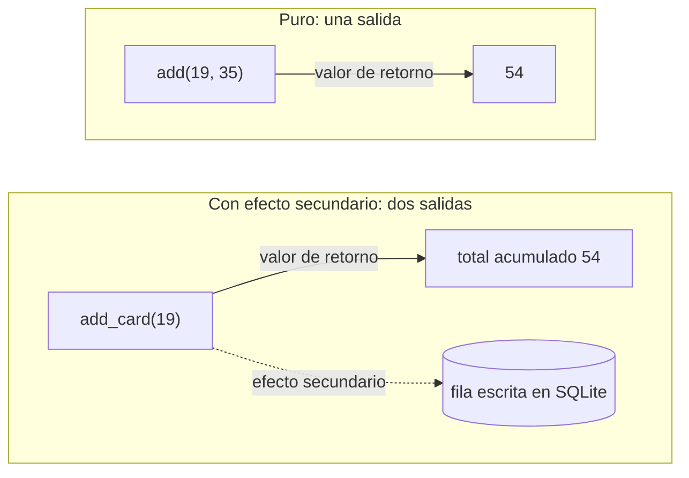
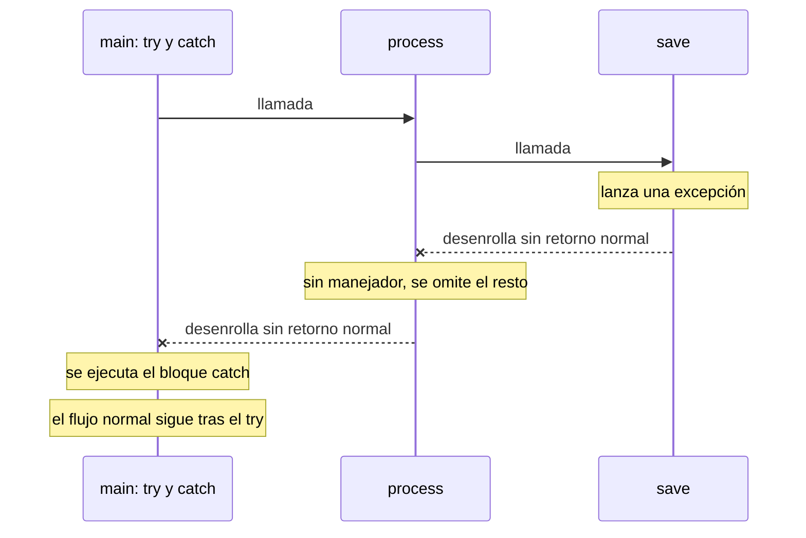
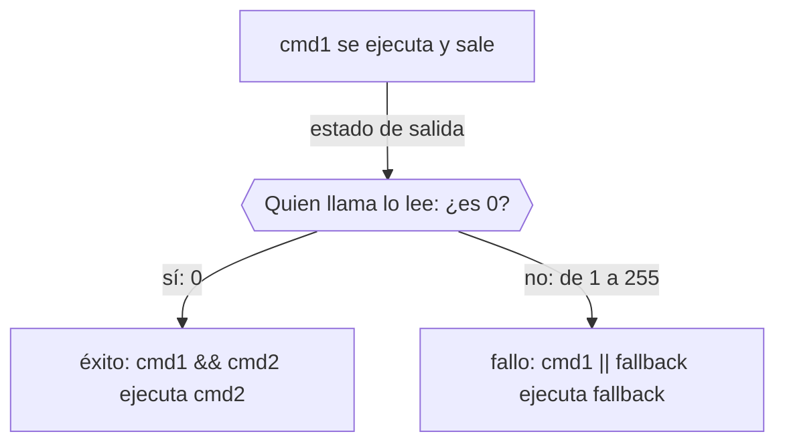
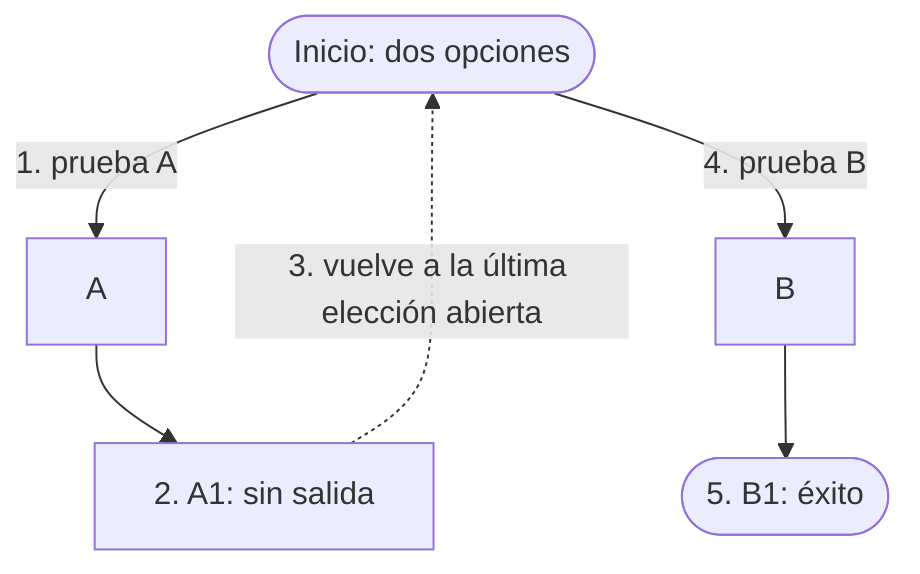
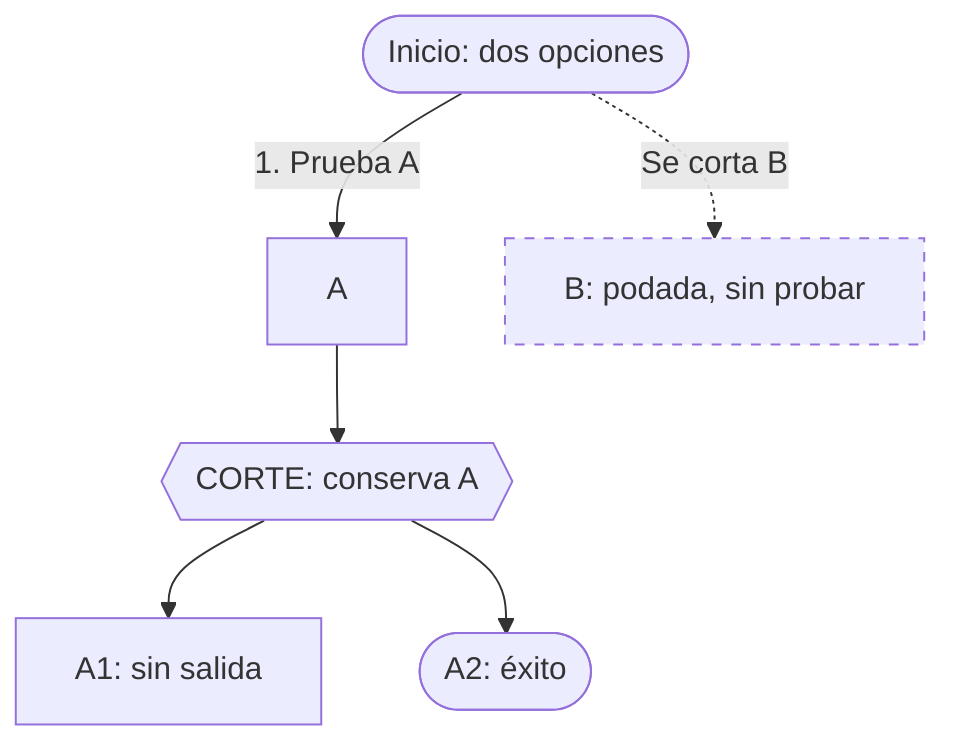
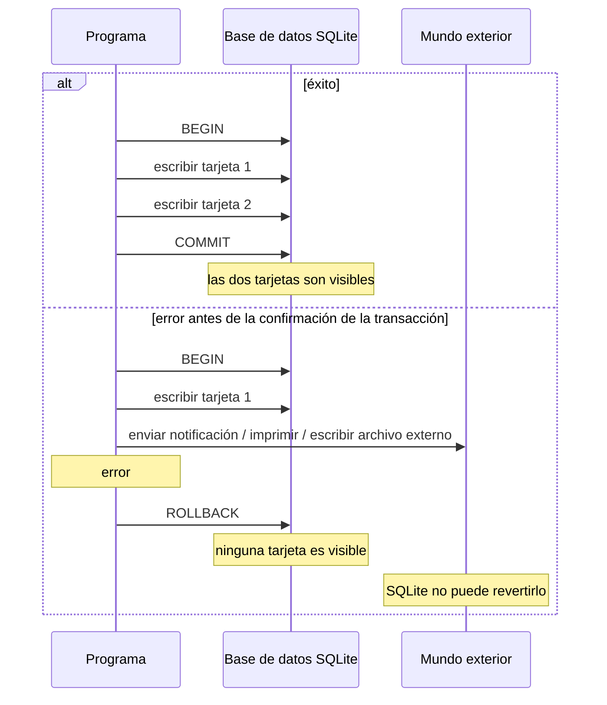
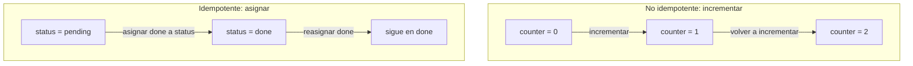

<!-- GENERADO por lessons/book/build.py a partir de lessons/cs-source/ y del frontmatter de las entradas. No lo edites; edita las fuentes y ejecuta build.py. -->

# Efectos, errores y confirmación

Para una lectura avanzada con trazas y experimentos, consulta la [guía de estudio sobre efectos, errores y confirmación](../guias-de-estudio/conceptos/efectos-errores-y-confirmacion.md).

Un programa que no hace nada fuera de sí mismo es un calefactor carísimo. Los programas útiles cambian el mundo: escriben archivos, imprimen e insertan filas. Este capítulo trata las tres preguntas que se desprenden de ello. ¿Cuándo se produce un efecto (**efectos secundarios**)? ¿Qué pasa cuando algo sale mal (**errores**)? ¿En qué momento se vuelve definitivo un cambio (**confirmación**)?

Las entradas de este capítulo juegan con los tres conceptos. Un motor de expresiones regulares ejecuta toda la demostración y luego *provoca un fallo a propósito*. La lección está en lo que sobrevive al fallo. Una infracción de una restricción, un desbordamiento aritmético o el estado de salida de un programa *es* la regla de parada. La confirmación de una transacción de base de datos solo ocurre cuando el trabajo termina. Los conceptos que siguen dan un nombre y una razón a cada caso: efectos secundarios, sistemas de efectos, excepciones, estado de salida, restricciones, retroceso, corte, transacciones, idempotencia y seguridad entre hilos.

## Efectos secundarios

Un efecto secundario es cualquier cosa que una operación hace además de devolver un valor: escribir un archivo, cambiar una variable, imprimir o insertar una fila en una base de datos. Los programas existen para producir efectos, así que los efectos no son malos. El problema es que *el orden, la cantidad y el momento* empiezan a importar. Ejecuta la operación dos veces y podrías obtener dos filas. Ejecútala más tarde y podrías obtener otra respuesta. Varias entradas esconden un efecto en lo que parece una simple descripción: una lista perezosa de Haskell, una consulta LINQ o un árbol XAML. De ahí sale una regla: **quien lee la estructura decide si ocurre el efecto y cuándo.** `evaluate (length cards)` en Haskell y el `Aggregate` final en LINQ significan "fuerza la evaluación ahora".

Ambas llamadas devuelven un valor. Solo la segunda cambia también algo fuera de sí misma: ahora hay una fila en la base de datos y sigue ahí aunque quien llama ignore el valor de retorno. Por eso un efecto secundario no es simplemente otro valor de retorno. Quien llama solo ve el valor de retorno si lo consulta, pero el efecto ya ocurrió. Compara con [Transparencia referencial](04-evaluacion-y-demanda.md#transparencia-referencial): puedes sustituir una llamada pura por su valor, pero no la segunda llamada.

- **Usa efectos** en los bordes de un programa, donde se comunica con el mundo. Úsalos también en los lugares donde puedas decir con exactitud cuándo se ejecutan.
- **Evita los efectos cuando:** se ocultan en código perezoso o "de apariencia pura", donde nadie puede decir quién los activa.

**Lee más:**

- [Efecto secundario (informática)](https://en.wikipedia.org/wiki/Side_effect_(computer_science)) (Wikipedia)
- [Transparencia referencial](04-evaluacion-y-demanda.md#transparencia-referencial) en "Evaluación y demanda"

**En este repositorio:**

| Entrada | Lenguaje | Cómo se relaciona | Qué enseña |
| --- | --- | --- | --- |
| [`find-gnu`](../../src/find-gnu/README.md) | find, SQLite | demuestra | Que los extras de GNU para find (profundidad de ruta, marcas de tiempo de los archivos, expresiones regulares y un perfilador integrado) pueden reemplazar una tabla entera de ramas, y que el optimizador de find no tiene nada que reordenar cuando cada rama termina en un efecto secundario. |
| [`find-posix`](../../src/find-posix/README.md) | find, SQLite | demuestra | Que un recorrido de directorios puede ser un bucle y un programa: find cava el árbol que está recorriendo, y la ruta al directorio actual es toda la máquina. |
| [`GoChallenge1`](../../src/GoChallenge1/README.md) | Go | demuestra | Que un solo `for` de tres partes con un cuerpo vacío puede ejecutar todo el programa en Go. |
| [`haskell-weird`](../../src/haskell-weird/README.md) | Haskell | demuestra | Que leer una lista perezosa puede dirigir un programa cuando forzar cada elemento tiene un efecto secundario. |
| [`JavaChallenge1`](../../src/JavaChallenge1/README.md) | Java | demuestra | Que un `for (init; condition; update) { }` de Java puede conservar la forma del programa original en C#. |
| [`javascript`](../../src/javascript/README.md) | JavaScript, SQLite | demuestra | Que una sentencia for consta de tres expresiones y un cuerpo vacío, y que el orden de evaluación propio de JavaScript, la veracidad de los valores y el operador coma bastan para ejecutar un programa completo a partir de las tres cláusulas. |
| [`javascript-events`](../../src/javascript-events/README.md) | JavaScript, SQLite | demuestra | Que un programa puede ser un conjunto de escuchadores de eventos, cada uno con una sola tarea pequeña que termina emitiendo el evento que espera el siguiente; y que emit() llama a sus escuchadores de inmediato, así que solo un límite de planificación explícito da un turno al bucle de eventos. |
| [`javascript-weird`](../../src/javascript-weird/README.md) | JavaScript, SQLite | demuestra | Que una clausura es una máquina de estados: una función más las variables junto a las que se creó, que un iterador hace avanzar un paso a la vez, con reduce como el único pliegue que no puede detenerse. |
| [`KotlinChallenge1`](../../src/KotlinChallenge1/README.md) | Kotlin | demuestra | Que Kotlin puede usar `generateSequence` como el bucle, y termina cuando el generador devuelve null. |
| [`LinqChallenge1`](../../src/LinqChallenge1/README.md) | C#, LINQ | demuestra | Que una cadena de métodos de LINQ puede expresar el programa completo. |
| [`LinqChallenge2`](../../src/LinqChallenge2/README.md) | C#, LINQ | demuestra | Que la sintaxis de consulta de C# puede expresar el cálculo y ordenar sus efectos. |
| [`ModernChallenge1`](../../src/ModernChallenge1/README.md) | C# | demuestra | Que una sentencia `for` con el cuerpo vacío puede controlar XAML en tiempo de ejecución, LINQ to Objects, EF Core y la animación de WPF. |
| [`PythonChallenge1`](../../src/PythonChallenge1/README.md) | Python | demuestra | Que Python puede controlar un programa completo con `iter(step, False)`, que llama a `step` hasta que devuelve `False`. |
| [`regex-pcre2`](../../src/regex-pcre2/README.md) | C, PCRE2, Regular expressions | demuestra | Que los callouts de regex pueden servir como un conjunto diminuto de instrucciones. |
| [`regex-pcre2grep`](../../src/regex-pcre2grep/README.md) | PCRE2, Regular expressions | demuestra | Que los códigos de salida de un programa pueden dirigir el flujo de control. |
| [`regex-perl`](../../src/regex-perl/README.md) | Perl, Regular expressions | demuestra | Que Perl puede ejecutar código durante una coincidencia de una expresión regular. |
| [`RustChallenge1`](../../src/RustChallenge1/README.md) | Rust | demuestra | Que los iteradores y las clausuras (*closures*, funciones que capturan variables de su entorno) pueden expresar el flujo de control de un programa completo en Rust. |
| [`tar-gnu-weird`](../../src/tar-gnu-weird/README.md) | GNU tar, SQLite | demuestra | Que la disposición física de un archivo puede marcar el ritmo de un programa: los puntos de control de tar son un reloj y cada pulso hace avanzar un paso a una máquina de estados. |
| [`xaml`](../../src/xaml/README.md) | XAML, C# | demuestra | Que un analizador sintáctico de marcado puede ejecutar un programa mientras describe una interfaz de usuario. |

## Mónadas y sistemas de efectos

Los lenguajes funcionales puros tienen una respuesta ingeniosa a los efectos secundarios: describe el efecto como un *valor* y deja que el entorno de ejecución lo lleve a cabo. En Haskell, una acción `IO` es un valor de ese tipo. Una **mónada** es el patrón que encadena estas acciones en orden ("haz esto y usa el resultado para decidir qué hacer después"). Un *sistema de efectos* va más allá y registra los efectos posibles en el tipo. Así todavía puedes probar las partes puras y razonar sobre ellas. [`haskell-weird`](../../src/haskell-weird/README.md) rompe el patrón a propósito. `unsafeInterleaveIO` deja que la mera *lectura* de un elemento de la lista realice operaciones de entrada de datos y salida. Es justo lo que el sistema de tipos intenta impedir. El programa sigue siendo correcto solo porque no se puede leer la tarjeta *n* antes de la tarjeta *n−1*.

- **Úsalos cuando:** quieras que los efectos se vean en las firmas, en Haskell o en cualquier lenguaje que lleve cuenta de ellos.
- **Evita `unsafePerformIO` y `unsafeInterleaveIO`** salvo en lo más interno de una biblioteca, con un comentario que explique por qué es seguro.

**Lee más:**

- [Mónada (programación funcional)](https://en.wikipedia.org/wiki/Monad_(functional_programming)) (Wikipedia)
- [Sistema de efectos](https://en.wikipedia.org/wiki/Effect_system) (Wikipedia)
- [Haskell](https://en.wikipedia.org/wiki/Haskell) (Wikipedia)

**En este repositorio:**

| Entrada | Lenguaje | Cómo se relaciona | Qué enseña |
| --- | --- | --- | --- |
| [`haskell-weird`](../../src/haskell-weird/README.md) | Haskell | demuestra | Que leer una lista perezosa puede dirigir un programa cuando forzar cada elemento tiene un efecto secundario. |

## Manejo de excepciones

El manejo de excepciones es una función del lenguaje para tratar errores: lanza una señal, desenrolla la pila y deja que un manejador se ocupe de ella. Así el recorrido normal del código queda libre de comprobaciones de errores. COBOL tiene una forma más antigua y sencilla. `ON SIZE ERROR` se ejecuta cuando un resultado aritmético no cabe en el campo, que queda intacto. En [`cobol-weird`](../../src/cobol-weird/README.md) ese desbordamiento *es* la regla de parada: un contador de dos dígitos se desborda a propósito y la rama de error termina el bucle. Usar errores como flujo de control funciona, pero le oculta el diseño real al siguiente lector.

El `return` normal de `save` y `process` nunca se ejecuta. La excepción sale de cada llamada hasta que un `catch` la acepta. Entonces el flujo normal se reanuda tras el `try` en `main`. Si nada la atrapa, sale del programa. Desenrollar la pila solo desplaza el control. No deshace lo que ya hizo el código que se omite. Una fila que escribió `save` queda escrita, salvo que una transacción revierta el cambio (consulta [Transacciones](07-efectos-errores-y-confirmacion.md#transacciones)).

- **Úsalo cuando:** ocurra algo realmente inesperado y quien llama pueda recuperarse o deba enterarse.
- **Evítalo cuando:** el "error" sea un resultado normal y frecuente (como "fin de la entrada de datos") o cuando atrapes todo y sigas sin avisar.

**Lee más:**

- [Manejo de excepciones](https://en.wikipedia.org/wiki/Exception_handling) (Wikipedia)
- [Sistema de fallo rápido](https://en.wikipedia.org/wiki/Fail-fast_system) (Wikipedia)

**En este repositorio:**

| Entrada | Lenguaje | Cómo se relaciona | Qué enseña |
| --- | --- | --- | --- |
| [`cobol-weird`](../../src/cobol-weird/README.md) | COBOL | demuestra | Que un programa puede reescribir su propio flujo de control y que la programación estructurada facilita trazar esos cambios. |
| [`javascript-events`](../../src/javascript-events/README.md) | JavaScript, SQLite | demuestra | Que un programa puede ser un conjunto de escuchadores de eventos, cada uno con una sola tarea pequeña que termina emitiendo el evento que espera el siguiente; y que emit() llama a sus escuchadores de inmediato, así que solo un límite de planificación explícito da un turno al bucle de eventos. |

## Estado de salida

Un estado de salida es el número que un proceso, al finalizar, devuelve a quien lo inició. En Unix, `0` indica éxito y cualquier otro valor indica un fallo, en el rango de 0 a 255. Sirve para enlazar programas: `if`, `&&` y `||` en un intérprete de comandos (*shell*) leen ese estado. También es una señal de control en este repositorio. En [`regex-pcre2grep`](../../src/regex-pcre2grep/README.md) el estado de salida de un programa pequeño dirige la coincidencia de la expresión regular. En [`regex-sed`](../../src/regex-sed/README.md) el script sale con `1` a propósito y el envoltorio lo interpreta como éxito. Cada `check.sh` sale con un valor distinto de cero ante cualquier fallo. Así el control del entorno aislado (*sandbox*), que limita el acceso al sistema anfitrión, puede evaluar una ejecución sin leerla.

El estado es un solo número pequeño. Quien llama solo aprende qué rama tomar, sin saber qué salió mal. En `cmd1 && cmd2` el intérprete de comandos ejecuta `cmd2` tras un 0. En `cmd1 || fallback` ejecuta `fallback` tras cualquier otro valor. Un `if` del intérprete de comandos lee el mismo estado. Un programa que necesite decir más también debe imprimir un mensaje o escribir un archivo.

- **Úsalo cuando:** otras herramientas llamen a tus scripts o herramientas. Documenta qué significa cada código.
- **Evítalo cuando:** necesites devolver datos más ricos o conservar un número fuera del rango de estados de salida de la plataforma.

**Lee más:**

- [Estado de salida](https://en.wikipedia.org/wiki/Exit_status) (Wikipedia)

**En este repositorio:**

| Entrada | Lenguaje | Cómo se relaciona | Qué enseña |
| --- | --- | --- | --- |
| [`regex-pcre2grep`](../../src/regex-pcre2grep/README.md) | PCRE2, Regular expressions | demuestra | Que los códigos de salida de un programa pueden dirigir el flujo de control. |
| [`regex-sed`](../../src/regex-sed/README.md) | GNU sed, Regular expressions | demuestra | Que un programa puede ser una línea de texto que las sustituciones reescriben hasta que ninguna se aplique: un algoritmo de Markov, con una expresión regular de retroceso catastrófico como reloj. |
| [`tar-gnu`](../../src/tar-gnu/README.md) | GNU tar, SQLite | demuestra | Que un archivo tar puede ser un programa serializado: tar lee los miembros en orden y solo el comando que indica el operador les da un efecto. |
| [`tar-gnu-weird`](../../src/tar-gnu-weird/README.md) | GNU tar, SQLite | demuestra | Que la disposición física de un archivo puede marcar el ritmo de un programa: los puntos de control de tar son un reloj y cada pulso hace avanzar un paso a una máquina de estados. |

## Restricciones de integridad

Una restricción de integridad es una regla que la propia base de datos hace cumplir: `NOT NULL`, `UNIQUE`, `FOREIGN KEY` y `CHECK`. Existe porque "validamos en la aplicación" solo funciona si todas las aplicaciones validan. Una restricción hace que los datos incorrectos sean *imposibles*, no solo improbables. En este repositorio, `CHECK(demo_only=1)` aparece en casi todas las entradas. En esa tabla no puede existir una fila ajena a la demostración y cada `check.sh` intenta infringir la regla. Aquí las restricciones sirven como regla de parada (una infracción termina la ejecución) y como garantía. Conserva el segundo uso en los programas reales.

- **Úsala cuando:** una regla deba cumplirse sin importar quién escriba los datos. Consulta también [Invariantes](02-que-cuenta-como-maquina.md#invariantes).
- **Evítala cuando:** los usuarios necesiten mensajes de validación que les indiquen qué hacer. Una restricción simple tampoco sirve bien para reglas complejas que requieren disparadores.

**Lee más:**

- [Restricción de integridad](https://en.wikipedia.org/wiki/Integrity_constraint) (Wikipedia)
- [Restricción de comprobación](https://en.wikipedia.org/wiki/Check_constraint) (Wikipedia)

**En este repositorio:**

| Entrada | Lenguaje | Cómo se relaciona | Qué enseña |
| --- | --- | --- | --- |
| [`cobol`](../../src/cobol/README.md) | COBOL | demuestra | Que una regla de parada se puede declarar como datos, y que la imagen de un número puede encargarse de tu redondeo. |
| [`find-gnu`](../../src/find-gnu/README.md) | find, SQLite | demuestra | Que los extras de GNU para find (profundidad de ruta, marcas de tiempo de los archivos, expresiones regulares y un perfilador integrado) pueden reemplazar una tabla entera de ramas, y que el optimizador de find no tiene nada que reordenar cuando cada rama termina en un efecto secundario. |
| [`find-posix`](../../src/find-posix/README.md) | find, SQLite | demuestra | Que un recorrido de directorios puede ser un bucle y un programa: find cava el árbol que está recorriendo, y la ruta al directorio actual es toda la máquina. |
| [`javascript`](../../src/javascript/README.md) | JavaScript, SQLite | demuestra | Que una sentencia for consta de tres expresiones y un cuerpo vacío, y que el orden de evaluación propio de JavaScript, la veracidad de los valores y el operador coma bastan para ejecutar un programa completo a partir de las tres cláusulas. |
| [`javascript-events`](../../src/javascript-events/README.md) | JavaScript, SQLite | demuestra | Que un programa puede ser un conjunto de escuchadores de eventos, cada uno con una sola tarea pequeña que termina emitiendo el evento que espera el siguiente; y que emit() llama a sus escuchadores de inmediato, así que solo un límite de planificación explícito da un turno al bucle de eventos. |
| [`regex-pcre2grep`](../../src/regex-pcre2grep/README.md) | PCRE2, Regular expressions | demuestra | Que los códigos de salida de un programa pueden dirigir el flujo de control. |
| [`tar-gnu`](../../src/tar-gnu/README.md) | GNU tar, SQLite | demuestra | Que un archivo tar puede ser un programa serializado: tar lee los miembros en orden y solo el comando que indica el operador les da un efecto. |
| [`tar-gnu-weird`](../../src/tar-gnu-weird/README.md) | GNU tar, SQLite | demuestra | Que la disposición física de un archivo puede marcar el ritmo de un programa: los puntos de control de tar son un reloj y cada pulso hace avanzar un paso a una máquina de estados. |

## Retroceso

El retroceso es una búsqueda sistemática. Prueba una opción y sigue. Si te atascas, deshaz la elección y prueba la siguiente. Sirve para problemas con muchas respuestas posibles y reglas para descartar algunas: acertijos, análisis sintáctico y búsqueda de coincidencias con patrones. Los motores de expresiones regulares de Perl, PCRE2 y .NET funcionan así. Las entradas de este repositorio le dan la vuelta: *haz el trabajo mediante efectos secundarios y luego provoca un fallo a propósito.* La coincidencia devuelve falso solo después de escribir todas las filas. Lo que sobrevive al fallo es toda la lección. El motor restaura las variables `local` de Perl, pero no puede deshacer sus llamadas a `INSERT` y `print`. [`regex-dotnet`](../../src/regex-dotnet/README.md) no puede jugar a esto porque .NET descarta las capturas de una coincidencia fallida.

La búsqueda recuerda las elecciones que aún tienen alternativas sin probar. Cuando falla un camino, vuelve a la más reciente. Aquí vuelve al inicio, donde `B` sigue pendiente. Deshacer una elección revierte el estado de la búsqueda, pero no el mundo exterior. Como dice el párrafo anterior, una fila escrita en un camino fallido queda escrita.

- **Úsalo cuando:** el espacio de búsqueda sea pequeño o puedas reducirlo pronto.
- **Evítalo cuando:** los efectos no se puedan deshacer o la entrada de datos venga de un atacante (consulta [Denegación de servicio mediante expresiones regulares](08-fugas-de-abstraccion-y-dependencia-de-la-implementacion.md#denegación-de-servicio-mediante-expresiones-regulares)).

**Lee más:**

- [Retroceso](https://en.wikipedia.org/wiki/Backtracking) (Wikipedia)
- [Expresión regular](https://en.wikipedia.org/wiki/Regular_expression) (Wikipedia)

**En este repositorio:**

| Entrada | Lenguaje | Cómo se relaciona | Qué enseña |
| --- | --- | --- | --- |
| [`regex-dotnet`](../../src/regex-dotnet/README.md) | C#, Regular expressions | demuestra | Que una expresión regular puede usar una pila para contar. |
| [`regex-pcre2`](../../src/regex-pcre2/README.md) | C, PCRE2, Regular expressions | demuestra | Que los callouts de regex pueden servir como un conjunto diminuto de instrucciones. |
| [`regex-pcre2grep`](../../src/regex-pcre2grep/README.md) | PCRE2, Regular expressions | demuestra | Que los códigos de salida de un programa pueden dirigir el flujo de control. |
| [`regex-perl`](../../src/regex-perl/README.md) | Perl, Regular expressions | demuestra | Que Perl puede ejecutar código durante una coincidencia de una expresión regular. |

## El corte: cómo fijar una elección

El *corte* es una idea de Prolog: una vez que el programa pasa por ese punto, conserva las opciones elegidas hasta allí y descarta las demás. Sirve para ganar velocidad y determinismo: no quieres que la búsqueda explore alternativas o repita trabajo que ya das por resuelto. Los motores de expresiones regulares tienen las mismas herramientas: `(*COMMIT)` de PCRE, grupos atómicos y cuantificadores posesivos. [`regex-pcre2`](../../src/regex-pcre2/README.md) y las entradas afines terminan el patrón con `(*COMMIT)(*FAIL)`. Sin `(*COMMIT)` el motor volvería a probar con bucles más cortos y ejecutaría el finalizador más de una vez. Quienes programan en Prolog distinguen los cortes "verdes" (solo ganan velocidad) de los cortes "rojos" (cambian la respuesta).

Compara este dibujo con el retroceso simple. En ese caso, la búsqueda probaría `B` si fallara `A`. Aquí el corte conserva primero `A` y poda `B`. La búsqueda aún puede probar las alternativas que vienen *después* del corte (`A1` y luego `A2`). Si todas fallan, falla toda la búsqueda. No vuelve a `B`. Eso significa que "el corte cambia el espacio de búsqueda". El corte de Prolog también descarta las opciones elegidas antes en la misma cláusula. El dibujo muestra solo el caso más sencillo.

- **Úsalo cuando:** sepas que un fallo posterior nunca debe llevar a otro intento.
- **Evítalo cuando:** no sepas qué tipo de corte tienes. Un corte rojo esconde un cambio de lógica en un truco para ganar velocidad.

**Lee más:**

- [Corte (programación lógica)](https://en.wikipedia.org/wiki/Cut_(logic_programming)) (Wikipedia)
- [Prolog](https://en.wikipedia.org/wiki/Prolog) (Wikipedia)

**En este repositorio:**

| Entrada | Lenguaje | Cómo se relaciona | Qué enseña |
| --- | --- | --- | --- |
| [`regex-pcre2`](../../src/regex-pcre2/README.md) | C, PCRE2, Regular expressions | demuestra | Que los callouts de regex pueden servir como un conjunto diminuto de instrucciones. |
| [`regex-pcre2grep`](../../src/regex-pcre2grep/README.md) | PCRE2, Regular expressions | demuestra | Que los códigos de salida de un programa pueden dirigir el flujo de control. |
| [`regex-perl`](../../src/regex-perl/README.md) | Perl, Regular expressions | demuestra | Que Perl puede ejecutar código durante una coincidencia de una expresión regular. |

## Transacciones

Una transacción es un grupo de operaciones que ocurren *todas* o no ocurre *ninguna*. La promesa clásica se llama ACID: atómica, consistente, aislada y durable. Existe porque una caída o un error en mitad de una actualización dejaría los datos a medio cambiar. Cada entrada de script escribe sus tarjetas de demostración en una sola transacción de SQLite, y la **confirmación de la transacción** es el punto sin retorno. Ahí es donde la pereza puede hacer daño. En [`haskell-weird`](../../src/haskell-weird/README.md) un `let` perezoso se forzó solo después de cerrar la tubería hacia SQLite, así que el trabajo ocurrió demasiado tarde. `evaluate (length cards)` antes de la confirmación lo arregló.

`COMMIT` hace visibles las dos filas a la vez, y `ROLLBACK` las quita las dos. Ninguno llega más allá de la base de datos. Una notificación, una impresión o un archivo escrito fuera de ella ya ocurrió. Por eso [`haskell-weird`](../../src/haskell-weird/README.md) tuvo que forzar sus efectos perezosos *antes* de la confirmación de la transacción, y por eso esta imagen trata del límite de la transacción y no de las tarjetas. No todas las entradas colocan los límites de su transacción en el mismo sitio.

- **Úsalo cuando:** cambies datos almacenados en varios pasos.
- **Evítalo cuando:** la transacción retendría bloqueos durante mucho tiempo. Los efectos fuera de la base de datos, como un correo o la escritura de un archivo, permanecen después de la reversión.

**Más información:**

- [Transacción de base de datos](https://en.wikipedia.org/wiki/Database_transaction) (Wikipedia)
- [ACID](https://en.wikipedia.org/wiki/ACID) (Wikipedia)
- [Confirmación (gestión de datos)](https://en.wikipedia.org/wiki/Commit_(data_management)) (Wikipedia)

**En este repositorio:**

| Entrada | Lenguaje | Cómo se relaciona | Qué enseña |
| --- | --- | --- | --- |
| [`forth`](../../src/forth/README.md) | Forth | demuestra | Que un lenguaje de pila necesita un `begin ... until` y una tubería para ser un programa completo. |
| [`regex-perl`](../../src/regex-perl/README.md) | Perl, Regular expressions | demuestra | Que Perl puede ejecutar código durante una coincidencia de una expresión regular. |
| [`tcl`](../../src/tcl/README.md) | Tcl | demuestra | Que el Tcl idiomático agrupa los procedimientos en un espacio de nombres y usa diccionarios para los registros. Usa `expr` entre llaves y `db eval` para enlazar variables Tcl en SQL. |

## Idempotencia

Una operación es idempotente si hacerla dos veces tiene el mismo efecto que hacerla una vez. Las redes y las máquinas fallan. De ahí la idempotencia: la forma más segura de recuperarse es "vuelve a intentarlo". Si repetir es inocuo, puedes hacerlo sin miedo. HTTP define `PUT` y `DELETE` como idempotentes (RFC 9110, sección 9.2.2). `POST` queda fuera de esa categoría. En este repositorio, los scripts de comprobación borran y vuelven a crear sus datos temporales. Así, la segunda ejecución parte del mismo punto que la primera. Lo mismo ocurre con una herramienta de compilación. Ejecuta `make` dos veces y la segunda ejecución no debería hacer nada.

Para una operación `f` sobre un estado `s`, la idempotencia significa `f(f(s)) = f(s)`. Fíjate en qué le hace la segunda llamada al *estado*, en vez de fijarte en si los dos valores de retorno coinciden. Compara con el reloj de [Transparencia referencial](04-evaluacion-y-demanda.md#transparencia-referencial). Llamar a `now()` dos veces puede dar respuestas distintas. Eso por sí solo no le quita la idempotencia, porque no cambia nada.

- **Úsala cuando:** diseñes una API, una cola de trabajos o un script de despliegue.
- **Evita darla por sentada:** "suma uno al contador" no es idempotente. Si la operación no puede serlo, asigna a cada solicitud una clave única e ignora las repeticiones.

**Lee más:**

- [Idempotencia](https://en.wikipedia.org/wiki/Idempotence) (Wikipedia)
- [Idempotente](https://developer.mozilla.org/en-US/docs/Glossary/Idempotent) (glosario de MDN)
- [RFC 9110, sección 9.2.2: métodos idempotentes](https://www.rfc-editor.org/rfc/rfc9110)

**En este repositorio:**

| Entrada | Lenguaje | Cómo se relaciona | Qué enseña |
| --- | --- | --- | --- |
| [`tar-gnu`](../../src/tar-gnu/README.md) | GNU tar, SQLite | demuestra | Que un archivo tar puede ser un programa serializado: tar lee los miembros en orden y solo el comando que indica el operador les da un efecto. |

## Seguridad entre hilos y afinidad de hilo

Un código es seguro entre hilos (*thread-safe*) si se comporta bien cuando varios hilos lo usan al mismo tiempo. Es un problema porque datos compartidos y modificables más hilos en paralelo producen una carrera: el resultado depende de quién llega primero. Las entradas de .NET y de sus adaptaciones tocan dos versiones del problema. En las entradas de C#, un `DbContext` de EF Core no es seguro entre hilos. En las adaptaciones de una sola sentencia, el código usa un bloqueo alrededor de las tarjetas preparadas mientras un hilo en segundo plano las guarda. Y WPF tiene *afinidad de hilo*: una ventana solo la puede tocar el hilo que la creó. Que un código funcione una vez no prueba que sea seguro.

- **Úsalo cuando:** compartas datos entre hilos: usa bloqueos, datos inmutables o un contexto por hilo.
- **Evítalo cuando:** los hilos compartirían un objeto modificable sin sincronización. Una prueba que pasa no basta para demostrar la seguridad.

**Más información:**

- [Seguridad entre hilos](https://en.wikipedia.org/wiki/Thread_safety) (Wikipedia)
- [Condición de carrera](https://en.wikipedia.org/wiki/Race_condition) (Wikipedia)

**En este repositorio:**

| Entrada | Lenguaje | Cómo se relaciona | Qué enseña |
| --- | --- | --- | --- |
| [`GoChallenge1`](../../src/GoChallenge1/README.md) | Go | demuestra | Que un solo `for` de tres partes con un cuerpo vacío puede ejecutar todo el programa en Go. |
| [`JavaChallenge1`](../../src/JavaChallenge1/README.md) | Java | demuestra | Que un `for (init; condition; update) { }` de Java puede conservar la forma del programa original en C#. |
| [`KotlinChallenge1`](../../src/KotlinChallenge1/README.md) | Kotlin | demuestra | Que Kotlin puede usar `generateSequence` como el bucle, y termina cuando el generador devuelve null. |
| [`LinqChallenge1`](../../src/LinqChallenge1/README.md) | C#, LINQ | demuestra | Que una cadena de métodos de LINQ puede expresar el programa completo. |
| [`LinqChallenge2`](../../src/LinqChallenge2/README.md) | C#, LINQ | demuestra | Que la sintaxis de consulta de C# puede expresar el cálculo y ordenar sus efectos. |
| [`ModernChallenge1`](../../src/ModernChallenge1/README.md) | C# | demuestra | Que una sentencia `for` con el cuerpo vacío puede controlar XAML en tiempo de ejecución, LINQ to Objects, EF Core y la animación de WPF. |
| [`PythonChallenge1`](../../src/PythonChallenge1/README.md) | Python | demuestra | Que Python puede controlar un programa completo con `iter(step, False)`, que llama a `step` hasta que devuelve `False`. |
| [`RustChallenge1`](../../src/RustChallenge1/README.md) | Rust | demuestra | Que los iteradores y las clausuras (*closures*, funciones que capturan variables de su entorno) pueden expresar el flujo de control de un programa completo en Rust. |
