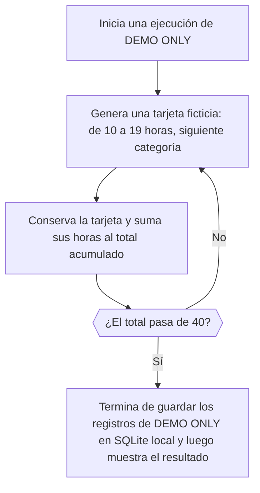

# Introducción: por qué existen estas lecciones

Ya sabes escribir un bucle, consultar una base de datos y llamar a una función. Has leído los tutoriales. Esto es lo que viene después.

El [reto de código](../README.md) plantea una sola pregunta en muchos acentos: *¿hasta dónde se puede llevar la maquinaria propia de un lenguaje antes de que empiece a comportarse como un programa de propósito general?* Las propuestas abordan una pequeña demo ficticia de tarjetas de horas con una restricción absurda: una sola sentencia, ningún bucle, ningún `IF`, solo una expresión regular, solo un archivo de marcado.

Las acrobacias son la puerta. Estas lecciones son lo que hay detrás.

En este libro, BICHO significa **Bicho raro, Interpreta, Camino indirecto, Hallazgos y Octetos**. Claro que no. Pero describe con sorprendente acierto lo que hacen estos programas.

## Qué hace el reto

Empieza con un total de cero. Crea tarjetas de tiempo ficticias de 10 a 19 horas enteras y alterna entre Meetings, Coding, Debugging y Learning. Suma las horas y conserva la primera tarjeta que hace que el total pase de 40. Un total de exactamente 40 continúa. Eso da de 3 a 5 tarjetas y un total final de 41 a 59. Guarda las tarjetas en local como registros **DEMO ONLY** y muestra el resultado mediante la interfaz disponible. La imagen muestra la versión habitual de esa tarea en SQLite. Cada programa decide cuándo persistir las filas.

Las entradas no coinciden en *cómo* sucede. El README de cada entrada tiene una sección **Flujo del programa** con su propia imagen, y el libro la muestra en la página de la lección del lenguaje de esa entrada, bajo **Cómo se ejecuta cada programa**. Esas imágenes no son todas diagramas de flujo, porque las máquinas no son todas iguales. Un programa COBOL con un `GO TO` reescrito es un estado que cambia. Un programa Haskell es una demanda que tira del resultado. Un programa m4 es texto que se lee de nuevo. Un programa Node construido con escuchadores de eventos es una conversación. Si una imagen pudiera pegarse sin cambios en diez entradas, no enseñaría nada.

### Dónde difieren las entradas

| Entradas | Qué difiere de la ejecución habitual |
| --- | --- |
| [Cadena de métodos LINQ](../src/LinqChallenge1/README.md) y [sintaxis de consulta LINQ](../src/LinqChallenge2/README.md) | Cinco días fijos de 8 horas terminan en 40.0 horas. Estas demostraciones enseñan la ejecución diferida con una semana laboral fija. |
| [XAML](../src/xaml/README.md) | Cuatro pasadas copiadas pueden repartir como máximo cuatro tarjetas. Con cuatro decenas se llegaría a 40 sin una quinta pasada disponible. En el entorno de ejecución .NET incluido, la semilla 42 produce 16, 11, 11 y 15, para un total de 53. La variante estricta guarda XML; las otras variantes usan SQLite. |
| [Regex de .NET](../src/regex-dotnet/README.md) | La regla de parada numérica sigue vigente. El anfitrión agrega un informe TSV a partir de las capturas de la coincidencia exitosa y lo imprime. |
| [PCRE2 en C](../src/regex-pcre2/README.md) | La regla de parada numérica sigue vigente. Los callouts escriben TSV durante la coincidencia y cierran el archivo antes del fallo deliberado de la coincidencia. |
| [pcre2grep estándar](../src/regex-pcre2grep/README.md) | La regla de parada numérica sigue vigente. Las invocaciones separadas de `sqlite3` guardan tarjetas mientras avanza la coincidencia. El `(*COMMIT)` de la regex poda los reintentos, y las escrituras anteriores sobreviven a la coincidencia final fallida. |

El [verificador de salida compartido](tools/check-demo.sh) prueba la regla de parada numérica en un informe, incluido el requisito de continuar cuando el total es exactamente 40. Para ver si un informe coincide con el estado duradero, revisa también la base de datos o el archivo correspondiente.

## La filosofía de enseñanza

> Enseña el lenguaje usándolo mal a propósito y explica después por qué ese mal uso funciona.

La mayoría de los tutoriales enseñan primero los modismos: esta es la forma correcta de iterar, de mantener el estado, de manejar los errores. Estas lecciones empiezan donde terminan los tutoriales:

*Ya conoces la forma correcta. Ahora descubre qué te permite hacer realmente el lenguaje. Después pregúntate por qué, aunque sea perfectamente legal, podría ser una pésima idea.*

El objetivo es subir tu comprensión un nivel en dos direcciones a la vez:

- **En un lenguaje concreto.** Aprenderás qué hacen en realidad `ALTER`, `unsafeInterleaveIO`, `>in`, `include`, `CMAKE_MATCH_1`, `⎕FX`, la combinación de métodos, el reescaneo, `unknown`, `RT` y un `find` que excava su propio árbol. Eso significa que aprenderás cómo funcionan en realidad COBOL, Haskell, Forth, Make, CMake, APL, Common Lisp, m4, Tcl, AWK y find.
- **Como conceptos.** El flujo de control, el estado, el orden de evaluación y los efectos secundarios resultan ser cosas separables que cada lenguaje une a su manera. Cuando ya has visto el flujo de control guardado en el destino de `GO TO`, en una posición de análisis, en una herramienta de compilación que se reinicia y en una captura de regex, dejas de ver "el bucle" como algo dado.

## La estructura de una lección

La mayoría de las lecciones usan estos cinco pasos para enseñar un ejemplo raro. Los capítulos panorámicos agrupan entradas relacionadas y adaptan los pasos a su contenido. Algunos capítulos también reúnen rarezas o comparan el programa raro con su equivalente común.

| Paso | Qué ocurre |
| --- | --- |
| 1. **Observa el monstruo** | El programa que funciona y el comando para ejecutarlo ([en un contenedor](exercises.md#ejecutar-con-seguridad)). Intenta entenderlo *antes* de seguir leyendo. |
| 2. **¿Cómo diablos funciona eso?** | La semántica real: lo que hace en realidad el compilador, el intérprete, el entorno de ejecución o el sistema operativo. El mecanismo, no solo el truco. |
| 3. **¿Qué acabamos de aprender?** | La idea generalizable. Make es un motor de dependencias que puede reiniciarse a sí mismo. El `ALTER` de COBOL significa que un destino de salto es un estado mutable. LINQ es una canalización de ejecución, no solo un lenguaje de consultas. |
| 4. **Haz esto en producción y estás despedido** | Los modos de fallo concretos: depuración, optimizadores, concurrencia, portabilidad, seguridad, pruebas y mantenimiento. Además, los casos honestos en los que la técnica es legítima. |
| 5. **Ahora rómpelo tú** | Un experimento que solo funciona si entendiste el paso 2. Predice, cambia, ejecuta y compara. Consulta los [ejercicios](exercises.md). |

Sin el paso 5, esto sería un museo de curiosidades. El ejercicio es lo que convierte la curiosidad en comprensión.

## Tres tipos de conocimiento

Los programadores con experiencia a veces confunden "llevo veinte años haciendo esto" con "el lenguaje garantiza esto". Pregunta qué comportamiento concreto está prometido, en qué especificación o manual de ejecución, y qué comportamiento solo has visto en una prueba.

| Etiqueta | Significado | Ejemplo |
| --- | --- | --- |
| **garantizado** | Una especificación con nombre o una API documentada promete el comportamiento dentro de su ámbito. | La API de expresiones regulares de .NET documenta las operaciones de extracción (*pop*) de los grupos de equilibrio. Esa promesa se aplica al motor de expresiones regulares de .NET. |
| **permitido por la implementación** | Funciona por un compilador, un entorno de ejecución, una plataforma o una versión concretos. | GnuCOBOL sigue ejecutando `ALTER`. Los scripts de callout de `pcre2grep` necesitan una compilación especial. |
| **aprovechado por accidente** | Una prueba puede mostrar que funciona, pero la implementación no promete nada sobre ese comportamiento. | Un `find` en preorden puede descender a un directorio recién creado por su propio `-exec`. POSIX deja sin especificar si el recorrido incluye los archivos recién agregados. |

El grado de garantía de una entrada tiene una sola etiqueta: la del comportamiento más débil que necesita su truco. Una operación documentada puede estar justo al lado de una suposición no documentada en el mismo programa.

## La pregunta recurrente

Cuando termines una lección, hazte esta pregunta:

> ¿En qué circunstancias esta terrible idea se convertiría en una decisión de ingeniería razonable?

A veces la respuesta es "nunca, dadas las alternativas". A veces es "cuando escribes un compilador, un depurador, un intérprete o un marco de pruebas". En ocasiones es "cuando operas un mainframe en 1978". Una característica de un lenguaje no es buena ni mala en sí misma: su valor depende del problema, del entorno y de las consecuencias. `ALTER` horroriza a los programadores modernos y también cumplió propósitos reales bajo restricciones reales. Eso no significa que debamos revivirlo. Significa que debemos entender por qué funcionaba, qué costaba y qué cambió.

## Lo raro junto a lo aburrido

Empareja cada programa raro con la versión pequeña e idiomática del mismo comportamiento (el repositorio tiene varias: [`cobol`](../src/cobol/README.md) junto a [`cobol-weird`](../src/cobol-weird/README.md), [`haskell`](../src/haskell/README.md) junto a [`haskell-weird`](../src/haskell-weird/README.md), [`lisp`](../src/lisp/README.md) junto a [`lisp-weird`](../src/lisp-weird/README.md) y así sucesivamente). El objetivo no es demostrar que la versión idiomática es moralmente superior. Es ver qué se volvió más fácil, qué se volvió más difícil y qué capacidad sorprendente reveló la versión rara.

## Tres puertas de entrada

- **Por concepto de informática**, si quieres ver primero la teoría: [cs/](informatica/README.md). Cada idea incluye una explicación breve de por qué existe, por qué la usa la gente, cuándo encaja y cuándo no, con enlaces a Wikipedia y a otras fuentes duraderas de libre reutilización.
- **Por lenguaje**, si quieres profundizar en el que usas: [languages/](lenguajes/README.md).
- **Por mecanismo**, si quieres explorar una forma poco familiar de computar: [patrones](patrones.md). Un lector que llega por C# puede encontrarse con la evaluación perezosa de Haskell y darse cuenta de que ambos lenguajes plantean la misma pregunta: *¿cuándo se ejecuta realmente el cálculo?* Quien llega por `ALTER`, de COBOL, se encuentra con la maquinaria de reinicio de Make y los registros de expresiones regulares de CMake, que son otras formas de mantener el estado de control fuera de las variables ordinarias. Esa polinización cruzada es la idea central.

Luego consulta las [metas](objetivos.md), lo que se [superó](problemas-superados.md), lo que sigue [bloqueado](problemas-bloqueantes.md) y los [ejercicios](exercises.md).

## Una advertencia

Esta no es una guía de estilo para producción. No pruebes nada de esto en el trabajo y no se lo digas al jefe. Estos programas funcionan con datos **DEMO ONLY** y con almacenamiento temporal local. Ejecútalos en un [contenedor o entorno aislado (*sandbox*) que limita el acceso al sistema anfitrión](exercises.md#ejecutar-con-seguridad).
