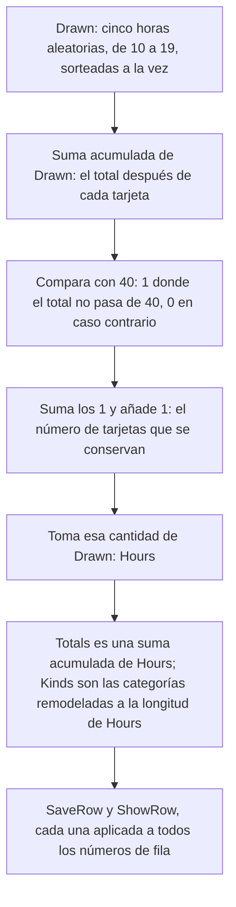
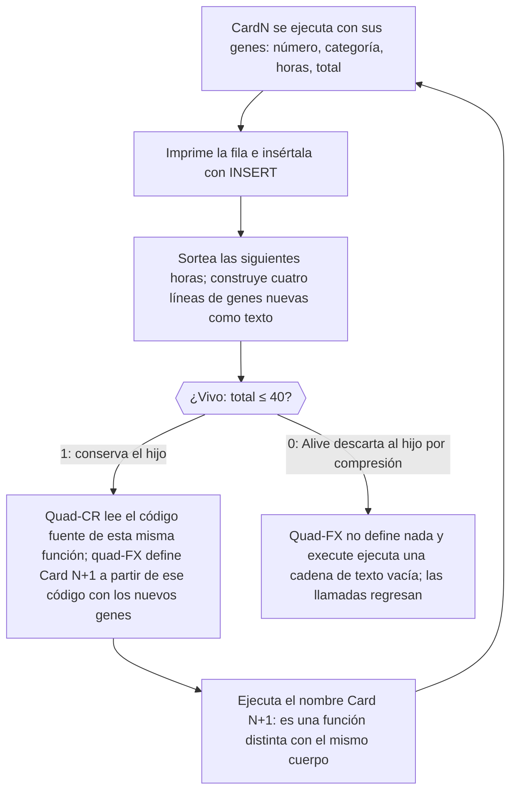

# APL

Entradas: [`src/apl`](../../src/apl/README.md) (cinco tiradas y un "take-while") y [`src/apl-weird`](../../src/apl-weird/README.md) (funciones que escriben a sus sucesoras).

Para una ruta de lectura avanzada con trazas y experimentos, consulta la [guía de estudio de APL](../guias-de-estudio/lenguajes/apl.md).

APL tiene una página propia porque es la excepción de todo el repositorio. Todos los demás lenguajes de aquí se construyeron para *ejecutar* programas. APL nació como una forma de *describirlos*.

## APL se pensó para la pizarra

Kenneth Iverson ideó la notación a finales de la década de 1950. La publicó en *A Programming Language* (1962) para escribir algoritmos y, como es bien sabido, para especificar la arquitectura de las computadoras. Primero fue un **lenguaje de diseño**. Las implementaciones llegaron después, cuando la gente se dio cuenta de que la notación se podía ejecutar. Ese origen explica todo lo raro que tiene:

- **Primitivas de un solo glifo.** `⍴` (remodelar), `⍳` (generador de índices), `+\` (suma acumulada), `/` (comprimir): los símbolos son las operaciones, porque la notación se pensó para escribirse a mano y leerse de un vistazo, como escriben los matemáticos.
- **Sin bucles por defecto.** La notación matemática no dice "para i desde 1 hasta n": aplica una operación a un vector completo. Las primitivas de APL trabajan sobre arreglos completos por la misma razón.
- **Evaluación de derecha a izquierda y sin precedencia de operadores.** Los hábitos de la notación matemática (BODMAS) se dejaron de lado a propósito en favor de una sola regla uniforme.

Ahora imagina lo que viniste a buscar: **diseñar en la pizarra con esto.** Pregúntate:

- *¿Qué escribirías en realidad?* Dibuja `Drawn←(10-⎕IO)+?5⍴10` en una pizarra y tendrás un diseño en una línea. Dibuja la misma idea como un bucle al estilo de C y tendrás ocho líneas y un riesgo de error de desfase en una posición.
- *¿Qué oculta una pizarra?* Todo lo que requiere un teclado: los glifos mismos, la dependencia de `⎕IO`, si `⊃` significa "primero" o "revelar" en tu intérprete. APL en una pizarra es conciso y *ambiguo justo de las maneras en que una notación no debería serlo*.
- *¿Quién puede leerlo?* El autor, hoy. La sección ["Cómo ver los glifos" del README](../../src/apl/README.md#cómo-ver-los-glifos) existe porque muchas fuentes y terminales ni siquiera pueden *mostrar* el código fuente.

El resumen honesto: APL es una notación para *pensar* asombrosamente buena y un lenguaje de *mantenimiento* implacable. El repositorio te deja sentir ambos lados.

## El pensamiento en arreglos reemplaza al flujo de control (`apl`)

### Contempla la monstruosidad

```bash
sandbox/container/run-image.sh src/apl
```

Cuatro asignaciones de arreglos con nombre deciden qué tarjetas se conservan. `Drawn` guarda cinco tiradas; `Hours`, `Totals` y `Kinds` derivan las filas que se conservan. Sin bucle y sin `if`.

### ¿Cómo demonios funciona eso?

Mira [`apl/timecards.apl` L30-39](../../src/apl/timecards.apl#L30-L39):

```apl
Drawn←(10-⎕IO)+?5⍴10
Hours←Drawn↑⍨1++/40≥+\Drawn
Totals←+\Hours
Kinds←(≢Hours)⍴Categories
```

Lee cada una de derecha a izquierda.

1. **Sortea todo desde el principio.** `5⍴10` son cinco dieces, `?` tira cada uno y `10-⎕IO` los desplaza al rango de 10 a 19 horas. ¿Por qué cinco? Cada tarjeta vale al menos 10, así que cinco suman siempre al menos 50. Cinco es una *cota que nunca puede quedarse corta*, no un número de repeticiones del bucle.
2. **Aplica la regla de parada como datos.** `+\Drawn` es el total acumulado; `40≥` lo convierte en `1 1 0 0 ...`; `+/` cuenta los 1; `1+` suma la tarjeta que cruza; `↑⍨` toma esa cantidad.
3. **Deriva el resto.** `⍴` *recicla* cuando el argumento derecho es más corto que el destino, así que cuatro nombres de categoría llenan un espacio por cada tarjeta conservada, hasta cinco. El quinto espacio, si lo hay, vuelve a recibir `Meetings`.

### ¿Qué acabamos de aprender?

- Un bucle con condición de parada puede reemplazarse por **el cálculo de un prefijo de una secuencia precalculada.** El [`span` sobre una lista perezosa](haskell.md) de Haskell hace lo mismo con evaluación perezosa en lugar de una cota. Los dos lenguajes discrepan sobre *cuándo* se crea la lista y coinciden en *qué* es.
- `⎕IO` (origen de los índices) es un ajuste a nivel del lenguaje. La entrada directa nunca lo da por sentado; la rara fija `⎕IO←0` y depende de él.

Etiquetas: el comportamiento de las primitivas de arreglos es **garantizado**. El comportamiento de `⎕FIO` (E/S de archivos) y de los significados de `⊃`/`↑` es **permitido por la implementación** y varía según el intérprete. En los intérpretes de la familia APL2 (GNU APL), `⊃` *revela* y `↑` es "primero"; Dyalog los intercambia.

## Funciones que se modifican a sí mismas (`apl-weird`)

### Contempla la monstruosidad

```bash
sandbox/container/run-image.sh src/apl-weird
```

El anfitrión define exactamente una función, `Card0`. Cada una de las demás tarjetas es una función que la tarjeta anterior **escribió**.

### ¿Cómo demonios funciona eso?

Mira [`apl-weird/timecards.apl` L51-54](../../src/apl-weird/timecards.apl#L51-L54):

```apl
Genes←('N←',⍕N+1) ('C←',⍕4|C+1) ('H←',⍕D) ('T←',⍕T+D)
Alive←40≥T                                       ⍝ 1 until the total passes 40
Kid←⎕FX Alive/(⊂'Card',(⍕N+1),Locals),Genes,5↓⊂[1]⎕CR 'Card',⍕N
⍎Alive/'Card',⍕N+1
```

- `⎕CR 'Card',⍕N` devuelve *el código fuente de esta misma función* como una matriz de caracteres.
- `5↓⊂[1]` lo divide en filas. Descarta el encabezado y cuatro líneas de "genes" y deja el cuerpo.
- El encabezado nuevo y las líneas de genes nuevas (`N←2`, `C←1`, ...) se construyen **como texto** y se colocan delante.
- `Alive/` es la regla de parada, una **compresión**. Un 1 escalar conserva todas las líneas y un 0 escalar no conserva ninguna, así que todo el hijo se comprime hasta desaparecer. `⎕FX` no define nada a partir de una lista vacía.
- `⍎Alive/'Card',⍕N+1` llama al hijo o ejecuta la cadena de texto vacía, una operación nula. El mismo booleano controla tanto la escritura como la llamada.

El estado del programa no está en variables. **Está en el texto del programa.**

### ¿Qué acabamos de aprender?

- **El código son datos**, en el sentido más fuerte: una función puede leer, transformar y definir otra función. Los programadores de Lisp lo conocen como homoiconicidad; APL llega ahí tratando el código fuente como una matriz de caracteres.
- **Una recursión puede ser una cadena de funciones distintas** en lugar de una función que se llama a sí misma.
- **Comprimir es un condicional.** `0/x` está vacío y `1/x` es `x`. "Si" es una multiplicación por un booleano.

### Haz esto en producción y estás despedido

- **Ámbito dinámico.** Los locales de APL son visibles para todo lo que se *llama* desde la función. Cada tarjeta generada debe declarar `N;C;H;T;...` ([L36](../../src/apl-weird/timecards.apl#L36) `Locals`) o los genes de un hijo sobrescribirían los de su padre.
- **Fallo estructural silencioso.** La propia anécdota de guerra del README: el primer borrador descartó cuatro líneas en lugar de cinco al copiar el cuerpo. Por eso cada hijo conservaba la línea `T←H` de su padre y reiniciaba el total acumulado. La regla de parada nunca se activó y el programa recursionó hasta que lo mataron. Por esa razón [`check.sh`](../../src/apl-weird/check.sh) se ejecuta bajo `timeout`.
- **Sin independencia de `⎕IO`**: la versión rara depende de `⎕IO←0`.
- **Debugging y seguridad.** El comportamiento que depende de código fuente generado deja sin efecto a las herramientas estáticas; `⍎` sobre texto ensamblado es la forma clásica de inyección. (Aquí, todo valor es un número que calculó el programa.)

Usos legítimos: metaprogramación, exploración interactiva y generación de código, donde el modelo de espacio de trabajo de APL (funciones como datos editables) es una fortaleza real.

### Ahora rómpelo tú

Consulta los [ejercicios](../exercises.md#b6-apl-la-reescritura-del-error-por-uno-verificada).

## Rarezas

- **Glifos.** `⎕` debe ser una caja vacía (se llama "quad"). Si otros símbolos aparecen como cajas, tu fuente no tiene el rango de APL. Funcionan DejaVu Sans Mono y APL385 Unicode; los programas de Windows no usan las fuentes instaladas dentro de WSL.
- **Semilla.** GNU APL inicia cada sesión con `⎕RL` en 16807, así que sin una semilla cada ejecución sortearía las mismas tarjetas ([`apl` L19](../../src/apl/timecards.apl)).
- **`_←` es desechable.** Una expresión suelta imprime su valor, así que `_←` lo absorbe.
- **`)OFF` es un comando del sistema, no código APL.** Sin él, `--script` se queda esperando en el indicador de comandos.
- **No hay formateador**; el estilo (una sentencia por línea, nombres en CamelCase, comentarios alineados) se cuida a mano.
- **`⍴` recicla**; una remodelación más larga que su origen lo repite. Es una ventaja cuando quieres un módulo y un bicho cuando no lo querías.
- **`⎕FIO[22]` es `fprintf`**: el argumento izquierdo es una cadena de texto de formato seguida de sus valores. `⎕FIO[24]` es `popen`, con `'w'` para una tubería de escritura, que es como APL envía SQL a un `sqlite3` real.

## Lo raro junto a lo aburrido

Ambas entradas son APL y ninguna es idiomática en el sentido que le da un programador de C. La primera dice: *nunca hizo falta un bucle.* La segunda dice: *tampoco hizo falta un programa fijo.* La comparación interesante es qué facilita cada una. La primera es corta, comprobable y obvia una vez que la lees de derecha a izquierda. La segunda demuestra que el texto fuente es un valor mutable.

## ¿En qué circunstancias esta idea terrible se volvería razonable?

La primera no es una idea terrible; así piensan en realidad los programadores de APL. La segunda se vuelve razonable cuando generas código a partir de datos en un entorno diseñado para ello. Y como notación de *diseño*, el verdadero hogar de APL, fue razonable desde el principio: se pensó para describir el cálculo en una pizarra, mucho antes de que alguien lo ejecutara.

<!-- BEGIN GENERATED program-flow:languages/apl.md -->
## Cómo corre cada programa

Cada imagen de abajo es la sección `## Flujo del programa` del README de una entrada, copiada aquí por la compilación. Muestra cómo ese programa hace el trabajo: lo que el lenguaje, el entorno de ejecución o la herramienta hacen en realidad. [La introducción](../introduccion.md#qué-hace-el-reto) muestra qué pide el reto y en qué se distinguen las entradas.

### Flujo del programa de `apl`

Desde [`apl`](../../src/apl/README.md) ([sección original](../../src/apl/README.md#flujo-del-programa)).



**Qué muestra:** el programa no saca ninguna tarjeta *después* de conocer la regla de parada. Primero saca las cinco. La regla de parada es aritmética sobre arreglos completos: una suma acumulada, una comparación y un conteo. La única repetición es `¨` ("cada uno"), que visita filas que ya estaban decididas.

**Por qué importa este mecanismo:** cinco no es un número de repeticiones del bucle. Es un límite que nunca puede quedar corto, porque cinco tarjetas de al menos 10 horas siempre pasan de 40. El programa hace su trabajo con operaciones sobre arreglos, y una operación sobre arreglos ocupa el lugar de un bucle. Compara [`apl-weird`](../../src/apl-weird/README.md), donde el programa se escribe a sí mismo.

### Flujo del programa de `apl-weird`

Desde [`apl-weird`](../../src/apl-weird/README.md) ([sección original](../../src/apl-weird/README.md#flujo-del-programa)).



**Qué muestra:** la recursión es una cadena de funciones distintas, no una función que se llama a sí misma. Cada función `Card` *escribe* la siguiente como texto y luego la llama. El booleano `Alive` es a la vez la regla de parada y la condición que protege la escritura, porque comprimir con `0` elimina todas las líneas de la función hija.

**Por qué importa este mecanismo:** el programa se modifica a sí mismo y su estado es texto fuente: los "genes" son cuatro líneas que cada hijo recibe con valores nuevos. Una regla de parada rota no falla. Recurre sin fin, y por eso la comprobación ejecuta el programa con un límite de tiempo.
<!-- END GENERATED program-flow:languages/apl.md -->

## Las ciencias de la computación detrás de esta página

<!-- BEGIN GENERATED concepts:languages/apl.md -->
Las ideas de ciencias de la computación detrás de esta página: [Flujo de control](../informatica/03-flujo-de-control-y-continuaciones.md#flujo-de-control), [Código automodificable](../informatica/03-flujo-de-control-y-continuaciones.md#código-automodificable), [Evaluación inmediata](../informatica/04-evaluacion-y-demanda.md#evaluación-inmediata), [Transparencia referencial](../informatica/04-evaluacion-y-demanda.md#transparencia-referencial), [Programación con arreglos](../informatica/04-evaluacion-y-demanda.md#programación-con-arreglos), [Estado](../informatica/06-estado-mas-alla-de-las-variables.md#estado), [Ámbito y enlace de nombres](../informatica/06-estado-mas-alla-de-las-variables.md#ámbito-y-enlace-de-nombres), [Homoiconicidad: código como datos](../informatica/06-estado-mas-alla-de-las-variables.md#homoiconicidad-código-como-datos), [Reflexión y metaprogramación](../informatica/06-estado-mas-alla-de-las-variables.md#reflexión-y-metaprogramación), [Serialización, deserialización y pickling de objetos](../informatica/06-estado-mas-alla-de-las-variables.md#serialización-deserialización-y-pickling-de-objetos).
<!-- END GENERATED concepts:languages/apl.md -->
