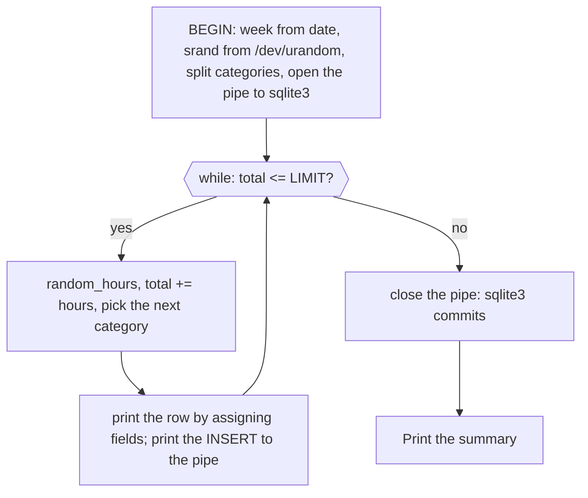
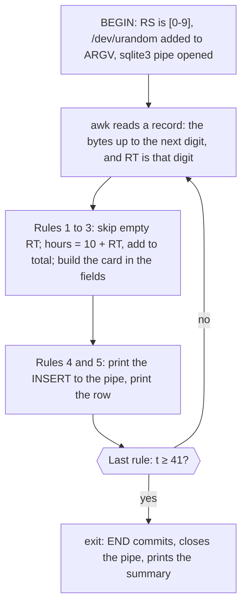

# AWK

Entradas: [`src/awk`](../../src/awk/README.md) (awk POSIX portable, un `while` en un bloque `BEGIN`) y [`src/awk-weird`](../../src/awk-weird/README.md) (gawk: un flujo de bytes aleatorios cortado por una expresión regular, sin bucle, `if`, función ni llamada a números aleatorios).

## Qué hace especial a AWK

Un programa awk es una lista de **reglas de patrón y acción**. El lenguaje las ejecuta en un bucle que nunca escribes: lee un registro, lo divide en campos, ejecuta cada regla cuyo patrón coincide y repite. `BEGIN` se ejecuta antes del primer registro y `END` después del último. Las variables aparecen de la nada como `""` o `0`, según lo que pida el contexto. Por eso los programas awk son cortos y por eso el "bucle" de la entrada rara no está en el programa.

| Característica | Dónde | Qué enseña |
| --- | --- | --- |
| Parámetros como variables locales | [`awk/timecards.awk` L14](../../src/awk/timecards.awk#L14): `function command_line(command,    line) {` | awk no tiene `local`. Los parámetros adicionales que no pasas son locales y, por convención, se separan con espacios. |
| Citar dividiendo | [L23](../../src/awk/timecards.awk#L23) `shell_quote` | `split(text, parts, "'")` hace seguro, sin trucos de regex, citar una ruta para el intérprete de comandos (*shell*). |
| Asignar a un campo reconstruye `$0` | [L44](../../src/awk/timecards.awk#L44) `print_row` | Fija `OFS`, asigna `$1 = $1` y `$0` se vuelve a unir con tabuladores. |
| Una tubería es un archivo | [L84](../../src/awk/timecards.awk#L84): `print "BEGIN;" \| sqlite` | `print ... \| command` inicia un proceso en el primer uso; `close(command)` espera a que termine. |
| Un bucle simple, en `BEGIN` | [L93](../../src/awk/timecards.awk#L93): `while (total <= LIMIT) {` | La entrada directa usa awk como lenguaje de scripts, no como procesador de registros. |
| `close()` es la comprobación de errores | [L102](../../src/awk/timecards.awk#L102) | Devuelve el estado de salida del comando en gawk y mawk, pero `status * 256` en busybox y `0` en el one-true-awk. Mira más abajo. |

## Un awk portable (`awk`)

La entrada directa se limita a lo que POSIX awk garantiza, así que funciona con gawk, mawk, el one-true-awk (BWK) y el awk de busybox. Su `check.sh` la ejecuta con los cuatro y la revisa con `gawk --lint --posix`, que debe quedar en silencio. Esa es la lección: **el awk portable es una restricción real** y las cuatro implementaciones difieren en detalles pequeños.

- **`close()` de una tubería devuelve números distintos según el awk.** gawk y mawk devuelven el estado de salida; busybox devuelve el estado multiplicado por 256. La compilación del one-true-awk que se probó devolvió 0 en todos los casos. La entrada trata "distinto de cero" como fallo y no depende del valor.
- **`srand`/`rand` se siembran con `od -An -N4 -tu4 /dev/urandom`** ([L70-71](../../src/awk/timecards.awk#L70-L71)): POSIX awk no tiene una fuente de entropía; `srand()` sin argumento se siembra con la hora, que se repite dentro de un segundo.
- **Los parámetros de una función no deben compartir nombre con una variable global** (`--lint` detecta el ocultamiento de nombres).

## Registros a partir de un flujo de bytes aleatorios (`awk-weird`)

### Contempla la monstruosidad

```bash
sandbox/container/run-image.sh src/awk-weird
```

El comentario de encabezado de [`timecards.awk`](../../src/awk-weird/timecards.awk#L17-L18) contiene todo el reto, sin la base de datos, en un solo comando:

```bash
gawk 'BEGIN{RS="[0-9]"; split("Meetings Coding Debugging Learning",C)}
      {printf "%s\t%d\t%d\n", C[(NR-1)%4+1], h=10+RT, t+=h} t>40{exit}' /dev/urandom
```

El programa lee bytes aleatorios e imprime tarjetas de horas. No hay llamada a números aleatorios, ni bucle, ni `if`.

### ¿Cómo demonios funciona eso?

**`RS` puede ser una expresión regular (gawk).** POSIX awk dice que el separador de registros es un solo carácter. gawk también acepta una regex y guarda en `RT` el texto que coincidió. [`RS = "[0-9]"`](../../src/awk-weird/timecards.awk#L34) dice "un registro termina en un dígito ASCII". Lee `/dev/urandom` con eso en mente y el flujo se corta después de cada byte que sea un dígito. Alrededor de 10 de cada 256 bytes son dígitos, repartidos de manera uniforme en 0-9, así que **`RT` es un dígito aleatorio uniforme**. El texto propio del registro (basura aleatoria antes del dígito) se ignora.

**Un registro es una tarjeta y un dígito es un dado.** `10 + RT` vale de 10 a 19 horas. El bucle de lectura de registros de awk, que tú no escribiste, ejecuta una pasada por tarjeta. Las reglas ([L52-69](../../src/awk-weird/timecards.awk#L52-L69)):

```awk
RT == "" { next }                                   # not a die roll (see below)
{ t += h = 10 + RT }                                # the die, and the running total
{ $0 = C[n++ % 4 + 1] "," h "," t "," week }        # the card, as fields
{ print "INSERT INTO ..." | sql }                   # one INSERT to sqlite3
{ OFS = "\t"; $1 = $1; print $0, "DEMO ONLY" }      # the same row, for people
t > 40 { exit }                                     # the stop rule
```

La regla 3 asigna `$0`, lo que hace que awk **vuelva a dividir** el registro en campos con `FS` (fijado en una coma en `BEGIN`). Así, `$1` es la categoría, `$2` las horas y `$3` el total. La regla 5 fija `OFS` y asigna `$1 = $1`, lo que reconstruye `$0` unido con tabuladores. La regla de parada es un *patrón*: **`t > 40 { exit }`** coincide cuando el total pasa de 40. Entonces `exit` termina el bucle principal (`END` todavía se ejecuta y confirma).

**Hacer que lea `/dev/urandom` sin `if`.** [`ARGV[ARGC] = "/dev/urandom"; ARGC += (ARGC < 2)`](../../src/awk-weird/timecards.awk#L39-L40) agrega un argumento de archivo y luego incrementa `ARGC` en `(ARGC < 2)`, que vale 1 si no se dio ningún archivo y 0 si se dio uno. En awk una comparación es un número, así que un condicional es aritmética.

**El orden importa: `RS` se aplica a cada lectura.** La semana se obtiene con `"date +%G-W%V" | getline week`. Con `RS="[0-9]"` ya fijado, la salida de `date` terminaría en el primer dígito del año y la semana quedaría vacía. Por eso la llamada se hace **antes** de fijar `RS` en [`BEGIN`](../../src/awk-weird/timecards.awk#L25).

### ¿Qué acabamos de aprender?

- **El bucle principal de awk es un bucle al que puedes apuntar.** Cambia `RS` y cambias lo que es un "registro"; cambia la entrada y cambias cuántas veces se ejecuta el bucle. El programa es el *cuerpo*.
- **Las reglas son condicionales.** Un patrón es un `if`; `exit` es `break`; un patrón vacío significa "siempre". Las seis reglas de arriba son un programa en línea recta cuyo flujo de control es la columna de patrones.
- **Una fuente de aleatoriedad puede ser cualquier flujo que cortes en trozos.** Cortar un flujo uniforme de bytes en una clase de bytes da un dígito uniforme; no hacen falta generador ni semilla.
- **Las implementaciones difieren justo donde el estándar se detiene.** `RT` es una extensión de gawk, así que este programa es una lección sobre qué parte de awk es el lenguaje y cuál es gawk.

Etiquetas: las reglas de patrón y acción, `BEGIN`/`END`, la nueva división de `$0`, `getline` desde un comando y `exit` son comportamiento **garantizado** por POSIX. Un `RS` de varios caracteres como regex es comportamiento **permitido por la implementación** (gawk, mawk, el one-true-awk y busybox lo aceptan). `RT`, `systime()` y `PROCINFO` son extensiones de gawk (comportamiento **permitido por la implementación**). Leer `/dev/urandom` como un archivo normal es comportamiento **permitido por la implementación** (Linux/BSD).

### Haz esto en producción y estás despedido

- **Solo funciona en gawk y el fallo con otros awk es silencioso.** mawk no tiene `RT`, así que `RT == ""` es *siempre* verdadero, la regla 1 omite todos los registros y la regla de parada nunca se activa. Con `/dev/urandom` mawk lee hasta quedarse sin memoria; con un archivo finito de dígitos informa `total=0 entries=0`. (Pruébalo, con cuidado, en [B13](../exercises.md#b13-awk-el-rt-que-falta-verificado).)
- **El último registro vacío.** Un archivo cuyo último carácter no es un dígito deja un registro final vacío con `RT == ""`. Sin la regla 1, eso cuenta como una tarjeta de 10 horas.
- **`RS` cambia cada lectura**, incluida la de `getline` desde un comando.
- **Un nombre de directorio con una comilla simple** rompería el comando del intérprete de comandos que crea el directorio.
- **Nada se puede probar de forma aislada**: el flujo es la entrada, así que la comprobación alimenta archivos de dígitos en cuatro formas y los compara tarjeta por tarjeta con una referencia en bash.

Usos legítimos: un `RS` como regex y `RT` son herramientas reales para el **análisis sintáctico de registros que no tienen forma de línea** (registros de varias líneas, tokens separados por un patrón, entradas de un log). Para *eso* se agregaron.

### Ahora rómpelo tú

Consulta los [ejercicios](../exercises.md#b13-awk-el-rt-que-falta-verificado). También hay un ejercicio de awk más antiguo que no necesita gawk: [C3](../exercises.md#c3-un-bucle-cuyo-estado-no-es-una-variable-verificado). Hay además una adaptación de referencia a awk en [`solutions/awk-port`](../solutions/awk-port), que es un tercer diseño (quien llama aporta los registros con `seq 5` y un patrón `total <= 40` es la regla de parada).

## Rarezas

- **Las variables sin inicializar son a la vez `""` y `0`.** `t` no necesita inicialización y `--lint` emite una advertencia de todos modos: la entrada directa inicializa `total` y `cards` por esa razón.
- **`print > "file"` trunca una vez y luego agrega** durante toda la vida del programa. Una tubería se inicia una sola vez y se reutiliza hasta que haces `close` sobre ella.
- **`$(NF)` y `$NF`** son distintos; `NF = 3` trunca un registro. Los campos empiezan en 1 y `$0` es el registro completo.
- **Una comparación vale 0 o 1**; por eso `ARGC += (ARGC < 2)` es legal.
- **`split(s, a, "'")` con un separador de un solo carácter** es literal; los más largos son regex, una sorpresa clásica.

## Lo raro junto a lo aburrido

[`awk`](../../src/awk/README.md) usa awk como lenguaje de scripts: un bloque `BEGIN`, funciones, un bucle. [`awk-weird`](../../src/awk-weird/README.md) usa awk como **máquina de procesamiento de registros**: sin bucle, el programa es una columna de patrones. La primera es lo que escribe el autor de un script. La segunda es para lo que se diseñó awk originalmente, apuntada a un flujo que nunca estuvo pensado para leer. Compara [`haskell`](haskell.md#la-es-perezosa-como-flujo-de-control), donde la estructura de datos dirige la evaluación, con [`regex-sed`](regex.md#gnu-sed), otra pequeña herramienta de Unix con un bucle implícito.

## ¿En qué circunstancias esta idea terrible se volvería razonable?

Cuando la entrada *es* el bucle. Un separador de registros con regex es la forma idiomática de leer párrafos, bloques de un archivo de configuración o entradas de un log. Cortar `/dev/urandom` para sacar dados es una acrobacia. Pero el mismo mecanismo le da a awk su fama de hacer en una línea lo que en otros lugares ocupa una página. Ese mecanismo es que un patrón decide dónde termina un registro y otro decide si importa.

<!-- BEGIN GENERATED program-flow:languages/awk.md -->
## How each program runs

Each picture below is the `## Program Flow` section of an entry's README, copied here by the build. It shows how that program makes the work happen: what the language, runtime or tool really does. [The introduction](../introduccion.md#qué-hace-el-reto) shows what the challenge asks for and where entries differ.

### Program flow of `awk`

From [`awk`](../../src/awk/README.md) ([source section](../../src/awk/README.md#flujo-del-programa)).



**What this shows:** the idiomatic shape of an AWK generator. There is no input, so `BEGIN` does everything, and an ordinary `while` is the loop. The test comes before each draw, so the card that crosses 40 is the last one added.

**Why this mechanism matters:** the pipe is an output stream with a name. `print ... | sqlite` starts `sqlite3` once and streams SQL to it, and `close` is what flushes it and returns its exit status. AWK's real loop, the one over input records, is not used here. The weird sibling [`awk-weird`](../../src/awk-weird/README.md) uses it.

### Program flow of `awk-weird`

From [`awk-weird`](../../src/awk-weird/README.md) ([source section](../../src/awk-weird/README.md#flujo-del-programa)).



**What this shows:** the loop is the loop that every AWK program has: read a record, run every rule in order, read the next. The program has no `while` and no `if`. A record separator that is a regular expression turns the random bytes into dice, and the digit that ended the record (`RT`) is the die.

**Why this mechanism matters:** the stop rule is a bare pattern, `t > 40 { exit }`, and it is the last rule, so the crossing card has already passed through every earlier rule. The input is `/dev/urandom`, which never ends, so only `exit` can stop the loop. Compare [`awk`](../../src/awk/README.md), which loops in `BEGIN`.
<!-- END GENERATED program-flow:languages/awk.md -->

## Las ciencias de la computación detrás de esta página

<!-- BEGIN GENERATED concepts:languages/awk.md -->
The computer-science ideas behind this page: [Control flow](../informatica/03-flujo-de-control-y-continuaciones.md#flujo-de-control), [Regular expressions](../informatica/05-lenguajes-formales-como-sustratos-de-computacion.md#expresiones-regulares), [Declarative programming](../informatica/05-lenguajes-formales-como-sustratos-de-computacion.md#programación-declarativa), [Domain-specific languages](../informatica/05-lenguajes-formales-como-sustratos-de-computacion.md#lenguajes-específicos-de-dominio), [State](../informatica/06-estado-mas-alla-de-las-variables.md#estado), [Portability](../informatica/08-fugas-de-abstraccion-y-dependencia-de-la-implementacion.md#portabilidad).
<!-- END GENERATED concepts:languages/awk.md -->
