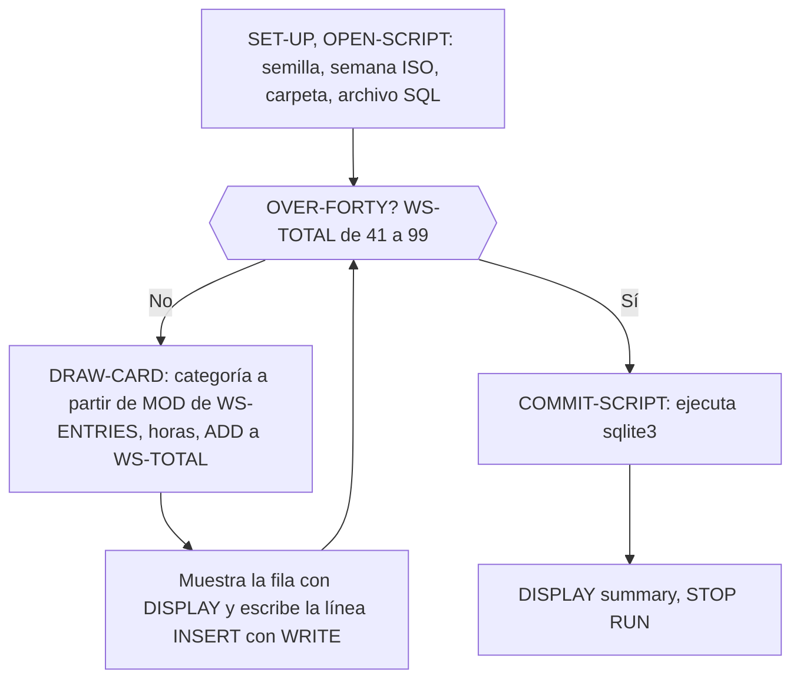
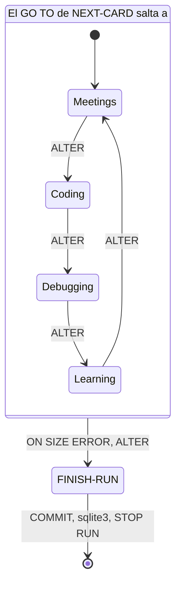

# COBOL

Entradas: [`src/cobol`](../../src/cobol/README.md) (la idiomática) y [`src/cobol-weird`](../../src/cobol-weird/README.md) (sin `IF` ni `PERFORM`).

Para una ruta de lectura avanzada con trazas y experimentos, consulta la [guía de estudio de COBOL](../guias-de-estudio/lenguajes/cobol.md).

COBOL (1959) se creó para registros, totales e informes y se nota. Lo que lo hace especial es que mueve las reglas y las formas *fuera del procedimiento y hacia la descripción de los datos*. Lo que lo vuelve un campo rico en rarezas es su edad: es lo bastante viejo como para tener una característica, `ALTER`, que el estándar ya eliminó.

## Qué hace especial a COBOL

| Característica | Dónde | Qué enseña |
| --- | --- | --- |
| Una regla de parada declarada como datos | [`cobol/timecards.cob` L41-42](../../src/cobol/timecards.cob#L41-L42): `01 WS-TOTAL PIC 99 VALUE 0.` / `88 OVER-FORTY VALUE 41 THRU 99.` usados por [L93](../../src/cobol/timecards.cob#L93): `PERFORM DRAW-CARD UNTIL OVER-FORTY` | Un *nombre de condición* de nivel `88` es un rango con nombre de valores de un campo. El bucle no contiene ninguna comparación; para cambiar la regla se edita el dato, no el código. |
| La cláusula PICTURE hace el redondeo | [L107](../../src/cobol/timecards.cob#L107): `COMPUTE WS-HOURS = 10 + FUNCTION RANDOM * 10`, en `PIC 99` | Guardar 10.0-19.99 en un campo de dos dígitos descarta la fracción. La forma del campo es la función piso. La aritmética de COBOL es decimal, no de punto flotante binario. |
| Una cadena de texto, vista dos veces | [L48-55](../../src/cobol/timecards.cob#L48-L55): `CATEGORY-TABLE REDEFINES CATEGORY-NAMES` / `PIC X(9) OCCURS 4 TIMES` | `REDEFINES` coloca una segunda descripción sobre los mismos bytes. Una tabla de cadenas de texto también es una sola cadena de texto larga. |
| Archivos cuyos nombres son variables | `SELECT SQL-SCRIPT ASSIGN TO WS-SQL-PATH` | El programa escribe un script SQL como un archivo secuencial por líneas y se lo entrega a `sqlite3`: una transacción o ninguna. |

## ALTER

`ALTER` es el ejemplo perfecto de "una rareza del lenguaje que alguna vez fue una característica". Se declaró obsoleto en 1985 y se eliminó del estándar en 2002. GnuCOBOL todavía lo ejecuta y emite cinco advertencias.

### Contempla la monstruosidad

```bash
sandbox/container/run-image.sh src/cobol-weird
```

De tres a cinco filas de tarjeta de horas y un total confirmado que pasa de 40, a partir de un programa sin `IF`, `PERFORM`, `EVALUATE`, `UNTIL` ni `MOD`.

### ¿Cómo demonios funciona eso?

Los párrafos se ejecutan en el orden en que están escritos, a menos que un `GO TO` los redirija. El bucle es un párrafo que contiene un `GO TO` ([`cobol-weird/timecards.cob` L150-151](../../src/cobol-weird/timecards.cob#L150-L151)):

```cobol
       NEXT-CARD.
           GO TO MEETINGS-CARD.
```

Un párrafo que es exactamente un `GO TO` es lo único que `ALTER` puede cambiar. Cada párrafo de categoría lo reconecta con la categoría siguiente ([L157](../../src/cobol-weird/timecards.cob#L157), [L162](../../src/cobol-weird/timecards.cob#L162), [L167](../../src/cobol-weird/timecards.cob#L167), [L172](../../src/cobol-weird/timecards.cob#L172)): `ALTER NEXT-CARD TO PROCEED TO CODING-CARD`. Nada cuenta módulo 4. "Cuál es la categoría siguiente" existe solo como el destino actual de un salto.

La regla de parada es el desbordamiento. `WS-HEADROOM` es `PIC 99` y empieza en 59 ([L44](../../src/cobol-weird/timecards.cob#L44)). Cada tarjeta suma sus horas ([L196-199](../../src/cobol-weird/timecards.cob#L196-L199)):

```cobol
ADD WS-HOURS TO WS-HEADROOM
    ON SIZE ERROR
        ALTER NEXT-CARD TO PROCEED TO FINISH-RUN
END-ADD
```

59 + total cabe en dos dígitos mientras el total sea 40 o menos. La suma que llega a 100 es un *error de tamaño*: el campo queda sin cambios y `ON SIZE ERROR` reconecta `NEXT-CARD` por última vez. El `GO TO NEXT-CARD` que sigue es la misma sentencia de siempre y ahora termina la ejecución.

### ¿Qué acabamos de aprender?

- **Un destino de salto puede ser estado.** El flujo de control no es solo el contador de programa recorriendo el texto fuente; también puede ser un dato que el programa edita. Compara [el reinicio de Make](make-cmake.md#gnu-make), [los registros de CMake](make-cmake.md#cmake) y [el `>in` de Forth](forth.md): todos guardan el estado de control en un lugar distinto de las variables ordinarias. Consulta los [patrones](../patrones.md#el-estado-de-control-fuera-de-las-variables).
- **El desbordamiento es una decisión.** `ON SIZE ERROR` es un condicional que se dispara porque la aritmética se queda sin dígitos, no por una comparación que alguien escribió.
- **La programación estructurada ganó por una razón** y este programa es esa razón. Mira el paso siguiente.

Etiquetas: `ALTER` es comportamiento **permitido por la implementación** (se eliminó del estándar, pero GnuCOBOL lo conserva). El comportamiento ante un error de tamaño (campo sin cambios) es **garantizado** por el estándar.

### Haz esto en producción y estás despedido

- **No puedes entender un párrafo leyéndolo.** `NEXT-CARD` dice `GO TO MEETINGS-CARD` y, en tiempo de ejecución, casi nunca lo hace. Esa queja es lo que hizo que se eliminara `ALTER`.
- **Los depuradores muestran variables, no destinos de salto.** Nada en los campos de `WS-*` te dice cuál es la categoría siguiente.
- **Portabilidad.** Los compiladores más nuevos podrían no aceptarlo y las banderas de conformidad con el estándar podrían rechazarlo.
- **Optimizadores.** Un compilador que no puede suponer que un `GO TO` es constante tiene poco que hacer con el párrafo.
- **Reentrada.** Reescribir la propia tabla de saltos del código es lo opuesto a la reentrada: dos llamadores comparten un solo `NEXT-CARD`. (Sobre el tema de reescribir el programa, consulta [APL](apl.md#funciones-que-se-modifican-a-sí-mismas-apl-weird).)

Usos legítimos: ninguno en código nuevo. Históricamente, sin embargo, en sistemas por lotes con poca memoria y sensibles al rendimiento, un interruptor fijado una vez y probado con un `GO TO` incondicional costaba menos que probar una bandera en cada pasada. Esa es la respuesta del "mainframe en 1978" a la pregunta recurrente: *era razonable cuando la restricción era real*. Consulta la [introducción](../introduccion.md#la-pregunta-recurrente).

### Ahora rómpelo tú

Consulta los [ejercicios](../exercises.md#b1-cobol-predice-y-luego-rompe-alter-verificado): predice qué pasa si agregas un `DISPLAY` a `NEXT-CARD` o cambias el `59`.

## Rarezas

- **Formato fijo.** Las columnas 1-6 eran un número de secuencia. `*` en la columna 7 es un comentario. Los nombres de divisiones y párrafos empiezan en la columna 8 ("área A") y las sentencias en la columna 12 ("área B"). **No se lee nada más allá de la columna 72**. Una línea larga se trunca en silencio, no se rechaza. `check.sh` rechaza las líneas de más de 72 ([`cobol-weird/check.sh`](../../src/cobol-weird/check.sh)).
- **`STRING` no limpia su destino.** Escribe desde la izquierda y deja los bytes viejos a la derecha, así que los búferes reutilizados necesitan `MOVE SPACES` antes.
- **Las palabras reservadas están en todas partes.** `TAB` está reservada en GnuCOBOL, por eso el carácter de tabulación es `WS-TAB`.
- **`SYSTEM` devuelve el estado de espera sin procesar**: un código de salida de 3 vuelve como 768. [`cobol-weird`](../../src/cobol-weird/README.md#cómo-funciona-el-truco) divide entre 256 para recuperarlo.
- **`ACCEPT ... FROM ENVIRONMENT` deja el campo en blanco** cuando la variable no está definida, en lugar de dejarlo como estaba.
- **La semana ISO hay que construirla a mano.** COBOL tiene funciones de fecha, pero no de semana ISO. `FUNCTION INTEGER-OF-DATE` cuenta desde 1601-01-01 (un lunes) y la regla del jueves son cuatro `COMPUTE`. El README indica que se comprobó con `date +%G-W%V` para 2020-2030.
- **Elegir sin `IF`.** [`cobol-weird` L119](../../src/cobol-weird/timecards.cob#L119): `COMPUTE WS-BASE-IX = 1 + FUNCTION MIN(WS-XDG-LENGTH, 1)` elige una de dos entradas de la tabla solo con datos.
- **`ALTER` necesita un párrafo de una sola `GO TO`.** Pon un `DISPLAY` en `NEXT-CARD` y el compilador lo rechaza.
- **Un error de tamaño deja sin cambios el campo de destino**, así que `WS-HEADROOM` no necesita reinicio. Sin `ON SIZE ERROR`, la suma descartaría en silencio el dígito inicial (99 + 1 = 00).

## Lo raro junto a lo aburrido

[`cobol`](../../src/cobol/README.md) hace el trabajo en un solo `PERFORM ... UNTIL OVER-FORTY` con la regla declarada como datos. [`cobol-weird`](../../src/cobol-weird/README.md) lo hace con saltos reconectados. La primera es más fácil de cambiar y de leer; la segunda muestra lo que el lenguaje le permite a un programa hacerse a sí mismo.

## ¿En qué circunstancias esta idea terrible se volvería razonable?

Rara vez en la forma que se muestra. Sin embargo, la regla de parada de nivel `88` es un buen diseño dondequiera que las reglas de negocio cambien más a menudo que el código. La forma con `ALTER` era razonable cuando la memoria y los ciclos eran la restricción y los ingenieros que mantenían el sistema entendían cada salto. Dejó de serlo cuando crecieron los equipos, las herramientas y los horizontes de mantenimiento.

<!-- BEGIN GENERATED program-flow:languages/cobol.md -->
## Cómo corre cada programa

Cada imagen de abajo es la sección `## Flujo del programa` del README de una entrada, copiada aquí por la compilación. Muestra cómo ese programa hace el trabajo: lo que el lenguaje, el entorno de ejecución o la herramienta hacen en realidad. [La introducción](../introduccion.md#qué-hace-el-reto) muestra qué pide el reto y en qué se distinguen las entradas.

### Flujo del programa de `cobol`

Desde [`cobol`](../../src/cobol/README.md) ([sección original](../../src/cobol/README.md#flujo-del-programa)).



**Qué muestra:** un bucle estructurado convencional. `PERFORM DRAW-CARD UNTIL OVER-FORTY` evalúa la condición antes de cada pasada, así que la prueba es un nodo real y el ciclo es una arista real.

**Por qué importa este mecanismo:** la regla de parada son datos, no código. `OVER-FORTY` es un nombre de nivel 88 para los valores de 41 a 99 de `WS-TOTAL`, así que el bucle pregunta a los datos si debe continuar. El hermano raro [`cobol-weird`](../../src/cobol-weird/README.md) no tiene esa prueba.

### Flujo del programa de `cobol-weird`

Desde [`cobol-weird`](../../src/cobol-weird/README.md) ([sección original](../../src/cobol-weird/README.md#flujo-del-programa)).



**Qué muestra:** el estado de este programa es el destino de un solo `GO TO`. En cada tarjeta, el párrafo de categoría que indica el destino se ejecuta, reescribe el destino con `ALTER` para que apunte a la categoría siguiente y pasa a `RECORD-CARD`, que salta de nuevo a `NEXT-CARD`. El texto fuente de ese `GO TO` no cambia nunca. El salto sí cambia.

**Por qué importa este mecanismo:** no hay ninguna condición de bucle que dibujar. La salida es otra reescritura: cuando `WS-HEADROOM` se desborda, `ON SIZE ERROR` apunta el mismo `GO TO` a `FINISH-RUN`. Compara la entrada simple [`cobol`](../../src/cobol/README.md), donde `PERFORM ... UNTIL` prueba una condición.
<!-- END GENERATED program-flow:languages/cobol.md -->

## Las ciencias de la computación detrás de esta página

<!-- BEGIN GENERATED concepts:languages/cobol.md -->
Las ideas de ciencias de la computación detrás de esta página: [Cómo representar el estado](../informatica/02-que-cuenta-como-maquina.md#cómo-representar-el-estado), [Flujo de control](../informatica/03-flujo-de-control-y-continuaciones.md#flujo-de-control), [Goto y programación estructurada](../informatica/03-flujo-de-control-y-continuaciones.md#goto-y-programación-estructurada), [El contador de programa](../informatica/03-flujo-de-control-y-continuaciones.md#el-contador-de-programa), [Código automodificable](../informatica/03-flujo-de-control-y-continuaciones.md#código-automodificable), [Programación declarativa](../informatica/05-lenguajes-formales-como-sustratos-de-computacion.md#programación-declarativa), [Estado](../informatica/06-estado-mas-alla-de-las-variables.md#estado), [Manejo de excepciones](../informatica/07-efectos-errores-y-confirmacion.md#manejo-de-excepciones), [Restricciones de integridad](../informatica/07-efectos-errores-y-confirmacion.md#restricciones-de-integridad), [Comportamiento indefinido, no especificado y definido por la implementación](../informatica/08-fugas-de-abstraccion-y-dependencia-de-la-implementacion.md#comportamiento-indefinido-no-especificado-y-definido-por-la-implementación).
<!-- END GENERATED concepts:languages/cobol.md -->
