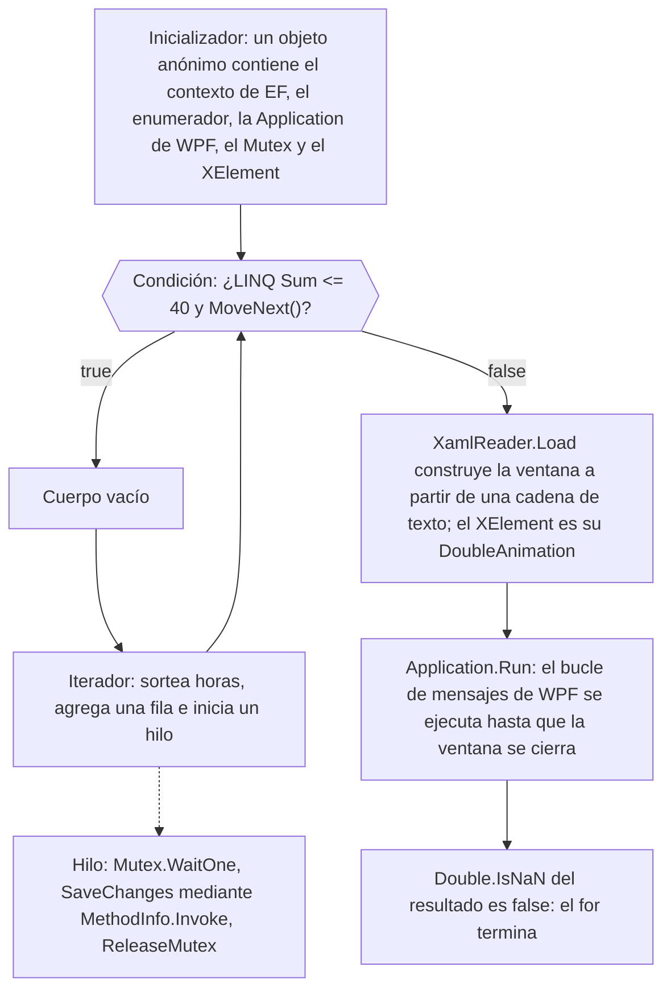
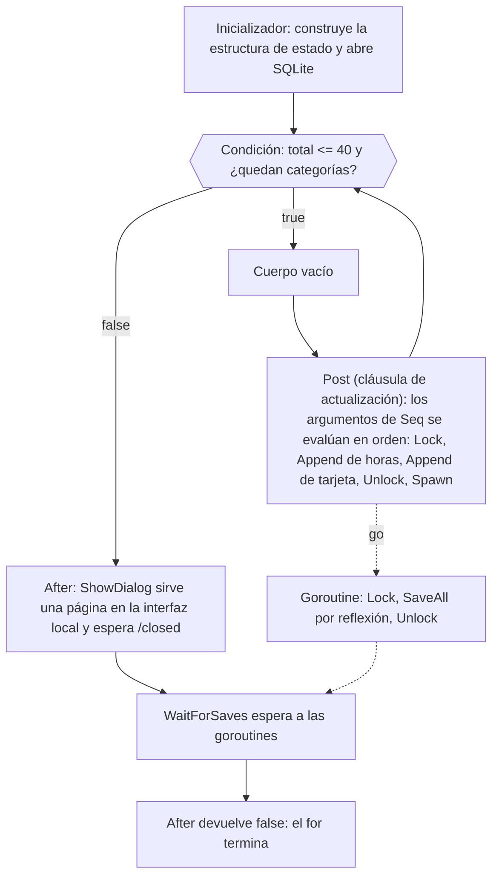
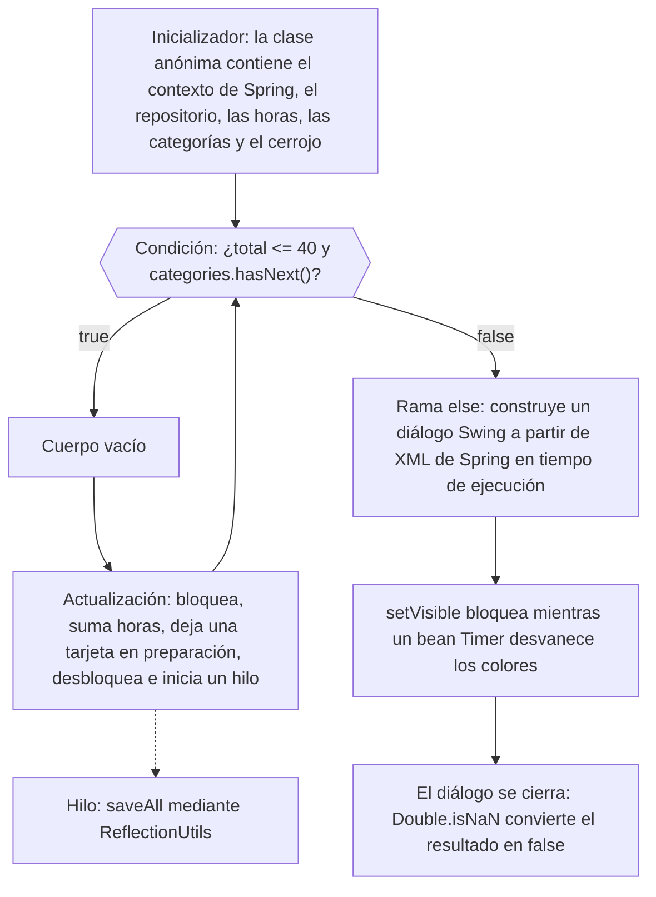
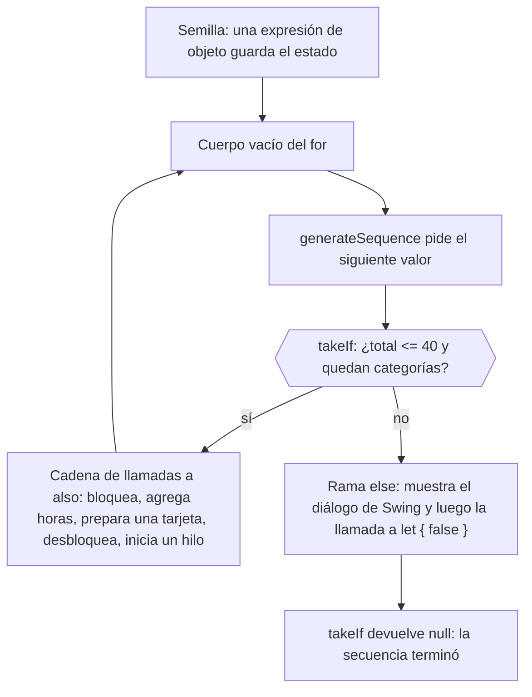
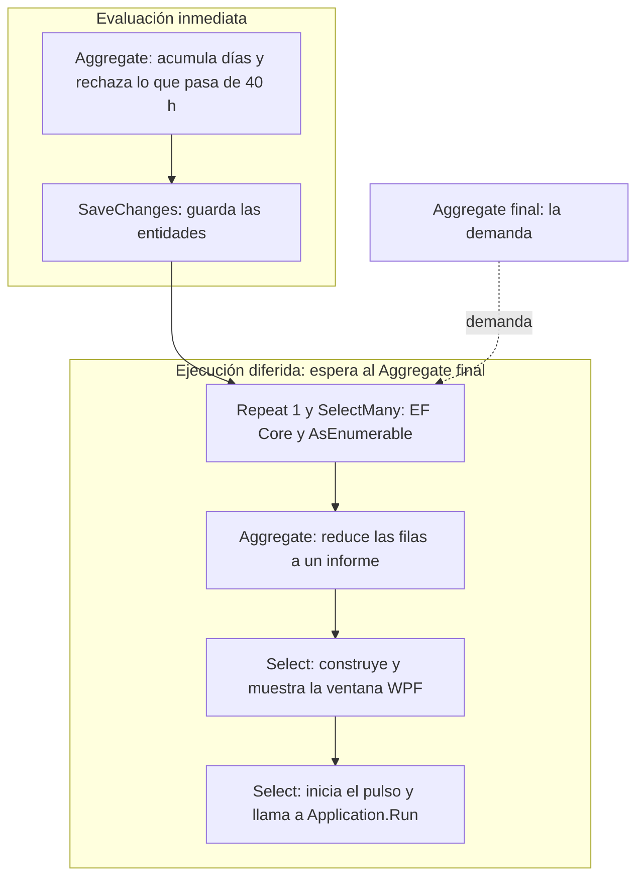
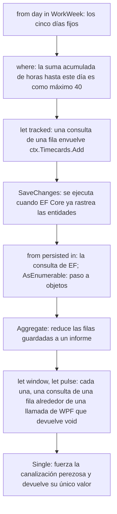
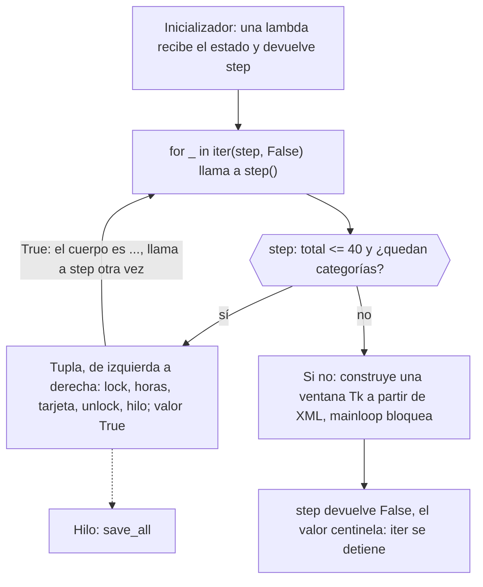
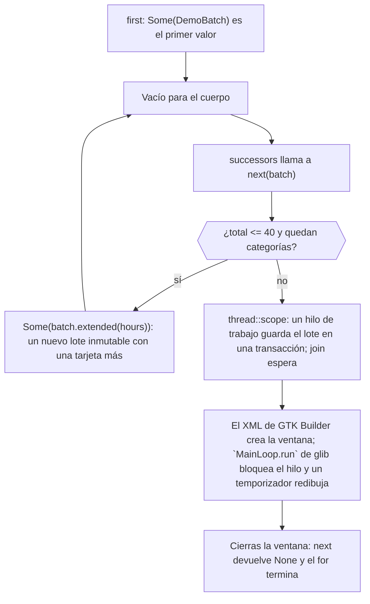
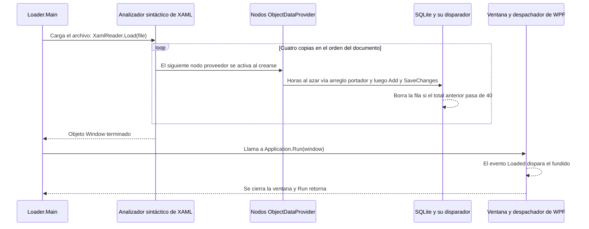

# C#, LINQ y XAML (más las adaptaciones de una sola sentencia)

Entradas: [`src/ModernChallenge1`](../../src/ModernChallenge1/README.md), [`src/LinqChallenge1`](../../src/LinqChallenge1/README.md), [`src/LinqChallenge2`](../../src/LinqChallenge2/README.md), [`src/xaml`](../../src/xaml/README.md) y las adaptaciones [`src/JavaChallenge1`](../../src/JavaChallenge1/README.md), [`src/KotlinChallenge1`](../../src/KotlinChallenge1/README.md), [`src/PythonChallenge1`](../../src/PythonChallenge1/README.md), [`src/GoChallenge1`](../../src/GoChallenge1/README.md), [`src/RustChallenge1`](../../src/RustChallenge1/README.md).

Para una ruta de lectura avanzada con trazas y experimentos, consulta la [guía de estudio de C#, LINQ, XAML y adaptaciones](../guias-de-estudio/lenguajes/csharp-linq-xaml-y-adaptaciones.md).

C# es el lenguaje *canónico* del repositorio: el reto comenzó como un ejercicio de clase en 2008 para mostrar las características de C# 3.0 y .NET 3.x. También es la referencia para medir los [problemas bloqueantes](../problemas-bloqueantes.md).

Este recorrido cubre la entrada original de C#, las variantes de LINQ y XAML y las adaptaciones de una sola sentencia. Los ejemplos usan los pasos de las lecciones que corresponden a cada mecanismo.

## El original: ModernChallenge1

### Contempla la monstruosidad

```powershell
cd src\ModernChallenge1
dotnet run          # Windows + .NET 10; or: sandbox\windows\run.ps1 src\ModernChallenge1
```

Una ventana de WPF aparece y desaparece gradualmente. `Main` contiene exactamente un `for` cuyo cuerpo está vacío ([`Program.cs` L132](../../src/ModernChallenge1/Program.cs#L132): `{ /* Intentionally empty. */ }`).

### ¿Cómo demonios funciona eso?

Lee el encabezado `for` como un pequeño lenguaje de tres espacios.

| Cláusula | Dónde | Qué contiene |
| --- | --- | --- |
| **Inicializador** | [L37-58](../../src/ModernChallenge1/Program.cs#L37-L58) | Un objeto anónimo `var i = new { ... }` contiene todo el estado: contexto de EF Core, `Random`, enumerador de categorías, `Application` de WPF, un `Mutex` y un `XElement` que se convierte en `DoubleAnimation`. Un inicializador `for` permite una declaración, así que el objeto anónimo es el único contenedor permitido. |
| **Condición** | [L66-98](../../src/ModernChallenge1/Program.cs#L66-L98) | `(from hours in i.totalHours select hours).Sum() <= 40d && i.categories!.MoveNext() ? true : new Func<bool>(() => Double.IsNaN(i.app.Run(...))).Invoke()`. Mientras el total sea 40 o menos, el bucle continúa. Cuando deja de serlo, la condición construye y muestra la ventana en línea y devuelve false. |
| **Iterador** | [L106-130](../../src/ModernChallenge1/Program.cs#L106-L130) | Extrae horas, agrega una fila a EF Core e inicia en segundo plano un `Thread` que llama a `Mutex.WaitOne`, `SaveChanges` y `ReleaseMutex` *mediante `MethodInfo.Invoke`*. |

Cada evaluación de la condición `for` necesita un número de inmediato. La proyección LINQ puede aplazar la enumeración. La operación terminal `Sum()` la enumera de inmediato en la misma evaluación de la condición. La [adaptación de Node](javascript.md#el-for-sin-cuerpo-en-node) también calcula su total de inmediato, con `reduce` sobre el arreglo.

La ventana se construye a partir de una cadena de texto de XAML sin procesar mediante `XamlReader.Load` durante la ejecución ([L77](../../src/ModernChallenge1/Program.cs#L77)).

### ¿Qué acabamos de aprender?

- `for` consta de tres expresiones y un cuerpo, y el cuerpo es opcional.
- Un **tipo anónimo** permite reunir estados distintos en una sola expresión.
- Un efecto secundario de `void` puede convertirse en un valor con un `Func<T>` invocado in situ. Cada entrada posterior reutiliza esta maniobra.

### Haz esto en producción y estás despedido

- **`DbContext` no es seguro para hilos.** El `Mutex` existe solo para que la estructura de hilo más reflexión funcione siquiera ([README](../../src/ModernChallenge1/README.md#trampas-que-conviene-conocer)); es un vestigio histórico.
- **La reflexión y un hilo no aportan nada.** Son una cápsula del tiempo deliberada al estilo de 2008; el código moderno usaría `await SaveChangesAsync()`.
- **WPF necesita `[STAThread]`** y un solo hilo de interfaz de usuario ([L30](../../src/ModernChallenge1/Program.cs#L30)).
- **Legibilidad, pruebas y depuración**: nada en ese encabezado `for` permite avanzar paso a paso, hacer pruebas unitarias ni reutilizarlo.

Usos legítimos: ninguno para el encabezado tal como está escrito. Las *ideas* (estado en un objeto, consultas puras sobre una lista, efectos en los extremos) son comunes.

## La ejecución diferida y el truco de convertir void en valor

Una nota antes del código: las dos entradas LINQ **no** son el reto compartido. No extraen horas aleatorias. Su semana laboral tiene cinco días fijos de 8 horas. El límite deja el total en exactamente 40.0 horas y ninguna tarjeta cruza el límite. Estas entradas enseñan la ejecución diferida, no la regla de parada.

### LinqChallenge1: una cadena fluida

Una sentencia de expresión terminada en `;` se construye con llamadas LINQ. Empieza en [`Program.cs` L45](../../src/LinqChallenge1/Program.cs#L45) y termina en `.Aggregate(...)`, que fuerza la cola diferida. Etapas:

| Etapa | Operador | Lección |
| --- | --- | --- |
| 1 | `Aggregate` sobre una semana laboral fija, `ctx.Add(...)` dentro de `new Func<...>(() => {...}).Invoke()` | `Aggregate` es de **evaluación inmediata**; se ejecuta primero. |
| tupla | `(..., ctx.SaveChanges())` ([L66-68](../../src/LinqChallenge1/Program.cs#L66-L68)) | Los elementos de la tupla se evalúan **de izquierda a derecha**. Esto sitúa el guardado después de que se rastrea cada entidad. |
| 2 | `Enumerable.Repeat(x, 1).SelectMany(...)` y `.AsEnumerable()` ([L72-78](../../src/LinqChallenge1/Program.cs#L72-L78)) | El límite entre `IQueryable<T>` y `IEnumerable<T>`: EF traduce `Where/OrderBy/Select` a SQL y se detiene en `AsEnumerable()`. |
| 3-5 | `Aggregate`, `Select` construye la ventana WPF, `Select` emite pulsos y llama a `Application.Run()` | Las etapas diferidas de `Select` no hacen nada hasta que se enumeran. |
| final | `.Aggregate(0, (count, _) => count + 1)` | Un operador de evaluación inmediata al final arrastra toda la canalización diferida. |

¿Por qué hay dos `Enumerable.Repeat(..., 1)` anidados? C# permite pocas formas de expresión como sentencia (invocación, asignación, `await`...), pero no `x is var r && ...`. Por eso cada etapa se anida directamente como argumento del siguiente `Repeat`. Este convierte un valor de nuevo en una secuencia de un elemento para que el siguiente paso siga siendo un operador LINQ.

### LinqChallenge2: sintaxis de consulta hasta el fondo

Desde [`LinqChallenge2/Program.cs` L53](../../src/LinqChallenge2/Program.cs#L53) aparece la misma demostración que en casi todos los `from`/`where`/`let`/`select`. Cuando un `let` debe colar una llamada a `void` ([L71-72](../../src/LinqChallenge2/Program.cs#L71-L72)), la envuelve en una consulta desechable de una fila: `from _track in Enumerable.Repeat(0, 1) ...`. Tortugas hasta el fondo, a propósito. El [README](../../src/LinqChallenge2/README.md) enumera lo que no puede usar sintaxis de consulta (`Aggregate`, `Repeat`, `ToList`, `Sum`, `Single`, `AsEnumerable`).

### ¿Qué acabamos de aprender?

- **LINQ es una canalización de ejecución, no solo un lenguaje de consulta.** Las etapas de evaluación inmediata o diferida y el proveedor (SQL u objetos) que ejecuta cada una determinan *cuándo ocurren tus efectos secundarios*. Mira la misma pregunta en [Haskell](haskell.md#la-es-perezosa-como-flujo-de-control).
- **Los límites entre proveedores son reales.** Todo lo anterior a `AsEnumerable()` se convierte en SQL; todo lo posterior es C# que se ejecuta en tu proceso.
- **Los efectos secundarios en una canalización diferida son un imán para los bichos**, y las entradas lo hacen visible.

Etiquetas: el comportamiento de ejecución diferida o inmediata de cada operador está **garantizado** (documentado). El orden de evaluación de izquierda a derecha de las tuplas está **garantizado** por la especificación de C#. El comportamiento por el cual EF traduce una expresión dada está **permitido por la implementación** y depende del proveedor.

### Haz esto en producción y estás despedido

- **Mutación oculta.** Ambos acumuladores `Aggregate` se modifican in situ (`list.Add`). Es un atajo pragmático, no la pureza de LINQ.
- **La enumeración repetida ejecuta de nuevo los efectos.** Una consulta con un efecto secundario en un `Select` que se enumera dos veces ejecuta el efecto secundario dos veces.
- **Afinidad con el hilo de la interfaz.** Crear y procesar una ventana WPF dentro de una lambda `Select` solo funciona por el hilo STA y `Application.Run()`. `ShutdownMode` es `OnExplicitShutdown`, así que el controlador `Completed` de la animación termina la aplicación, no "se cerró la última ventana".
- **Datos fijos.** Ambas entradas LINQ generan una semana laboral *fija* de cinco días de 8 horas, no tarjetas aleatorias de 10 a 19 horas. Consulta [problemas bloqueantes](../problemas-bloqueantes.md#c-y-linq).

### Ahora rómpelo tú

Consulta los [ejercicios](../exercises.md#b7-linq-enumera-dos-veces-verificado).

## XAML

[`xaml/Loader.cs` L10-15](../../src/xaml/Loader.cs#L10-L15) es una sola expresión: `new Application().Run((Window)XamlReader.Load(File.OpenRead(args[0])))`. Todo lo demás está en el archivo `.xaml` y se ejecuta **mientras se analiza el archivo**.

### ¿Cómo es posible siquiera?

| Mecanismo | Papel |
| --- | --- |
| `XamlReader.Load` | el intérprete: el análisis sintáctico *es* la ejecución |
| `ObjectDataProvider` | la instrucción: construye cualquier objeto, llama a cualquier método y se activa al analizarse. El orden del documento es el contador de programa. |
| Arreglos "portadores" | las variables: un proveedor llena un `char[]` o `byte[]` in situ; el siguiente lo lee ([`efcore.xaml` L15-30](../../src/xaml/efcore.xaml#L15-L30) muestra la cadena `Next` -> `ToString` -> `CopyTo`) |
| Motores de expresiones (`DataTable.Compute("Sum(h)")`, `DataView.RowFilter`, SQL) | la ALU y los condicionales |
| `Delegate.CreateDelegate` en marcado | un `Thread` construido, iniciado y unido desde XAML |

### Letra pequeña, pero honesta

- **El bucle está desenrollado**: cuatro pasadas copiadas y pegadas. "Cuatro categorías" está incorporado al marcado, así que esta entrada puede repartir como máximo cuatro tarjetas. Con la semilla incluida (`Random(42)`: 16, 11, 11, 15 horas), siempre reparte cuatro y termina en 53. Por eso nunca ocurre el caso en que cuatro tarjetas suman un total de exactamente 40 (que debería continuar hasta una quinta). Es la única entrada con ese límite.
- **La ramificación la hace SQL o `DataTable`**, no los disparadores de WPF.
- **`Random(42)` tiene una semilla fija** en los archivos `.xaml`, así que las horas son las mismas en cada ejecución.
- **`XamlChallenge1.csproj` tiene `<Page Remove="**/*.xaml" />`**, así que los archivos se cargan en tiempo de ejecución y nunca se compilan. Ese *es* el propósito.
- **Tres variantes**: `strict.xaml` (solo tipos .NET, guarda XML), `sqlite.xaml`, `efcore.xaml`. La regla de parada es una cláusula SQL `WHERE` o un disparador de SQLite.

### ¿Qué acabamos de aprender?

Se supone que XAML *describe* un árbol de objetos. El analizador sintáctico no lo impone: con `ObjectDataProvider` y algunos tipos integrados, el análisis sintáctico y la ejecución se vuelven el mismo acto. Una [entrada de blog](../../docs/graficos-de-barras-apiladas.md) sobre Web Forms de 2013 impulsó la misma idea (un gráfico sin código subyacente), así que el linaje es real.

Etiquetas: la documentación de WPF indica que está **garantizado** que `ObjectDataProvider` llame a métodos al construir; depender de la evaluación en el orden del documento y de arreglos portadores en el mismo lugar es **aprovechado por accidente**.

**Activado en producción**: la invocación arbitraria de métodos desde un archivo de marcado es una superficie de ejecución de código. Cargar XAML no confiable con `XamlReader.Load` es un riesgo conocido. Las herramientas (diseñadores y linters) suponen que el archivo es dato.

## Las adaptaciones de una sola sentencia: mismo truco, distinta maquinaria

Las adaptaciones de Ken conservan la regla del bucle sin cuerpo y usan las piezas propias de cada lenguaje. Un buen ejercicio es encontrar las tres cláusulas de cada lenguaje.

| Adaptación | Mecanismo de la cabecera | Peculiaridad que vale la pena robar |
| --- | --- | --- |
| [Java](../../src/JavaChallenge1/README.md) | Cabecera `for`; una clase anónima guarda el estado; ventana Swing ensamblada desde XML de Spring con SpEL | Un bloque de texto XML como interfaz; el README compara las cuatro adaptaciones |
| [Kotlin](../../src/KotlinChallenge1/README.md) | `for (pass in generateSequence(...) {...})`; un valor nulo de `takeIf` termina la secuencia | El cuerpo se ejecuta una vez antes de la primera comprobación, una diferencia documentada |
| [Python](../../src/PythonChallenge1/README.md) | `for _ in iter(<lambda>, False): ...` | No hay bucles `;`, así que una tupla y `[-1]` sustituyen al operador coma; widgets Tk creados desde una cadena de texto XML con `getattr(tk, e.tag)` |
| [Go](../../src/GoChallenge1/README.md) | Un `for` real de tres cláusulas; auxiliares como `Seq` y `After` en `helpers.go` | Las operaciones que solo admiten sentencias tuvieron que ocultarse en un archivo auxiliar, el costo declarado de la versión Go |
| [Rust](../../src/RustChallenge1/README.md) | `for _ in std::iter::successors(...) {}` ([`main.rs` L19](../../src/RustChallenge1/src/main.rs#L19)) | Sin `;`, `let` ni `return` en `main`; `match x { name => ... }` reemplaza a `let`; una prueba examina el código fuente para imponerlo |

## ¿En qué circunstancias esta idea terrible se volvería razonable?

Poner todo en una cabecera de `for`: nunca. Pero conviene saber que LINQ es diferido y que `IQueryable` y `IEnumerable` son mundos distintos. También conviene saber que `DbContext` no es seguro para hilos y que el analizador sintáctico de XAML puede llamar métodos. Aprende todo eso *antes* de que te lo enseñe un bicho en producción.

<!-- BEGIN GENERATED program-flow:languages/csharp-linq-xaml.md -->
## Cómo corre cada programa

Cada imagen de abajo es la sección `## Flujo del programa` del README de una entrada, copiada aquí por la compilación. Muestra cómo ese programa hace el trabajo: lo que el lenguaje, el entorno de ejecución o la herramienta hacen en realidad. [La introducción](../introduccion.md#qué-hace-el-reto) muestra qué pide el reto y en qué se distinguen las entradas.

### Flujo del programa de `ModernChallenge1`

Desde [`ModernChallenge1`](../../src/ModernChallenge1/README.md) ([sección original](../../src/ModernChallenge1/README.md#flujo-del-programa)).



**Qué muestra:** el truco original. Una sentencia `for` con el cuerpo vacío, en la que la condición y el iterador hacen todo el trabajo. Mientras el total no pasa de 40 y queda una categoría por repartir, la condición es verdadera. Cuando no es así, la condición crea y muestra la ventana, y la llamada bloqueante de la ventana devuelve el `false` que termina el bucle.

**Por qué importa este mecanismo:** `Application.Run` es el propio bucle de un marco de interfaz de usuario, iniciado desde dentro de la condición de un bucle. La animación desvanece la ventana por sí sola: nada en `Program.cs` se suscribe a un evento para hacerlo. Consulta [`xaml`](../../src/xaml/README.md) para ver con más rigor qué hace ese análisis sintáctico en tiempo de ejecución.

### Flujo del programa de `GoChallenge1`

Desde [`GoChallenge1`](../../src/GoChallenge1/README.md) ([sección original](../../src/GoChallenge1/README.md#flujo-del-programa)).



**Qué muestra:** `for` en Go tiene las mismas tres cláusulas que el original en C#, pero Go solo permite sentencias simples ahí. Por eso el trabajo pasa a funciones auxiliares, y `Seq(...)` recibe sus argumentos, que se evalúan en orden, en lugar de usar la lista separada por comas. Las aristas punteadas son la parte concurrente: cada pasada inicia una goroutine, y el programa debe esperar a todas antes de terminar.

**Por qué importa este mecanismo:** el bucle termina por su condición, no por un `break`. Con `||`, la rama falsa (el operando derecho, que se evalúa si la primera parte de la condición es falsa) hace el trabajo final (mostrar la página, esperar los guardados) y luego devuelve `false`. La ventana es una página del navegador, porque Go no tiene una biblioteca estándar para interfaces gráficas.

### Flujo del programa de `JavaChallenge1`

Desde [`JavaChallenge1`](../../src/JavaChallenge1/README.md) ([sección original](../../src/JavaChallenge1/README.md#flujo-del-programa)).



**Qué muestra:** el `for (init; condition; update) { }` literal de tres cláusulas. La condición decide entre "vuelve a dar otra vuelta" y "muestra la ventana y luego devuelve false". La ventana se construye a partir de definiciones de beans de Spring en XML cuando se necesita, y el diálogo modal bloquea la llamada hasta que el usuario lo cierra.

**Por qué importa este mecanismo:** esta entrada mantiene el flujo de control en el `for` y coloca la llamada bloqueante de un framework (un diálogo modal con su propio manejo de eventos) dentro de la condición. La arista punteada lleva al hilo del guardado en segundo plano del original, torpe a propósito.

### Flujo del programa de `KotlinChallenge1`

Desde [`KotlinChallenge1`](../../src/KotlinChallenge1/README.md) ([sección original](../../src/KotlinChallenge1/README.md#flujo-del-programa)).



**Qué muestra:** Kotlin no tiene un `for` de tres cláusulas, así que el bucle recorre una secuencia. La condición es `takeIf` y "detenerse" es un `null`. La actualización es la cadena de llamadas a `?.also { ... }` que se ejecuta solo cuando la condición se cumple. El cuerpo se ejecuta una vez antes de la primera prueba, lo que aquí no cambia nada porque el cuerpo está vacío.

**Por qué importa este mecanismo:** son los mismos tres trabajos que en la adaptación de Java (inicializar, probar, actualizar), pero los hace una secuencia perezosa de la que se toma un valor a la vez. Terminar la secuencia es un valor (`null`), no una sentencia.

### Flujo del programa de `LinqChallenge1`

Desde [`LinqChallenge1`](../../src/LinqChallenge1/README.md) ([sección original](../../src/LinqChallenge1/README.md#flujo-del-programa)).



**Qué muestra:** todo el programa es una sola expresión, así que el orden del trabajo es el orden de *evaluación*. El `Aggregate` interno es inmediato y se ejecuta primero. Todo lo que viene después es una cadena perezosa de etapas `LINQ`, y el último `Aggregate` es lo que hace que se ejecuten. La arista punteada es demanda, no datos.

**Por qué importa este mecanismo:** esta es la diferencia entre una consulta como descripción y una consulta como ejecución. `Enumerable.Repeat(…, 1)` convierte un valor en una secuencia de un elemento para que cada etapa pueda seguir siendo un operador `LINQ` real. Cada llamada a un método que devuelve `void` se envuelve para que devuelva un valor, como explica el truco de `void` a valor (una sección de este README).

### Flujo del programa de `LinqChallenge2`

Desde [`LinqChallenge2`](../../src/LinqChallenge2/README.md) ([sección original](../../src/LinqChallenge2/README.md#flujo-del-programa)).



**Qué muestra:** la misma ruta de datos que [`LinqChallenge1`](../../src/LinqChallenge1/README.md), escrita con sintaxis de consulta. La cláusula `where` es la regla de parada: recalcula para cada día la suma acumulada hasta ese día (*prefix sum*) en lugar de mantener un total acumulado en una variable. Nada se ejecuta hasta el `Single()` final.

**Por qué importa este mecanismo:** la sintaxis de consultas es solo una forma de escribir llamadas a métodos. El compilador convierte `where`, `let` y `select` en las mismas llamadas a `Where`, `Select` y `SelectMany`, así que el motor de ejecución no cambia. La consulta de una sola fila que rodea cada llamada a un método que devuelve `void` es una broma que demuestra hasta dónde llega la sintaxis.

### Flujo del programa de `PythonChallenge1`

Desde [`PythonChallenge1`](../../src/PythonChallenge1/README.md) ([sección original](../../src/PythonChallenge1/README.md#flujo-del-programa)).



**Qué muestra:** Python no tiene un `for` de tres cláusulas, así que el bucle es `iter(step, False)`: llama a `step` hasta que devuelva el valor centinela. Una expresión condicional es la prueba, y una tupla ocupa el lugar de la lista separada por comas. Python evalúa los elementos de la tupla en orden, y el último elemento (`True`) es el valor de la actualización.

**Por qué importa este mecanismo:** la parada es un valor de retorno que `iter` compara con el valor centinela, no una condición que `for` comprueba por su cuenta. La ventana muestra la misma idea que las otras versiones: la rama final hace el último trabajo y después devuelve el valor que termina el bucle.

### Flujo del programa de `RustChallenge1`

Desde [`RustChallenge1`](../../src/RustChallenge1/README.md) ([sección original](../../src/RustChallenge1/README.md#flujo-del-programa)).



**Qué muestra:** `std::iter::successors(first, next)` reúne los tres trabajos de un `for`: `first` es el inicializador, `next` es a la vez la condición y la actualización, y devolver `None` es la parada. El estado nunca se modifica. Cada paso construye un `DemoBatch` nuevo.

**Por qué importa este mecanismo:** guardar es un hilo unido y con ámbito, así que el programa nunca dice "guardado" antes de que termine la transacción. La ventana GTK ejecuta su propio bucle de eventos (`MainLoop.run`) dentro de la llamada a `next`, que es el último paso antes de que termine el bucle.

### Flujo del programa de `xaml`

Desde [`xaml`](../../src/xaml/README.md) ([sección original](../../src/xaml/README.md#flujo-del-programa)).



**Qué muestra:** no hay bucle ni regla de parada en el flujo de control del marcado. El analizador sintáctico recorre el documento una sola vez, de arriba abajo. Cada proveedor hace su trabajo en cuanto se crea. Cada una de las cuatro pasadas es una copia. El límite de 40 horas lo aplica un disparador de SQLite que elimina las filas que llegan demasiado tarde.

**Por qué importa este mecanismo:** el orden del documento hace de contador de programa, es decir, indica qué se ejecuta a continuación. El único evento en el diagrama es el que activa el disparador `Loaded`. Este solo inicia una animación. La lógica del programa no se suscribe a nada. Aquí el analizador sintáctico hace de intérprete y el código no responde a eventos. El diagrama muestra `efcore.xaml`. `strict.xaml` y `sqlite.xaml` tienen la misma estructura.
<!-- END GENERATED program-flow:languages/csharp-linq-xaml.md -->

## La informática detrás de esta página

<!-- BEGIN GENERATED concepts:languages/csharp-linq-xaml.md -->
Las ideas de ciencias de la computación detrás de esta página: [Modelo de amenazas](../informatica/01-lectura-de-un-programa-adversarial.md#modelo-de-amenazas), [Ejecución de código arbitrario](../informatica/01-lectura-de-un-programa-adversarial.md#ejecución-de-código-arbitrario), [Cálculo frente a orquestación](../informatica/02-que-cuenta-como-maquina.md#cálculo-frente-a-orquestación), [Flujo de control](../informatica/03-flujo-de-control-y-continuaciones.md#flujo-de-control), [Estrategias de evaluación](../informatica/04-evaluacion-y-demanda.md#estrategias-de-evaluación), [Evaluación inmediata](../informatica/04-evaluacion-y-demanda.md#evaluación-inmediata), [Evaluación perezosa](../informatica/04-evaluacion-y-demanda.md#evaluación-perezosa), [Ejecución diferida](../informatica/04-evaluacion-y-demanda.md#ejecución-diferida), [Iteradores y generadores](../informatica/04-evaluacion-y-demanda.md#iteradores-y-generadores), [Funciones de primera clase y de orden superior](../informatica/04-evaluacion-y-demanda.md#funciones-de-primera-clase-y-de-orden-superior), [Monoides y plegados](../informatica/04-evaluacion-y-demanda.md#monoides-y-plegados), [Programación por flujo de datos](../informatica/04-evaluacion-y-demanda.md#programación-por-flujo-de-datos), [Análisis sintáctico](../informatica/05-lenguajes-formales-como-sustratos-de-computacion.md#análisis-sintáctico), [Programación declarativa](../informatica/05-lenguajes-formales-como-sustratos-de-computacion.md#programación-declarativa), [Lenguajes específicos de dominio](../informatica/05-lenguajes-formales-como-sustratos-de-computacion.md#lenguajes-específicos-de-dominio), [Lenguajes de marcado](../informatica/05-lenguajes-formales-como-sustratos-de-computacion.md#lenguajes-de-marcado), [Seguridad basada en teoría de lenguajes](../informatica/05-lenguajes-formales-como-sustratos-de-computacion.md#seguridad-basada-en-teoría-de-lenguajes), [Máquinas raras](../informatica/05-lenguajes-formales-como-sustratos-de-computacion.md#máquinas-raras), [Intérpretes y máquinas virtuales](../informatica/05-lenguajes-formales-como-sustratos-de-computacion.md#intérpretes-y-máquinas-virtuales), [Estado](../informatica/06-estado-mas-alla-de-las-variables.md#estado), [Clausuras y entornos léxicos](../informatica/06-estado-mas-alla-de-las-variables.md#clausuras-y-entornos-léxicos), [Reflexión y metaprogramación](../informatica/06-estado-mas-alla-de-las-variables.md#reflexión-y-metaprogramación), [Serialización, deserialización y pickling de objetos](../informatica/06-estado-mas-alla-de-las-variables.md#serialización-deserialización-y-pickling-de-objetos), [Efectos secundarios](../informatica/07-efectos-errores-y-confirmacion.md#efectos-secundarios), [Seguridad entre hilos y afinidad de hilo](../informatica/07-efectos-errores-y-confirmacion.md#seguridad-entre-hilos-y-afinidad-de-hilo), [El bucle de eventos y la planificación de turnos](../informatica/10-eventos-retrollamadas-y-flujo-de-control-reactivo.md#el-bucle-de-eventos-y-la-planificación-de-turnos).
<!-- END GENERATED concepts:languages/csharp-linq-xaml.md -->
