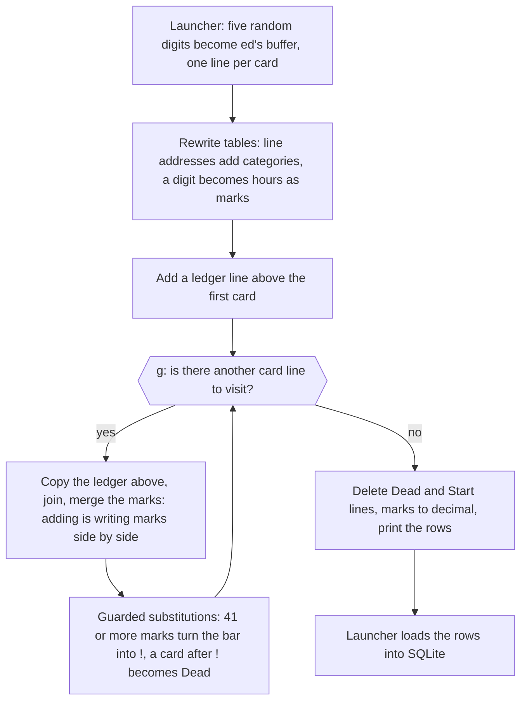
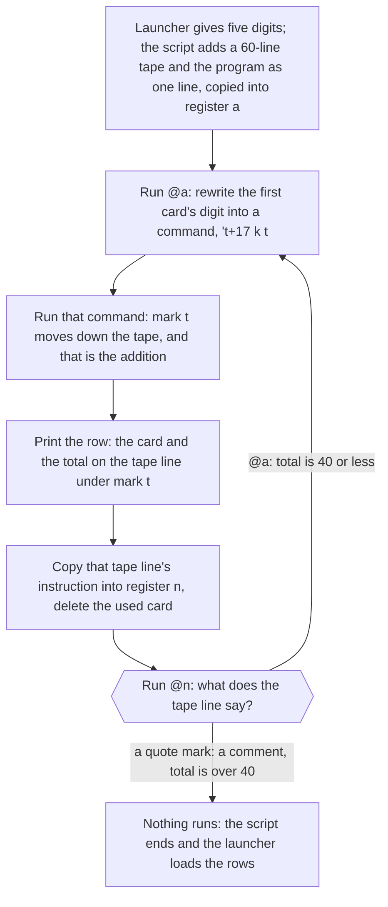

# ed y Ex

Entradas: [`src/ed-weird`](../../src/ed-weird/README.md) (el búfer es la máquina) y [`src/ex-weird`](../../src/ex-weird/README.md) (un programa que puedes editar). `ed` es el editor de líneas original de Unix, de 1969 a 1971. Le indicas qué líneas (una *dirección*) y qué hacer con ellas (un *comando*). No tiene pantalla. Todo lo que hace a un archivo, lo hace a un **búfer** de líneas en memoria, un comando a la vez. Los comandos son tan generales que el programa de este libro no contiene nada más. `ex` es su descendiente más grande: el lenguaje de comandos de `vi`. Añade registros, marcas, `@` y la barra.

Para un recorrido avanzado de lectura con trazas y experimentos, consulta la [guía de estudio de ed y Ex](../guias-de-estudio/lenguajes/ed-y-ex.md).

## Qué hace especial a ed

| Característica | Qué enseña |
| --- | --- |
| Direcciones: `3`, `.`, `$`, `.-1`, `/re/` | Se llega a una línea por número, posición o patrón. Una dirección es una referencia a los datos, como un puntero o un índice. |
| `s/re/text/` | La sustitución es una reescritura condicional. Si el patrón coincide, el texto cambia. Si no, no pasa nada. |
| `g/re/command-list` | El comando global marca cada línea que coincide y luego ejecuta los comandos para cada una, en orden. Es el único bucle de ed. |
| `t`, `m`, `j`, `d` | Copiar, mover, unir y borrar líneas completas: la forma en que ed construye y deshace datos. |
| Sin aritmética ni variables | Los números deben escribirse como texto. En la entrada son filas de marcas. |

## El búfer es la máquina

### Contempla la monstruosidad

```bash
sandbox/container/run-image.sh src/ed-weird
```

Setenta líneas de comandos de ed. Un lanzador que proporciona cinco dígitos aleatorios y guarda la respuesta. Todo el cómputo consiste en que el editor cambia texto.

### ¿Cómo demonios funciona eso?

- **El orden de las categorías es el direccionamiento.** `1s/^/Meetings /` coloca un nombre en la línea 1 y `2s/^/Coding /` en la línea 2.
- **Una tabla de reescritura hace la búsqueda.** Hay diez reglas: `g/x7$/s/7$/xxxxxxx/` y nueve más. Un dígito se convierte en esa cantidad de marcas.
- **Un marcador inicia el registro.** `Start 0|` aporta el total cero encima de la primera tarjeta. Después de la pasada, `g/^Start /d` elimina ese marcador de la salida.
- **Sumar es escribir marcas una al lado de otra.** `-t.` copia la línea anterior (el total acumulado), `-,.j` la une a la tarjeta y un `s` junta ambos grupos de marcas.
- **Un `s` fallido es un `if`.** Dentro de un comando global no hace nada ni detiene la lista. Así, cada sustitución significa "si la línea tiene esta forma, reescríbela".
- **La regla de parada es una expresión regular.** `x\{41,\}` significa "41 o más marcas". La barra antes de las marcas se convierte en un signo de exclamación. La siguiente tarjeta ve el signo y se convierte en una línea `Dead`.

El [README](../../src/ed-weird/README.md#cómo-funciona-el-truco) contiene la tabla completa.

**Un sistema de reescritura con otro control.** [`regex-sed`](regex.md#gnu-sed) también reescribe texto, pero sed tiene un comando de rama. Puede ejecutar un bucle hasta que ninguna regla se aplique. ed no puede. Su única repetición es `g` y su única elección es una sustitución que puede no encontrar coincidencia.

### ¿Qué acabamos de aprender?

- **Los números pueden ser texto.** Las marcas unarias hacen que la suma sea una concatenación. El precio es la longitud de la cadena de texto.
- **Una guarda es una condición.** "Reescribe solo si hay coincidencia" es `if` en un lenguaje que carece de ella.
- **Los datos pueden llevar el control.** Una barra o un signo de exclamación en una línea indica si la máquina sigue en ejecución. El estado viaja con los datos.
- **Las normas y las implementaciones difieren.** busybox ed es un `ed` y no puede ejecutar este programa: no tiene `g`, `t`, `j`, `#` ni coincidencia vacía.
- **Un obstáculo es un resultado.** Se rechaza `g` anidado. Una línea vacía es un comando. Conservamos una prueba para cada caso.

Etiquetas: los comandos `s`, `g`, `t`, `j`, `d` y `0a` están en POSIX. Que un `s` fallido dentro de `g` sea silencioso es conocimiento **aprovechado por accidente**: GNU ed 1.20.1 lo hace y su manual no lo dice. Los comentarios `#` son una extensión de GNU.

### Haz esto en producción y estás despedido

- **El sistema unario no escala.** Un millón es un millón de caracteres.
- **El programa depende de las posiciones.** Una línea de más entre una tarjeta y su libro de cuentas arruina todos los totales.
- **Nadie puede depurar diez reglas de reescritura a simple vista.** La entrada tiene una prueba que la compara con un modelo breve.

Usos legítimos: `ed` y `ex` en scripts para hacer ediciones exactas y automatizables (`ed -s file < commands`). Por ejemplo, un paso de compilación que debe cambiar una línea de un archivo de configuración.

### Ahora rómpelo tú

Consulta el [ejercicio B18](../exercises.md#b18-ed-move-the-stop-rule-and-break-the-cleanup-verified).

## Un programa que puedes editar

### Contempla la monstruosidad

```bash
sandbox/container/run-image.sh src/ex-weird
```

Un script de unas 100 líneas, en su mayoría una tabla de sesenta líneas numeradas. El programa en sí es **una línea de texto**.

### ¿Cómo demonios funciona eso?

- **Una marca es un registro.** `k t` pone una marca en una línea. `'t+17k t` la mueve diecisiete líneas hacia abajo. Eso es `t = t + 17`.
- **La cinta es la recta numérica.** Sesenta líneas, cada una `total instruction`. La posición de la marca *es* el total acumulado; el texto de la línea expresa ese total en cifras.
- **El programa escribe su propio comando.** Una sustitución convierte la tarjeta `Meetings 7` en el texto `'t+17k t`. El programa copia ese texto en un registro y lo ejecuta con `@d`.
- **El bucle es un registro que se ejecuta a sí mismo.** El programa copia la línea numerada de la cinta al final del búfer. Elimina las cifras y el espacio siguiente con `$s/^[0-9]* //` y copia solo la instrucción al registro `n`. Con un total de exactamente 40 o menos es `@a`, que es el programa otra vez. Con más de 40 es una comilla, que indica un comentario, así que no se ejecuta nada.
- **Nada en el programa dice 40.** El límite es donde `@a` se detiene en la cinta.

El [README](../../src/ex-weird/README.md#cómo-funciona-el-truco) tiene la tabla de pasos, la comparación con la entrada de ed y los cinco puntos en los que nvi y Vim discrepan.

### ¿Qué acabamos de aprender?

- **El código es texto, así que se puede construir.** Un programa puede escribir un comando como cadena de texto y ejecutarlo. Eso es `eval`.
- **El estado del editor es estado.** La línea actual, las marcas y los registros son memoria fuera del texto del búfer.
- **Una tabla de saltos es dato.** El siguiente paso se busca por dirección en una tabla; la tabla contiene la regla de parada.
- **No hay un solo Ex.** nvi y Vim discrepan en el orden de los registros, los comandos globales anidados, la impresión, los errores y los rangos inversos. El programa se escribió teniendo en cuenta los cinco.
- **El procesamiento por lotes no es interactivo.** Los mismos comandos deben ser correctos al primer intento, sin nadie que los observe.

Etiquetas: POSIX para Ex establece como **garantizado** el comportamiento de los comandos `@`, `k`, `ya`, `t`, `j`, `s`, la barra y el comentario `"`. La evidencia es la especificación. Que el programa se ejecute igual en nvi 1.81.6 y Vim 9.1 es **permitido por la implementación**: la comprobación cubrió esas dos implementaciones.

### Haz esto en producción y estás despedido

- **Un registro que ejecuta datos es `eval`.** Si la cinta viniera de un desconocido, ese desconocido escribiría tu programa. Aquí la cinta es fija y se comprueban los dígitos antes de que se acerquen a un comando.
- **Las marcas son frágiles.** Una marca en una línea eliminada desaparece, al igual que tu contador.
- **El script depende de la versión de Ex que tengas.** Un script que funciona en una puede no funcionar en la otra. Prueba con ambas.

Usos legítimos: `ex -s` en scripts para hacer ediciones exactas y registros como un pequeño sistema de macros para ediciones repetidas en `vi`.

### Ahora rómpelo tú

Mira el [ejercicio B19](../exercises.md#b19-ex-move-the-limit-on-the-tape-and-cut-the-loop-verified).

<!-- BEGIN GENERATED program-flow:languages/editors.md -->
## How each program runs

Each picture below is the `## Program Flow` section of an entry's README, copied here by the build. It shows how that program makes the work happen: what the language, runtime or tool really does. [The introduction](../introduccion.md#what-the-challenge-does) shows what the challenge asks for and where entries differ.

### Program flow of `ed-weird`

From [`ed-weird`](../../src/ed-weird/README.md) ([source section](../../src/ed-weird/README.md#flujo-del-programa)).



**What this shows:** `ed` has one loop, the global command `g`, and it has no `if`. A substitution that finds nothing to replace does nothing, so each guarded substitution means "if the line has this pattern, rewrite it". The state is text: marks that are added by writing them side by side.

**Why this mechanism matters:** the stop rule is a regex over the ledger (41 or more marks), and it runs *after* the card is written, so the crossing card is kept. The `!` that it writes is a state that later cards read. It is the whole memory of "we are over".

### Program flow of `ex-weird`

From [`ex-weird`](../../src/ex-weird/README.md) ([source section](../../src/ex-weird/README.md#flujo-del-programa)).



**What this shows:** Ex keeps state outside the text, in marks, and it can run a register as a command. The position of mark `t` on a tape *is* the running total. The tape line under it holds the next instruction: `@a`, which means "go round again", or a quote mark, which Ex reads as a comment.

**Why this mechanism matters:** this is self-modifying code. The program writes the command that does its arithmetic, and the stop rule is the place on the tape where `@a` turns into a comment. Nothing in the program says "40" anywhere except in how the tape is laid out.
<!-- END GENERATED program-flow:languages/editors.md -->

## La informática detrás de esta página

<!-- BEGIN GENERATED concepts:languages/editors.md -->
The computer-science ideas behind this page: [Specification versus implementation](../informatica/01-lectura-de-un-programa-adversarial.md#specification-versus-implementation), [Capability and authority](../informatica/01-lectura-de-un-programa-adversarial.md#capability-and-authority), [Transition systems and state machines](../informatica/02-que-cuenta-como-maquina.md#transition-systems-and-state-machines), [Representing state](../informatica/02-que-cuenta-como-maquina.md#representing-state), [Register machines and counter machines](../informatica/02-que-cuenta-como-maquina.md#register-machines-and-counter-machines), [Markov algorithms](../informatica/02-que-cuenta-como-maquina.md#markov-algorithms), [Operational semantics](../informatica/02-que-cuenta-como-maquina.md#operational-semantics), [Computation versus orchestration](../informatica/02-que-cuenta-como-maquina.md#computation-versus-orchestration), [The program counter](../informatica/03-flujo-de-control-y-continuaciones.md#the-program-counter), [Self-modifying code](../informatica/03-flujo-de-control-y-continuaciones.md#self-modifying-code), [Regular expressions](../informatica/05-lenguajes-formales-como-sustratos-de-computacion.md#regular-expressions), [Term and string rewriting](../informatica/05-lenguajes-formales-como-sustratos-de-computacion.md#term-and-string-rewriting), [Weird machines](../informatica/05-lenguajes-formales-como-sustratos-de-computacion.md#weird-machines), [Interpreters and virtual machines](../informatica/05-lenguajes-formales-como-sustratos-de-computacion.md#interpreters-and-virtual-machines), [State](../informatica/06-estado-mas-alla-de-las-variables.md#state), [Homoiconicity: code as data](../informatica/06-estado-mas-alla-de-las-variables.md#homoiconicity-code-as-data), [Reflection and metaprogramming](../informatica/06-estado-mas-alla-de-las-variables.md#reflection-and-metaprogramming), [Portability](../informatica/08-fugas-de-abstraccion-y-dependencia-de-la-implementacion.md#portability), [Hyrum's law](../informatica/08-fugas-de-abstraccion-y-dependencia-de-la-implementacion.md#hyrums-law).
<!-- END GENERATED concepts:languages/editors.md -->
