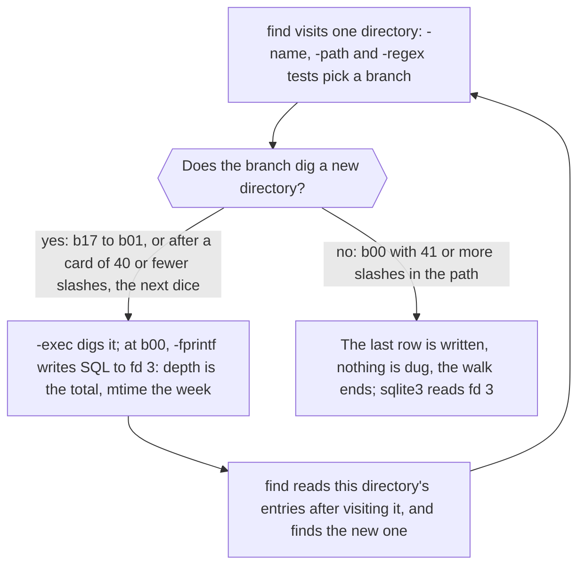
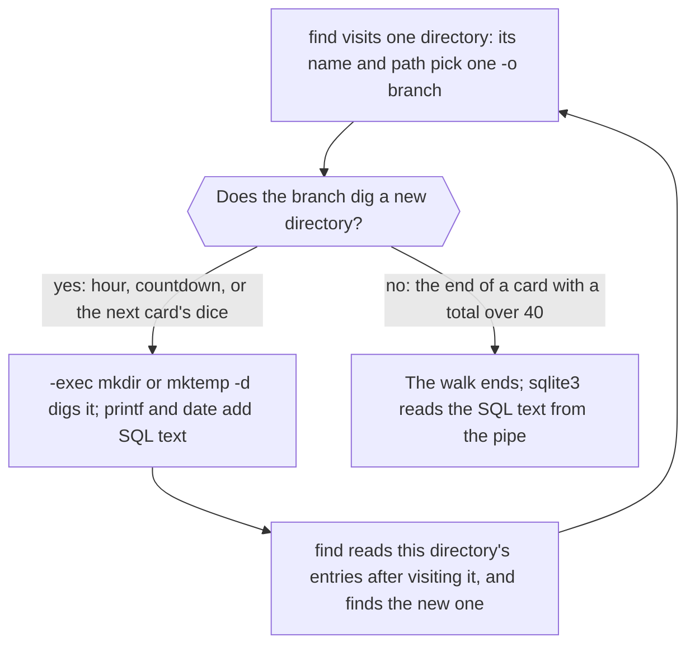

# find

Entradas: [`src/find-posix`](../../src/find-posix/README.md) (portable) y [`src/find-gnu`](../../src/find-gnu/README.md) (todas las extensiones de GNU). `find` es una herramienta de búsqueda de archivos. Aquí se le pide que ejecute un programa y solo se le permite ser una herramienta de búsqueda de archivos: un comando, cuatro primarios, ninguna variable.

## Qué hace especial a find

Un comando `find` es una **expresión**. Se evalúa una vez por cada archivo de un árbol, de izquierda a derecha. Se detiene antes de terminar, como `&&` y `||`. Las pruebas (`-name`, `-path`) devuelven verdadero o falso. Las acciones (`-exec`, `-print`) hacen algo y también devuelven verdadero o falso. Eso es todo lo que tiene find: valores booleanos, patrones, efectos secundarios y un recorrido.

| Característica | Qué enseña |
| --- | --- |
| `-a` (y) está implícito y tiene mayor precedencia que `-o` (o) | `A -a B -o C -a D` significa "si A y B, de lo contrario si C y D". Una cadena de ramas `-o` es una sentencia `case`, con evaluación de cortocircuito gratis. |
| `-exec` devuelve el estado de salida del programa | Un comando también es una prueba. Un `mkdir` que falla hace falso el resto de la cadena `-a`. Flujo de control mediante código de error. |
| Los patrones `-path` son patrones glob donde `*` cruza `/` | `-path '*/0/*/0/*'` significa "la ruta tiene al menos dos directorios llamados `0`". La ruta es una cadena de texto y un glob es una forma de contar en ella. |
| El recorrido visita un directorio antes de leer sus entradas | Si `-exec` crea un directorio dentro del que se visita, el recorrido entra en él a continuación. Este es el bucle. POSIX no lo promete. |

## Un recorrido de árbol que cava su propio árbol

### Contempla la monstruosidad

```bash
sandbox/container/run-image.sh src/find-posix
```

Un `find` de unos 5.7 KB, sin `-delete`, sin `-printf`, sin `-regex` ni intérprete de comandos (*shell*), `awk` o `expr` en ninguna parte. El programa sortea horas, las suma, decide cuándo detenerse e imprime SQL.

### ¿Cómo demonios funciona eso?

- **El bucle es el recorrido.** Cada directorio que visita el recorrido crea el siguiente con `-exec mkdir {}/...` y el recorrido lo visita después. Para detenerse, la expresión simplemente deja de crear directorios.
- **La ruta es la pila de llamadas y los nombres son los registros.** Un nombre de un carácter es una hora. Cuenta de 1 a 9 y vuelve a 0, así que es el último dígito del total acumulado. Un nombre como `b07` es una cuenta regresiva. Un nombre de seis caracteres de `mktemp` es el dado. No se suma ni se resta nada. El *siguiente* nombre se escribe en la expresión como un literal, con una rama por valor.
- **El dígito de las decenas es un patrón glob.** Los dígitos se repiten en ciclo. Por eso, el número de directorios llamados exactamente `0` en la ruta es el dígito de las decenas del total. `-path '*/0/*/0/*'` lo lee.
- **El azar es un nombre.** `mktemp -d` crea un directorio con un nombre aleatorio. Un patrón `-name` o `-path` lee su último carácter. mktemp tiene 62 caracteres. De ellos, 60 forman diez grupos de seis, y `Y` y `Z` se vuelven a tirar.
- **La salida es texto SQL.** find imprime una sentencia `INSERT` pieza por pieza. mktemp también imprime la ruta que creó. La línea la convierte en un comentario SQL al imprimir ` -- ` primero.

El [README](../../src/find-posix/README.md#cómo-funciona-el-truco) tiene la tabla completa de tareas y [`build-line.py`](../../src/find-posix/build-line.py) muestra las tablas en forma legible.

**La versión GNU deja que find haga la aritmética.** [`find-gnu`](../../src/find-gnu/README.md) usa el mismo recorrido, pero GNU find puede medir cosas por ti. `%d` imprime la profundidad de un directorio. Un directorio es una hora, así que la profundidad *es* el total acumulado. `%TG-W%TV` imprime la semana ISO de la fecha de modificación del directorio nuevo. `-regex` sustituye las tablas de patrones glob por `([^/]*/){41}.*` ("al menos 41 barras", la regla de parada). `-fprintf /dev/fd/3` envía el SQL a su propio descriptor de archivo. La línea ocupa unos 3 KB en lugar de 5.7 KB.

**El optimizador no tiene nada que mover.** `-O3` reordena las pruebas, pero nunca a través de un efecto secundario. En este programa cada rama es una prueba seguida de un efecto. Por eso, el árbol de expresiones es idéntico en `-O0` y en `-O3`. Además, `-D rates` (el perfil del propio find) muestra por qué las estimaciones uniformes del 80 % del optimizador son incorrectas aquí.

### ¿Qué acabamos de aprender?

- **Un orden de recorrido es un contrato o es una costumbre.** Aquí es una costumbre. Funciona en GNU find, bfs y busybox, pero POSIX no dice que deba hacerlo.
- **Un patrón de ruta es un analizador sintáctico diminuto.** Con un comodín que cruza `/`, puedes contar, buscar y comprobar el último segmento.
- **Haz que los nombres lleven el estado.** En un lenguaje sin variables, el sistema de archivos es la memoria.
- **La evaluación de cortocircuito es un contador de programa.** La prueba que falló determina qué rama se ejecuta después.
- **Las propias mediciones de una herramienta pueden ser tus valores.** La profundidad y la fecha del archivo hicieron, con una directiva cada una, lo que hicieron tablas de diez filas en la versión portable.
- **La promesa de un optimizador es barata de probar.** Ejecuta en cada nivel y compara. Aquí la promesa se cumplió y nada se movió.

Etiquetas: `-fprintf`, `%d`, `%T`, `-regex` y `-D` son extensiones de GNU (**permitido por la implementación**). POSIX garantiza la precedencia de `-a`/`-o`, `-name`, `-path` y `-exec` (**garantizado**). Entrar en un directorio que `-exec` acaba de crear es **aprovechado por accidente**. `{}` dentro de un argumento más largo es **permitido por la implementación**: POSIX lo deja sin especificar y GNU find, bfs y busybox lo reemplazan. `mktemp` está fuera de POSIX, pero está en todos los sistemas BSD y Linux.

### Haz esto en producción y estás despedido

- **Una ejecución terminada deja una ruta con más de cien nombres de profundidad.** La entrada la crea en una carpeta temporal y elimina la carpeta al salir, incluso con Ctrl-C.
- **Que `*` cruce `/` es una trampa.** La primera versión hizo coincidir `*/1/b*` con un `1/b...` anterior en la misma ruta y el dígito quedó fijado. Los patrones deben terminar en un nombre de ancho fijo.
- **Es difícil razonar sobre un recorrido que cambia lo que recorre.** El resultado depende de qué entradas del directorio se leen antes y después de cada visita.
- **La línea tiene 5.7 KB.** Nadie puede revisarla a simple vista. Por eso existe [`build-line.py`](../../src/find-posix/build-line.py) y por eso `check.sh` comprueba que ambos coincidan.

Legitimate uses: `find ... -exec ... {} +` and `-prune` are everyday tools. Changing the tree while find walks it is the thing the manuals warn you about.

### Now break it yourself

See [exercises](../exercises.md#b14-find-rig-the-dice-verified) and [B15](../exercises.md#b15-gnu-find-move-the-stop-rule-read-the-profile-verified).

<!-- BEGIN GENERATED program-flow:languages/find.md -->
## How each program runs

Each picture below is the `## Program Flow` section of an entry's README, copied here by the build. It shows how that program makes the work happen: what the language, runtime or tool really does. [The introduction](../introduccion.md#what-the-challenge-does) shows what the challenge asks for and where entries differ.

### Program flow of `find-gnu`

From [`find-gnu`](../../src/find-gnu/README.md) ([source section](../../src/find-gnu/README.md#flujo-del-programa)).



**What this shows:** the same trick as [`find-posix`](../../src/find-posix/README.md), with GNU extras that remove bookkeeping. `-fprintf` can write to its own file descriptor, `%d` is the directory depth, and `%TG-W%TV` formats the modification time as the ISO week. So the depth *is* the total, and no digit-by-digit arithmetic is needed.

**Why this mechanism matters:** the stop rule is a regular expression on the path, "at least 41 slashes". GNU find also has an optimizer that may reorder tests. An effect pins the order, so the program gives the same answer at every optimization level. That is tested, not promised.

### Program flow of `find-posix`

From [`find-posix`](../../src/find-posix/README.md) ([source section](../../src/find-posix/README.md#flujo-del-programa)).



**What this shows:** the loop is a tree walk that keeps growing. find reads a directory's entries *after* it visits the directory, so a directory that `-exec` makes inside the current one is walked next. The path from the start is the history, and the directory name is the state. It is the call stack of a recursion, drawn on the file system.

**Why this mechanism matters:** the stop rule is the absence of a new child: at the end of a card, five `0` hour-digits in the path (or four and a non-zero last digit) mean the total is over 40, and no branch digs. The running total is the number of hour directories in the path, and no arithmetic exists anywhere. This relies on the order in which find reads and visits, which is accidental to find, not promised by POSIX.
<!-- END GENERATED program-flow:languages/find.md -->

## Computer science behind this page

<!-- BEGIN GENERATED concepts:languages/find.md -->
The computer-science ideas behind this page: [Transition systems and state machines](../informatica/02-que-cuenta-como-maquina.md#transition-systems-and-state-machines), [Representing state](../informatica/02-que-cuenta-como-maquina.md#representing-state), [Observability](../informatica/02-que-cuenta-como-maquina.md#observability), [Control flow](../informatica/03-flujo-de-control-y-continuaciones.md#control-flow), [Recursion](../informatica/03-flujo-de-control-y-continuaciones.md#recursion), [Short-circuit evaluation](../informatica/04-evaluacion-y-demanda.md#short-circuit-evaluation), [Regular expressions](../informatica/05-lenguajes-formales-como-sustratos-de-computacion.md#regular-expressions), [Domain-specific languages](../informatica/05-lenguajes-formales-como-sustratos-de-computacion.md#domain-specific-languages), [Weird machines](../informatica/05-lenguajes-formales-como-sustratos-de-computacion.md#weird-machines), [The call stack](../informatica/06-estado-mas-alla-de-las-variables.md#the-call-stack), [Side effects](../informatica/07-efectos-errores-y-confirmacion.md#side-effects), [Integrity constraints](../informatica/07-efectos-errores-y-confirmacion.md#integrity-constraints), [Undefined, unspecified and implementation-defined behavior](../informatica/08-fugas-de-abstraccion-y-dependencia-de-la-implementacion.md#undefined-unspecified-and-implementation-defined-behavior), [Portability](../informatica/08-fugas-de-abstraccion-y-dependencia-de-la-implementacion.md#portability), [Optimizers](../informatica/08-fugas-de-abstraccion-y-dependencia-de-la-implementacion.md#optimizers), [Hyrum's law](../informatica/08-fugas-de-abstraccion-y-dependencia-de-la-implementacion.md#hyrums-law).
<!-- END GENERATED concepts:languages/find.md -->
