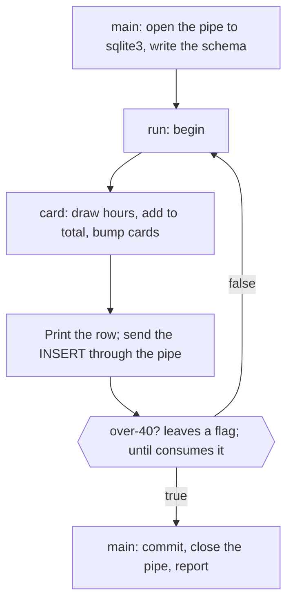
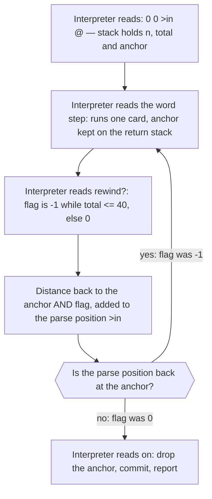

# Forth

Entradas: [`src/forth`](../../src/forth/README.md) (un `begin ... until`) y [`src/forth-weird`](../../src/forth-weird/README.md) (sin palabra de bucle ni variable).

Para un recorrido avanzado de lectura con trazas y experimentos, consulta la [guía de estudio de Forth](../guias-de-estudio/lenguajes/forth.md).

## Qué hace especial a Forth

Forth casi no tiene sintaxis: el intérprete lee una palabra delimitada por espacios, la busca y la ejecuta. Las palabras pasan valores en una **pila**, y cada definición lleva un comentario de pila como `( hours -- )`. El lenguaje es lo bastante pequeño para que puedas acceder al propio intérprete.

| Característica | Dónde | Qué enseña |
| --- | --- | --- |
| Un switch es un arreglo de funciones | [`forth/timecards.fs` L34-36](../../src/forth/timecards.fs#L34-L36): `create categories ' meetings , ...` y `: category$ ( n -- c-addr u ) 4 mod cells categories + @ execute ;` | `'` ("tick") da el token de ejecución de una palabra; los tokens son datos. |
| La redirección de salida como característica | [L68](../../src/forth/timecards.fs#L68): `: >sqlite ( xt -- ) sqlite outfile-execute ;` | `outfile-execute` redirige toda la salida a una tubería durante ese tiempo. `.schema` y `.insert` son palabras ordinarias que imprimen texto, y la tubería convierte el texto en SQL. |
| Una palabra de bucle | [L108](../../src/forth/timecards.fs#L108): `: run ( -- ) begin card over-40? until ;` | `until` consume una bandera y repite hasta que sea verdadera. |

## La posición de análisis sintáctico como contador de programa

### Contempla la monstruosidad

```bash
sandbox/container/run-image.sh src/forth-weird
```

El bucle de todo el programa ocupa una línea en el nivel superior ([L101](../../src/forth-weird/timecards.fs#L101)):

```forth
0 0 >in @ step rewind?                                     \ <== THE LOOP  ( n total anchor )
```

### ¿Cómo demonios funciona eso?

El intérprete de texto es un bucle que nunca ves. `>in` guarda *hasta dónde ha leído la línea actual*; `>in @` lee ese valor y `>in !` lo establece. Establécelo a un valor anterior y el intérprete vuelve a leer las mismas palabras.

- `0 0` es el estado inicial (tarjeta 0, total 0). `>in @` apila la posición como **ancla**: el lugar al que volverá el salto.
- `step` ([L88](../../src/forth-weird/timecards.fs#L88)) es `>r card r>`: guarda el ancla en la pila de retorno, ejecuta una tarjeta y la restaura.
- `rewind?` ([L92-94](../../src/forth-weird/timecards.fs#L92-L94)) termina con `over >in @ - and >in @ + >in !`. Una bandera de Forth es **-1** (todos los bits activados) para verdadero y **0** para falso. Así funciona como máscara de bits. `anchor - >in` es la distancia hacia atrás; `and` con la bandera conserva la distancia si es verdadera y la pone en cero si es falsa. Al sumarla a `>in` se obtiene el ancla o "quedarse aquí". No hay `if`. El salto es aritmético.

La memoria es la pila de datos: no hay ni un solo `variable` en el archivo. El contador de programa es `>in`.

### ¿Qué acabamos de aprender?

- **La posición de un intérprete puede ser un contador de programa.** Si puedes leerla y escribirla, tienes goto.
- **Los booleanos como máscaras de bits** son un viejo truco respetable. Explican por qué el valor verdadero de Forth es -1.
- **El estado en una pila** es un modelo completo de memoria. (Compara [el salto mutable de COBOL](cobol.md#alter), [el estado de existencia de archivos de Make](make-cmake.md#gnu-make) y [los registros de CMake](make-cmake.md#cmake).)

Etiquetas: los efectos de pila y las banderas son comportamiento **garantizado** por Forth estándar. La existencia de la manipulación de `>in` es un comportamiento **garantizado** en ISO Forth. Pero su efecto en una definición frente al nivel superior es **permitido por la implementación**. `outfile-execute`, `open-pipe` y `utime` son extensiones de Gforth (**permitido por la implementación**).

### Haz esto en producción y estás despedido

- **Solo funciona en el nivel superior o en texto procesado con `evaluate` o `included`.** `>in` es la posición de análisis de la línea actual de entrada de datos. Compila el bucle *dentro* de una palabra y no habrá ninguna línea que rebobinar.
- **Mover un token lo rompe sin aviso.** Si `0 0` se mueve *después* de `>in @` (`>in @ 0 0 step rewind?`), el ancla queda antes del estado. Por eso, cada rebobinado apila un nuevo `0 0`: el total vuelve a cero en cada pasada y el programa nunca se detiene (verificado: cientos de filas, sin línea `# committed`). Un programa que parece correcto y un bucle desbocado. Mover `0 0` a la línea anterior no causa daño, porque el ancla sigue después de él.
- **Ninguna herramienta lo entenderá.** Los analizadores, trazadores y humanos suponen que la posición de análisis no es estado.
- **Portabilidad.** Palabras específicas de Gforth; `3dup` no está en Gforth 0.7.3, así que el archivo la define con `2 pick` tres veces ([L37](../../src/forth-weird/timecards.fs#L37)).

Usos legítimos: intérpretes, depuradores y palabras de análisis sintáctico, donde la tarea es manipular el flujo de entrada de datos.

### Ahora rómpelo tú

Consulta los [ejercicios](../exercises.md#b3-forth-move-the-anchor-verified).

## Peculiaridades

- **Las palabras de control solo funcionan dentro de definiciones** en Forth estándar. Escribir `begin ... until` en el nivel superior es un error, por eso `run` es una palabra. La versión rara hace trampa en el otro sentido.
- **Las cadenas de texto `s"` pueden ser temporales**: algunos intérpretes devuelven un búfer que la siguiente sobrescribe, por eso las palabras de categoría son definiciones.
- **`random` es `0..n-1`**, por eso `10 random 10 +` da de 10 a 19.
- **`close-pipe` devuelve el estado de salida**; `close-sqlite` convierte un estado distinto de cero en una interrupción para que un `sqlite3` fallido no se ignore.
- **Los comentarios de pila son el sistema de tipos.** Nada hace cumplir `( n total -- n' total' )`; es una convención.

## Lo raro junto a lo aburrido

[`forth`](../../src/forth/README.md) es un programa de pila limpio: palabras pequeñas, un bucle. [`forth-weird`](../../src/forth-weird/README.md) reemplaza cada `variable` y palabra de control por la posición en la pila y un analizador sintáctico rebobinado. El primero es lo que escriben los programadores de Forth; el segundo es lo que Forth *permite*.

## ¿En qué circunstancias esta idea terrible se volvería razonable?

Cuando escribes el intérprete, una palabra de análisis sintáctico o un depurador. Rebobinar el analizador sintáctico es una acrobacia en un bucle; es una herramienta para quien implementa un lenguaje.

<!-- BEGIN GENERATED program-flow:languages/forth.md -->
## How each program runs

Each picture below is the `## Program Flow` section of an entry's README, copied here by the build. It shows how that program makes the work happen: what the language, runtime or tool really does. [The introduction](../introduccion.md#what-the-challenge-does) shows what the challenge asks for and where entries differ.

### Program flow of `forth`

From [`forth`](../../src/forth/README.md) ([source section](../../src/forth/README.md#flujo-del-programa)).



**What this shows:** Forth has one ordinary loop, `begin ... until`. The loop body runs `card`, and then `over-40?` leaves a flag on the stack for `until` to take. The state lives in two variables, `total` and `cards`, and the data stack carries values between words.

**Why this mechanism matters:** the stop rule is a flag, not a condition in the loop's header. The flag is computed after the card, so the crossing card is kept. The weird sibling [`forth-weird`](../../src/forth-weird/README.md) has no `begin` and no `until`.

### Program flow of `forth-weird`

From [`forth-weird`](../../src/forth-weird/README.md) ([source section](../../src/forth-weird/README.md#flujo-del-programa)).



**What this shows:** the loop is the text interpreter, the loop you never see, and the jump is a change to `>in`, the number that says how far it has read. Setting `>in` to an earlier value makes the interpreter read the same words again. There is no `if`: a Forth flag is `-1` or `0`, so `AND` turns the distance back into either itself or nothing.

**Why this mechanism matters:** the program counter is a variable, and a program can rewrite it. The state is two numbers on the data stack, and they survive the rewind because nothing else touches them. This works because the words are read from an input line, and it does not work the same way in a definition. See [`forth`](../../src/forth/README.md) for the ordinary loop.
<!-- END GENERATED program-flow:languages/forth.md -->

## Informática detrás de esta página

<!-- BEGIN GENERATED concepts:languages/forth.md -->
The computer-science ideas behind this page: [Stack machines](../informatica/02-que-cuenta-como-maquina.md#stack-machines), [Register machines and counter machines](../informatica/02-que-cuenta-como-maquina.md#register-machines-and-counter-machines), [Control flow](../informatica/03-flujo-de-control-y-continuaciones.md#control-flow), [The program counter](../informatica/03-flujo-de-control-y-continuaciones.md#the-program-counter), [Parsing](../informatica/05-lenguajes-formales-como-sustratos-de-computacion.md#parsing), [State](../informatica/06-estado-mas-alla-de-las-variables.md#state), [The stack as a data structure](../informatica/06-estado-mas-alla-de-las-variables.md#the-stack-as-a-data-structure), [Reflection and metaprogramming](../informatica/06-estado-mas-alla-de-las-variables.md#reflection-and-metaprogramming), [Transactions](../informatica/07-efectos-errores-y-confirmacion.md#transactions).
<!-- END GENERATED concepts:languages/forth.md -->
