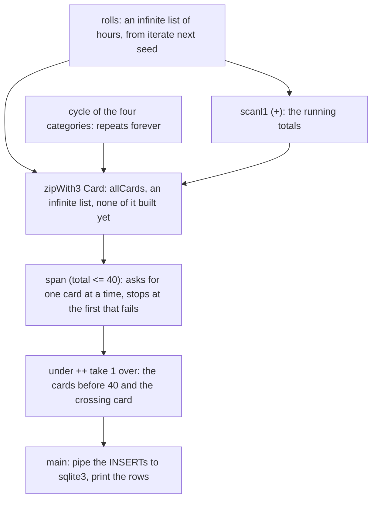
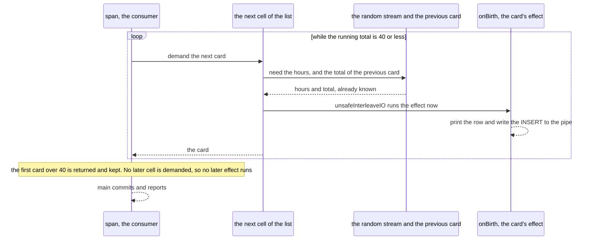

# Haskell

Entradas: [`src/haskell`](../../src/haskell/README.md) (una función pura) y [`src/haskell-weird`](../../src/haskell-weird/README.md) ("Haskell bajo los efectos de las drogas": leer la lista hace el trabajo).

Para una ruta de lectura avanzada con trazas y experimentos, consulta la [guía de estudio de Haskell](../guias-de-estudio/lenguajes/haskell.md).

## Qué hace especial a Haskell

Haskell es **perezoso**: un valor se calcula solo cuando algo lo demanda. La entrada ordinaria usa eso para una regla de parada que no es una condición de bucle, sino *cuánto eliges leer de una lista*.

| Característica | Dónde | Qué enseña |
| --- | --- | --- |
| Listas infinitas como descripciones | [`haskell/timecards.hs` L41](../../src/haskell/timecards.hs#L41): `rolls = map toHours . tail . iterate next` | `iterate` produce un flujo sin fin. Es una receta, no datos. |
| Sumas acumuladas sobre un flujo | [L49](../../src/haskell/timecards.hs#L49): `zipWith3 Card (cycle [minBound ..]) hs (scanl1 (+) hs)` | `scanl1 (+)` es un total acumulado; `cycle [minBound ..]` repite las categorías porque el tipo deriva `Enum` y `Bounded`. |
| La regla de parada es una división | [L56-59](../../src/haskell/timecards.hs#L56-L59): `under ++ take 1 over where (under, over) = span ((<= 40) . runningTotal) (allCards seed)` | `span` lee una tarjeta a la vez y se detiene en la primera que no cumple. `takeWhile` descartaría la tarjeta que cruza el tope; `span` devuelve ambas mitades. |
| La aritmética con desbordamiento circular es una característica | `rolls` usa un LCG de 64 bits sobre `Word64` | "mod 2^64" sale gratis porque `Word64` se desborda de forma circular. |

## La E/S perezosa como flujo de control

### Contempla la monstruosidad

```bash
sandbox/container/run-image.sh src/haskell-weird
```

Una lista infinita de tarjetas. *Forzar la n-ésima celda imprime la tarjeta n y envía su `INSERT` a `sqlite3`.* Nada más escribe una fila. No hay bucle, acumulador, contador ni recursión explícita.

### ¿Cómo demonios funciona eso?

Tres trucos apilados.

1. **Una lista definida en términos de sí misma.** [L53](../../src/haskell-weird/timecards.hs#L53): `rolls seed = map toHours (tail (fix (\xs -> seed : map next xs)))`. `fix f = f (fix f)` le entrega a una función su propio resultado, así que `xs = seed : map next xs`. Funciona porque `map` necesita solo un elemento a la vez.
2. **Un nudo a través de las tarjetas.** [L75-78](../../src/haskell-weird/timecards.hs#L75-L78): `sheet onBirth seed = fixIO $ \cards -> let before = 0 : map runningTotal cards ...`. El total de la tarjeta n es sus horas más el total *leído de la tarjeta n-1, un elemento de la lista en construcción*. `fixIO` es `fix` para IO.
3. **Efectos que esperan a que los pidan.** [L62-64](../../src/haskell-weird/timecards.hs#L62-L64): `lazily = fix $ \self actions -> unsafeInterleaveIO $ case actions of ...`. El `sequence` ordinario ejecuta primero todas las acciones, y eso nunca termina con una lista infinita. `unsafeInterleaveIO` significa "ejecuta esto solo cuando alguien demande su resultado". Cuando `sheet` regresa, nada se ha ejecutado; cada celda es una promesa.

La regla de parada es [`untilOver40` (L82-83)](../../src/haskell-weird/timecards.hs#L82-L83): `under ++ take 1 over`. Leer la tarjeta n ejecuta `onBirth` para la tarjeta n, así que el total de lecturas es igual al total de `INSERT` por construcción.

### ¿Qué acabamos de aprender?

- **El orden de evaluación forma parte del significado de un programa cuando intervienen efectos.** En un programa puro no importa. Pon IO detrás de una celda perezosa y ese orden decide *qué filas existen*.
- **La transparencia referencial es un contrato, y `unsafe...` es el punto donde dejas de respetarlo.**
- **"¿Cuándo se ejecuta esto?" es la misma pregunta** que la ejecución diferida de LINQ (consulta [C#](csharp-linq-xaml.md#la-ejecución-diferida-y-el-truco-de-convertir-void-en-valor)). En ambos casos, una descripción se separa de su ejecución.

Etiquetas: la pereza de `span` es comportamiento **garantizado** por la semántica del lenguaje. El orden de `unsafeInterleaveIO` es comportamiento **permitido por la implementación**: el programa es correcto porque la tarjeta n no puede forzarse antes que la tarjeta n-1, no porque el evaluador prometa un orden.

### Haz esto en producción y estás despedido

- **La historia de guerra del propio README.** El primer borrador contaba con `let entries = length cards`, y el programa imprimió `# committed total=Meetings 12 12 ...` y luego falló con "handle is closed". Como `let` era perezoso, nada forzó las tarjetas hasta que se imprimió el resumen, cuando la tubería ya estaba cerrada. Los efectos de las tarjetas se dispararon *durante la salida de `show`*. La solución: [L144](../../src/haskell-weird/timecards.hs#L144) `entries <- evaluate (length cards)`.
- **`lazily` debe diferir su propia coincidencia de patrón.** Si el `case` se ejecuta antes de `unsafeInterleaveIO`, forzarlo necesita `before`, que necesita `cards`, que todavía no existe: `<<loop>>`.
- **`take 1 over` dispara un efecto más.** Hay que leer la tarjeta que cruza el tope para ver que lo cruza, así que se escribe su fila. La pereza hace visible el error por uno.
- **Pruebas y concurrencia.** Los efectos cuyo momento depende del consumidor no se pueden probar sin el consumidor, y no se pueden compartir de forma segura.

Usos legítimos: la E/S perezosa existe para el flujo continuo (`getContents` sobre una entrada de datos grande), y los mismos peligros explican por qué la gente migró a bibliotecas de flujo continuo. Atar nudos (`fix`) es una técnica respetable para datos autorreferenciales, como estructuras circulares y tablas de memoización.

### Ahora rómpelo tú

Consulta los [ejercicios](../exercises.md#b2-haskell-break-the-laziness-verified): reemplaza `unsafeInterleaveIO` por IO simple o mueve el `evaluate`. Después predice la salida.

## Peculiaridades

- **`takeWhile` no basta**: descarta la tarjeta que cruza el tope. `span` conserva ambas mitades.
- **Funciones parciales.** `head`, `last` y `!!` fallan con una lista vacía; ninguno de los dos programas las usa.
- **`Int` frente a `Integer` frente a `Word64`.** El generador necesita exactamente 64 bits sin signo, así que usa `Word64`, cuyo desbordamiento circular es la característica buscada.
- **GHC no incluye un paquete de números aleatorios.** Ambas entradas construyen a mano un generador congruencial lineal (con las constantes MMIX de Knuth) y usan los bits altos.
- **Sorpresas al estilo de `hGetContents`.** La entrada rara convierte en algoritmo la sorpresa más famosa de la entrada y salida perezosa de Haskell.
- **Herramientas de estilo.** El código fuente está formateado a mano al estilo de Ormolu y compila sin problemas con `-Wall -Wcompat`, pero *no* se ejecutó mediante `ormolu` ni `hlint`.
- **`check.sh` como restricción.** [`haskell-weird/check.sh`](../../src/haskell-weird/check.sh) prohíbe `scanl iterate foldr foldl unfoldr until go mapM forM forever replicateM foldM zipWithM sequence` y exige `fixIO $ \cards ->` y exactamente un `unsafeInterleaveIO`.

## Lo raro junto a lo aburrido

[`haskell`](../../src/haskell/README.md) es una función pura más cómo viaja el dato: es fácil de probar y razonar. [`haskell-weird`](../../src/haskell-weird/README.md) pone los efectos dentro de la estructura de datos. La versión rara revela algo que la idiomática oculta: una lista perezosa es un *programa que espera ser leído*.

## ¿En qué circunstancias esta idea terrible se volvería razonable?

Dentro de una biblioteca que implementa el procesamiento perezoso de flujos y que se ha probado cuidadosamente para comprobar el orden. No en el código de aplicación, donde `evaluate`, la entrada y salida estricta y las bibliotecas de procesamiento de flujos dan los mismos resultados sin sorpresas.

<!-- BEGIN GENERATED program-flow:languages/haskell.md -->
## How each program runs

Each picture below is the `## Program Flow` section of an entry's README, copied here by the build. It shows how that program makes the work happen: what the language, runtime or tool really does. [The introduction](../introduccion.md#what-the-challenge-does) shows what the challenge asks for and where entries differ.

### Program flow of `haskell`

From [`haskell`](../../src/haskell/README.md) ([source section](../../src/haskell/README.md#flujo-del-programa)).



**What this shows:** the lists are descriptions, not data. Nothing is computed until `span` asks for a card, and `span` stops asking at the first card that fails the test. So only a handful of cards are ever built, even though the lists are infinite.

**Why this mechanism matters:** the stop rule is not a loop condition. It is *how much of a list you choose to read*. Demand flows backwards, from `span` to the lists, while the data flows forwards. This is lazy evaluation as a way to write a loop without one.

### Program flow of `haskell-weird`

From [`haskell-weird`](../../src/haskell-weird/README.md) ([source section](../../src/haskell-weird/README.md#flujo-del-programa)).



**What this shows:** the effects are tied to the *reading* of the list. The list is built so that nothing runs when it is made. Each cell holds a promise, and forcing the cell runs that card's `onBirth`. So the number of rows printed equals the number of `INSERT`s, equals the number of cards read.

**Why this mechanism matters:** this is demand-driven control flow with side effects, and it is only safe because of how the cells are linked. `unsafeInterleaveIO` is called *unsafe* for a reason: the order of effects now depends on the order of demand. The same laziness without effects is in the plain [`haskell`](../../src/haskell/README.md) entry.
<!-- END GENERATED program-flow:languages/haskell.md -->

## Ciencias de la computación detrás de esta página

<!-- BEGIN GENERATED concepts:languages/haskell.md -->
The computer-science ideas behind this page: [Control flow](../informatica/03-flujo-de-control-y-continuaciones.md#control-flow), [Evaluation strategies](../informatica/04-evaluacion-y-demanda.md#evaluation-strategies), [Lazy evaluation](../informatica/04-evaluacion-y-demanda.md#lazy-evaluation), [Iterators and generators](../informatica/04-evaluacion-y-demanda.md#iterators-and-generators), [Referential transparency](../informatica/04-evaluacion-y-demanda.md#referential-transparency), [First-class and higher-order functions](../informatica/04-evaluacion-y-demanda.md#first-class-and-higher-order-functions), [Monoids and folds](../informatica/04-evaluacion-y-demanda.md#monoids-and-folds), [State](../informatica/06-estado-mas-alla-de-las-variables.md#state), [Side effects](../informatica/07-efectos-errores-y-confirmacion.md#side-effects), [Monads and effect systems](../informatica/07-efectos-errores-y-confirmacion.md#monads-and-effect-systems).
<!-- END GENERATED concepts:languages/haskell.md -->
