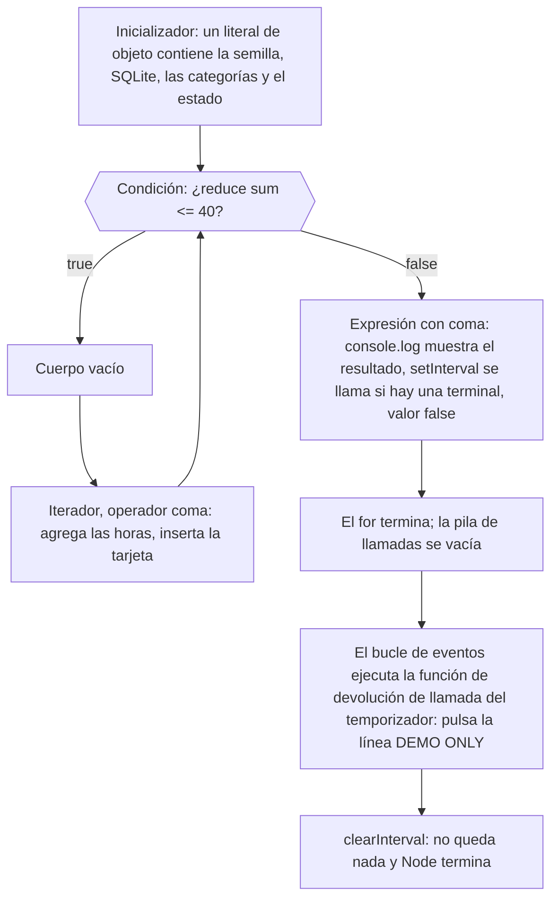
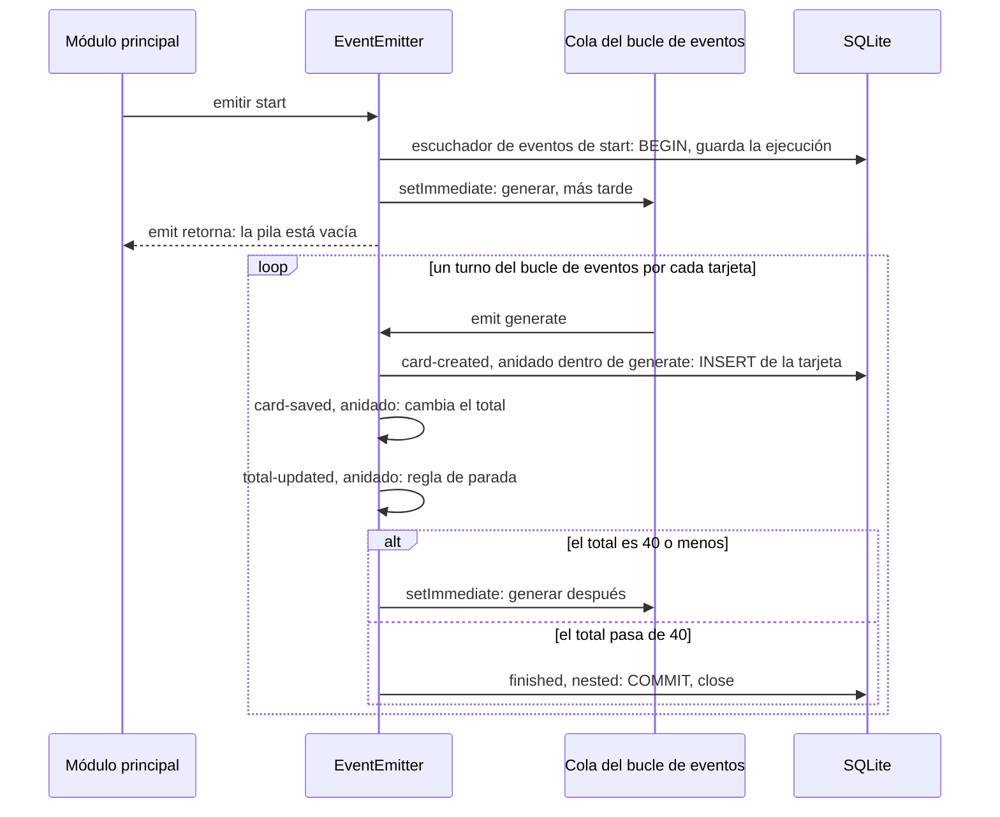
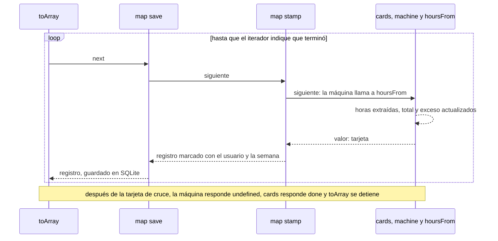

# JavaScript

Entradas: [`src/javascript`](../../src/javascript/README.md) (el `for` sin cuerpo del original, en Node.js), [`src/javascript-weird`](../../src/javascript-weird/README.md) (clausuras (*closures*), funciones que conservan su entorno, y un iterador perezoso, sin sentencia de bucle) y [`src/javascript-events`](../../src/javascript-events/README.md) (diez escuchadores de eventos en un `EventEmitter`, sin sentencia de bucle ni canalización). JavaScript es el lenguaje del navegador y con Node.js también es un lenguaje de scripting de propósito general en el servidor. Su sentencia `for` es el `for` de C: tres cláusulas y un cuerpo. Aquí el cuerpo está vacío y las tres cláusulas son todo el programa.

Para una ruta de lectura avanzada con trazas y experimentos, consulta la [guía de estudio de JavaScript](../guias-de-estudio/lenguajes/javascript.md).

## Qué hace especial a JavaScript

| Característica | Qué enseña |
| --- | --- |
| `for (init; test; update) body` | Un bucle consta de tres expresiones y una sentencia. El orden es fijo: inicialización una vez; luego prueba, cuerpo, actualización, prueba, cuerpo, actualización, hasta que la prueba sea falsa. |
| El operador coma `(a, b)` | Evalúa ambos y devuelve el segundo. Permite que una expresión haga varias cosas en orden. Así la cláusula del iterador añade una tarjeta *y* la guarda. |
| Valores verdaderos o falsos y `&&`, `?:` | Una prueba puede ser cualquier valor, y `a ? b : c` es una expresión, no una sentencia. Por eso la regla de parada puede ser un valor y un efecto secundario puede estar en la rama falsa. |
| `let` en un encabezado `for` | La variable del bucle se copia en cada iteración. Una clausura creada en el cuerpo ve su propia copia. Una copia de una *referencia a un objeto* apunta al mismo objeto, así que el estado se comparte. |
| Funciones flecha y clausuras | Una función lleva consigo las variables que la rodean. El generador aleatorio con semilla es una clausura sobre un número. |
| Iteradores y el protocolo de iteración | Un objeto con `[Symbol.iterator]()` y un método `next()` puede consumirse con `for...of`, con propagación o con `Iterator.from(...).map(...)`. El *consumidor* decide cuántos valores pedir. |
| Node.js: el bucle de eventos | JavaScript se ejecuta en un solo hilo. Los temporizadores se activan solo cuando termina el código actual. El pulso funciona porque el bucle termina primero. |

## El for sin cuerpo en Node

### Contempla la monstruosidad

```bash
sandbox/container/run-image.sh src/javascript
```

Una sentencia de unas 80 líneas. El cuerpo está vacío. No se declara ninguna función en el archivo.

### ¿Cómo demonios funciona eso?

- **El inicializador construye el estado.** Un `let i = ...` contiene una lista de horas, la base de datos, el reloj y un generador aleatorio con semilla. Un `for` permite una declaración, así que el estado es un objeto. El objeto global Web Crypto proporciona una semilla mediante `crypto.getRandomValues` cuando `SEED` no está definido. `randomInt` es una exportación independiente de `node:crypto`.
- **La condición es la regla de parada y el informe.** `total <= 40 ? true : (print, false)`. Mientras indica `true`, el bucle continúa. Cuando indica `false`, ya imprimió el resultado.
- **El iterador hace el trabajo.** Obtiene las horas y guarda la tarjeta. Después de la prueba inicial, cada actualización guarda su tarjeta antes de la siguiente prueba. Por eso se incluye la tarjeta que cruza el tope.
- **Un temporizador produce la animación.** En una terminal, `setInterval` hace pulsar la línea DEMO ONLY. Solo comienza después del bucle, así que no puede retrasar las tarjetas.

El [README](../../src/javascript/README.md#cómo-funciona-el-truco) contiene la tabla de lo que hacía el programa de C# y lo que hace este, además de una comparación medida con el original.

### ¿Qué acabamos de aprender?

- **El orden de evaluación es el programa.** Inicialización, prueba, cuerpo, actualización: el orden es el flujo de control y puedes poner efectos secundarios en cualquier cláusula.
- **Una expresión condicional es un valor.** `?:` y `&&` eligen entre expresiones, así que pueden elegir entre *efectos*.
- **El estado tiene que vivir en un lugar que sobreviva a una iteración.** Un número `let` se copiaría. Un objeto se comparte.
- **El bucle de eventos es un segundo bucle.** Primero se ejecuta `for` hasta el final. Después se ejecuta el temporizador. No se intercalan.
- **La coma tiene dos significados.** En una declaración separa declaradores. En una expresión es un operador. C# permite mezclar los dos en un inicializador. JavaScript no.

Etiquetas: el comportamiento de la semántica de `for`, `?:`, `&&`, el operador coma y las clausuras es **garantizado** por la especificación ECMAScript. `node:sqlite` es una API de Node.js, fuera del estándar del lenguaje (**permitido por la implementación**).

### Haz esto en producción y estás despedido

- **Un `for` con cuerpo vacío esconde el programa en su encabezado.** Nadie puede encontrar el cuerpo del bucle porque no existe.
- **Los efectos secundarios en una condición son un bicho a punto de aparecer.** Si la prueba se ejecuta dos veces, el resultado se imprime dos veces.
- **El objeto de estado es una variable global disfrazada.** Cualquier cosa puede acceder a él.

Usos legítimos: `for (;;)` con un `break` y una coma en una cláusula de actualización para dos contadores.

### Ahora rómpelo tú

Mira el [ejercicio B20](../exercises.md#b20-javascript-lee-las-cláusulas-mueve-el-límite-y-haz-fallar-la-comprobación-de-estructura-verificado).

## Clausuras hasta el fondo

### Contempla la monstruosidad

```bash
sandbox/container/run-image.sh src/javascript-weird
```

Sin `for`, sin `while`, sin `this`. El algoritmo consta de tres clausuras de una línea cada una. El programa es una canalización: `Iterator.from(...).map(...).map(...).toArray()`.

### ¿Cómo demonios funciona eso?

- **Una clausura es una máquina de estados.** `machine(nextHours)` devuelve una función. Recuerda un conteo, un total y una bandera de parada en variables que solo ella puede alcanzar. Cada llamada crea la siguiente tarjeta.
- **El protocolo de iteración es el bucle.** Un objeto con un método `next()` que dice `{ done: true }` cuando termina. `toArray()` sigue preguntando hasta que escucha eso.
- **La regla de parada es una variable.** `over = total > 40`, fijada en la misma llamada que crea la tarjeta que cruza el tope. Después, la máquina responde `undefined` y termina el flujo.
- **La demanda decide.** No se sortea nada hasta que algo lo pide. `take(1)` sortea una tarjeta. `toArray()` las sortea todas.
- **`reduce` es el plegado que no puede detenerse.** Se ejecuta para cada elemento. Así suma la lista terminada y la parada se hace en otro lugar.

El [README](../../src/javascript-weird/README.md#cómo-funciona-el-truco) tiene el diagrama de la clausura, una tabla de cinco formas de detenerse y una comparación del C# original, el `for` sin cuerpo y este.

### ¿Qué acabamos de aprender?

- **Una clausura es una función más su entorno.** La sintaxis lambda por sí sola no es una clausura que importe. Sí lo es una función que cambia una variable que perdura después de la llamada.
- **Las clausuras capturan variables, no valores.** Dos clausuras sobre una variable la comparten. Cada llamada a una fábrica crea variables nuevas.
- **`this` no es una variable capturada.** Separa un método y perderá su `this`. Una clausura conserva lo que capturó.
- **Una clausura no es una continuación.** Se puede llamar de nuevo. No puede reanudar algo por la mitad ni volver atrás.
- **La evaluación diferida y la inmediata producen los efectos en distinto orden.** `Iterator.from(xs).map(a).map(b)` ejecuta `a1 b1 a2 b2`. `xs.map(a).map(b)` ejecuta `a1 a2 b1 b2`. Con funciones puras nadie puede distinguirlos. Con efectos sí se puede. Por eso la ley "map preserva la composición" necesita funciones puras.
- **Solo algunas operaciones pueden detenerse antes.** `some`, `find`, `take` y una fuente que dice `done` pueden hacerlo. `reduce` no puede. Un `throw` sí puede, pero es la herramienta equivocada.

Etiquetas: las clausuras, las funciones flecha y el protocolo de iteración están en la especificación ECMAScript. También lo están los auxiliares de iteradores desde ECMAScript 2025 (**garantizado**). `node:sqlite`, el momento de `WeakRef` y `--expose-gc` son detalles del motor y de Node, usados solo en la comprobación.

### Haz esto en producción y estás despedido

- **Los efectos dentro de `map` sorprenden.** Un lector espera que `map` sea pura. Esta guarda filas.
- **Es difícil inspeccionar el estado oculto.** Un depurador muestra las variables capturadas, pero `console.log` de la función no las muestra.
- **Un iterador agotado es una trampa.** Una segunda pasada no devuelve nada, sin ningún error.

Usos legítimos: clausuras para estado privado, fábricas de funciones configuradas y canalizaciones diferidas para flujos demasiado grandes para almacenarlos. También `some`/`find` para "detenerse en el primero".

### Ahora rómpelo tú

Mira el [ejercicio B21](../exercises.md#b21-javascript-más-raro-mueve-la-regla-de-parada-a-una-clausura-closure-y-observa-la-demanda-verificado).

## Escuchadores de eventos hasta el fondo

### Contempla la monstruosidad

```bash
sandbox/container/run-image.sh src/javascript-events
```

Sin `for`, sin `while`, sin canalización ni fábrica de clausuras. El inicio visible ocupa una línea, `program(realWorld()).emit('start')`. Todo lo demás es un escuchador de eventos: una función pequeña que Node llama cuando llega un evento.

### ¿Cómo demonios funciona eso?

- **Un escuchador de eventos hace una cosa y emite el siguiente evento.** `generate` sortea una tarjeta y emite `card-created`. `card-created` la guarda y emite `card-saved`. `card-saved` actualiza el total y emite `total-updated`. `total-updated` es la regla de parada.
- **`emit()` es una llamada.** Ejecuta cada escuchador de eventos del evento, en orden, antes de regresar. El escuchador está encima de quien lo llama en la pila de llamadas.
- **`setImmediate()` es una solicitud.** `total-updated` no vuelve a emitir `generate`. Se lo pide al bucle de eventos. Node lo ejecuta en un turno posterior, cuando la pila está vacía. Sin eso, cada tarjeta añadiría marcos a la pila y una ejecución larga terminaría con un `RangeError`.
- **El guardado va primero.** `node:sqlite` es síncrono, así que la fila se escribe cuando `run()` regresa. Solo después cambia el total acumulado.
- **Un fallo es un evento.** Cada escuchador de eventos captura su propia excepción emitida y emite `failed`. `failed` revierte la transacción, cierra la base de datos, imprime una línea y elimina todos los escuchadores de eventos.

El [README](../../src/javascript-events/README.md#cómo-funciona-el-truco) contiene la tabla de eventos, la traza y la comparación con las otras dos entradas de Node.

### ¿Qué acabamos de aprender?

- **El flujo de control puede ser un conjunto de registros.** El orden del programa está en los nombres de los eventos y en lo que emite cada escuchador de eventos.
- **`emit()` síncrono no es el bucle de eventos.** Un emisor es una tabla de escuchadores de eventos y una función que los llama. La cola y el bucle pertenecen a Node.
- **Un turno es la unidad de planificación.** Todo lo que hay en un turno se ejecuta hasta terminar antes de que empiece otra cosa. Una función de devolución de llamada que tarda mucho bloquea el resto.
- **Los errores suben por la pila de llamadas.** El `throw` de un escuchador de eventos llega a quien llamó a `emit`. Si es una función de devolución de llamada programada, nadie lo captura. Por eso cada escuchador de eventos necesita su propio `try`.
- **El nombre `error` es especial.** `emit('error', e)` sin un escuchador de eventos lanza `e`.
- **La limpieza forma parte del diseño.** Un escuchador de eventos, temporizador o inmediato que queda pendiente mantiene vivo un proceso o provoca una fuga.

Etiquetas: la llamada síncrona de `EventEmitter` y su orden, así como la ejecución de `setImmediate()` después de la operación actual, son comportamiento documentado de Node (**garantizado**). Consulta la [documentación de `events`](https://nodejs.org/api/events.html) de Node.js. El orden de `setImmediate` frente a `setTimeout(fn, 0)` no está prometido en todas partes, así que el programa no depende de él.

### Haz esto en producción y estás despedido

- **Un escuchador de eventos por evento es una llamada a función con pasos extra.** Si solo una parte puede tener interés, llámala.
- **El orden es difícil de ver.** Un lector debe encontrar cada `emit` para saber qué sigue a qué.
- **No hay contrapresión.** Un emisor sigue emitiendo. Este programa es seguro solo porque cada tarjeta espera a la anterior.
- **Los escuchadores de eventos que cambian los escuchadores durante un `emit`** hacen difícil predecir el orden. Este programa elimina sus escuchadores solo al final.

Usos legítimos: muchas partes pueden tener interés en una cosa (el `request` de un servidor, el `click` de una interfaz), el remitente no debe conocer a los destinatarios y el trabajo es de entrada y salida que no debería bloquear el hilo.

### Ahora rómpelo tú

Consulta el [ejercicio B22](../exercises.md#b22-javascript-dirigido-por-eventos-predice-la-traza-y-luego-elimina-el-límite-verificado) y el capítulo [Eventos, funciones de devolución de llamada y flujo de control reactivo](../informatica/10-eventos-retrollamadas-y-flujo-de-control-reactivo.md).

<!-- BEGIN GENERATED program-flow:languages/javascript.md -->
## Cómo corre cada programa

Cada imagen de abajo es la sección `## Flujo del programa` del README de una entrada, copiada aquí por la compilación. Muestra cómo ese programa hace el trabajo: lo que el lenguaje, el entorno de ejecución o la herramienta hacen en realidad. [La introducción](../introduccion.md#qué-hace-el-reto) muestra qué pide el reto y en qué se distinguen las entradas.

### Flujo del programa de `javascript`

Desde [`javascript`](../../src/javascript/README.md) ([sección original](../../src/javascript/README.md#flujo-del-programa)).



**Qué muestra:** las tres cláusulas de un `for`, donde la condición es una expresión condicional que hace el trabajo final cuando es falsa. La única parte asíncrona es el pulso. Hasta que termina `for`, todo se ejecuta de forma síncrona en una sola pila de llamadas.

**Por qué importa este mecanismo:** el programa tiene un bucle, una parada y una segunda fase, y la segunda fase existe solo porque un temporizador mantiene vivo el bucle de eventos. Sin una terminal no hay temporizador y Node termina en cuanto acaba `for`. Las otras dos entradas de Node se centran en esta planificación: [`javascript-weird`](../../src/javascript-weird/README.md) (clausuras) y [`javascript-events`](../../src/javascript-events/README.md) (escuchadores de eventos).

### Flujo del programa de `javascript-events`

Desde [`javascript-events`](../../src/javascript-events/README.md) ([sección original](../../src/javascript-events/README.md#flujo-del-programa)).



**Qué muestra:** dos tipos de flecha. Un `emit` es una llamada: el escuchador de eventos se ejecuta *dentro* de ella, encima del llamador, y `emit` solo regresa cuando el escuchador de eventos termina. Las flechas `setImmediate` son solicitudes: el siguiente `generate` espera en la cola del bucle de eventos hasta que la pila quede vacía. Cada tarjeta es un turno del bucle y cuatro emisiones se anidan dentro de ese turno. Una excepción lanzada en cualquier escuchador de eventos emite `failed`, que revierte, informa una sola vez y elimina todos los escuchadores de eventos.

**Por qué importa este mecanismo:** el programa no tiene sentencias de bucle ni recursión. El ciclo es "total-updated le pide al bucle de eventos otro generate". Sin ese límite, los mismos eventos se anidarían un nivel más por cada tarjeta. La escritura en la base de datos termina dentro de `card-created`, antes de que el total cambie en `card-saved`.

### Flujo del programa de `javascript-weird`

Desde [`javascript-weird`](../../src/javascript-weird/README.md) ([sección original](../../src/javascript-weird/README.md#flujo-del-programa)).



**Qué muestra:** la demanda fluye *hacia arriba* por la canalización y las tarjetas fluyen *hacia abajo*. No se saca nada hasta que `toArray()` lo pide, y cada petición hace pasar una tarjeta por todo el recorrido: sacada, sellada, guardada. El bucle es el consumidor que vuelve a pedir. Una clausura es una función que conserva las variables del lugar donde se creó. Las tres clausuras (`cards`, `machine`, `hoursFrom`) forman aquí una sola columna, porque cada una es llamada por la anterior.

**Por qué importa este mecanismo:** el estado vive en clausuras: el número del generador y el conteo, el total y la bandera de parada de la máquina. Nada más puede acceder a él. La regla de parada es una variable capturada, `over`, que se asigna en la misma llamada que crea la tarjeta que cruza. Compara [`javascript`](../../src/javascript/README.md), donde una sentencia `for` impulsa el mismo trabajo, y [`javascript-events`](../../src/javascript-events/README.md), donde lo hacen los escuchadores de eventos.
<!-- END GENERATED program-flow:languages/javascript.md -->

## Ciencias de la computación detrás de esta página

<!-- BEGIN GENERATED concepts:languages/javascript.md -->
Las ideas de ciencias de la computación detrás de esta página: [Sistemas de transición y máquinas de estados](../informatica/02-que-cuenta-como-maquina.md#sistemas-de-transición-y-máquinas-de-estados), [Invariantes](../informatica/02-que-cuenta-como-maquina.md#invariantes), [Observabilidad](../informatica/02-que-cuenta-como-maquina.md#observabilidad), [Semántica operacional](../informatica/02-que-cuenta-como-maquina.md#semántica-operacional), [Cálculo frente a orquestación](../informatica/02-que-cuenta-como-maquina.md#cálculo-frente-a-orquestación), [Flujo de control](../informatica/03-flujo-de-control-y-continuaciones.md#flujo-de-control), [Evaluación inmediata](../informatica/04-evaluacion-y-demanda.md#evaluación-inmediata), [Evaluación perezosa](../informatica/04-evaluacion-y-demanda.md#evaluación-perezosa), [Evaluación de cortocircuito](../informatica/04-evaluacion-y-demanda.md#evaluación-de-cortocircuito), [Ejecución diferida](../informatica/04-evaluacion-y-demanda.md#ejecución-diferida), [Iteradores y generadores](../informatica/04-evaluacion-y-demanda.md#iteradores-y-generadores), [Transparencia referencial](../informatica/04-evaluacion-y-demanda.md#transparencia-referencial), [Funciones de primera clase y de orden superior](../informatica/04-evaluacion-y-demanda.md#funciones-de-primera-clase-y-de-orden-superior), [Funtores y mapeo](../informatica/04-evaluacion-y-demanda.md#funtores-y-mapeo), [Monoides y plegados](../informatica/04-evaluacion-y-demanda.md#monoides-y-plegados), [Programación por flujo de datos](../informatica/04-evaluacion-y-demanda.md#programación-por-flujo-de-datos), [Estado](../informatica/06-estado-mas-alla-de-las-variables.md#estado), [La pila de llamadas](../informatica/06-estado-mas-alla-de-las-variables.md#la-pila-de-llamadas), [Ámbito y enlace de nombres](../informatica/06-estado-mas-alla-de-las-variables.md#ámbito-y-enlace-de-nombres), [Clausuras y entornos léxicos](../informatica/06-estado-mas-alla-de-las-variables.md#clausuras-y-entornos-léxicos), [Efectos secundarios](../informatica/07-efectos-errores-y-confirmacion.md#efectos-secundarios), [Manejo de excepciones](../informatica/07-efectos-errores-y-confirmacion.md#manejo-de-excepciones), [Restricciones de integridad](../informatica/07-efectos-errores-y-confirmacion.md#restricciones-de-integridad), [Reproducibilidad y compilaciones deterministas](../informatica/08-fugas-de-abstraccion-y-dependencia-de-la-implementacion.md#reproducibilidad-y-compilaciones-deterministas), [Programación dirigida por eventos](../informatica/10-eventos-retrollamadas-y-flujo-de-control-reactivo.md#programación-dirigida-por-eventos), [Funciones de devolución de llamada](../informatica/10-eventos-retrollamadas-y-flujo-de-control-reactivo.md#funciones-de-devolución-de-llamada), [Publicación y suscripción](../informatica/10-eventos-retrollamadas-y-flujo-de-control-reactivo.md#publicación-y-suscripción), [El bucle de eventos y la planificación de turnos](../informatica/10-eventos-retrollamadas-y-flujo-de-control-reactivo.md#el-bucle-de-eventos-y-la-planificación-de-turnos).
<!-- END GENERATED concepts:languages/javascript.md -->
