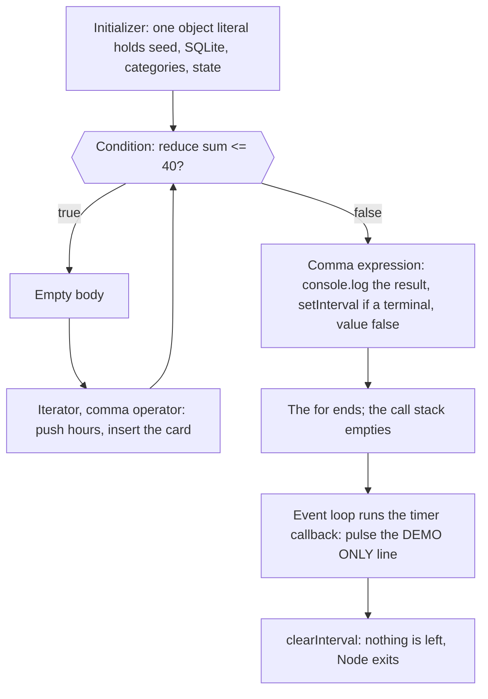
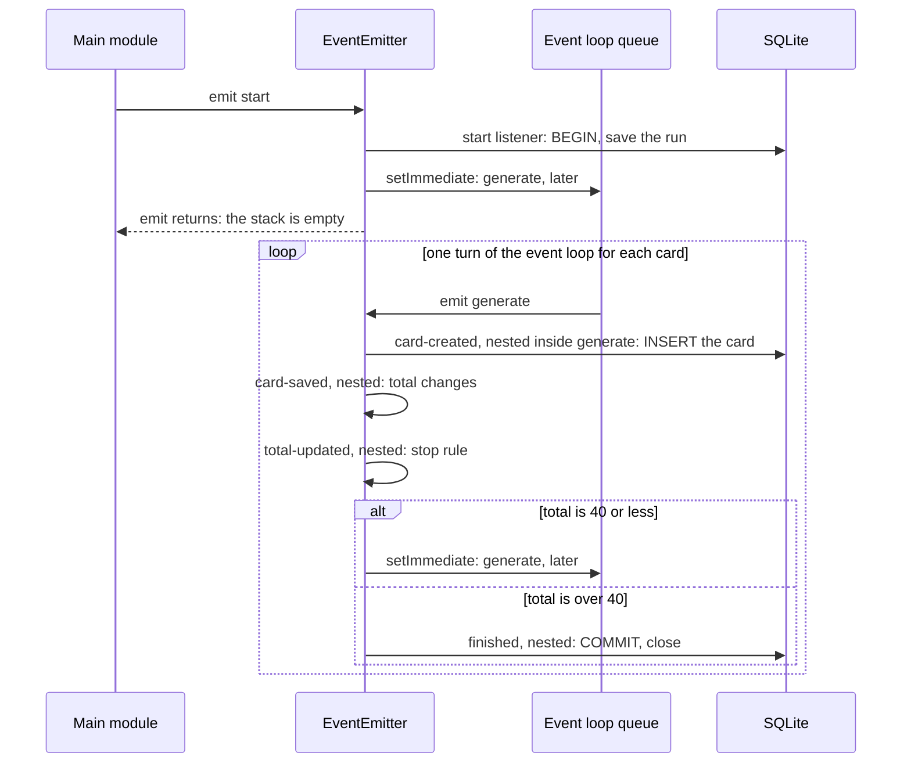
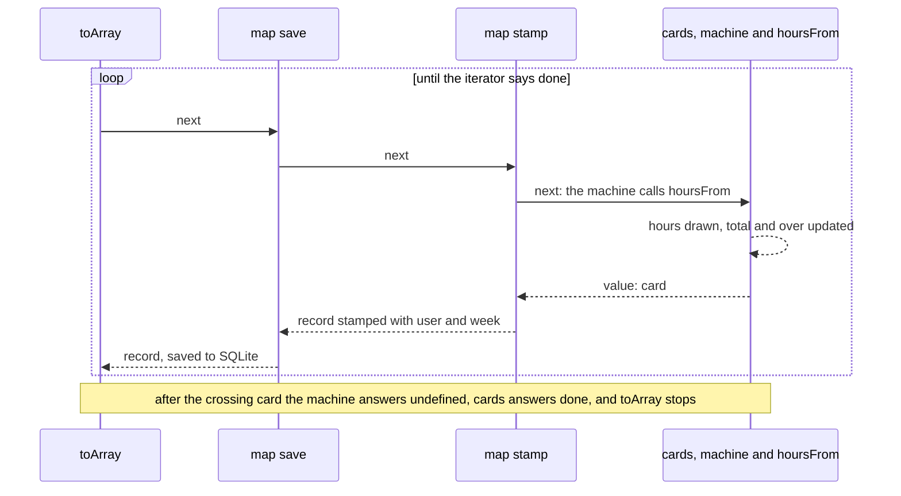

# JavaScript

Entradas: [`src/javascript`](../../src/javascript/README.md) (el `for` sin cuerpo del original, en Node.js), [`src/javascript-weird`](../../src/javascript-weird/README.md) (clausuras (*closures*), funciones que conservan su entorno, y un iterador perezoso, sin sentencia de bucle) y [`src/javascript-events`](../../src/javascript-events/README.md) (diez escuchadores de eventos en un `EventEmitter`, sin sentencia de bucle ni canalización). JavaScript es el lenguaje del navegador y con Node.js también es un lenguaje de scripting de propósito general en el servidor. Su sentencia `for` es el `for` de C: tres cláusulas y un cuerpo. Aquí el cuerpo está vacío y las tres cláusulas son todo el programa.

Para una ruta de lectura avanzada con trazas y experimentos, consulta la [guía de estudio de JavaScript](../guias-de-estudio/lenguajes/javascript.md).

## Qué hace especial a JavaScript

| Característica | Qué enseña |
| --- | --- |
| `for (init; test; update) body` | Un bucle consta de tres expresiones y una sentencia. El orden es fijo: inicialización una vez; luego prueba, cuerpo, actualización, prueba, cuerpo, actualización, hasta que la prueba sea falsa. |
| El operador coma `(a, b)` | Evalúa ambos y devuelve el segundo. Permite que una expresión haga varias cosas en orden. Así la cláusula del iterador añade una tarjeta *y* la guarda. |
| Valores verdaderos o falsos y `&&`, `?:` | Una prueba puede ser cualquier valor, y `a ? b : c` es una expresión, no una sentencia. Por eso la regla de parada puede ser un valor y un efecto secundario puede estar en la rama falsa. |
| `let` en un encabezado `for` | La variable del bucle se copia en cada iteración. Una clausura creada en el cuerpo ve su propia copia. Una copia de una *referencia a un objeto* apunta al mismo objeto, así que el estado se comparte. |
| Funciones flecha y clausuras | Una función lleva consigo las variables que la rodean. El generador aleatorio con semilla es una clausura sobre un número. |
| Iteradores y el protocolo de iteración | Un objeto con `[Symbol.iterator]()` y un método `next()` puede consumirse con `for...of`, con propagación o con `Iterator.from(...).map(...)`. El *consumidor* decide cuántos valores pedir. |
| Node.js: el bucle de eventos | JavaScript se ejecuta en un solo hilo. Los temporizadores se activan solo cuando termina el código actual. El pulso funciona porque el bucle termina primero. |

## El for sin cuerpo en Node

### Contempla la monstruosidad

```bash
sandbox/container/run-image.sh src/javascript
```

Una sentencia de unas 80 líneas. El cuerpo está vacío. No se declara ninguna función en el archivo.

### ¿Cómo demonios funciona eso?

- **El inicializador construye el estado.** Un `let i = ...` contiene una lista de horas, la base de datos, el reloj y un generador aleatorio con semilla. Un `for` permite una declaración, así que el estado es un objeto. El objeto global Web Crypto proporciona una semilla mediante `crypto.getRandomValues` cuando `SEED` no está definido. `randomInt` es una exportación independiente de `node:crypto`.
- **La condición es la regla de parada y el informe.** `total <= 40 ? true : (print, false)`. Mientras indica `true`, el bucle continúa. Cuando indica `false`, ya imprimió el resultado.
- **El iterador hace el trabajo.** Obtiene las horas y guarda la tarjeta. Después de la prueba inicial, cada actualización guarda su tarjeta antes de la siguiente prueba. Por eso se incluye la tarjeta que cruza el tope.
- **Un temporizador produce la animación.** En una terminal, `setInterval` hace pulsar la línea DEMO ONLY. Solo comienza después del bucle, así que no puede retrasar las tarjetas.

El [README](../../src/javascript/README.md#cómo-funciona-el-truco) contiene la tabla de lo que hacía el programa de C# y lo que hace este, además de una comparación medida con el original.

### ¿Qué acabamos de aprender?

- **El orden de evaluación es el programa.** Inicialización, prueba, cuerpo, actualización: el orden es el flujo de control y puedes poner efectos secundarios en cualquier cláusula.
- **Una expresión condicional es un valor.** `?:` y `&&` eligen entre expresiones, así que pueden elegir entre *efectos*.
- **El estado tiene que vivir en un lugar que sobreviva a una iteración.** Un número `let` se copiaría. Un objeto se comparte.
- **El bucle de eventos es un segundo bucle.** Primero se ejecuta `for` hasta el final. Después se ejecuta el temporizador. No se intercalan.
- **La coma tiene dos significados.** En una declaración separa declaradores. En una expresión es un operador. C# permite mezclar los dos en un inicializador. JavaScript no.

Etiquetas: el comportamiento de la semántica de `for`, `?:`, `&&`, el operador coma y las clausuras es **garantizado** por la especificación ECMAScript. `node:sqlite` es una API de Node.js, fuera del estándar del lenguaje (**permitido por la implementación**).

### Haz esto en producción y estás despedido

- **Un `for` con cuerpo vacío esconde el programa en su encabezado.** Nadie puede encontrar el cuerpo del bucle porque no existe.
- **Los efectos secundarios en una condición son un bicho a punto de aparecer.** Si la prueba se ejecuta dos veces, el resultado se imprime dos veces.
- **El objeto de estado es una variable global disfrazada.** Cualquier cosa puede acceder a él.

Usos legítimos: `for (;;)` con un `break` y una coma en una cláusula de actualización para dos contadores.

### Ahora rómpelo tú

Mira el [ejercicio B20](../exercises.md#b20-javascript-read-the-clauses-move-the-limit-and-fail-the-structure-check-verified).

## Clausuras hasta el fondo

### Contempla la monstruosidad

```bash
sandbox/container/run-image.sh src/javascript-weird
```

Sin `for`, sin `while`, sin `this`. El algoritmo consta de tres clausuras de una línea cada una. El programa es una canalización: `Iterator.from(...).map(...).map(...).toArray()`.

### ¿Cómo demonios funciona eso?

- **Una clausura es una máquina de estados.** `machine(nextHours)` devuelve una función. Recuerda un conteo, un total y una bandera de parada en variables que solo ella puede alcanzar. Cada llamada crea la siguiente tarjeta.
- **El protocolo de iteración es el bucle.** Un objeto con un método `next()` que dice `{ done: true }` cuando termina. `toArray()` sigue preguntando hasta que escucha eso.
- **La regla de parada es una variable.** `over = total > 40`, fijada en la misma llamada que crea la tarjeta que cruza el tope. Después, la máquina responde `undefined` y termina el flujo.
- **La demanda decide.** No se sortea nada hasta que algo lo pide. `take(1)` sortea una tarjeta. `toArray()` las sortea todas.
- **`reduce` es el plegado que no puede detenerse.** Se ejecuta para cada elemento. Así suma la lista terminada y la parada se hace en otro lugar.

El [README](../../src/javascript-weird/README.md#cómo-funciona-el-truco) tiene el diagrama de la clausura, una tabla de cinco formas de detenerse y una comparación del C# original, el `for` sin cuerpo y este.

### ¿Qué acabamos de aprender?

- **Una clausura es una función más su entorno.** La sintaxis lambda por sí sola no es una clausura que importe. Sí lo es una función que cambia una variable que perdura después de la llamada.
- **Las clausuras capturan variables, no valores.** Dos clausuras sobre una variable la comparten. Cada llamada a una fábrica crea variables nuevas.
- **`this` no es una variable capturada.** Separa un método y perderá su `this`. Una clausura conserva lo que capturó.
- **Una clausura no es una continuación.** Se puede llamar de nuevo. No puede reanudar algo por la mitad ni volver atrás.
- **La evaluación diferida y la inmediata producen los efectos en distinto orden.** `Iterator.from(xs).map(a).map(b)` ejecuta `a1 b1 a2 b2`. `xs.map(a).map(b)` ejecuta `a1 a2 b1 b2`. Con funciones puras nadie puede distinguirlos. Con efectos sí se puede. Por eso la ley "map preserva la composición" necesita funciones puras.
- **Solo algunas operaciones pueden detenerse antes.** `some`, `find`, `take` y una fuente que dice `done` pueden hacerlo. `reduce` no puede. Un `throw` sí puede, pero es la herramienta equivocada.

Etiquetas: las clausuras, las funciones flecha y el protocolo de iteración están en la especificación ECMAScript. También lo están los auxiliares de iteradores desde ECMAScript 2025 (**garantizado**). `node:sqlite`, el momento de `WeakRef` y `--expose-gc` son detalles del motor y de Node, usados solo en la comprobación.

### Haz esto en producción y estás despedido

- **Los efectos dentro de `map` sorprenden.** Un lector espera que `map` sea pura. Esta guarda filas.
- **Es difícil inspeccionar el estado oculto.** Un depurador muestra las variables capturadas, pero `console.log` de la función no las muestra.
- **Un iterador agotado es una trampa.** Una segunda pasada no devuelve nada, sin ningún error.

Usos legítimos: clausuras para estado privado, fábricas de funciones configuradas y canalizaciones diferidas para flujos demasiado grandes para almacenarlos. También `some`/`find` para "detenerse en el primero".

### Ahora rómpelo tú

Mira el [ejercicio B21](../exercises.md#b21-javascript-weirder-move-the-stop-rule-in-a-closure-and-watch-the-demand-verified).

## Listeners all the way down

### Behold the monstrosity

```bash
sandbox/container/run-image.sh src/javascript-events
```

No `for`, no `while`, no pipeline, no closure factory. The visible start-up is one line, `program(realWorld()).emit('start')`. Everything else is a listener: a small function that Node calls when an event arrives.

### How the hell does that work?

- **A listener does one thing and emits the next event.** `generate` draws a card and emits `card-created`. `card-created` saves it and emits `card-saved`. `card-saved` updates the total and emits `total-updated`. `total-updated` is the stop rule.
- **`emit()` is a call.** It runs every listener of the event, in order, before it returns. The listener sits on top of the caller on the call stack.
- **`setImmediate()` is a request.** `total-updated` does not emit `generate` again. It asks the event loop for it. Node runs it on a later turn, when the stack is empty. Without that, every card would add frames to the stack, and a long run would end with a `RangeError`.
- **The save comes first.** `node:sqlite` is synchronous, so the row is written when `run()` returns. The running total changes only after that.
- **A failure is one event.** Every listener catches its own throw and emits `failed`. `failed` rolls back, closes the database, prints one line and removes every listener.

The [README](../../src/javascript-events/README.md#cómo-funciona-el-truco) has the table of events, the trace and the comparison with the other two Node entries.

### What did we just learn?

- **Control flow can be a set of registrations.** The order of the program is in the event names, and in what each listener emits.
- **Synchronous `emit()` is not the event loop.** An emitter is a table of listeners and a function that calls them. The queue and the loop belong to Node.
- **A turn is the unit of scheduling.** Everything on one turn runs to its end before anything else starts. A callback that runs long stalls the rest.
- **Errors travel up the call stack.** A listener's `throw` goes to whoever called `emit`. If that is a scheduled callback, nobody catches it, so each listener needs its own `try`.
- **The name `error` is special.** `emit('error', e)` with no listener throws `e`.
- **Cleanup is part of the design.** A listener, timer or immediate that stays behind keeps a process alive or leaks.

Tags: `EventEmitter`'s synchronous call and its order, and `setImmediate()` running after the current operation, are documented Node behavior (**guaranteed**). See the Node.js [`events` documentation](https://nodejs.org/api/events.html). The order of `setImmediate` against `setTimeout(fn, 0)` is not promised everywhere, so the program does not depend on it.

### Do this in production and you're fired

- **One listener per event is a function call with extra steps.** If only one party can ever care, call it.
- **The order is hard to see.** A reader must find every `emit` to know what follows what.
- **There is no backpressure.** An emitter keeps emitting. This program is safe only because each card waits for the one before it.
- **Listeners that change the listeners during an `emit`** make the order hard to predict. This program removes its listeners only at the very end.

Legitimate uses: many parties may care about one thing (a server's `request`, a UI's `click`), the sender must not know the receivers and the work is I/O that should not block the thread.

### Now break it yourself

See [exercise B22](../exercises.md#b22-javascript-event-driven-predict-the-trace-then-remove-the-boundary-verified), and the chapter [Events, callbacks and reactive control flow](../informatica/10-eventos-retrollamadas-y-flujo-de-control-reactivo.md).

<!-- BEGIN GENERATED program-flow:languages/javascript.md -->
## How each program runs

Each picture below is the `## Program Flow` section of an entry's README, copied here by the build. It shows how that program makes the work happen: what the language, runtime or tool really does. [The introduction](../introduccion.md#what-the-challenge-does) shows what the challenge asks for and where entries differ.

### Program flow of `javascript`

From [`javascript`](../../src/javascript/README.md) ([source section](../../src/javascript/README.md#flujo-del-programa)).



**What this shows:** the three clauses of a `for`, where the condition is a conditional expression that does the final work when it is false. The only asynchronous part is the pulse. Until the `for` is over, everything runs synchronously on one call stack.

**Why this mechanism matters:** the program has a loop, a stop and a second phase, and the second phase exists only because a timer keeps the event loop alive. Without a terminal there is no timer, and Node exits as soon as the `for` ends. The other two Node entries make this scheduling the point: [`javascript-weird`](../../src/javascript-weird/README.md) (closures) and [`javascript-events`](../../src/javascript-events/README.md) (listeners).

### Program flow of `javascript-events`

From [`javascript-events`](../../src/javascript-events/README.md) ([source section](../../src/javascript-events/README.md#flujo-del-programa)).



**What this shows:** two kinds of arrow. An `emit` is a call: the listener runs *inside* it, on top of the caller, and `emit` returns only when the listener has. The `setImmediate` arrows are requests: the next `generate` waits in the event loop's queue until the stack is empty. Each card is one turn of the loop, and four emits nest inside that turn. A throw in any listener emits `failed`, which rolls back, reports once and removes every listener.

**Why this mechanism matters:** the program has no loop statement and no recursion. The cycle is "total-updated asks the event loop for another generate". Without that boundary the same events would nest one level deeper for every card. The database write finishes inside `card-created`, before the total changes in `card-saved`.

### Program flow of `javascript-weird`

From [`javascript-weird`](../../src/javascript-weird/README.md) ([source section](../../src/javascript-weird/README.md#flujo-del-programa)).



**What this shows:** demand flows *up* the pipeline and cards flow *down* it. Nothing is drawn until `toArray()` asks, and each ask pulls one card all the way through: drawn, stamped, saved. The loop is the consumer asking again. The three closures (`cards`, `machine`, `hoursFrom`) are one column here, because each is called by the one before it.

**Why this mechanism matters:** the state lives in closures: the generator's number, and the machine's count, total and stop flag. Nothing else can reach it. The stop rule is a captured variable, `over`, set in the same call that makes the crossing card. Compare [`javascript`](../../src/javascript/README.md), where a `for` statement drives the same work, and [`javascript-events`](../../src/javascript-events/README.md), where listeners do.
<!-- END GENERATED program-flow:languages/javascript.md -->

## Computer science behind this page

<!-- BEGIN GENERATED concepts:languages/javascript.md -->
The computer-science ideas behind this page: [Transition systems and state machines](../informatica/02-que-cuenta-como-maquina.md#transition-systems-and-state-machines), [Invariants](../informatica/02-que-cuenta-como-maquina.md#invariants), [Observability](../informatica/02-que-cuenta-como-maquina.md#observability), [Operational semantics](../informatica/02-que-cuenta-como-maquina.md#operational-semantics), [Computation versus orchestration](../informatica/02-que-cuenta-como-maquina.md#computation-versus-orchestration), [Control flow](../informatica/03-flujo-de-control-y-continuaciones.md#control-flow), [Eager evaluation](../informatica/04-evaluacion-y-demanda.md#eager-evaluation), [Lazy evaluation](../informatica/04-evaluacion-y-demanda.md#lazy-evaluation), [Short-circuit evaluation](../informatica/04-evaluacion-y-demanda.md#short-circuit-evaluation), [Deferred execution](../informatica/04-evaluacion-y-demanda.md#deferred-execution), [Iterators and generators](../informatica/04-evaluacion-y-demanda.md#iterators-and-generators), [Referential transparency](../informatica/04-evaluacion-y-demanda.md#referential-transparency), [First-class and higher-order functions](../informatica/04-evaluacion-y-demanda.md#first-class-and-higher-order-functions), [Functors and mapping](../informatica/04-evaluacion-y-demanda.md#functors-and-mapping), [Monoids and folds](../informatica/04-evaluacion-y-demanda.md#monoids-and-folds), [Dataflow programming](../informatica/04-evaluacion-y-demanda.md#dataflow-programming), [State](../informatica/06-estado-mas-alla-de-las-variables.md#state), [The call stack](../informatica/06-estado-mas-alla-de-las-variables.md#the-call-stack), [Scope and binding](../informatica/06-estado-mas-alla-de-las-variables.md#scope-and-binding), [Closures and lexical environments](../informatica/06-estado-mas-alla-de-las-variables.md#closures-and-lexical-environments), [Side effects](../informatica/07-efectos-errores-y-confirmacion.md#side-effects), [Exception handling](../informatica/07-efectos-errores-y-confirmacion.md#exception-handling), [Integrity constraints](../informatica/07-efectos-errores-y-confirmacion.md#integrity-constraints), [Reproducibility and deterministic builds](../informatica/08-fugas-de-abstraccion-y-dependencia-de-la-implementacion.md#reproducibility-and-deterministic-builds), [Event-driven programming](../informatica/10-eventos-retrollamadas-y-flujo-de-control-reactivo.md#event-driven-programming), [Callbacks](../informatica/10-eventos-retrollamadas-y-flujo-de-control-reactivo.md#callbacks), [Publish and subscribe](../informatica/10-eventos-retrollamadas-y-flujo-de-control-reactivo.md#publish-and-subscribe), [The event loop and scheduling turns](../informatica/10-eventos-retrollamadas-y-flujo-de-control-reactivo.md#the-event-loop-and-scheduling-turns).
<!-- END GENERATED concepts:languages/javascript.md -->
