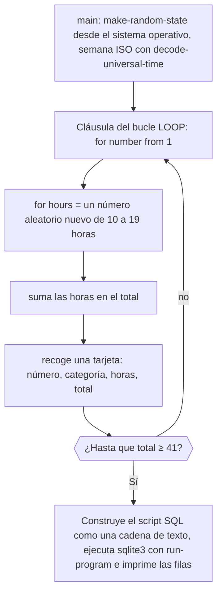
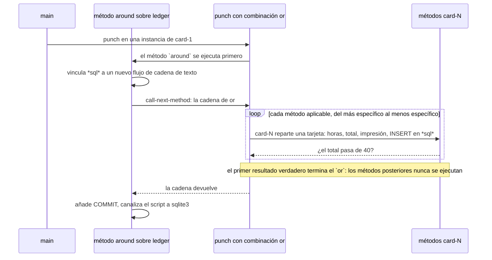

# Common Lisp

Entradas: [`src/lisp`](../../src/lisp/README.md) (una forma `LOOP`) y [`src/lisp-weird`](../../src/lisp-weird/README.md) (sin bucle ni `if`: una jerarquía de clases y una combinación de métodos hacen el trabajo).

Para una ruta de lectura avanzada con trazas y experimentos, consulta la [guía de estudio de Common Lisp](../guias-de-estudio/lenguajes/common-lisp.md).

## Qué hace especial a Common Lisp

En Common Lisp, casi todos los mecanismos que el lenguaje *usa* son también mecanismos a los que puedes *acceder*: el lector que convierte texto en datos, el expansor de macros, el despacho del sistema de objetos y el sistema de condiciones. La entrada idiomática usa muy poco de eso. La rara usa el sistema de objetos como una construcción de flujo de control.

| Característica | Dónde | Qué enseña |
| --- | --- | --- |
| `LOOP` es un pequeño lenguaje propio | [`lisp/timecards.lisp` L42-46](../../src/lisp/timecards.lisp#L42-L46): `for number from 1`, `for hours = ...`, `sum hours into total`, `collect ...`, `until (> total +limit+)` | El orden de las cláusulas es el orden de ejecución. `until` viene *después* de `collect`, por eso se conserva la tarjeta que hace que el total pase de 40. |
| Las estructuras son registros con tipos y accesores generados | [L28](../../src/lisp/timecards.lisp#L28): `(defstruct (card (:constructor make-card ...)))` | `defstruct` escribe el constructor, los accesores y el predicado por ti. |
| Aritmética de calendario escrita a mano | [L64](../../src/lisp/timecards.lisp#L64) `iso-week` | SBCL no tiene una función de semana ISO, así que se calcula y luego se comprueba con `date(1)`. Una regla de numeración de semanas es un algoritmo, no una búsqueda. |
| Comunicación con otro proceso | [L133](../../src/lisp/timecards.lisp#L133): `sb-ext:run-program "sqlite3"` | Lisp construye todo el script SQL como texto y lo envía por una tubería. Aquí la base de datos no es una biblioteca, sino una herramienta al otro extremo de una tubería. |

## Combinación de métodos como flujo de control

### Contempla la monstruosidad

```bash
sandbox/container/run-image.sh src/lisp-weird
```

La última línea de la salida te indica qué buscar:

```text
# PUNCH had 5 OR methods and 3 ran: the class precedence list is the loop, and OR is the stop rule
```

Existen cinco métodos. Se ejecutan tres o cuatro de ellos. Nada en el programa dice "stop". Debajo del marcador `RUN TIME` en [`timecards.lisp`](../../src/lisp-weird/timecards.lisp) no hay `loop`, ni `if`, ni `cond`, ni recursión.

### ¿Cómo demonios funciona eso?

**Combinación de métodos.** Cuando se llama a una función genérica y se aplican varios métodos, CLOS los ordena de más específico a menos específico y los *combina*. La combinación predeterminada llama al más específico, que puede llamar a `call-next-method`. Pero el estándar también incluye otras (`and`, `or`, `progn`, `append`, `list`, `max`, `min`, `+`, `nconc`) que llaman por ti a todos los métodos aplicables:

```lisp
(defgeneric punch (ledger)
  (:method-combination or))            ; L60-61
(defmethod punch or ((ledger card-3)) ...)   ; "or" is the method's qualifier
```

`punch` ahora es `(or (method-for-card-1 ...) (method-for-card-2 ...) ...)` en orden de especificidad. Tiene el mismo cortocircuito que el `or` ordinario: el primer resultado verdadero lo termina.

**La jerarquía de clases es el contador.** [`defcard`](../../src/lisp-weird/timecards.lisp#L34-L39) es una macro: `(defcard 3 card-4)` se expande a una clase `card-3` que hereda de `card-4` y a un método `punch or` especializado en ella. [Cinco de ellas](../../src/lisp-weird/timecards.lisp#L87-L91) encadenan `card-1 → card-2 → ... → card-5 → ledger`. Una instancia `card-1` tiene la lista de precedencia de clases `(card-1 card-2 card-3 card-4 card-5 ledger ...)`. Así, `punch` ejecuta el método de la tarjeta 1, luego el de la tarjeta 2 y así sucesivamente. Las clases no tienen ranuras: la *clase misma* es el mensaje "esta es la tarjeta número N".

**La regla de parada es un valor de retorno.** Cada método reparte una tarjeta y termina con [`(> (total ledger) 40)`](../../src/lisp-weird/timecards.lisp#L84). Cuando eso es verdadero, `or` retorna y los métodos restantes nunca son llamados. ¿Por qué cinco? Las tarjetas tienen al menos 10 horas, así que cuatro tarjetas suman un total de 40 como mínimo. Y 40 no es *más de* 40. Una quinta tarjeta siempre pasa el límite.

**Enlace dinámico como argumento implícito.** Un [método `:around`](../../src/lisp-weird/timecards.lisp#L93) enlaza la variable especial `*sql*` a un flujo de cadena de texto. Llama a `call-next-method` (toda la cadena `or`) y luego envía el script terminado por una tubería a `sqlite3`. Cada `format *sql*` más abajo en la pila de llamadas escribe en ese flujo, sin que se le pase el flujo.

**El lector construye un anillo.** [`*week*`](../../src/lisp-weird/timecards.lisp#L44-L46) es `'#1=("Meetings" "Coding" "Debugging" "Learning" . #1#)`: `#1=` etiqueta la lista y `#1#` vuelve a apuntar a ella. Las categorías se repiten sin `mod`.

**El programa se audita a sí mismo.** La nota final se calcula con el protocolo de metaobjetos: `sb-mop:compute-applicable-methods` pregunta al sistema qué métodos se aplican a este registro. El programa cuenta cuántos se ejecutaron.

### ¿Qué acabamos de aprender?

- **El flujo de control puede vivir en una jerarquía de tipos.** El despacho es la iteración, el orden de especificidad es la secuencia y un valor de retorno es el `break`. Compara el [salto mutable de COBOL](cobol.md#alter) y la [posición de análisis de Forth](forth.md). Los tres ponen el "¿dónde estoy?" en un lugar donde normalmente no está un contador de bucle.
- **Un lenguaje puede proporcionar *políticas* de flujo de control como datos.** `or`, `and` y `progn` no son especiales para `defgeneric`; `define-method-combination` te permite escribir las tuyas.
- **Las clases se calculan, no solo se declaran.** La lista de precedencia de clases es la salida de un algoritmo (`sb-mop:compute-class-precedence-list`) que puedes consultar.
- **El código de compilación se ejecuta *antes* del programa.** `defcard` construye nombres con `intern` y `format` durante la compilación, dentro de `eval-when`. Nada de eso es un bucle sobre tarjetas durante la ejecución.

Etiquetas: la combinación de métodos `or`, `:around`, la sintaxis `#n=`, `defmacro` y `eval-when` son comportamiento **garantizado** por ANSI Common Lisp. `sb-mop:compute-applicable-methods` es el MOP, **permitido por la implementación** (SBCL, CCL y otros lo ofrecen; no está en el estándar ANSI). `sb-ext:run-program` es específico de SBCL (**permitido por la implementación**).

### Haz esto en producción y estás despedido

- **El flujo de control es invisible.** Nada cerca de `punch` dice "esto es un bucle". Un mantenedor debe saber que el orden de definición de las clases determina el orden de ejecución. Insertar una clase en la cadena cambia el comportamiento sin tocar un método.
- **El límite está incorporado en el diseño.** Cinco clases manejan "de 10 a 19 horas, detenerse con más de 40". Otras reglas necesitan una cadena más larga o más corta; la versión ordinaria no tiene ese límite. (Pruébalo en [B10](../exercises.md#b10-lisp-cambia-la-combinación-de-métodos-verificado).)
- **Los depuradores y trazadores muestran una pila de llamadas a funciones genéricas**, no un bucle. Un perfilador atribuye el tiempo a métodos que nadie escribió a mano.
- **Solo SBCL** en la versión distribuida: las funciones `sb-` son de SBCL, mientras que las partes de CLOS son estándar.

Usos legítimos: **las combinaciones de `or`/`and` son herramientas reales** para "gana el primer manejador que diga que sí" (cadenas de validación, puntos de extensión y manejo de eventos). La pirueta es usar la *propia jerarquía de clases* como secuencia.

### Ahora rómpelo tú

Consulta los [ejercicios](../exercises.md#b10-lisp-cambia-la-combinación-de-métodos-verificado).

## Particularidades

- **El orden de las cláusulas de `LOOP` importa.** Mueve `until` por encima de `collect` y se descarta la tarjeta que cruza el tope. Es la misma trampa que en `takeWhile` de Haskell ([por qué `span`](haskell.md)).
- **Las definiciones deben ejecutarse en orden.** Una clase debe existir antes de que otra pueda heredar de ella, así que `defcard` va primero por la cola. Las implementaciones difieren en si una referencia adelantada es una advertencia.
- **`sql-quote` no escapa.** Cada valor es un número o una de cuatro palabras fijas; no lo reutilices para nada más.
- **No existe un formateador** para Common Lisp; la disposición sigue a mano la sangría de `lisp-mode` de Emacs.

## Lo raro junto a lo aburrido

[`lisp`](../../src/lisp/README.md) es una sola forma `LOOP` que suma, recopila y se detiene: lo que escribe un programador de Lisp. [`lisp-weird`](../../src/lisp-weird/README.md) saca el bucle de cualquier forma y lo lleva al *sistema de tipos*. El primero es idiomático; el segundo es lo que el sistema de objetos *permite*. Compara cómo [`haskell`](haskell.md) y [`apl`](apl.md) también emparejan una respuesta de una expresión con otra que reconstruye el flujo de control a partir de la propia metaprogramación del lenguaje.

## ¿En qué circunstancias esta idea terrible se volvería razonable?

Cuando el "bucle" es en realidad *un conjunto de participantes registrados de manera independiente* (complementos, validadores, escuchadores de eventos) y el lenguaje te da una regla para combinarlos. Usar cinco clases vacías para contar hasta cinco es una pirueta; usar `or` para encontrar el primer escuchador de eventos que acepta un evento es el diseño previsto.

<!-- BEGIN GENERATED program-flow:languages/lisp.md -->
## Cómo corre cada programa

Cada imagen de abajo es la sección `## Flujo del programa` del README de una entrada, copiada aquí por la compilación. Muestra cómo ese programa hace el trabajo: lo que el lenguaje, el entorno de ejecución o la herramienta hacen en realidad. [La introducción](../introduccion.md#qué-hace-el-reto) muestra qué pide el reto y en qué se distinguen las entradas.

### Flujo del programa de `lisp`

Desde [`lisp`](../../src/lisp/README.md) ([sección original](../../src/lisp/README.md#flujo-del-programa)).



**Qué muestra:** `LOOP` es un lenguaje pequeño. Sus cláusulas se ejecutan en el orden en que están escritas, en cada pasada. `for hours =` se vuelve a evaluar cada vez, `sum ... into total` guarda el total en una variable que pertenece al bucle y `until` termina el bucle.

**Por qué importa este mecanismo:** la posición de `until` es la de la regla de parada. Si lo escribes después de `collect`, conserva la tarjeta del cruce. Si lo escribes antes, la última tarjeta se descarta sin ningún error. El hermano raro [`lisp-weird`](../../src/lisp-weird/README.md) no tiene `LOOP`.

### Flujo del programa de `lisp-weird`

Desde [`lisp-weird`](../../src/lisp-weird/README.md) ([sección original](../../src/lisp-weird/README.md#flujo-del-programa)).



**Qué muestra:** el bucle es una jerarquía de clases. `card-1` hereda de `card-2` y así sucesivamente. La función genérica `punch` llama al método de cada clase, una tras otra. La clase es todo el mensaje "esta es la tarjeta número N". La combinación de métodos `or` es lo que lo detiene: llama a los métodos hasta que uno devuelva verdadero.

**Por qué importa este mecanismo:** CLOS decide qué se ejecuta y en qué orden. El programa no tiene ninguna sentencia que diga "detente", y los métodos que no se usan simplemente nunca se llaman. El método `:around` envuelve toda la cadena y usa enlace dinámico para enviar cada `format` a un único flujo.
<!-- END GENERATED program-flow:languages/lisp.md -->

## La informática detrás de esta página

<!-- BEGIN GENERATED concepts:languages/lisp.md -->
Las ideas de ciencias de la computación detrás de esta página: [Flujo de control](../informatica/03-flujo-de-control-y-continuaciones.md#flujo-de-control), [Evaluación de cortocircuito](../informatica/04-evaluacion-y-demanda.md#evaluación-de-cortocircuito), [Macros y expansión de texto](../informatica/05-lenguajes-formales-como-sustratos-de-computacion.md#macros-y-expansión-de-texto), [Lenguajes específicos de dominio](../informatica/05-lenguajes-formales-como-sustratos-de-computacion.md#lenguajes-específicos-de-dominio), [Estado](../informatica/06-estado-mas-alla-de-las-variables.md#estado), [Ámbito y enlace de nombres](../informatica/06-estado-mas-alla-de-las-variables.md#ámbito-y-enlace-de-nombres), [Homoiconicidad: código como datos](../informatica/06-estado-mas-alla-de-las-variables.md#homoiconicidad-código-como-datos), [Reflexión y metaprogramación](../informatica/06-estado-mas-alla-de-las-variables.md#reflexión-y-metaprogramación).
<!-- END GENERATED concepts:languages/lisp.md -->
