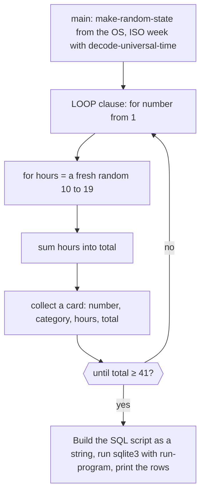
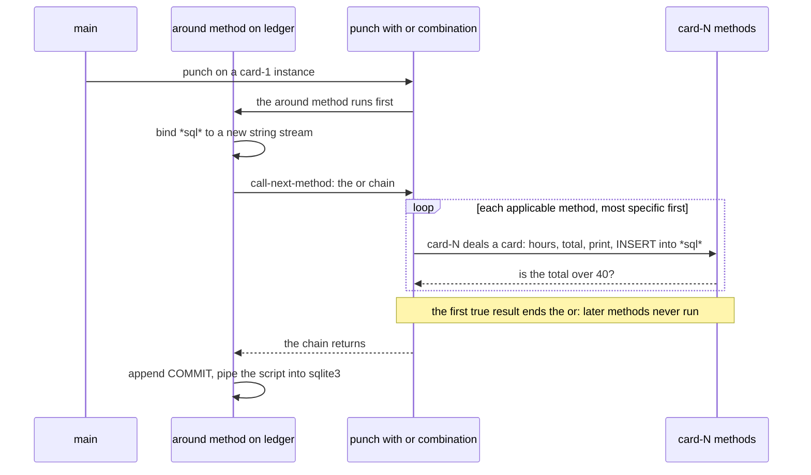

# Common Lisp

Entradas: [`src/lisp`](../../src/lisp/README.md) (una forma `LOOP`) y [`src/lisp-weird`](../../src/lisp-weird/README.md) (sin bucle ni `if`: una jerarquía de clases y una combinación de métodos hacen el trabajo).

Para una ruta de lectura avanzada con trazas y experimentos, consulta la [guía de estudio de Common Lisp](../guias-de-estudio/lenguajes/common-lisp.md).

## Qué hace especial a Common Lisp

En Common Lisp, casi todos los mecanismos que el lenguaje *usa* son también mecanismos a los que puedes *acceder*: el lector que convierte texto en datos, el expansor de macros, el despacho del sistema de objetos y el sistema de condiciones. La entrada idiomática usa muy poco de eso. La rara usa el sistema de objetos como una construcción de flujo de control.

| Característica | Dónde | Qué enseña |
| --- | --- | --- |
| `LOOP` es un pequeño lenguaje propio | [`lisp/timecards.lisp` L42-46](../../src/lisp/timecards.lisp#L42-L46): `for number from 1`, `for hours = ...`, `sum hours into total`, `collect ...`, `until (> total +limit+)` | El orden de las cláusulas es el orden de ejecución. `until` viene *después* de `collect`, por eso se conserva la tarjeta que hace que el total pase de 40. |
| Las estructuras son registros con tipos y accesores generados | [L28](../../src/lisp/timecards.lisp#L28): `(defstruct (card (:constructor make-card ...)))` | `defstruct` escribe el constructor, los accesores y el predicado por ti. |
| Aritmética de calendario escrita a mano | [L64](../../src/lisp/timecards.lisp#L64) `iso-week` | SBCL no tiene una función de semana ISO, así que se calcula y luego se comprueba con `date(1)`. Una regla de numeración de semanas es un algoritmo, no una búsqueda. |
| Comunicación con otro proceso | [L133](../../src/lisp/timecards.lisp#L133): `sb-ext:run-program "sqlite3"` | Lisp construye todo el script SQL como texto y lo envía por una tubería. Aquí la base de datos no es una biblioteca, sino una herramienta al otro extremo de una tubería. |

## Combinación de métodos como flujo de control

### Contempla la monstruosidad

```bash
sandbox/container/run-image.sh src/lisp-weird
```

La última línea de la salida te indica qué buscar:

```text
# PUNCH had 5 OR methods and 3 ran: the class precedence list is the loop, and OR is the stop rule
```

Existen cinco métodos. Se ejecutan tres o cuatro de ellos. Nada en el programa dice "stop". Debajo del marcador `RUN TIME` en [`timecards.lisp`](../../src/lisp-weird/timecards.lisp) no hay `loop`, ni `if`, ni `cond`, ni recursión.

### ¿Cómo demonios funciona eso?

**Combinación de métodos.** Cuando se llama a una función genérica y se aplican varios métodos, CLOS los ordena de más específico a menos específico y los *combina*. La combinación predeterminada llama al más específico, que puede llamar a `call-next-method`. Pero el estándar también incluye otras (`and`, `or`, `progn`, `append`, `list`, `max`, `min`, `+`, `nconc`) que llaman por ti a todos los métodos aplicables:

```lisp
(defgeneric punch (ledger)
  (:method-combination or))            ; L60-61
(defmethod punch or ((ledger card-3)) ...)   ; "or" is the method's qualifier
```

`punch` ahora es `(or (method-for-card-1 ...) (method-for-card-2 ...) ...)` en orden de especificidad. Tiene el mismo cortocircuito que el `or` ordinario: el primer resultado verdadero lo termina.

**La jerarquía de clases es el contador.** [`defcard`](../../src/lisp-weird/timecards.lisp#L34-L39) es una macro: `(defcard 3 card-4)` se expande a una clase `card-3` que hereda de `card-4` y a un método `punch or` especializado en ella. [Cinco de ellas](../../src/lisp-weird/timecards.lisp#L87-L91) encadenan `card-1 → card-2 → ... → card-5 → ledger`. Una instancia `card-1` tiene la lista de precedencia de clases `(card-1 card-2 card-3 card-4 card-5 ledger ...)`. Así, `punch` ejecuta el método de la tarjeta 1, luego el de la tarjeta 2 y así sucesivamente. Las clases no tienen ranuras: la *clase misma* es el mensaje "esta es la tarjeta número N".

**La regla de parada es un valor de retorno.** Cada método reparte una tarjeta y termina con [`(> (total ledger) 40)`](../../src/lisp-weird/timecards.lisp#L84). Cuando eso es verdadero, `or` retorna y los métodos restantes nunca son llamados. ¿Por qué cinco? Las tarjetas tienen al menos 10 horas, así que cuatro tarjetas suman un total de 40 como mínimo. Y 40 no es *más de* 40. Una quinta tarjeta siempre pasa el límite.

**Enlace dinámico como argumento implícito.** Un [método `:around`](../../src/lisp-weird/timecards.lisp#L93) enlaza la variable especial `*sql*` a un flujo de cadena de texto. Llama a `call-next-method` (toda la cadena `or`) y luego envía el script terminado por una tubería a `sqlite3`. Cada `format *sql*` más abajo en la pila de llamadas escribe en ese flujo, sin que se le pase el flujo.

**El lector construye un anillo.** [`*week*`](../../src/lisp-weird/timecards.lisp#L44-L46) es `'#1=("Meetings" "Coding" "Debugging" "Learning" . #1#)`: `#1=` etiqueta la lista y `#1#` vuelve a apuntar a ella. Las categorías se repiten sin `mod`.

**El programa se audita a sí mismo.** La nota final se calcula con el protocolo de metaobjetos: `sb-mop:compute-applicable-methods` pregunta al sistema qué métodos se aplican a este registro. El programa cuenta cuántos se ejecutaron.

### ¿Qué acabamos de aprender?

- **El flujo de control puede vivir en una jerarquía de tipos.** El despacho es la iteración, el orden de especificidad es la secuencia y un valor de retorno es el `break`. Compara el [salto mutable de COBOL](cobol.md#alter) y la [posición de análisis de Forth](forth.md). Los tres ponen el "¿dónde estoy?" en un lugar donde normalmente no está un contador de bucle.
- **Un lenguaje puede proporcionar *políticas* de flujo de control como datos.** `or`, `and` y `progn` no son especiales para `defgeneric`; `define-method-combination` te permite escribir las tuyas.
- **Las clases se calculan, no solo se declaran.** La lista de precedencia de clases es la salida de un algoritmo (`sb-mop:compute-class-precedence-list`) que puedes consultar.
- **El código de compilación se ejecuta *antes* del programa.** `defcard` construye nombres con `intern` y `format` durante la compilación, dentro de `eval-when`. Nada de eso es un bucle sobre tarjetas durante la ejecución.

Etiquetas: la combinación de métodos `or`, `:around`, la sintaxis `#n=`, `defmacro` y `eval-when` son comportamiento **garantizado** por ANSI Common Lisp. `sb-mop:compute-applicable-methods` es el MOP, **permitido por la implementación** (SBCL, CCL y otros lo ofrecen; no está en el estándar ANSI). `sb-ext:run-program` es específico de SBCL (**permitido por la implementación**).

### Haz esto en producción y estás despedido

- **El flujo de control es invisible.** Nada cerca de `punch` dice "esto es un bucle". Un mantenedor debe saber que el orden de definición de las clases determina el orden de ejecución. Insertar una clase en la cadena cambia el comportamiento sin tocar un método.
- **El límite está incorporado en el diseño.** Cinco clases manejan "de 10 a 19 horas, detenerse con más de 40". Otras reglas necesitan una cadena más larga o más corta; la versión ordinaria no tiene ese límite. (Pruébalo en [B10](../exercises.md#b10-lisp-swap-the-method-combination-verified).)
- **Debuggers and tracers show a stack of generic-function calls**, not a loop, and a profiler attributes the time to methods nobody wrote by hand.
- **SBCL only** as shipped: the `sb-` functions are SBCL's, while the CLOS parts are standard.

Legitimate uses: **`or`/`and` combinations are real tools** for "first handler that says yes wins" (validation chains, plug-in hooks, event handling). The stunt is using the *class hierarchy itself* as the sequence.

### Now break it yourself

See [exercises](../exercises.md#b10-lisp-swap-the-method-combination-verified).

## Quirks

- **`LOOP` clause order matters.** Move `until` above `collect` and the crossing card is dropped. This is the same trap as Haskell's `takeWhile` ([why `span`](haskell.md)).
- **Definitions must run in order.** A class must exist before another can inherit from it, so `defcard` goes tail first. Implementations differ on whether a forward reference is a warning.
- **`sql-quote` does not escape.** Every value is a number or one of four fixed words; do not reuse it for anything else.
- **No formatter exists** for Common Lisp; layout follows Emacs `lisp-mode` indentation by hand.

## Weird next to boring

[`lisp`](../../src/lisp/README.md) is one `LOOP` that sums, collects and stops: what a Lisp programmer writes. [`lisp-weird`](../../src/lisp-weird/README.md) moves the loop out of any form and into the *type system*. The first is idiomatic; the second is what the object system *permits*. Compare how [`haskell`](haskell.md) and [`apl`](apl.md) also pair a one-expression answer with one that rebuilds control flow from the language's own metaprogramming.

## Under what circumstances would this terrible idea become reasonable?

When the "loop" is really *a set of independently registered participants* (plug-ins, validators, listeners) and the language gives you a combination rule for them. Using five empty classes to count to five is a stunt; using `or` to find the first listener that accepts an event is the intended design.

<!-- BEGIN GENERATED program-flow:languages/lisp.md -->
## How each program runs

Each picture below is the `## Program Flow` section of an entry's README, copied here by the build. It shows how that program makes the work happen: what the language, runtime or tool really does. [The introduction](../introduccion.md#what-the-challenge-does) shows what the challenge asks for and where entries differ.

### Program flow of `lisp`

From [`lisp`](../../src/lisp/README.md) ([source section](../../src/lisp/README.md#flujo-del-programa)).



**What this shows:** `LOOP` is a small language. Its clauses run in the order written, on every pass. `for hours =` is re-evaluated each time, `sum ... into total` keeps the total in a variable the loop owns, and `until` ends the loop.

**Why this mechanism matters:** the position of `until` is the stop rule's position. Written after `collect`, it keeps the crossing card. Written before it, the last card is dropped without any error. The weird sibling [`lisp-weird`](../../src/lisp-weird/README.md) has no `LOOP`.

### Program flow of `lisp-weird`

From [`lisp-weird`](../../src/lisp-weird/README.md) ([source section](../../src/lisp-weird/README.md#flujo-del-programa)).



**What this shows:** the loop is a class hierarchy. `card-1` inherits from `card-2`, and so on, and the generic function `punch` calls the method of each class in turn. The class is the whole message "this is card number N". The method combination `or` is what stops it: it calls methods until one returns true.

**Why this mechanism matters:** CLOS decides what runs and in what order. The program has no statement that says "stop", and the unused methods are simply never called. The `:around` method wraps the whole chain and uses dynamic binding to send every `format` to one stream.
<!-- END GENERATED program-flow:languages/lisp.md -->

## Computer science behind this page

<!-- BEGIN GENERATED concepts:languages/lisp.md -->
The computer-science ideas behind this page: [Control flow](../informatica/03-flujo-de-control-y-continuaciones.md#control-flow), [Short-circuit evaluation](../informatica/04-evaluacion-y-demanda.md#short-circuit-evaluation), [Macros and text expansion](../informatica/05-lenguajes-formales-como-sustratos-de-computacion.md#macros-and-text-expansion), [Domain-specific languages](../informatica/05-lenguajes-formales-como-sustratos-de-computacion.md#domain-specific-languages), [State](../informatica/06-estado-mas-alla-de-las-variables.md#state), [Scope and binding](../informatica/06-estado-mas-alla-de-las-variables.md#scope-and-binding), [Homoiconicity: code as data](../informatica/06-estado-mas-alla-de-las-variables.md#homoiconicity-code-as-data), [Reflection and metaprogramming](../informatica/06-estado-mas-alla-de-las-variables.md#reflection-and-metaprogramming).
<!-- END GENERATED concepts:languages/lisp.md -->
