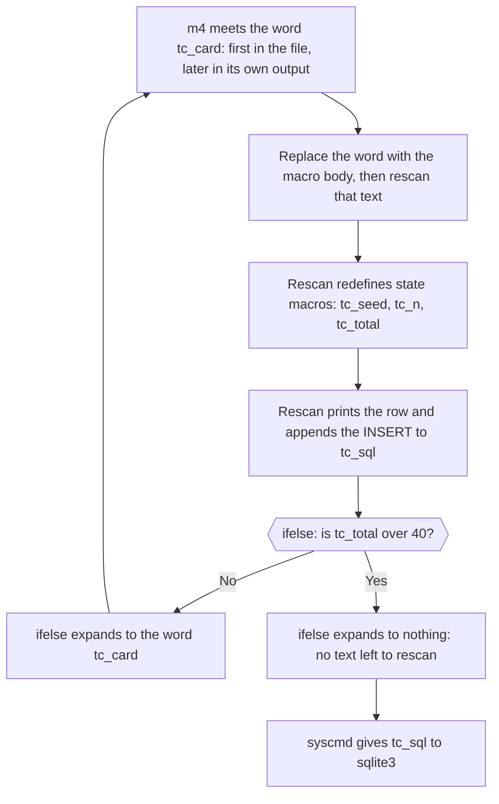

# m4

Entrada: [`src/m4`](../../src/m4/README.md). No hay `m4-weird`, a propósito: m4 es un procesador de macros y *usarlo para ejecutar un programa* ya es la hazaña.

Para una ruta de lectura avanzada con trazas y experimentos, consulta la [guía de estudio de m4](../guias-de-estudio/lenguajes/m4.md).

## Qué hace especial a m4

m4 no ejecuta un programa. **Lee texto y escribe texto** y, a medida que avanza, reemplaza los nombres de macros por sus definiciones. Todo lo demás (variables, aritmética, condicionales, bucles, entrada y salida) es una macro incluida en m4 o escrita por ti. Todo es sustitución de texto.

| Característica | Dónde | Qué enseña |
| --- | --- | --- |
| Las comillas retrasan la evaluación | [L22](../../src/m4/timecards.m4#L22): `changequote([, ])` | Los caracteres de cita predeterminados de m4 son `` ` `` y `'`, que entran en conflicto con el intérprete de comandos (*shell*) y SQL. Los corchetes son el reemplazo tradicional. Una cadena de texto entre comillas *no* se expande; así puedes pasar un nombre de macro sin llamarla. |
| La salida puede desactivarse | [L25](../../src/m4/timecards.m4#L25) y [L85](../../src/m4/timecards.m4#L85): `divert(-1)` ... `divert(0)` | Las desviaciones son búferes de salida numerados. La desviación -1 es el sumidero de bits, así que las definiciones no imprimen nada. |
| `defn` devuelve el texto de una macro | [L69](../../src/m4/timecards.m4#L69): `define([tc_append], [define([tc_sql], defn([tc_sql])[$1])])` | "Una variable que crece" es una macro que se redefine como sí misma más algo adicional. El script SQL se construye así. |
| La única operación aritmética es `eval` | [L44-46](../../src/m4/timecards.m4#L44-L46): `tc_next` | `eval` es de **32 bits**, así que un generador de números aleatorios debe evitar el desbordamiento (ver más abajo). |
| `ifelse` recibe argumentos en grupos de tres | [L53-54](../../src/m4/timecards.m4#L53-L54): `tc_pick` | `ifelse(a, b, then, c, d, then, ..., else)`: después del primer grupo sigue comparando, así que el valor bajo prueba debe repetirse en cada grupo. |
| Se accede al intérprete de comandos mediante `syscmd` y `esyscmd` | [L34-37](../../src/m4/timecards.m4#L34-L37) semilla, semana e identificador de ejecución; [L95](../../src/m4/timecards.m4#L95) el guardado | La única entropía y el único reloj del programa provienen de `od` y `date`. SQLite recibe datos de un solo `syscmd` con un documento aquí. |

## Un bucle hecho de reescaneo

### Contempla la monstruosidad

```bash
sandbox/container/run-image.sh src/m4
```

Todo el bucle es la última línea de una macro ([L75-82](../../src/m4/timecards.m4#L75-L82)):

```m4
define([tc_card],
  [tc_next()dnl
define([tc_hours], eval(10 + tc_seed / 1024 % 10))dnl
define([tc_n], incr(tc_n))dnl
define([tc_total], eval(tc_total + tc_hours))dnl
tc_append(tc_insert(tc_category(tc_n), tc_hours, tc_total))dnl
tc_row(tc_category(tc_n), tc_hours, tc_total)
ifelse(eval(tc_total > 40), 1, [], [tc_card()])])
```

There is no `while`, no `for` and no recursion keyword. There is a macro whose last word is *itself*.

### How the hell does that work?

**Rescanning.** When m4 expands a macro, it pushes the replacement text back onto its *input* and keeps reading. Any macro name in that text is expanded in turn. So `tc_card` reads as: do these steps, print a row, then `ifelse(...)`. If the total is over 40, `ifelse` returns the empty string `[]` and the input runs out. Otherwise it returns the text `tc_card()`, which is pushed back and read as another call. The loop counter is the input stream.

**Why the quotes around `[tc_card()]` matter.** m4 expands *arguments before it calls the macro*. If you write `ifelse(..., tc_card())` without the brackets, the call `tc_card()` is made while collecting the arguments, before `ifelse` has decided anything, and it never stops (see [B11](../exercises.md#b11-m4-quote-the-recursion-verified)). The brackets turn the name into text that is only expanded *after* `ifelse` chooses it. This is lazy versus eager evaluation, in a language with no values at all.

**A random number generator in 32-bit arithmetic.** [`tc_next`](../../src/m4/timecards.m4#L44-L46) is the Park-Miller generator `seed = 16807 * seed mod (2^31 - 1)`, written with Schrage's trick so that no intermediate value leaves 32 bits: `16807 * (seed % 127773) - 2836 * (seed / 127773)`, plus `2^31 - 1` if negative. Naive `16807 * seed` overflows silently in `eval` (`2147483647*4` gives `-4`). The generator was checked against a Python implementation over 20,000 draws.

**Building the SQL.** Each card appends an `INSERT` to `tc_sql` through `tc_append`. At the end one `syscmd` hands the finished script to `sqlite3`. The shell only chooses the folder and runs `sqlite3`; every byte of SQL was written by m4.

**The seed can be pinned.** [L34](../../src/m4/timecards.m4#L34): `ifdef([tc_seed], [], [define(...)])` creates a random seed only if you have not already defined one, so `m4 -Dtc_seed=12345 timecards.m4` always deals the same cards.

### What did we just learn?

- **Evaluation order is a property of the language, not of the loop.** m4's "eager arguments, lazy quotes" rule is what makes `ifelse` behave like `if`. Compare [Haskell's laziness](haskell.md#lazy-io-as-control-flow), which gets the same effect by default.
- **A language with only text can still hold state.** Variables are macros that redefine themselves; lists and strings are text; "append" is `defn`.
- **Output control is a language feature.** `divert` and `undivert` are part of why `autoconf` and `sendmail.cf` could be built on it.
- **Machine limits show up in the language.** Whether you want to or not, you learn that an integer is 32 bits.

Tags: rescanning, quoting, `define`, `defn`, `ifelse`, `eval`, `divert` and `syscmd` are **guaranteed** by POSIX m4. `esyscmd` and `format` are GNU m4 extensions (**implementation-permitted**, tested with 1.4.19); the `ifdef` + `-D` seed pin is POSIX. The 32-bit limit is **implementation-permitted**: POSIX only requires at least 32 bits.

### Do this in production and you're fired

- **Everything is a global macro.** Names are not scoped, so the program prefixes everything with `tc_` to avoid colliding with m4's own macros.
- **Quoting errors fail silently or runaway.** One missing bracket turns a loop into infinite recursion, or an unexpanded macro name into output. There is no type checker, no stack trace.
- **Special characters in your data collide with m4's own syntax** (quotes, `#` comments, parentheses, commas). [L21](../../src/m4/timecards.m4#L21) `changecom()` turns off `#` comments so the output can begin with `# DEMO ONLY`.
- **No real I/O.** The clock, the entropy and SQLite all come through the shell.
- **Debugging is `traceon` and patience.**

Legitimate uses: m4 is still a good tool for *generating* text: configuration files, boilerplate, `autoconf`'s `configure`, `sendmail.cf`. Running a computation in it is the stunt.

### Now break it yourself

See [exercises](../exercises.md#b11-m4-quote-the-recursion-verified).

## Quirks

- **`ifelse` with more than four arguments continues in groups of three.** Eight arguments does not mean "four conditions". Warnings said "excess arguments" before `tc_pick` fixed it.
- **`[]` splits tokens.** `$1[]foo` keeps `$1` from gluing onto `foo` into one name.
- **`undivert` inside an argument list prints directly** and does not return text.
- **`dnl` deletes to the end of the line**, including the newline, which is how the macros stay one logical line.
- **The comment on the last line of the output** says `tc_card` where the source says `[tc_card]`: the quotes are consumed on the way through.

## Weird next to boring

There is no pair for this language: the entry is idiomatic m4 *and* the stunt. Compare it with [Make](make-cmake.md#gnu-make) (a restart is the loop) and [Forth](forth.md) (the parse position is the program counter): in all three the program is *the input being reread*, and the loop is an effect of how the input is consumed.

## Under what circumstances would this terrible idea become reasonable?

When your target is text and your toolbox is a 1977 macro processor that ships on every Unix: generating many similar files from a template. Using it as a general-purpose computer is a lesson in what text rewriting can and cannot do. Compare [sed as a Markov algorithm](regex.md#gnu-sed).

<!-- BEGIN GENERATED program-flow:languages/m4.md -->
## How each program runs

Each picture below is the `## Program Flow` section of an entry's README, copied here by the build. It shows how that program makes the work happen: what the language, runtime or tool really does. [The introduction](../introduccion.md#what-the-challenge-does) shows what the challenge asks for and where entries differ.

### Program flow of `m4`

From [`m4`](../../src/m4/README.md) ([source section](../../src/m4/README.md#flujo-del-programa)).



**What this shows:** m4 has no loop statement. Its evaluation model is replace, then rescan. The loop is the edge from the last `ifelse` back to the first word: the expansion of `tc_card` contains the word `tc_card`.

**Why this mechanism matters:** the stop rule is the absence of text. When `ifelse` expands to nothing, there is nothing left to rescan, and the program is over. State lives in other macros, redefined during the rescan.
<!-- END GENERATED program-flow:languages/m4.md -->

## Computer science behind this page

<!-- BEGIN GENERATED concepts:languages/m4.md -->
The computer-science ideas behind this page: [Turing completeness](../informatica/02-que-cuenta-como-maquina.md#turing-completeness), [Recursion](../informatica/03-flujo-de-control-y-continuaciones.md#recursion), [Fixed-point iteration](../informatica/03-flujo-de-control-y-continuaciones.md#fixed-point-iteration), [Lazy evaluation](../informatica/04-evaluacion-y-demanda.md#lazy-evaluation), [Term and string rewriting](../informatica/05-lenguajes-formales-como-sustratos-de-computacion.md#term-and-string-rewriting), [Macros and text expansion](../informatica/05-lenguajes-formales-como-sustratos-de-computacion.md#macros-and-text-expansion), [State](../informatica/06-estado-mas-alla-de-las-variables.md#state), [Scope and binding](../informatica/06-estado-mas-alla-de-las-variables.md#scope-and-binding).
<!-- END GENERATED concepts:languages/m4.md -->
