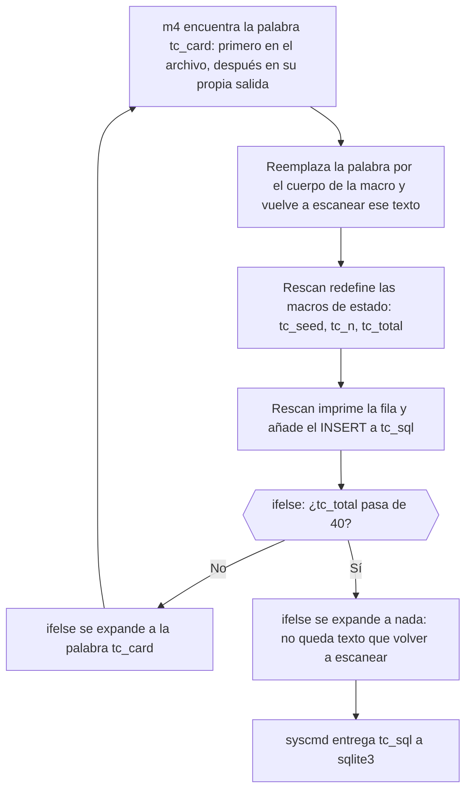

# m4

Entrada: [`src/m4`](../../src/m4/README.md). No hay `m4-weird`, a propósito: m4 es un procesador de macros y *usarlo para ejecutar un programa* ya es la hazaña.

Para una ruta de lectura avanzada con trazas y experimentos, consulta la [guía de estudio de m4](../guias-de-estudio/lenguajes/m4.md).

## Qué hace especial a m4

m4 no ejecuta un programa. **Lee texto y escribe texto** y, a medida que avanza, reemplaza los nombres de macros por sus definiciones. Todo lo demás (variables, aritmética, condicionales, bucles, entrada y salida) es una macro incluida en m4 o escrita por ti. Todo es sustitución de texto.

| Característica | Dónde | Qué enseña |
| --- | --- | --- |
| Las comillas retrasan la evaluación | [L22](../../src/m4/timecards.m4#L22): `changequote([, ])` | Los caracteres de cita predeterminados de m4 son `` ` `` y `'`, que entran en conflicto con el intérprete de comandos (*shell*) y SQL. Los corchetes son el reemplazo tradicional. Una cadena de texto entre comillas *no* se expande; así puedes pasar un nombre de macro sin llamarla. |
| La salida puede desactivarse | [L25](../../src/m4/timecards.m4#L25) y [L85](../../src/m4/timecards.m4#L85): `divert(-1)` ... `divert(0)` | Las desviaciones son búferes de salida numerados. La desviación -1 es el sumidero de bits, así que las definiciones no imprimen nada. |
| `defn` devuelve el texto de una macro | [L69](../../src/m4/timecards.m4#L69): `define([tc_append], [define([tc_sql], defn([tc_sql])[$1])])` | "Una variable que crece" es una macro que se redefine como sí misma más algo adicional. El script SQL se construye así. |
| La única operación aritmética es `eval` | [L44-46](../../src/m4/timecards.m4#L44-L46): `tc_next` | `eval` es de **32 bits**, así que un generador de números aleatorios debe evitar el desbordamiento (ver más abajo). |
| `ifelse` recibe argumentos en grupos de tres | [L53-54](../../src/m4/timecards.m4#L53-L54): `tc_pick` | `ifelse(a, b, then, c, d, then, ..., else)`: después del primer grupo sigue comparando, así que el valor bajo prueba debe repetirse en cada grupo. |
| Se accede al intérprete de comandos mediante `syscmd` y `esyscmd` | [L34-37](../../src/m4/timecards.m4#L34-L37) semilla, semana e identificador de ejecución; [L95](../../src/m4/timecards.m4#L95) el guardado | La única entropía y el único reloj del programa provienen de `od` y `date`. SQLite recibe datos de un solo `syscmd` con un documento aquí. |

## Un bucle hecho de reescaneo

### Contempla la monstruosidad

```bash
sandbox/container/run-image.sh src/m4
```

Todo el bucle es la última línea de una macro ([L75-82](../../src/m4/timecards.m4#L75-L82)):

```m4
define([tc_card],
  [tc_next()dnl
define([tc_hours], eval(10 + tc_seed / 1024 % 10))dnl
define([tc_n], incr(tc_n))dnl
define([tc_total], eval(tc_total + tc_hours))dnl
tc_append(tc_insert(tc_category(tc_n), tc_hours, tc_total))dnl
tc_row(tc_category(tc_n), tc_hours, tc_total)
ifelse(eval(tc_total > 40), 1, [], [tc_card()])])
```

No hay `while`, ni `for` ni palabra clave de recursión. Hay una macro cuya última palabra es *ella misma*.

### ¿Cómo demonios funciona eso?

**Reescaneo.** Cuando m4 expande una macro, devuelve el texto de reemplazo a su *entrada de datos* y sigue leyendo. A su vez, expande cualquier nombre de macro que aparezca en ese texto. Así, `tc_card` significa: haz estos pasos, imprime una fila y luego `ifelse(...)`. Si el total es más de 40, `ifelse` devuelve la cadena de texto vacía `[]` y la entrada de datos se agota. De lo contrario devuelve el texto `tc_card()`, que vuelve a la entrada y se lee como otra llamada. El contador del bucle es el flujo de entrada de datos.

**Por qué importan las comillas alrededor de `[tc_card()]`.** m4 expande *los argumentos antes de llamar a la macro*. Si escribes `ifelse(..., tc_card())` sin los corchetes, la llamada `tc_card()` se hace al recopilar los argumentos. Esto sucede antes de que `ifelse` haya decidido algo y nunca se detiene (ver [B11](../exercises.md#b11-m4-cita-la-recursión-verificado)). Los corchetes convierten el nombre en texto que solo se expande *después* de que `ifelse` lo elige. Es la evaluación diferida frente a la evaluación inmediata, en un lenguaje sin valores.

**Un generador de números aleatorios con aritmética de 32 bits.** [`tc_next`](../../src/m4/timecards.m4#L44-L46) es el generador de Park-Miller `seed = 16807 * seed mod (2^31 - 1)`, escrito con el truco de Schrage para que ningún valor intermedio salga de 32 bits: `16807 * (seed % 127773) - 2836 * (seed / 127773)`, más `2^31 - 1` si es negativo. La forma ingenua `16807 * seed` se desborda sin aviso en `eval` (`2147483647*4` da `-4`). El generador se comprobó frente a una implementación en Python con 20,000 sorteos.

**Construcción del SQL.** Cada tarjeta agrega un `INSERT` a `tc_sql` mediante `tc_append`. Al final, un `syscmd` entrega el script terminado a `sqlite3`. El intérprete de comandos solo elige la carpeta y ejecuta `sqlite3`; m4 escribió cada byte de SQL.

**La semilla se puede fijar.** [L34](../../src/m4/timecards.m4#L34): `ifdef([tc_seed], [], [define(...)])` crea una semilla aleatoria solo si aún no has definido una, así que `m4 -Dtc_seed=12345 timecards.m4` siempre reparte las mismas tarjetas.

### ¿Qué acabamos de aprender?

- **El orden de evaluación es una propiedad del lenguaje, no del bucle.** La regla de m4 "argumentos inmediatos, comillas diferidas" hace que `ifelse` se comporte como `if`. Compara la [evaluación diferida de Haskell](haskell.md#la-es-perezosa-como-flujo-de-control), que obtiene el mismo efecto por defecto.
- **Un lenguaje con solo texto aún puede guardar estado.** Las variables son macros que se redefinen; las listas y las cadenas de texto son texto; "agregar" es `defn`.
- **El control de salida es una característica del lenguaje.** `divert` y `undivert` son parte de la razón por la que se pudieron construir `autoconf` y `sendmail.cf` sobre él.
- **Los límites de la máquina aparecen en el lenguaje.** Quieras o no, aprendes que un entero es de 32 bits.

Etiquetas: el reescaneo, las comillas, `define`, `defn`, `ifelse`, `eval`, `divert` y `syscmd` son comportamiento **garantizado** por POSIX m4. `esyscmd` y `format` son extensiones de GNU m4 (**permitido por la implementación**, probado con 1.4.19); fijar la semilla con `ifdef` + `-D` es POSIX. El límite de 32 bits es **permitido por la implementación**: POSIX solo exige al menos 32 bits.

### Haz esto en producción y estás despedido

- **Todo es una macro global.** Los nombres no tienen ámbito, así que el programa antepone `tc_` a todo para evitar colisiones con las macros propias de m4.
- **Los errores de comillas fallan en silencio o se descontrolan.** Un corchete omitido convierte un bucle en recursión infinita o envía a la salida el nombre de una macro sin expandir. No hay verificador de tipos ni traza de pila.
- **Los caracteres especiales de tus datos chocan con la sintaxis propia de m4** (comillas, comentarios `#`, paréntesis, comas). En [L21](../../src/m4/timecards.m4#L21), `changecom()` desactiva los comentarios `#` para que la salida pueda empezar con `# DEMO ONLY`.
- **Sin entrada ni salida reales.** El reloj, la entropía y SQLite llegan a través del intérprete de comandos.
- **Debugging es `traceon` y paciencia.**

Usos legítimos: m4 sigue siendo una buena herramienta para *generar* texto: archivos de configuración, código repetitivo, `configure` de `autoconf`, `sendmail.cf`. Ejecutar un cálculo en él es la acrobacia.

### Ahora rómpelo tú

Consulta los [ejercicios](../exercises.md#b11-m4-cita-la-recursión-verificado).

## Peculiaridades

- **`ifelse` con más de cuatro argumentos continúa en grupos de tres.** Ocho argumentos no significan "cuatro condiciones". Las advertencias decían "excess arguments" antes de que `tc_pick` lo corrigiera.
- **`[]` separa tokens.** `$1[]foo` impide que `$1` se pegue a `foo` y forme un solo nombre.
- **`undivert` dentro de una lista de argumentos imprime directamente** y no devuelve texto.
- **`dnl` borra hasta el final de la línea**, incluido el salto de línea. Así las macros permanecen en una sola línea lógica.
- **El comentario de la última línea de la salida** dice `tc_card` donde el código fuente dice `[tc_card]`: las comillas se consumen al pasar por el proceso.

## Lo raro junto a lo aburrido

No hay un par para este lenguaje: la entrada es m4 idiomático *y* el truco. Compárala con [Make](make-cmake.md#gnu-make) (un reinicio es el bucle) y [Forth](forth.md) (la posición de análisis es el contador de programa). En los tres, el programa es *la entrada de datos que se vuelve a leer*. El bucle es un efecto de cómo se consume la entrada de datos.

## ¿En qué circunstancias esta idea terrible se volvería razonable?

Cuando tu objetivo es texto y tu caja de herramientas es un procesador de macros de 1977 incluido en todos los Unix: para generar muchos archivos similares a partir de una plantilla. Usarlo como computadora de propósito general enseña lo que la reescritura de texto puede y no puede hacer. Compara [sed como algoritmo de Markov](regex.md#gnu-sed).

<!-- BEGIN GENERATED program-flow:languages/m4.md -->
## Cómo corre cada programa

Cada imagen de abajo es la sección `## Flujo del programa` del README de una entrada, copiada aquí por la compilación. Muestra cómo ese programa hace el trabajo: lo que el lenguaje, el entorno de ejecución o la herramienta hacen en realidad. [La introducción](../introduccion.md#qué-hace-el-reto) muestra qué pide el reto y en qué se distinguen las entradas.

### Flujo del programa de `m4`

Desde [`m4`](../../src/m4/README.md) ([sección original](../../src/m4/README.md#flujo-del-programa)).



**Qué muestra:** m4 no tiene ninguna sentencia de bucle. Su modelo de evaluación es reemplazar y luego volver a explorar. El bucle es la arista desde el último `ifelse` hasta la primera palabra: la expansión de `tc_card` contiene la palabra `tc_card`.

**Por qué importa este mecanismo:** la regla de parada es la ausencia de texto. Cuando `ifelse` se expande a nada, no queda nada que volver a escanear y el programa termina. El estado vive en otras macros, que se redefinen durante el reescaneo.
<!-- END GENERATED program-flow:languages/m4.md -->

## Informática detrás de esta página

<!-- BEGIN GENERATED concepts:languages/m4.md -->
Las ideas de ciencias de la computación detrás de esta página: [Completitud de Turing](../informatica/02-que-cuenta-como-maquina.md#completitud-de-turing), [Recursión](../informatica/03-flujo-de-control-y-continuaciones.md#recursión), [Iteración de punto fijo](../informatica/03-flujo-de-control-y-continuaciones.md#iteración-de-punto-fijo), [Evaluación perezosa](../informatica/04-evaluacion-y-demanda.md#evaluación-perezosa), [Reescritura de términos y de cadenas de texto](../informatica/05-lenguajes-formales-como-sustratos-de-computacion.md#reescritura-de-términos-y-de-cadenas-de-texto), [Macros y expansión de texto](../informatica/05-lenguajes-formales-como-sustratos-de-computacion.md#macros-y-expansión-de-texto), [Estado](../informatica/06-estado-mas-alla-de-las-variables.md#estado), [Ámbito y enlace de nombres](../informatica/06-estado-mas-alla-de-las-variables.md#ámbito-y-enlace-de-nombres).
<!-- END GENERATED concepts:languages/m4.md -->
