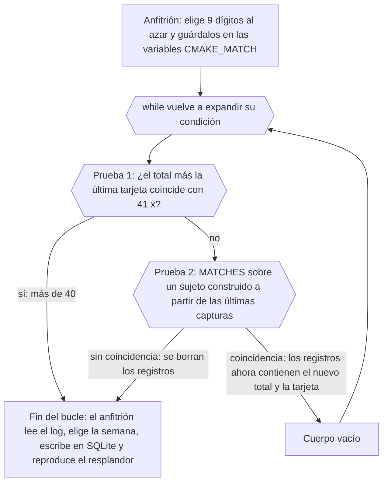
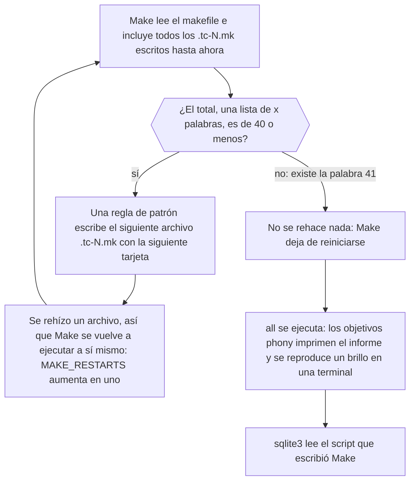

# GNU Make y CMake

Entradas: [`src/make-gnu`](../../src/make-gnu/README.md) y [`src/cmake`](../../src/cmake/README.md). Ambas son herramientas de compilación a las que se les pide comportarse como lenguajes de programación, cada una a su manera.

Para una ruta de lectura avanzada con trazas y experimentos, consulta la [guía de estudio de Make y CMake](../guias-de-estudio/lenguajes/make-y-cmake.md).

## GNU Make

### Contempla la monstruosidad

```bash
sandbox/container/run-image.sh src/make-gnu
```

Un Makefile **sin `$(shell)`, sin `!=`, sin Guile y sin `load`** (`check.sh` los busca a todos con grep). Elige horas al azar, hace aritmética (incluido un cálculo completo de la semana ISO a partir del reloj), ejecuta bucles, escribe una base de datos y brilla en una terminal.

### ¿Cómo demonios funciona eso?

- **Los números son listas de `x`.** Una "regla" de 60,000 palabras `x` y `$(words $(wordlist 1,a,$(U)) $(wordlist 1,b,$(U)))` suma; `$(wordlist b+1,a,...)` resta. La regla de parada `total > 40` es "existe la palabra 41": `$(word 41,...)`.
- **Entropía y reloj sin intérprete de comandos (*shell*), el programa que ejecuta órdenes.** `$(file </proc/sys/kernel/random/uuid)` lee un archivo; las `$(subst)` anidadas eliminan letras y dejan un dígito decimal. La hora es `btime` de `/proc/stat` más `/proc/uptime`, sumados dígito por dígito con acarreo.
- **El bucle consiste en que Make se vuelve a ejecutar.** [`Makefile` L95-101](../../src/make-gnu/Makefile#L95-L101):

  ```make
  K := $(or $(MAKE_RESTARTS),0)
  ...
  include $(if $(runs),$(wildcard .tc-*.mk))
  -include $(if $(runs),.tc-$(K).mk)
  ```

  Make trata como objetivo un makefile incluido que *puede rehacer*. Una regla de patrón ([L110-111](../../src/make-gnu/Makefile#L110-L111)) escribe el siguiente archivo de tarjeta `.tc-N.mk` mientras el total acumulado es 40 o menos. Un makefile recién rehecho significa "reiniciar". Por eso Make se ejecuta de nuevo e incluye un archivo más. `$(MAKE_RESTARTS)` es el contador del bucle. Cuando la regla no escribe, nada se rehace y se ejecuta `all`.
- **El `@:` final importa.** Una receta que *se expande a nada* no cuenta como una reconstrucción del archivo. El archivo de tarjeta se escribe mientras la receta *se expande* (`$(file >$@,...)`). Pero Make solo detecta un reinicio si realmente se ejecutó un comando. Por eso cada tarjeta termina con `@:`, la operación vacía del intérprete de comandos.
- **El informe es una cadena de objetivos ficticios** (`init`, `rows`, `footer` y objetivos de marco). Make expande todas las líneas de una receta antes de ejecutar cualquiera.

### ¿Qué acabamos de aprender?

- **Make es un motor de dependencias que puede reiniciarse.** "Rehacer lo que describe la compilación" es un bucle disfrazado.
- **El estado puede ser la existencia de archivos.** El estado de Make aquí consiste en cuáles archivos `.tc-N.mk` existen.
- **El tiempo de expansión y el tiempo de ejecución son fases diferentes** ([Las dos fases de Make](#peculiaridades)) y el programa vive en el intervalo entre ambas.

Etiquetas: el manual de GNU Make declara **garantizado** que se reconstruyan los makefiles incluidos y se reinicie. Su uso como bucle es **aprovechado por accidente**. `$(file <...)` necesita GNU Make 4.2+. Las lecturas de `/proc` son **permitido por la implementación** en Linux.

### Haz esto en producción y estás despedido

- **Una ejecución que falla deja `.tc-*.mk` atrás**; el siguiente `make` se niega a iniciar (los trataría como tarjetas reales) hasta que se ejecute `make clean`.
- **Granularidad de las marcas de tiempo.** El primer diseño reescribió un `.state.mk` y se reinició una vez; luego se detuvo. Las marcas de tiempo de los archivos en WSL eran tan poco precisas que la reescritura parecía no cambiar nada. "De ausente a presente" no es ambiguo; "modificado" sí lo es.
- **Solo UTC**, porque `/etc/localtime` es binario y Make no puede leerlo.
- **Debugging** significa razonar a la vez sobre las fases de expansión, los reinicios y el estado de los archivos.

Usos legítimos: generar archivos incluidos (`-include $(DEPS)`) que causan un reinicio cuando se regeneran es la forma estándar *prevista* para las dependencias automáticas. La versión rara lleva esa forma hasta sus últimas consecuencias.

### Ahora rómpelo tú

Consulta los [ejercicios](../exercises.md#b4-make-quita-la-operación-sin-efecto-y-sobrescribe-el-reloj-verificado).

## CMake

### Contempla la monstruosidad

```bash
sandbox/container/run-image.sh src/cmake
```

Un `while()` con el cuerpo vacío. Todo lo que toma decisiones está en su condición.

### ¿Cómo demonios funciona eso?

Mira [`timecards.cmake` L41-54](../../src/cmake/timecards.cmake#L41-L54):

```cmake
while(NOT "${CMAKE_MATCH_1}${CMAKE_MATCH_5}" MATCHES "^xxxxxxxxxxxxxxxxxxxxxxxxxxxxxxxxxxxxxxxxx"
      AND "${CMAKE_MATCH_1}${CMAKE_MATCH_5}|${CMAKE_MATCH_3}|..." MATCHES "^(x*)\\|([0-9])...${CMAKE_MATCH_2}:(x*)\\|")
endwhile()
```

El `MATCHES` `if()`/`while()` de CMake guarda sus grupos de captura en variables comunes `CMAKE_MATCH_1`..`n`. Un `while()` **vuelve a expandir su condición en cada pasada**. Así, la condición construye su cadena de texto y su patrón con las capturas de la pasada anterior. Es una máquina de registros y la coincidencia es el programa.

- **Estado** ([L28-32](../../src/cmake/timecards.cmake#L28-L32)): los números son secuencias de `x`; `CMAKE_MATCH_1` es el total, `_2` el dígito inspeccionado en la pasada anterior, `_3` el resto de la cinta de dígitos, `_4` el registro de tarjetas terminadas y `_5` las horas de la última tarjeta.
- **Las horas de 10 a 19** provienen de una tabla *dentro de la cadena de texto* (`0:xxxxxxxxxx|1:xxxxxxxxxxx|...`) y de un patrón que inserta el dígito de la pasada anterior (`${CMAKE_MATCH_2}:`).
- **La regla de parada** es la primera prueba: `NOT` (el total + la última tarjeta coincide con un literal de 41 `x`). Un total de exactamente 40 continúa.
- **El orden importa**: una `MATCHES` fallida borra todos los registros; una exitosa los reescribe. La prueba de parada va primero para conservar las capturas de la coincidencia *principal*.

### ¿Qué acabamos de aprender?

- **El ámbito y el orden de evaluación son estado del programa.** Las variables que no declaraste (`CMAKE_MATCH_n`) se escriben como efecto secundario de una condición.
- **Una condición puede ser una sentencia.** Aquí evaluar la prueba *es* la instrucción.
- **Compara**: [Perl y PCRE2](regex.md) colocan el bucle dentro de una coincidencia de expresión regular; CMake usa una expresión regular *por pasada*, pero deja que el bucle la vuelva a expandir. Misma idea, distinto lugar.

Etiquetas: la documentación establece como **garantizado** asignar `CMAKE_MATCH_n` en una coincidencia y expandir la condición `while()` en cada pasada. Borrar todos los registros ante una coincidencia fallida es **permitido por la implementación**, según lo observado.

### Haz esto en producción y estás despedido

- **La expresión regular de CMake no tiene repetición contada** (`x{41}` no está disponible, de ahí la prueba literal de 41 caracteres), **ni anticipación ni referencias inversas**. Un tentador `(x?x?...)` x 40 para "como máximo 40" retrocedería exponencialmente ante un fallo.
- **El anfitrión sigue informando.** La salida no puede ocurrir dentro de una condición. Por eso la impresión, las escrituras en SQLite y el resplandor son CMake ordinario después del bucle.
- **El año ISO a mano.** `string(TIMESTAMP)` conoce `%V` pero no `%G`.
- **`message()` va a stderr**, de ahí las escrituras de `/dev/stdout`.

### Ahora rómpelo tú

Mira los [ejercicios](../exercises.md#b5-cmake-muta-el-literal-verificado): el propio `check.sh` del repositorio modifica el literal de 41 caracteres para demostrar que controla el bucle.

## Peculiaridades

- **Make expande todas las líneas de una receta antes de ejecutar cualquiera**. Por eso la salida de `$(info)` aparecería antes del encabezado de SQLite.
- **`#` inicia un comentario incluso dentro de una cadena de texto SQL en una variable**; el `'# DEMO ONLY'` del encabezado se escribe `\#`.
- **Los códigos de escape de Make necesitan un byte ESC literal** (`define ESC` contiene un `0x1b`).
- **No hay forma de crear un directorio o un archivo SQLite con Make puro**, de ahí `mkdir -p` y `sqlite3`.
- **`wt.exe` trata `;` como su propio separador de subcomandos**, así que las líneas de comandos que recibe no contienen ninguno. En CMake, las listas también se separan con `;`, así que esto requiere cuidado.
- **Cuatro tarjetas de 10 horas suman un total de exactamente 40, que continúa**, así que la quinta tarjeta reutiliza Meetings (ambas entradas).
- **Detectar una terminal sin intérprete de comandos**: Make usa `$(realpath /proc/self/fd/1)` para buscar coincidencias con `/dev/pts/%`.
- **Make no puede obtener la hora de forma portable**; esta entrada calcula la fecha a partir de `/proc` y recorre el calendario desde 1970.

## Lo raro junto a lo aburrido

La versión "aburrida" de CMake fue el primer borrador: `while()`, `math(EXPR)`, `list(GET)`. El README cuenta que se descartó porque era `RunEverything()` con acento de CMake. La comparación enseña algo: el script ordinario es más claro. El raro fue el que enseñó lo que realmente hace `MATCHES`.

## ¿En qué circunstancias esta idea terrible se volvería razonable?

Nunca como bucle. Pero "un sistema de construcción que regenera sus propias entradas de datos y se reinicia" es justo en lo que se basa la generación automática de dependencias de compilación. Las capturas de regex de CMake son una forma legítima de analizar versiones y rutas. La pirueta consiste en usar esas funciones para todo.

<!-- BEGIN GENERATED program-flow:languages/make-cmake.md -->
## Cómo corre cada programa

Cada imagen de abajo es la sección `## Flujo del programa` del README de una entrada, copiada aquí por la compilación. Muestra cómo ese programa hace el trabajo: lo que el lenguaje, el entorno de ejecución o la herramienta hacen en realidad. [La introducción](../introduccion.md#qué-hace-el-reto) muestra qué pide el reto y en qué se distinguen las entradas.

### Flujo del programa de `cmake`

Desde [`cmake`](../../src/cmake/README.md) ([sección original](../../src/cmake/README.md#flujo-del-programa)).



**Qué muestra:** `while()` vuelve a expandir su condición en cada pasada, y `MATCHES` guarda sus capturas en variables ordinarias. Así, la condición puede construir su siguiente cadena de entrada a partir de sus últimas capturas, y la *coincidencia* es el programa. Los números son secuencias de `x`, y la regla de parada es un literal de 41 caracteres.

**Por qué importa este mecanismo:** el bucle tiene un cuerpo vacío y una máquina de registros como condición. La prueba 1 debe ejecutarse primero, porque una coincidencia fallida borra los registros y una exitosa los reescribe; por eso la coincidencia principal debe ejecutarse al final para que sus capturas sobrevivan. `AND` no se detiene en la primera prueba falsa: en la pasada final, cuando la prueba 1 ya indicó que se detenga, la prueba 2 aún se ejecuta, y eso es lo que mueve la última tarjeta al log (`CMAKE_MATCH_4`). Entonces los registros también guardan una búsqueda de horas más que nunca se informa. La documentación de CMake no promete que se evalúen ambos operandos, así que este comportamiento es aprovechado por accidente. Si intercambias las dos pruebas, obtienes una ejecución con cero tarjetas.

### Flujo del programa de `make-gnu`

Desde [`make-gnu`](../../src/make-gnu/README.md) ([sección original](../../src/make-gnu/README.md#flujo-del-programa)).



**Qué muestra:** el bucle es la herramienta de compilación que se vuelve a ejecutar a sí misma. Cada pasada incluye los archivos `.tc-N.mk` que existen, y un archivo que se escribe fuerza un reinicio. El estado es *qué archivos existen*. La regla de parada es que la regla se niega a escribir un archivo nuevo.

**Por qué importa este mecanismo:** el motor de dependencias de Make decide qué hacer a continuación según el estado del sistema de archivos. No hay sentencia de bucle ni `$(shell)`: la aritmética es cirugía de listas sobre palabras `x`. El informe es una cadena de objetivos *phony* para que su salida se mantenga en orden.
<!-- END GENERATED program-flow:languages/make-cmake.md -->

## La informática detrás de esta página

<!-- BEGIN GENERATED concepts:languages/make-cmake.md -->
Las ideas de ciencias de la computación detrás de esta página: [Máquinas de registros y máquinas de contadores](../informatica/02-que-cuenta-como-maquina.md#máquinas-de-registros-y-máquinas-de-contadores), [Completitud de Turing](../informatica/02-que-cuenta-como-maquina.md#completitud-de-turing), [Flujo de control](../informatica/03-flujo-de-control-y-continuaciones.md#flujo-de-control), [Iteración de punto fijo](../informatica/03-flujo-de-control-y-continuaciones.md#iteración-de-punto-fijo), [Expresiones regulares](../informatica/05-lenguajes-formales-como-sustratos-de-computacion.md#expresiones-regulares), [Programación declarativa](../informatica/05-lenguajes-formales-como-sustratos-de-computacion.md#programación-declarativa), [Lenguajes específicos de dominio](../informatica/05-lenguajes-formales-como-sustratos-de-computacion.md#lenguajes-específicos-de-dominio), [Automatización de la compilación](../informatica/05-lenguajes-formales-como-sustratos-de-computacion.md#automatización-de-la-compilación), [Estado](../informatica/06-estado-mas-alla-de-las-variables.md#estado), [Grafos de dependencias](../informatica/06-estado-mas-alla-de-las-variables.md#grafos-de-dependencias), [Ley de Hyrum](../informatica/08-fugas-de-abstraccion-y-dependencia-de-la-implementacion.md#ley-de-hyrum).
<!-- END GENERATED concepts:languages/make-cmake.md -->
