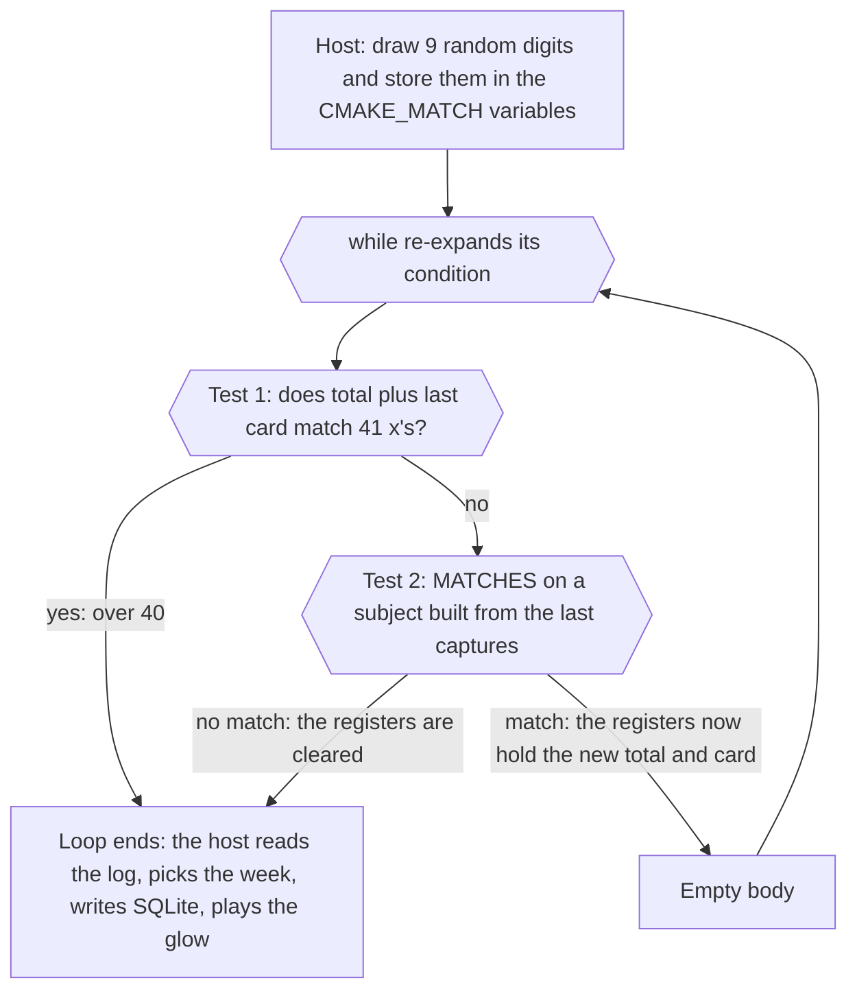
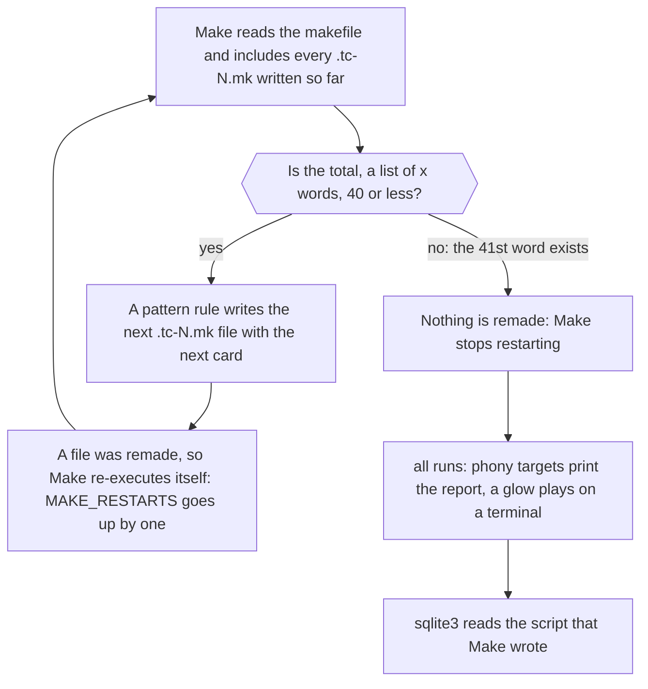

# GNU Make y CMake

Entradas: [`src/make-gnu`](../../src/make-gnu/README.md) y [`src/cmake`](../../src/cmake/README.md). Ambas son herramientas de compilación a las que se les pide comportarse como lenguajes de programación, cada una a su manera.

Para una ruta de lectura avanzada con trazas y experimentos, consulta la [guía de estudio de Make y CMake](../guias-de-estudio/lenguajes/make-y-cmake.md).

## GNU Make

### Contempla la monstruosidad

```bash
sandbox/container/run-image.sh src/make-gnu
```

Un Makefile **sin `$(shell)`, sin `!=`, sin Guile y sin `load`** (`check.sh` los busca a todos con grep). Elige horas al azar, hace aritmética (incluido un cálculo completo de la semana ISO a partir del reloj), ejecuta bucles, escribe una base de datos y brilla en una terminal.

### ¿Cómo demonios funciona eso?

- **Los números son listas de `x`.** Una "regla" de 60,000 palabras `x` y `$(words $(wordlist 1,a,$(U)) $(wordlist 1,b,$(U)))` suma; `$(wordlist b+1,a,...)` resta. La regla de parada `total > 40` es "existe la palabra 41": `$(word 41,...)`.
- **Entropía y reloj sin intérprete de comandos (*shell*), el programa que ejecuta órdenes.** `$(file </proc/sys/kernel/random/uuid)` lee un archivo; las `$(subst)` anidadas eliminan letras y dejan un dígito decimal. La hora es `btime` de `/proc/stat` más `/proc/uptime`, sumados dígito por dígito con acarreo.
- **El bucle consiste en que Make se vuelve a ejecutar.** [`Makefile` L95-101](../../src/make-gnu/Makefile#L95-L101):

  ```make
  K := $(or $(MAKE_RESTARTS),0)
  ...
  include $(if $(runs),$(wildcard .tc-*.mk))
  -include $(if $(runs),.tc-$(K).mk)
  ```

  Make trata como objetivo un makefile incluido que *puede rehacer*. Una regla de patrón ([L110-111](../../src/make-gnu/Makefile#L110-L111)) escribe el siguiente archivo de tarjeta `.tc-N.mk` mientras el total acumulado es 40 o menos. Un makefile recién rehecho significa "reiniciar". Por eso Make se ejecuta de nuevo e incluye un archivo más. `$(MAKE_RESTARTS)` es el contador del bucle. Cuando la regla no escribe, nada se rehace y se ejecuta `all`.
- **El `@:` final importa.** Una receta que *se expande a nada* no cuenta como una reconstrucción del archivo. El archivo de tarjeta se escribe mientras la receta *se expande* (`$(file >$@,...)`). Pero Make solo detecta un reinicio si realmente se ejecutó un comando. Por eso cada tarjeta termina con `@:`, la operación vacía del intérprete de comandos.
- **El informe es una cadena de objetivos ficticios** (`init`, `rows`, `footer` y objetivos de marco). Make expande todas las líneas de una receta antes de ejecutar cualquiera.

### ¿Qué acabamos de aprender?

- **Make es un motor de dependencias que puede reiniciarse.** "Rehacer lo que describe la compilación" es un bucle disfrazado.
- **El estado puede ser la existencia de archivos.** El estado de Make aquí consiste en cuáles archivos `.tc-N.mk` existen.
- **El tiempo de expansión y el tiempo de ejecución son fases diferentes** ([Las dos fases de Make](#quirks)) y el programa vive en el intervalo entre ambas.

Etiquetas: el manual de GNU Make declara **garantizado** que se reconstruyan los makefiles incluidos y se reinicie. Su uso como bucle es **aprovechado por accidente**. `$(file <...)` necesita GNU Make 4.2+. Las lecturas de `/proc` son **permitido por la implementación** en Linux.

### Haz esto en producción y estás despedido

- **Una ejecución que falla deja `.tc-*.mk` atrás**; el siguiente `make` se niega a iniciar (los trataría como tarjetas reales) hasta que se ejecute `make clean`.
- **Granularidad de las marcas de tiempo.** El primer diseño reescribió un `.state.mk` y se reinició una vez; luego se detuvo. Las marcas de tiempo de los archivos en WSL eran tan poco precisas que la reescritura parecía no cambiar nada. "De ausente a presente" no es ambiguo; "modificado" sí lo es.
- **Solo UTC**, porque `/etc/localtime` es binario y Make no puede leerlo.
- **Debugging** significa razonar a la vez sobre las fases de expansión, los reinicios y el estado de los archivos.

Usos legítimos: generar archivos incluidos (`-include $(DEPS)`) que causan un reinicio cuando se regeneran es la forma estándar *prevista* para las dependencias automáticas. La versión rara lleva esa forma hasta sus últimas consecuencias.

### Ahora rómpelo tú

Consulta los [ejercicios](../exercises.md#b4-make-remove-the-no-op-and-override-the-clock-verified).

## CMake

### Contempla la monstruosidad

```bash
sandbox/container/run-image.sh src/cmake
```

Un `while()` con el cuerpo vacío. Todo lo que toma decisiones está en su condición.

### ¿Cómo demonios funciona eso?

Mira [`timecards.cmake` L41-54](../../src/cmake/timecards.cmake#L41-L54):

```cmake
while(NOT "${CMAKE_MATCH_1}${CMAKE_MATCH_5}" MATCHES "^xxxxxxxxxxxxxxxxxxxxxxxxxxxxxxxxxxxxxxxxx"
      AND "${CMAKE_MATCH_1}${CMAKE_MATCH_5}|${CMAKE_MATCH_3}|..." MATCHES "^(x*)\\|([0-9])...${CMAKE_MATCH_2}:(x*)\\|")
endwhile()
```

El `MATCHES` `if()`/`while()` de CMake guarda sus grupos de captura en variables comunes `CMAKE_MATCH_1`..`n`. Un `while()` **vuelve a expandir su condición en cada pasada**. Así, la condición construye su cadena de texto y su patrón con las capturas de la pasada anterior. Es una máquina de registros y la coincidencia es el programa.

- **Estado** ([L28-32](../../src/cmake/timecards.cmake#L28-L32)): los números son secuencias de `x`; `CMAKE_MATCH_1` es el total, `_2` el dígito inspeccionado en la pasada anterior, `_3` el resto de la cinta de dígitos, `_4` el registro de tarjetas terminadas y `_5` las horas de la última tarjeta.
- **Las horas de 10 a 19** provienen de una tabla *dentro de la cadena de texto* (`0:xxxxxxxxxx|1:xxxxxxxxxxx|...`) y de un patrón que inserta el dígito de la pasada anterior (`${CMAKE_MATCH_2}:`).
- **La regla de parada** es la primera prueba: `NOT` (el total + la última tarjeta coincide con un literal de 41 `x`). Un total de exactamente 40 continúa.
- **El orden importa**: una `MATCHES` fallida borra todos los registros; una exitosa los reescribe. La prueba de parada va primero para conservar las capturas de la coincidencia *principal*.

### ¿Qué acabamos de aprender?

- **El ámbito y el orden de evaluación son estado del programa.** Las variables que no declaraste (`CMAKE_MATCH_n`) se escriben como efecto secundario de una condición.
- **Una condición puede ser una sentencia.** Aquí evaluar la prueba *es* la instrucción.
- **Compara**: [Perl y PCRE2](regex.md) colocan el bucle dentro de una coincidencia de expresión regular; CMake usa una expresión regular *por pasada*, pero deja que el bucle la vuelva a expandir. Misma idea, distinto lugar.

Etiquetas: la documentación establece como **garantizado** asignar `CMAKE_MATCH_n` en una coincidencia y expandir la condición `while()` en cada pasada. Borrar todos los registros ante una coincidencia fallida es **permitido por la implementación**, según lo observado.

### Haz esto en producción y estás despedido

- **La expresión regular de CMake no tiene repetición contada** (`x{41}` no está disponible, de ahí la prueba literal de 41 caracteres), **ni anticipación ni referencias inversas**. Un tentador `(x?x?...)` x 40 para "como máximo 40" retrocedería exponencialmente ante un fallo.
- **El anfitrión sigue informando.** La salida no puede ocurrir dentro de una condición. Por eso la impresión, las escrituras en SQLite y el resplandor son CMake ordinario después del bucle.
- **El año ISO a mano.** `string(TIMESTAMP)` conoce `%V` pero no `%G`.
- **`message()` va a stderr**, de ahí las escrituras de `/dev/stdout`.

### Now break it yourself

See [exercises](../exercises.md#b5-cmake-mutate-the-literal-verified): the repo's own `check.sh` mutates the 41-character literal to prove it controls the loop.

## Quirks

- **Make expands every line of a recipe before it runs any**, so `$(info)` output would come out before SQLite's header.
- **`#` starts a comment even inside a SQL string in a variable**; the header's `'# DEMO ONLY'` is written `\#`.
- **Make escape codes need a literal ESC byte** (`define ESC` holds one `0x1b`).
- **No pure-Make way to create a directory or a SQLite file**, hence `mkdir -p` and `sqlite3`.
- **`wt.exe` treats `;` as its own subcommand separator**, so command lines passed to it contain none. In CMake, lists are `;`-separated too, so this needs care.
- **Four 10-hour cards total exactly 40, which continues**, so the fifth card reuses Meetings (both entries).
- **Detecting a terminal without a shell**: Make uses `$(realpath /proc/self/fd/1)` matching `/dev/pts/%`.
- **Make cannot tell time in a portable way**; this entry calculates the date from `/proc` and walks the calendar from 1970.

## Weird next to boring

The "boring" CMake version was the first draft: `while()`, `math(EXPR)`, `list(GET)`. The README records throwing it away because it was `RunEverything()` in CMake's accent. The comparison is instructive: the ordinary script is clearer, and the weird one is the one that taught what `MATCHES` actually does.

## Under what circumstances would this terrible idea become reasonable?

Never as a loop. But "a build system that regenerates its own inputs and restarts" is exactly what auto-dependency generation relies on, and CMake's regex captures are a legitimate way to parse versions and paths. The stunt is those features used for everything.

<!-- BEGIN GENERATED program-flow:languages/make-cmake.md -->
## How each program runs

Each picture below is the `## Program Flow` section of an entry's README, copied here by the build. It shows how that program makes the work happen: what the language, runtime or tool really does. [The introduction](../introduccion.md#what-the-challenge-does) shows what the challenge asks for and where entries differ.

### Program flow of `cmake`

From [`cmake`](../../src/cmake/README.md) ([source section](../../src/cmake/README.md#flujo-del-programa)).



**What this shows:** `while()` re-expands its condition on every pass, and `MATCHES` stores its captures in ordinary variables. So the condition can build its next subject out of its last captures, and the *match* is the program. Numbers are runs of `x`, and the stop rule is a 41-character literal.

**Why this mechanism matters:** the loop has an empty body and a register machine for a condition. Test 1 must run first, because a failed match clears the registers and a successful one rewrites them, so the main match has to run last for its captures to survive. `AND` does not stop at the first false test: on the final pass, when test 1 has already said stop, test 2 still runs, and that is what moves the last card into the log (`CMAKE_MATCH_4`). The registers then also hold one more hours lookup that is never reported. CMake's documentation does not promise that both operands are evaluated, so this is accidentally exploited. Swapping the two tests gives a run with zero cards.

### Program flow of `make-gnu`

From [`make-gnu`](../../src/make-gnu/README.md) ([source section](../../src/make-gnu/README.md#flujo-del-programa)).



**What this shows:** the loop is the build tool rerunning itself. Each pass includes the `.tc-N.mk` files that exist, and a file that gets written forces a restart. The state is *which files exist*. The stop rule is that the rule declines to write a new file.

**Why this mechanism matters:** Make's dependency engine decides what to do next from the state of the file system. There is no loop statement and no `$(shell)`: arithmetic is list surgery on `x` words. The report is a chain of phony targets so that its output stays in order.
<!-- END GENERATED program-flow:languages/make-cmake.md -->

## Computer science behind this page

<!-- BEGIN GENERATED concepts:languages/make-cmake.md -->
The computer-science ideas behind this page: [Register machines and counter machines](../informatica/02-que-cuenta-como-maquina.md#register-machines-and-counter-machines), [Turing completeness](../informatica/02-que-cuenta-como-maquina.md#turing-completeness), [Control flow](../informatica/03-flujo-de-control-y-continuaciones.md#control-flow), [Fixed-point iteration](../informatica/03-flujo-de-control-y-continuaciones.md#fixed-point-iteration), [Regular expressions](../informatica/05-lenguajes-formales-como-sustratos-de-computacion.md#regular-expressions), [Declarative programming](../informatica/05-lenguajes-formales-como-sustratos-de-computacion.md#declarative-programming), [Domain-specific languages](../informatica/05-lenguajes-formales-como-sustratos-de-computacion.md#domain-specific-languages), [Build automation](../informatica/05-lenguajes-formales-como-sustratos-de-computacion.md#build-automation), [State](../informatica/06-estado-mas-alla-de-las-variables.md#state), [Dependency graphs](../informatica/06-estado-mas-alla-de-las-variables.md#dependency-graphs), [Hyrum's law](../informatica/08-fugas-de-abstraccion-y-dependencia-de-la-implementacion.md#hyrums-law).
<!-- END GENERATED concepts:languages/make-cmake.md -->
