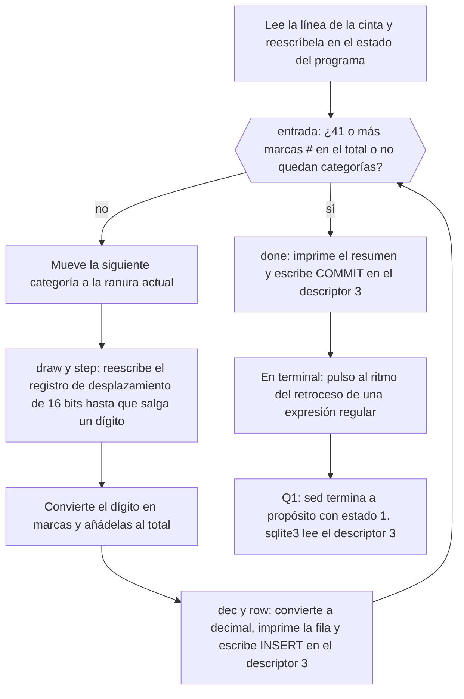
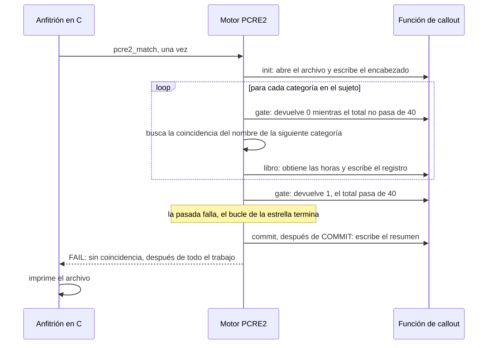
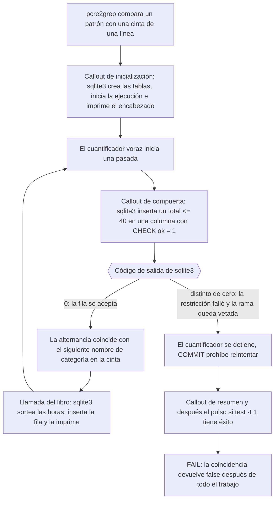
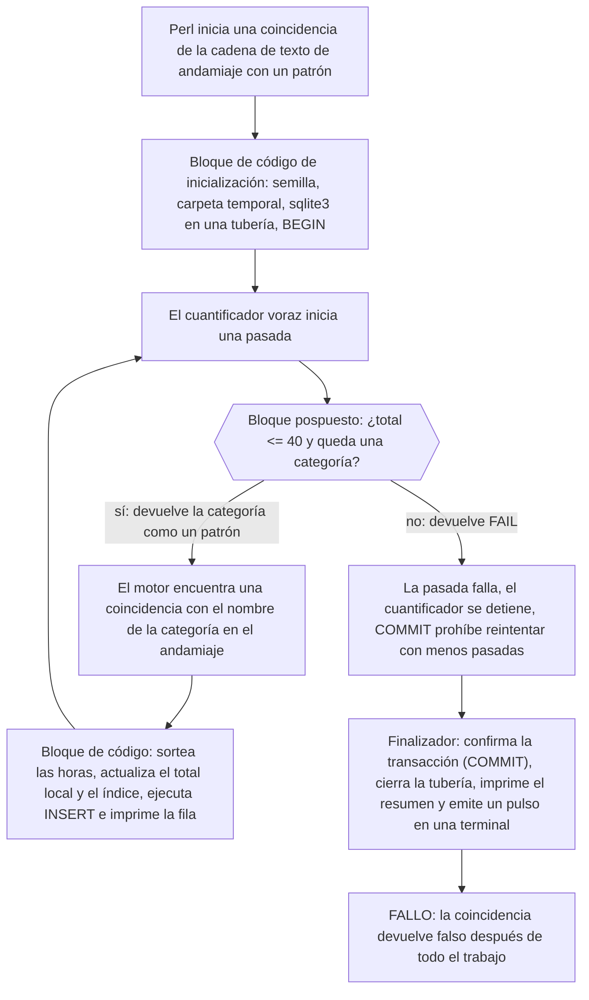
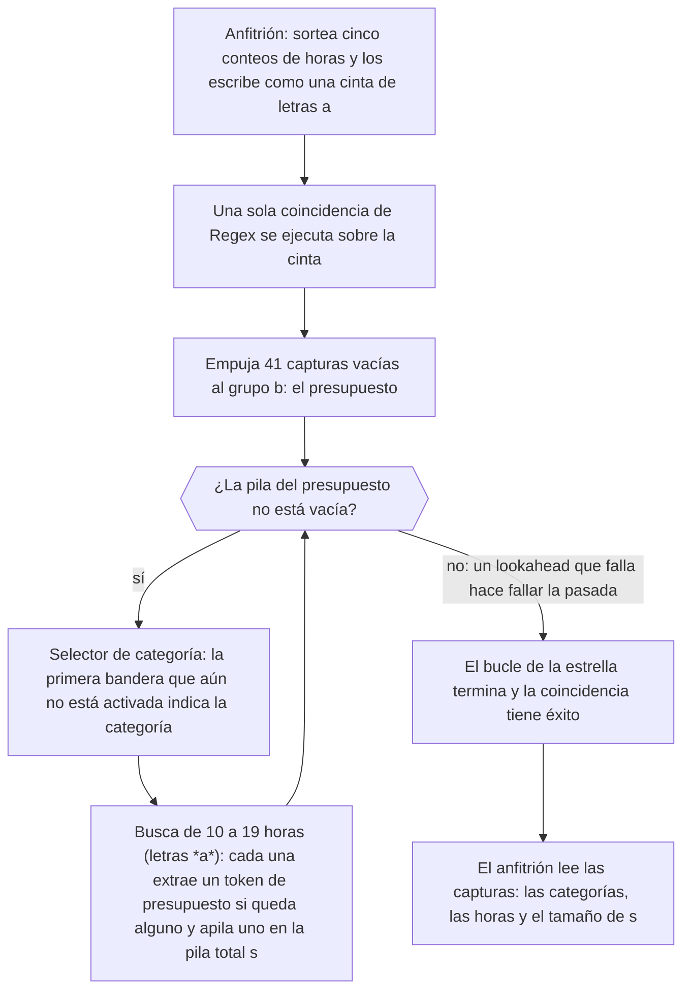

# Expresiones regulares: cinco motores, cinco personalidades

Entradas: [`src/regex-perl`](../../src/regex-perl/README.md), [`src/regex-pcre2`](../../src/regex-pcre2/README.md), [`src/regex-pcre2grep`](../../src/regex-pcre2grep/README.md), [`src/regex-dotnet`](../../src/regex-dotnet/README.md), [`src/regex-sed`](../../src/regex-sed/README.md).

Para una ruta de lectura avanzada con trazas y experimentos, consulta la [guía de estudio de motores de expresiones regulares y sed](../guias-de-estudio/lenguajes/motores-de-regex-y-sed.md).

Una expresión regular parece un patrón. Estas entradas la tratan como un **programa**: la coincidencia es el cálculo, el retroceso es la búsqueda y los efectos secundarios son lo que *querías*. La maniobra recurrente consiste en hacer todo el trabajo y luego **devolver "sin coincidencia" a propósito**.

Este panorama compara cinco motores. El ejemplo de Perl examina el mecanismo en detalle y combina la explicación con el ejercicio.

## Qué hace especial a cada motor

| Motor | El programa es... | Lo especial | Dónde |
| --- | --- | --- | --- |
| **Perl** | una coincidencia de `=~` | Los bloques de código `(?{ })` se ejecutan durante la coincidencia; `(??{ })` devuelve un *patrón* y `local` se deshace con el retroceso | [`timecards.pl` L7](../../src/regex-perl/timecards.pl#L7) |
| **PCRE2** | una llamada a `pcre2_match` | Las cadenas de texto de callout `(?C"book")` son códigos de operación para un despachador sin cuerpo en C | [`timecards.c` L24-26](../../src/regex-pcre2/timecards.c#L24-L26) |
| **pcre2grep** | una línea de comando, sin código personalizado | Los scripts de callout nombran programas para ejecutar y sus **estados de salida dirigen la coincidencia** | [`timecards.sh` L14-20](../../src/regex-pcre2grep/timecards.sh#L14-L20) |
| **.NET** | solo un patrón de grupos de equilibrio | Las *pilas* de capturas crean un contador | [`Program.cs` L13](../../src/regex-dotnet/Program.cs#L13) |
| **GNU sed** | una línea de texto, reescrita | Un [algoritmo de Markov](../../src/regex-sed/README.md#algoritmos-de-markov-calcular-con-buscar-y-reemplazar): buscar y reemplazar como computadora | [`timecards.sed`](../../src/regex-sed/timecards.sed) |

## Perl: código dentro de la coincidencia

### Contempla la monstruosidad

```bash
sandbox/container/run-image.sh src/regex-perl
```

La única sentencia del archivo es un solo `=~`. La inicialización de la semilla, los sorteos aleatorios, la transacción de SQLite, el pulso y toda la impresión ocurren *dentro de la coincidencia*. Luego la coincidencia devuelve falso.

### ¿Cómo demonios funciona eso?

| Pieza | Función |
| --- | --- |
| `^(?{ ... })` | inicializador: inicializa el estado, inicia `sqlite3` en una tubería y abre una transacción |
| `(?: ... )*` | el bucle: el cuantificador voraz es la iteración; la cadena de texto del armazón da algo que comer a cada pasada |
| `(??{ $::t<=40 ? $::c[$::n] // '(*FAIL)' : '(*FAIL)' })` | regla de parada **y** selector de categoría: devuelve la siguiente categoría *como patrón* o `(*FAIL)` |
| `(?{ local $::t = ...; print ... })` | una tarjeta |
| `(*COMMIT)` | cuando termina el bucle, impide que el retroceso reintente bucles más cortos |
| `(*COMMIT)(?{ settle })(*FAIL)` | la jugada característica: rendirse después de hacer todo el trabajo |

`local` es la parte interesante: Perl deshace las asignaciones `local` cuando el motor retrocede. Así, el total acumulado responde al retroceso, pero los `INSERT` y `print` *no* se deshacen. El motor abandona la rama y los efectos secundarios permanecen escritos. La transacción de SQLite es real y se confirma; **lo que miente es la coincidencia**.

### Aprende y rompe

- El retroceso es un procedimiento de búsqueda, y una rama que falla aporta información. El estado que se deshace (`local`) y el que no (entrada/salida) se comportan de forma distinta. Esa diferencia es todo el truco. Consulta [patrones](../patrones.md#retroceso-efectos-secundarios-y-manejo-de-errores).
- **Producción**: es difícil probar o depurar código en patrones. En Perl, los bloques de código regex se ejecutan con las reglas `strict` del archivo y solo pueden `local` variables de paquete.

Etiquetas: la documentación de regex de Perl establece como comportamiento **garantizado** `(?{ })`, `(??{ })` y el deshacimiento de `local`.

## PCRE2: los callouts como conjunto de instrucciones

El patrón completo ([`timecards.c` L24-26](../../src/regex-pcre2/timecards.c#L24-L26)):

```text
^(?C"init")(?:(?C"gate")(Meetings|Coding|Debugging|Learning)(?C"book"))*(*COMMIT)(?C"commit")(*FAIL)
```

(Más una cola de pulso.) El anfitrión en C lo compila, registra un despachador, llama a `pcre2_match` una vez e imprime el archivo. La cadena de texto del callout es un código de operación: `init`, `gate` (devuelve 1 cuando el total pasa de 40 para que falle la rama y termine el bucle), `book`, `commit`. **PCRE2 aporta la iteración, el recorrido de las categorías y el retroceso.**

- **La salvedad sobre el optimizador es la lección.** Los callouts solo tienen sentido si el motor los visita. El programa se compila con `PCRE2_NO_AUTO_POSSESS | PCRE2_NO_START_OPTIMIZE | PCRE2_NO_DOTSTAR_ANCHOR` ([L84-86](../../src/regex-pcre2/timecards.c#L84-L86)) y evita el JIT, que no admite callouts. Esto es **permitido por la implementación**, y el README no probó qué omitiría el optimizador si se quitaran las banderas.
- **El estado en una estructura de C no se rebobina durante el retroceso**, a diferencia de `local` de Perl. Eso le conviene a este programa: nunca se deshace nada.
- **Un retorno negativo de un callout aborta la coincidencia** con el código del callout. A propósito no usa `-1`, que significa "sin coincidencia" y se confundiría con el resultado esperado.

## pcre2grep: códigos de salida como flujo de control

El "anfitrión" es un `pcre2grep` estándar y una línea de comandos. Las cadenas de texto de los callouts nombran programas; **sus códigos de salida dirigen la coincidencia**. La regla de parada es un `INSERT INTO stop_rule SELECT (...)<=40` en una tabla con `CHECK(ok=1)`, por lo que la violación de la restricción de SQLite termina el bucle.

- **Los callouts necesitan rutas absolutas.** `pcre2grep` usa `fork` y `execv`, que no buscan en `PATH`. Un `true` o `sleep` sin ruta falla en silencio como callout y no se distingue de una rama vetada.
- **Sin estado en el patrón.** El total acumulado reside en SQLite y cada callout lo vuelve a leer.
- **Cada escritura se confirma por separado.** Los programas auxiliares ejecutan comandos independientes de SQLite en modo de confirmación automática. El `(*COMMIT)` de la expresión regular poda rutas de retroceso. El fallo final de coincidencia deja intactas las escrituras anteriores en la base de datos.
- **El `pcre2grep` propio de Ubuntu se compila sin scripts de callout.** Se necesita una compilación del proyecto original (la imagen del entorno aislado fija la versión 10.49). Un caso de manual **permitido por la implementación**.
- **Seguridad**: los callouts que ejecutan programas son una función de ejecución de comandos. `check.sh` solo permite `/usr/bin/sqlite3`, `/usr/bin/test` y `/bin/sleep`.

## .NET: grupos de equilibrio

[`Program.cs` L13](../../src/regex-dotnet/Program.cs#L13) usa un presupuesto de 41 capturas vacías y **grupos de equilibrio** que extraen una por hora: `(?<-b>)`. El "contador" es una pila de capturas.

Esta entrada es el mejor **fallo honesto** del repositorio. También es la que muestra con más claridad dónde se detiene la expresión regular por sí sola. Consulta [problemas bloqueantes](../problemas-bloqueantes.md#regex-dotnet):

- Una expresión regular no puede sortear números aleatorios, así que el anfitrión proporciona cinco cadenas de texto unarias.
- El anfitrión lee las capturas de la coincidencia exitosa y añade un informe TSV.
- **El fallo produce cero filas de tarjetas.** Añade `(?!)` para que falle toda la coincidencia. En la cinta fija de solo 10, el patrón normal tiene éxito con cinco tarjetas y un total de 50. El fallo forzado expone cero capturas, deja un informe TSV vacío y sale con 1. Consulta la [comprobación de la entrada](../../src/regex-dotnet/check.sh).

## GNU sed

Todo el estado del programa es **una línea de texto**; cada paso es una sustitución. No hay variables ni números.

- **El bucle** consiste en saltos `b`/`t` detrás de direcciones de expresiones regulares: [`/ tot:#{41}/b done`](../../src/regex-sed/timecards.sed#L14) es la regla de parada, con el total como marcas de conteo `#`.
- **La aleatoriedad** usa un registro de desplazamiento de 16 bits de `0` y `1` ([L17-29](../../src/regex-sed/timecards.sed#L17-L29)); XOR se hace al borrar ceros y comprobar si la cantidad es impar. Las derivaciones (16, 14, 13, 11) dan un período máximo de 65,535. Es un generador de juguete y la misma semilla da las mismas tarjetas.
- **Se rechaza un sorteo** con `/ rng:1(01|1)/b draw` cuando el nibble está entre 10 y 15. Una tabla de bits a dígitos y la expansión a marcas de conteo convierten el nibble en horas.
- **Una regex de retroceso catastrófico mide el pulso**: el reloj es un patrón que tarda unos 50 ms por fotograma en fallar. (Depende de la máquina; por eso las tuberías y `check.sh` lo omiten.)
- **Salir con 1 a propósito.** sed no tiene un resultado de coincidencia que abarque todo un programa, así que "devuelve falso" es el estado de salida del proceso (el envoltorio convierte 1 en 0).
- **Solo GNU**: `T`, `Q`, `--debug`, `\x1b`, `\t` y los intervalos `-E` son extensiones de GNU.
- **sed tiene un goto** (`b`, `t`), que Perl y PCRE no tienen. Por eso, la estructura del bucle de esta entrada es "una máquina de reescritura con un contador de programa, no una sola coincidencia".

El README tiene una traza de once pasos de una iteración, y `TRACE=1 ./timecards.sh` muestra la línea de estado en cada paso. Este es el mejor lugar del repositorio para *observar* una computación en marcha.

## ¿Qué acabamos de aprender?

- **Un motor de regex es una máquina de búsqueda general** con estado (capturas), control (alternancia, cuantificadores, `(*COMMIT)`) y puntos opcionales de entrada y salida.
- **El fallo es información**, y cada motor la conserva o descarta de forma distinta. Perl deshace `local`, el estado en C de PCRE2 persiste, .NET descarta capturas y los efectos secundarios de pcre2grep son escrituras reales en la base de datos.
- **Los sistemas de reescritura de cadenas de texto son universales.** sed hace aritmética sin números, que es lo que hace un algoritmo de Markov.

## ¿En qué circunstancias esta idea terrible se volvería razonable?

Nunca como diseño de una aplicación. Pero los callouts y los bloques de código son legítimos en *herramientas*: tokenizadores, analizadores léxicos, motores de coincidencia instrumentados, depuradores de patrones y herramientas didácticas. Comprender los precipicios de rendimiento del retroceso es la habilidad práctica que protege los sistemas de producción contra ReDoS. El pulso de sed aprovecha esos precipicios como reloj.

## Peculiaridades

- Los bloques de código de regex en Perl necesitan variables de paquete; `strict` y `local` interactúan.
- Se necesita `no warnings 'regexp'` de Perl para silenciar la advertencia "null iteration" (iteración nula) en un cuerpo de bucle dinámico.
- PCRE2 JIT no admite callouts; las banderas pueden cambiar si se activan los callouts.
- Los callouts de pcre2grep fallan en silencio si la ruta del programa no es absoluta.
- En .NET, `Match` no expone capturas en caso de fallo.
- La expresión regular de CMake es la más débil de todas (sin repetición contada, anticipación ni referencias inversas); consulta [Make y CMake](make-cmake.md#cmake).
- sed: funciones exclusivas de GNU; el comando `w` y el modificador `e` pueden ejecutar o escribir cualquier cosa. `check.sh` los rechaza (un grep, no un entorno aislado).
- Todas las entradas construyen SQL al pegar texto en cadenas de texto. Aquí es seguro solo porque cada valor se calcula o es una de cuatro palabras fijas. **No copies esta costumbre.**

<!-- BEGIN GENERATED program-flow:languages/regex.md -->
## Cómo corre cada programa

Cada imagen de abajo es la sección `## Flujo del programa` del README de una entrada, copiada aquí por la compilación. Muestra cómo ese programa hace el trabajo: lo que el lenguaje, el entorno de ejecución o la herramienta hacen en realidad. [La introducción](../introduccion.md#qué-hace-el-reto) muestra qué pide el reto y en qué se distinguen las entradas.

### Flujo del programa de `regex-sed`

Desde [`regex-sed`](../../src/regex-sed/README.md) ([sección original](../../src/regex-sed/README.md#flujo-del-programa)).



**Qué muestra:** la única memoria es una línea de texto y cada paso es una sustitución en ella. Los saltos (`b` y `t`) y las pruebas de dirección forman un contador de programa. El bucle vuelve de `row` a `entry`. La regla de parada usa una expresión regular que encuentra 41 marcas de conteo.

**Por qué importa este mecanismo:** es un sistema de reescritura, el modelo del algoritmo de Markov. No tiene variables ni números. Las otras entradas de expresiones regulares hacen el trabajo con una sola coincidencia. Esta hace el trabajo con muchas sustituciones y usa una coincidencia lenta solo como reloj.

### Flujo del programa de `regex-pcre2`

Desde [`regex-pcre2`](../../src/regex-pcre2/README.md) ([sección original](../../src/regex-pcre2/README.md#flujo-del-programa)).



**Qué muestra:** el anfitrión en C no tiene bucle. Llama a `pcre2_match` una sola vez y el motor vuelve a llamar al anfitrión en cada callout. El nombre del callout es un código de operación. El valor de retorno es la decisión: `0` significa continuar y `1` significa hacer fallar esta rama.

**Por qué importa este mecanismo:** la regla de parada es un callout que devuelve `1`, así que el cuantificador `*` termina por retroceso. `(*COMMIT)` hace que `commit` se ejecute exactamente una vez, y `(*FAIL)` hace que toda la coincidencia falle. Los callouts son llamadas síncronas del motor, no eventos en cola.

### Flujo del programa de `regex-pcre2grep`

Desde [`regex-pcre2grep`](../../src/regex-pcre2grep/README.md) ([sección original](../../src/regex-pcre2grep/README.md#flujo-del-programa)).



**Qué muestra:** una cadena de texto de callout que empieza con una ruta ejecuta un programa. El estado de salida 0 permite que la coincidencia continúe, y cualquier otro estado hace fallar esa rama. Así, cada decisión del programa es un estado de salida de `sqlite3`. Una violación de restricción (el total pasa de 40) es la regla de parada.

**Por qué importa este mecanismo:** `pcre2grep` no es un entorno de ejecución de un lenguaje, pero tiene un límite de proceso dentro del comparador. El motor le hace una pregunta a un programa externo y retrocede según la respuesta. Compara [`regex-pcre2`](../../src/regex-pcre2/README.md), donde la pregunta es una llamada a una función en el mismo proceso.

### Flujo del programa de `regex-perl`

Desde [`regex-perl`](../../src/regex-perl/README.md) ([sección original](../../src/regex-perl/README.md#flujo-del-programa)).



**Qué muestra:** una sola coincidencia de regex es todo el programa. El cuantificador es el bucle, y un bloque de código que devuelve un *patrón* es la regla de parada: devuelve el nombre de la siguiente categoría o `(*FAIL)` para que la pasada falle. Los bloques de código son los únicos lugares donde se hace el trabajo.

**Por qué importa este mecanismo:** el retroceso puede deshacer las variables `local`, pero no los efectos secundarios. El motor abandona una rama, mientras que `INSERT` y `print` siguen ejecutados. Por eso la coincidencia puede terminar en fallo y los datos siguen guardados. La transacción SQL es real. Solo la *coincidencia* miente.

### Flujo del programa de `regex-dotnet`

Desde [`regex-dotnet`](../../src/regex-dotnet/README.md) ([sección original](../../src/regex-dotnet/README.md#flujo-del-programa)).



**Qué muestra:** el motor de regex es una máquina con pilas. Cada `a` apila una captura en la pila del total `s`. El grupo de equilibrio también desapila un token de presupuesto de `b` mientras quede alguno. La pila de presupuesto es la regla de parada: cuando está vacía, la siguiente pasada no puede empezar.

**Por qué importa este mecanismo:** el estado es la *profundidad* de la pila. Nada cuenta y nada suma. La coincidencia tiene éxito y la respuesta del programa es lo que capturó el motor. Una entrada puede hacer que el total pase de 40 a mitad de camino. Esto ocurre porque el presupuesto se agota en medio de sus horas y los `a` adicionales no extraen nada.
<!-- END GENERATED program-flow:languages/regex.md -->

## La informática detrás de esta página

<!-- BEGIN GENERATED concepts:languages/regex.md -->
Las ideas de ciencias de la computación detrás de esta página: [Modelo de amenazas](../informatica/01-lectura-de-un-programa-adversarial.md#modelo-de-amenazas), [Ejecución de código arbitrario](../informatica/01-lectura-de-un-programa-adversarial.md#ejecución-de-código-arbitrario), [Cómo representar el estado](../informatica/02-que-cuenta-como-maquina.md#cómo-representar-el-estado), [Máquinas de registros y máquinas de contadores](../informatica/02-que-cuenta-como-maquina.md#máquinas-de-registros-y-máquinas-de-contadores), [Algoritmos de Markov](../informatica/02-que-cuenta-como-maquina.md#algoritmos-de-markov), [Completitud de Turing](../informatica/02-que-cuenta-como-maquina.md#completitud-de-turing), [Cálculo frente a orquestación](../informatica/02-que-cuenta-como-maquina.md#cálculo-frente-a-orquestación), [Iteración de punto fijo](../informatica/03-flujo-de-control-y-continuaciones.md#iteración-de-punto-fijo), [La jerarquía de Chomsky](../informatica/05-lenguajes-formales-como-sustratos-de-computacion.md#la-jerarquía-de-chomsky), [Expresiones regulares](../informatica/05-lenguajes-formales-como-sustratos-de-computacion.md#expresiones-regulares), [Análisis sintáctico](../informatica/05-lenguajes-formales-como-sustratos-de-computacion.md#análisis-sintáctico), [Reescritura de términos y de cadenas de texto](../informatica/05-lenguajes-formales-como-sustratos-de-computacion.md#reescritura-de-términos-y-de-cadenas-de-texto), [Lenguajes específicos de dominio](../informatica/05-lenguajes-formales-como-sustratos-de-computacion.md#lenguajes-específicos-de-dominio), [Intérpretes y máquinas virtuales](../informatica/05-lenguajes-formales-como-sustratos-de-computacion.md#intérpretes-y-máquinas-virtuales), [Estado](../informatica/06-estado-mas-alla-de-las-variables.md#estado), [La pila como estructura de datos](../informatica/06-estado-mas-alla-de-las-variables.md#la-pila-como-estructura-de-datos), [Efectos secundarios](../informatica/07-efectos-errores-y-confirmacion.md#efectos-secundarios), [Estado de salida](../informatica/07-efectos-errores-y-confirmacion.md#estado-de-salida), [Restricciones de integridad](../informatica/07-efectos-errores-y-confirmacion.md#restricciones-de-integridad), [Retroceso](../informatica/07-efectos-errores-y-confirmacion.md#retroceso), [El corte: cómo fijar una elección](../informatica/07-efectos-errores-y-confirmacion.md#el-corte-cómo-fijar-una-elección), [Transacciones](../informatica/07-efectos-errores-y-confirmacion.md#transacciones), [Portabilidad](../informatica/08-fugas-de-abstraccion-y-dependencia-de-la-implementacion.md#portabilidad), [Optimizadores](../informatica/08-fugas-de-abstraccion-y-dependencia-de-la-implementacion.md#optimizadores), [Precipicios de rendimiento y complejidad temporal](../informatica/08-fugas-de-abstraccion-y-dependencia-de-la-implementacion.md#precipicios-de-rendimiento-y-complejidad-temporal), [Denegación de servicio mediante expresiones regulares](../informatica/08-fugas-de-abstraccion-y-dependencia-de-la-implementacion.md#denegación-de-servicio-mediante-expresiones-regulares), [Funciones de devolución de llamada](../informatica/10-eventos-retrollamadas-y-flujo-de-control-reactivo.md#funciones-de-devolución-de-llamada).
<!-- END GENERATED concepts:languages/regex.md -->
