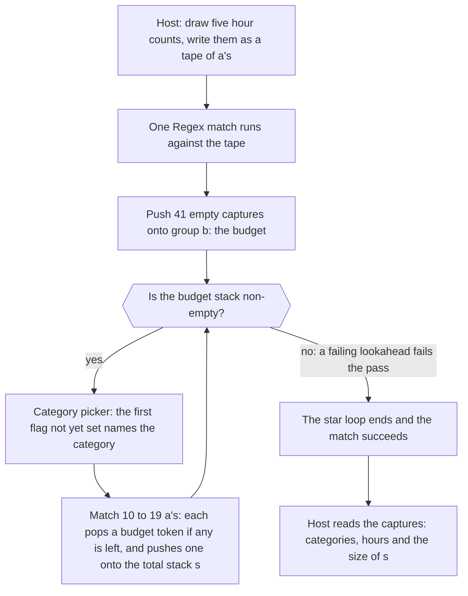
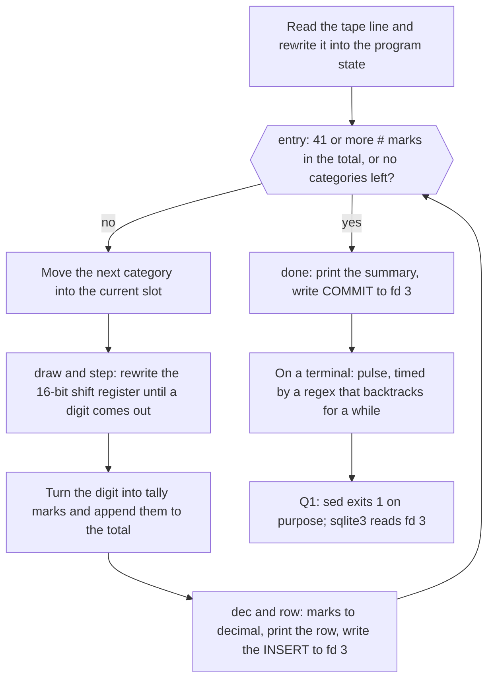
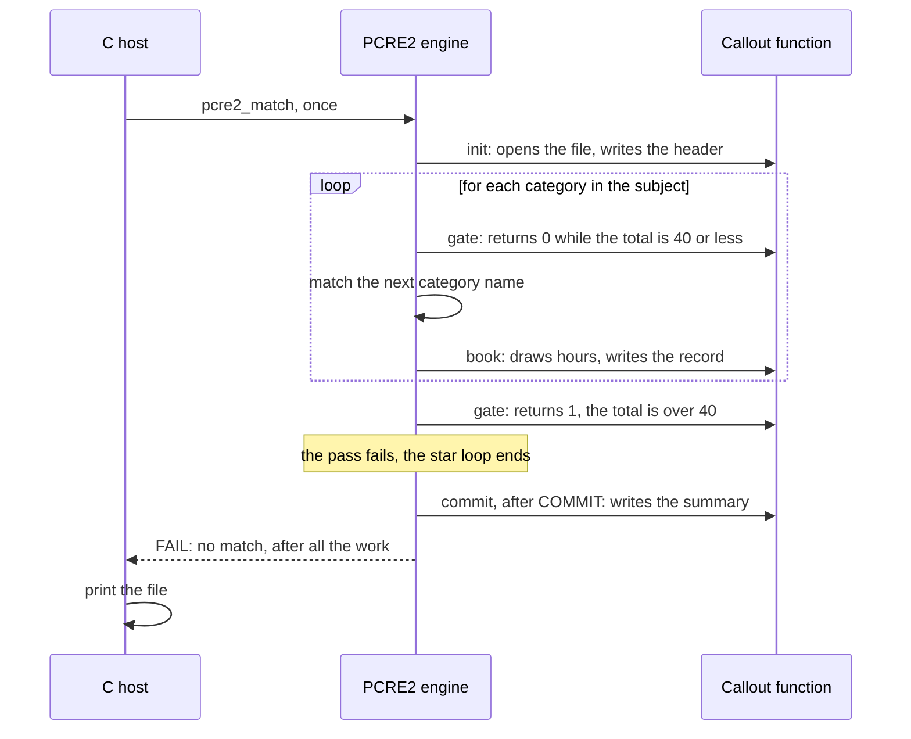
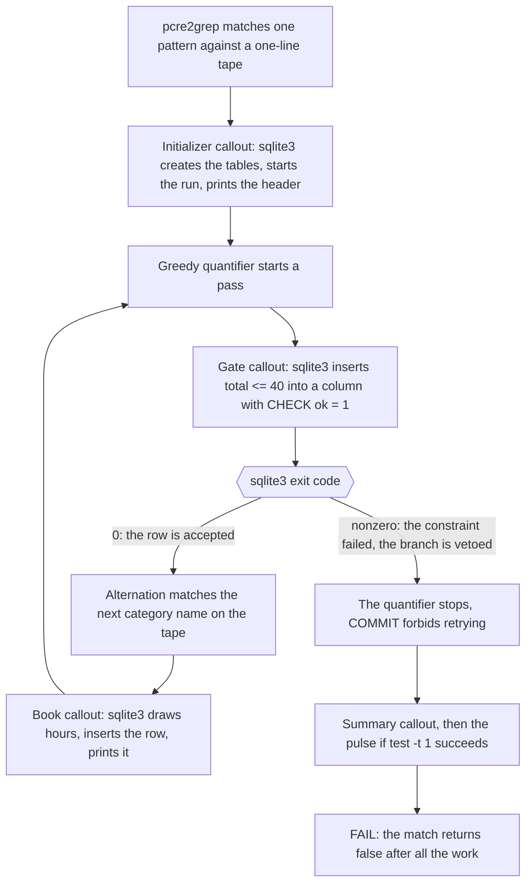
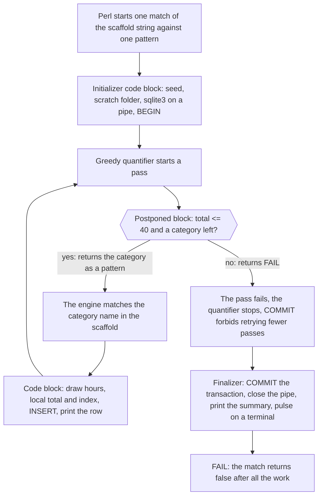

# Expresiones regulares: cinco motores, cinco personalidades

Entradas: [`src/regex-perl`](../../src/regex-perl/README.md), [`src/regex-pcre2`](../../src/regex-pcre2/README.md), [`src/regex-pcre2grep`](../../src/regex-pcre2grep/README.md), [`src/regex-dotnet`](../../src/regex-dotnet/README.md), [`src/regex-sed`](../../src/regex-sed/README.md).

Para una ruta de lectura avanzada con trazas y experimentos, consulta la [guía de estudio de motores de expresiones regulares y sed](../guias-de-estudio/lenguajes/motores-de-regex-y-sed.md).

Una expresión regular parece un patrón. Estas entradas la tratan como un **programa**: la coincidencia es el cálculo, el retroceso es la búsqueda y los efectos secundarios son lo que *querías*. La maniobra recurrente consiste en hacer todo el trabajo y luego **devolver "sin coincidencia" a propósito**.

Este panorama compara cinco motores. El ejemplo de Perl examina el mecanismo en detalle y combina la explicación con el ejercicio.

## Qué hace especial a cada motor

| Motor | El programa es... | Lo especial | Dónde |
| --- | --- | --- | --- |
| **Perl** | una coincidencia de `=~` | Los bloques de código `(?{ })` se ejecutan durante la coincidencia; `(??{ })` devuelve un *patrón* y `local` se deshace con el retroceso | [`timecards.pl` L7](../../src/regex-perl/timecards.pl#L7) |
| **PCRE2** | una llamada a `pcre2_match` | Las cadenas de texto de callout `(?C"book")` son códigos de operación para un despachador sin cuerpo en C | [`timecards.c` L24-26](../../src/regex-pcre2/timecards.c#L24-L26) |
| **pcre2grep** | una línea de comando, sin código personalizado | Los scripts de callout nombran programas para ejecutar y sus **estados de salida dirigen la coincidencia** | [`timecards.sh` L14-20](../../src/regex-pcre2grep/timecards.sh#L14-L20) |
| **.NET** | solo un patrón de grupos de equilibrio | Las *pilas* de capturas crean un contador | [`Program.cs` L13](../../src/regex-dotnet/Program.cs#L13) |
| **GNU sed** | una línea de texto, reescrita | Un [algoritmo de Markov](../../src/regex-sed/README.md#algoritmos-de-markov-calcular-con-buscar-y-reemplazar): buscar y reemplazar como computadora | [`timecards.sed`](../../src/regex-sed/timecards.sed) |

## Perl: código dentro de la coincidencia

### Contempla la monstruosidad

```bash
sandbox/container/run-image.sh src/regex-perl
```

La única sentencia del archivo es un solo `=~`. La inicialización de la semilla, los sorteos aleatorios, la transacción de SQLite, el pulso y toda la impresión ocurren *dentro de la coincidencia*. Luego la coincidencia devuelve falso.

### ¿Cómo demonios funciona eso?

| Pieza | Función |
| --- | --- |
| `^(?{ ... })` | inicializador: inicializa el estado, inicia `sqlite3` en una tubería y abre una transacción |
| `(?: ... )*` | el bucle: el cuantificador voraz es la iteración; la cadena de texto del armazón da algo que comer a cada pasada |
| `(??{ $::t<=40 ? $::c[$::n] // '(*FAIL)' : '(*FAIL)' })` | regla de parada **y** selector de categoría: devuelve la siguiente categoría *como patrón* o `(*FAIL)` |
| `(?{ local $::t = ...; print ... })` | una tarjeta |
| `(*COMMIT)` | cuando termina el bucle, impide que el retroceso reintente bucles más cortos |
| `(*COMMIT)(?{ settle })(*FAIL)` | la jugada característica: rendirse después de hacer todo el trabajo |

`local` es la parte interesante: Perl deshace las asignaciones `local` cuando el motor retrocede. Así, el total acumulado responde al retroceso, pero los `INSERT` y `print` *no* se deshacen. El motor abandona la rama y los efectos secundarios permanecen escritos. La transacción de SQLite es real y se confirma; **lo que miente es la coincidencia**.

### Aprende y rompe

- El retroceso es un procedimiento de búsqueda, y una rama que falla aporta información. El estado que se deshace (`local`) y el que no (entrada/salida) se comportan de forma distinta. Esa diferencia es todo el truco. Consulta [patrones](../patrones.md#backtracking-side-effects-and-error-handling).
- **Producción**: es difícil probar o depurar código en patrones. En Perl, los bloques de código regex se ejecutan con las reglas `strict` del archivo y solo pueden `local` variables de paquete.

Etiquetas: la documentación de regex de Perl establece como comportamiento **garantizado** `(?{ })`, `(??{ })` y el deshacimiento de `local`.

## PCRE2: los callouts como conjunto de instrucciones

El patrón completo ([`timecards.c` L24-26](../../src/regex-pcre2/timecards.c#L24-L26)):

```text
^(?C"init")(?:(?C"gate")(Meetings|Coding|Debugging|Learning)(?C"book"))*(*COMMIT)(?C"commit")(*FAIL)
```

(Más una cola de pulso.) El anfitrión en C lo compila, registra un despachador, llama a `pcre2_match` una vez e imprime el archivo. La cadena de texto del callout es un código de operación: `init`, `gate` (devuelve 1 cuando el total pasa de 40 para que falle la rama y termine el bucle), `book`, `commit`. **PCRE2 aporta la iteración, el recorrido de las categorías y el retroceso.**

- **La salvedad sobre el optimizador es la lección.** Los callouts solo tienen sentido si el motor los visita. El programa se compila con `PCRE2_NO_AUTO_POSSESS | PCRE2_NO_START_OPTIMIZE | PCRE2_NO_DOTSTAR_ANCHOR` ([L84-86](../../src/regex-pcre2/timecards.c#L84-L86)) y evita el JIT, que no admite callouts. Esto es **permitido por la implementación**, y el README no probó qué omitiría el optimizador si se quitaran las banderas.
- **El estado en una estructura de C no se rebobina durante el retroceso**, a diferencia de `local` de Perl. Eso le conviene a este programa: nunca se deshace nada.
- **Un retorno negativo de un callout aborta la coincidencia** con el código del callout. A propósito no usa `-1`, que significa "sin coincidencia" y se confundiría con el resultado esperado.

## pcre2grep: códigos de salida como flujo de control

El "anfitrión" es un `pcre2grep` estándar y una línea de comandos. Las cadenas de texto de los callouts nombran programas; **sus códigos de salida dirigen la coincidencia**. La regla de parada es un `INSERT INTO stop_rule SELECT (...)<=40` en una tabla con `CHECK(ok=1)`, por lo que la violación de la restricción de SQLite termina el bucle.

- **Los callouts necesitan rutas absolutas.** `pcre2grep` usa `fork` y `execv`, que no buscan en `PATH`. Un `true` o `sleep` sin ruta falla en silencio como callout y no se distingue de una rama vetada.
- **Sin estado en el patrón.** El total acumulado reside en SQLite y cada callout lo vuelve a leer.
- **Cada escritura se confirma por separado.** Los programas auxiliares ejecutan comandos independientes de SQLite en modo de confirmación automática. El `(*COMMIT)` de la expresión regular poda rutas de retroceso. El fallo final de coincidencia deja intactas las escrituras anteriores en la base de datos.
- **El `pcre2grep` propio de Ubuntu se compila sin scripts de callout.** Se necesita una compilación del proyecto original (la imagen del entorno aislado fija la versión 10.49). Un caso de manual **permitido por la implementación**.
- **Seguridad**: los callouts que ejecutan programas son una función de ejecución de comandos. `check.sh` solo permite `/usr/bin/sqlite3`, `/usr/bin/test` y `/bin/sleep`.

## .NET: grupos de equilibrio

[`Program.cs` L13](../../src/regex-dotnet/Program.cs#L13) usa un presupuesto de 41 capturas vacías y **grupos de equilibrio** que extraen una por hora: `(?<-b>)`. El "contador" es una pila de capturas.

Esta entrada es el mejor **fallo honesto** del repositorio. También es la que muestra con más claridad dónde se detiene la expresión regular por sí sola. Consulta [problemas bloqueantes](../problemas-bloqueantes.md#regex-dotnet):

- Una expresión regular no puede sortear números aleatorios, así que el anfitrión proporciona cinco cadenas de texto unarias.
- The host reads the successful match's captures and appends a TSV report.
- **Failure yields zero card rows.** Append `(?!)` to fail the entire match. On the fixed all-10 tape, the normal pattern succeeds with five cards and a total of 50. The forced failure exposes zero captures, leaves an empty TSV report and exits 1. See the [entry check](../../src/regex-dotnet/check.sh).

## GNU sed

The entire program state is **one line of text**; every step is a substitution. There are no variables or numbers.

- **The loop** is `b`/`t` jumps behind regex addresses: [`/ tot:#{41}/b done`](../../src/regex-sed/timecards.sed#L14) is the stop rule, with the total as tally marks `#`.
- **Randomness** is a 16-bit shift register of `0`s and `1`s ([L17-29](../../src/regex-sed/timecards.sed#L17-L29)); XOR is done by deleting zeros and testing for odd counts. The taps (16, 14, 13, 11) give a maximal period of 65,535. It is a toy generator, and the same seed gives the same cards.
- **A draw is rejected** with `/ rng:1(01|1)/b draw` when the nibble is 10-15, and a bits-to-digit table plus tally-mark expansion turns the nibble into hours.
- **The pulse is timed by a catastrophic-backtracking regex**: the clock is a pattern that takes about 50 ms per frame to fail. (Machine-dependent, which is why pipes and `check.sh` skip it.)
- **Exit 1 on purpose.** sed has no match result spanning a whole program, so "returns false" is the process exit status (the wrapper maps 1 to 0).
- **GNU only**: `T`, `Q`, `--debug`, `\x1b`, `\t` and `-E` intervals are GNU extensions.
- **sed has a goto** (`b`, `t`), which Perl and PCRE do not, so this entry's loop structure is "a rewriting machine with a program counter, not a single match".

The README has an eleven-step trace of one iteration, and `TRACE=1 ./timecards.sh` dumps the state line at each step. This is the best place in the repo to *watch* a computation happen.

## What did we just learn?

- **A regex engine is a general search machine** with state (captures), control (alternation, quantifiers, `(*COMMIT)`) and optional I/O hooks.
- **Failure is information**, and different engines keep or discard it differently (Perl unwinds `local`, PCRE2's C state persists, .NET discards captures, pcre2grep's side effects are real database writes).
- **String-rewriting systems are universal.** sed with no numbers does arithmetic, which is what a Markov algorithm is.

## Under what circumstances would this terrible idea become reasonable?

Never as an application design. But callouts and code blocks are legitimate in *tools*: tokenizers, lexers, instrumented matchers, pattern debuggers and teaching aids. And understanding backtracking performance cliffs, the thing sed's pulse exploits for a clock, is the practical skill that protects production systems from ReDoS.

## Quirks

- Perl regex code blocks need package variables; `strict` and `local` interact.
- Perl's `no warnings 'regexp'` is needed to silence the "null iteration" warning on a dynamic loop body.
- PCRE2 JIT does not support callouts; flags can change whether callouts fire.
- pcre2grep callouts fail silently if the program path is not absolute.
- .NET `Match` on failure exposes no captures.
- CMake's regex is the weakest of all of them (no counted repetition, lookahead or backreferences); see [Make and CMake](make-cmake.md#cmake).
- sed: GNU-only features; the `w` command and `e` modifier can run or write anything, and `check.sh` rejects them (a grep, not a sandbox).
- All entries build SQL by pasting text into strings. It is safe here only because every value is computed or one of four fixed words. **Do not copy the habit.**

<!-- BEGIN GENERATED program-flow:languages/regex.md -->
## How each program runs

Each picture below is the `## Program Flow` section of an entry's README, copied here by the build. It shows how that program makes the work happen: what the language, runtime or tool really does. [The introduction](../introduccion.md#what-the-challenge-does) shows what the challenge asks for and where entries differ.

### Program flow of `regex-dotnet`

From [`regex-dotnet`](../../src/regex-dotnet/README.md) ([source section](../../src/regex-dotnet/README.md#flujo-del-programa)).



**What this shows:** the regex engine is a machine with stacks. Each `a` pushes one capture onto the total stack `s`. The balancing group also pops one budget token from `b` while any remain. The budget stack is the stop rule: when it is empty, the next pass cannot start.

**Why this mechanism matters:** the state is stack *depth*. Nothing counts and nothing adds. The match succeeds, and the program's answer is what the engine captured. An entry may push the total over 40 mid-way, because the budget runs dry partway through its hours and the extra `a`s pop nothing.

### Program flow of `regex-sed`

From [`regex-sed`](../../src/regex-sed/README.md) ([source section](../../src/regex-sed/README.md#flujo-del-programa)).



**What this shows:** the only memory is one line of text, and every step is a substitution on it. The jumps (`b` and `t`) with address tests make a program counter. The loop is the jump from `row` back to `entry`, and the stop rule is a regex that matches 41 tally marks.

**Why this mechanism matters:** this is a rewriting system, the Markov-algorithm model: there are no variables and no numbers. The other regex entries make one match do the work. This one makes many substitutions do it, and uses a slow match only as a clock.

### Program flow of `regex-pcre2`

From [`regex-pcre2`](../../src/regex-pcre2/README.md) ([source section](../../src/regex-pcre2/README.md#flujo-del-programa)).



**What this shows:** the C host has no loop. It calls `pcre2_match` once and the engine calls back into the host at every callout. The callout name is an opcode. The return value is the decision: `0` means continue and `1` means fail this branch.

**Why this mechanism matters:** the stop rule is a callout that returns `1`, so the `*` quantifier ends by backtracking. `(*COMMIT)` makes `commit` run exactly once, and `(*FAIL)` makes the whole match lose. The callouts are synchronous calls from the engine, not queued events.

### Program flow of `regex-pcre2grep`

From [`regex-pcre2grep`](../../src/regex-pcre2grep/README.md) ([source section](../../src/regex-pcre2grep/README.md#flujo-del-programa)).



**What this shows:** a callout string that starts with a path runs a program. Exit status 0 lets the match go on, and any other status fails that branch. So every decision in the program is an exit code from `sqlite3`. A constraint violation (the total is over 40) is the stop rule.

**Why this mechanism matters:** `pcre2grep` is not a language runtime, but it has a process boundary inside the matcher. The engine asks an external program a question and backtracks on the answer. Compare [`regex-pcre2`](../../src/regex-pcre2/README.md), where the question is a function call in the same process.

### Program flow of `regex-perl`

From [`regex-perl`](../../src/regex-perl/README.md) ([source section](../../src/regex-perl/README.md#flujo-del-programa)).



**What this shows:** one regex match is the whole program. The quantifier is the loop, and a code block that returns a *pattern* is the stop rule: it returns the next category's name, or `(*FAIL)` to make the pass fail. Code blocks are the only places where work happens.

**Why this mechanism matters:** backtracking can undo `local` variables but not side effects. The engine abandons a branch, while the `INSERT` and the `print` stay done. That is why the match can end by failing and the data is still saved. The SQL transaction is real. Only the *match* lies.
<!-- END GENERATED program-flow:languages/regex.md -->

## Computer science behind this page

<!-- BEGIN GENERATED concepts:languages/regex.md -->
The computer-science ideas behind this page: [Threat model](../informatica/01-lectura-de-un-programa-adversarial.md#threat-model), [Arbitrary code execution](../informatica/01-lectura-de-un-programa-adversarial.md#arbitrary-code-execution), [Representing state](../informatica/02-que-cuenta-como-maquina.md#representing-state), [Register machines and counter machines](../informatica/02-que-cuenta-como-maquina.md#register-machines-and-counter-machines), [Markov algorithms](../informatica/02-que-cuenta-como-maquina.md#markov-algorithms), [Turing completeness](../informatica/02-que-cuenta-como-maquina.md#turing-completeness), [Computation versus orchestration](../informatica/02-que-cuenta-como-maquina.md#computation-versus-orchestration), [Fixed-point iteration](../informatica/03-flujo-de-control-y-continuaciones.md#fixed-point-iteration), [The Chomsky hierarchy](../informatica/05-lenguajes-formales-como-sustratos-de-computacion.md#the-chomsky-hierarchy), [Regular expressions](../informatica/05-lenguajes-formales-como-sustratos-de-computacion.md#regular-expressions), [Parsing](../informatica/05-lenguajes-formales-como-sustratos-de-computacion.md#parsing), [Term and string rewriting](../informatica/05-lenguajes-formales-como-sustratos-de-computacion.md#term-and-string-rewriting), [Domain-specific languages](../informatica/05-lenguajes-formales-como-sustratos-de-computacion.md#domain-specific-languages), [Interpreters and virtual machines](../informatica/05-lenguajes-formales-como-sustratos-de-computacion.md#interpreters-and-virtual-machines), [State](../informatica/06-estado-mas-alla-de-las-variables.md#state), [The stack as a data structure](../informatica/06-estado-mas-alla-de-las-variables.md#the-stack-as-a-data-structure), [Side effects](../informatica/07-efectos-errores-y-confirmacion.md#side-effects), [Exit status](../informatica/07-efectos-errores-y-confirmacion.md#exit-status), [Integrity constraints](../informatica/07-efectos-errores-y-confirmacion.md#integrity-constraints), [Backtracking](../informatica/07-efectos-errores-y-confirmacion.md#backtracking), [The cut: committing to a choice](../informatica/07-efectos-errores-y-confirmacion.md#the-cut-committing-to-a-choice), [Transactions](../informatica/07-efectos-errores-y-confirmacion.md#transactions), [Portability](../informatica/08-fugas-de-abstraccion-y-dependencia-de-la-implementacion.md#portability), [Optimizers](../informatica/08-fugas-de-abstraccion-y-dependencia-de-la-implementacion.md#optimizers), [Performance cliffs and time complexity](../informatica/08-fugas-de-abstraccion-y-dependencia-de-la-implementacion.md#performance-cliffs-and-time-complexity), [Regular-expression denial of service](../informatica/08-fugas-de-abstraccion-y-dependencia-de-la-implementacion.md#regular-expression-denial-of-service), [Callbacks](../informatica/10-eventos-retrollamadas-y-flujo-de-control-reactivo.md#callbacks).
<!-- END GENERATED concepts:languages/regex.md -->
