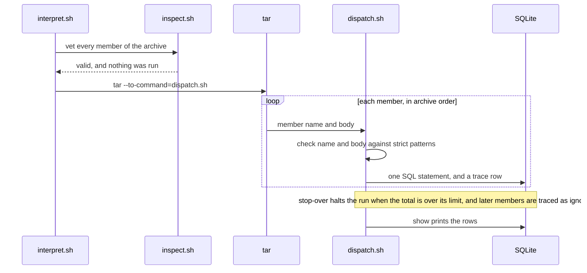
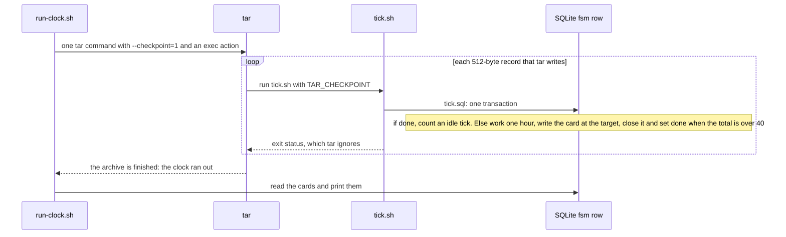

# tar

Entradas: [`src/tar-gnu`](../../src/tar-gnu/README.md) (el archivo es un programa) y [`src/tar-gnu-weird`](../../src/tar-gnu-weird/README.md) (el archivo es un reloj). `tar` ("archivo de cinta") empaqueta muchos archivos en un solo flujo de bytes. Se creó para cinta magnética, donde no puedes saltar de un lugar a otro. Por eso, un archivo es una *secuencia*: una cabecera, los bytes del archivo, la siguiente cabecera y así sucesivamente. Ese hecho explica por qué un archivo tar puede ser un programa. El orden ya forma parte del formato.

Para una ruta de lectura avanzada con trazas y experimentos, consulta la [guía de estudio de tar](../guias-de-estudio/lenguajes/tar.md).

## Qué hace especial a tar

| Característica | Qué enseña |
| --- | --- |
| Un archivo es una secuencia de bloques de 512 bytes: un bloque de cabecera, luego los bloques de datos y después la siguiente cabecera | No hay índice ni directorio. Para encontrar un miembro, lees desde el principio. Eso es un flujo, y un flujo es una cinta natural para un intérprete. |
| `tar -xf` escribe los miembros como archivos | La extracción es pasiva. Un archivo no puede hacer que tar ejecute nada. |
| GNU `--to-command=CMD` inicia `CMD` para cada miembro regular y le envía el miembro por una tubería | El *operador* conecta un intérprete. La línea de comandos lleva el poder; el archivo no. |
| `TAR_FILENAME`, `TAR_SIZE` y otras variables se establecen para cada comando | Los metadatos del miembro pasan a ser la entrada de datos del comando, junto con sus bytes. |
| tar continúa cuando falla el comando | No hay una "parada" incorporada. Una regla de control debe ser propia del intérprete. |
| `--checkpoint=N --checkpoint-action=exec=CMD` ejecuta `CMD` cada N registros | Un informe de progreso es una fuente de eventos. Puede ser un reloj. |
| `-b N` fija el tamaño del *registro* en N bloques de 512 bytes | La unidad de tiempo es un registro. El tamaño del archivo, no su contenido, determina cuántos registros hay. |

## Un programa que es un archivo

### Contempla la monstruosidad

```bash
sandbox/container/run-image.sh src/tar-gnu
```

Un archivo tar de doce archivos diminutos. Un despachador de unas 80 líneas. Sin bucle en el despachador, sin números aleatorios y sin el número 40.

### ¿Cómo demonios funciona eso?

- **Los miembros son las instrucciones.** `010.card` es "agrega una tarjeta". Su cuerpo es `category=Meetings` y `hours=13`. El nombre lleva el orden y el cuerpo lleva los operandos.
- **tar es el bucle.** Lee el siguiente miembro e inicia el despachador, hasta que termina el archivo.
- **Los dados se tiran al escribir el programa.** Un generador de archivos sortea las cinco horas con un generador con semilla y guarda la semilla en el primer miembro. La misma semilla produce los mismos bytes.
- **La regla de parada son datos.** Cada tarjeta va seguida de un miembro `011.stop-over` que contiene `limit=40`. El despachador solo sabe qué *significa* `stop-over`: detenerse si el total supera el límite.
- **Leer no es ejecutar.** `inspect.sh` lista y decodifica cada miembro con `tar -t` y `tar -xO`. `interpret.sh --execute` es el único lugar donde aparece `--to-command`.

El [README](../../src/tar-gnu/README.md#es-solo-un-archivo-tar-serialización-deserialización-y-ejecución) contiene la tabla completa de quién hace qué.

### ¿Qué acabamos de aprender?

- **La serialización, la deserialización y la ejecución son tres actos.** Puedes escribir un programa, analizarlo y ejecutarlo. La mayoría de los formatos permiten hacer los dos primeros sin el tercero. `pickle` de Python no lo permite.
- **La frontera de confianza es la línea de comandos.** Una extracción simple no ejecuta nada. Agregar `--to-command` es una decisión y le corresponde al operador.
- **Fail closed.** The dispatcher refuses an unknown record, and then it refuses every record after it, because tar will not stop on its own.
- **Four kinds of "the same".** Same bytes, same structure, same behavior and same live process are four different claims. This entry makes the first three and says plainly that it does not make the fourth.
- **A format is a contract.** `tarprog/1` is not part of tar. Two programs agree on it.

Tags: `--to-command` and `--occurrence` are GNU extensions (**implementation-permitted**). The `ustar` format and the order of members are in POSIX. That tar keeps going after a failed command is what GNU tar 1.35 does today, and the manual does not promise it: it is **accidentally exploited**, and the entry does not depend on it, because it writes its own halt.

### Do this in production and you're fired

- **An archive that runs is a program that arrived as data.** If the operator runs `--to-command` on an archive from a stranger, the stranger's records decide what happens. Here the dispatcher is strict. A careless one is a remote command runner.
- **Your own format has no tooling.** Nothing but a test keeps the builder and the dispatcher in step.
- **tar was not built for this.** Real tar jobs are backup, packaging and transport.

Legitimate uses: `--to-command` as a filter, such as checksumming each member while you extract. A tar archive as a *container* for a program's data, with a manifest.

### Now break it yourself

See [exercise B16](../exercises.md#b16-tar-read-the-program-then-run-it-verified).

## The archive is the clock

### Behold the monstrosity

```bash
sandbox/container/run-image.sh src/tar-gnu-weird
```

A tar archive whose payload is all zeros, and a state machine that moves one step each time tar says "I wrote a record". The program has no loop. tar is the loop.

### How the hell does that work?

- **One checkpoint is one hour.** `tar -b 1 --checkpoint=1 --checkpoint-action=exec=...` runs a command for every 512 bytes it writes. The command is a single SQL transaction.
- **The state is one row.** It holds the hours worked on the open card, the length of the card, the running total, the generator's seed and a `done` flag.
- **The layout is the schedule.** The number of ticks is `floor(ceil(blocks / b) / K)`. Make the archive shorter and the clock stops in the middle of a card. Make it longer and the extra ticks only count as idle.
- **The stop rule is a flag, because tar will not stop.** After the crossing card the archive is still being written, and the command still runs. It does nothing but count.
- **`check.sh` predicts, not just observes.** A second machine, written in awk, says which cards must exist for any seed and any layout. The entry must agree for 65 combinations.

The [README](../../src/tar-gnu-weird/README.md#cómo-funciona-el-truco) has the register table and the full list of what we measured.

### What did we just learn?

- **A progress indicator is an event source.** Once something calls your code at a steady beat, you have a clock. Event-driven programs work like this.
- **A logical clock counts events, not seconds.** Ticks here are records written. Nothing in the run depends on how long a second takes.
- **Control flow can be inverted.** The program does not call tar. tar calls the program.
- **A layout can set the pace as well as the meaning.** The payload of this archive is all zeros, and its size still decides when everything happens.
- **Say what a count counts.** A checkpoint counts records. A record is a number of blocks. The same archive gives 21 ticks when created, 10 when listed and 21 when extracted.

Tags: `--checkpoint`, `--checkpoint-action=exec` and `TAR_CHECKPOINT` are GNU extensions (**implementation-permitted**), tested on GNU tar 1.34 and 1.35. The exact tick count in list mode is **accidentally exploited** knowledge, and the entry does not use it.

### Do this in production and you're fired

- **It is a progress meter.** If someone changes the blocking factor, your schedule changes with it.
- **Every tick starts a process.** Do not use a checkpoint as a scheduler. Use a scheduler.
- **A failing callback is silent to tar.** Look for your own errors. The entry sends them to standard error and exits 3.

Legitimate uses: progress bars for long backups, and `--checkpoint-action=wait` to pause a job for a cooperating process, as the manual shows.

### Now break it yourself

See [exercise B17](../exercises.md#b17-tar-weirder-predict-the-clock-verified).

<!-- BEGIN GENERATED program-flow:languages/tar.md -->
## How each program runs

Each picture below is the `## Program Flow` section of an entry's README, copied here by the build. It shows how that program makes the work happen: what the language, runtime or tool really does. [The introduction](../introduccion.md#what-the-challenge-does) shows what the challenge asks for and where entries differ.

### Program flow of `tar-gnu`

From [`tar-gnu`](../../src/tar-gnu/README.md) ([source section](../../src/tar-gnu/README.md#flujo-del-programa)).



**What this shows:** tar is the loop and the archive is the program. For every member, tar hands the bytes to the dispatcher, and the dispatcher decides what the name means. The order of the members is the order of execution.

**Why this mechanism matters:** reading and running are two separate steps. The inspector parses and checks everything and runs nothing. The dispatcher runs one SQL statement per member and passes no part of a member to a shell. That is the difference between data that is *serialized* and data that is *executed*.

### Program flow of `tar-gnu-weird`

From [`tar-gnu-weird`](../../src/tar-gnu-weird/README.md) ([source section](../../src/tar-gnu-weird/README.md#flujo-del-programa)).



**What this shows:** the program is a state machine in one SQLite row, and tar's checkpoint is its clock. One tick is one transaction. tar does not stop when the machine is done. It keeps ticking, and the extra ticks only count as idle.

**Why this mechanism matters:** this is an event source made from a file's layout. The number of ticks is set by the archive size, so a layout that is too short stalls the machine in the middle of a card. The ticks are callbacks that tar runs for the program. They are not events that the program waits for.
<!-- END GENERATED program-flow:languages/tar.md -->

## Computer science behind this page

<!-- BEGIN GENERATED concepts:languages/tar.md -->
The computer-science ideas behind this page: [Threat model](../informatica/01-lectura-de-un-programa-adversarial.md#threat-model), [Arbitrary code execution](../informatica/01-lectura-de-un-programa-adversarial.md#arbitrary-code-execution), [Principle of least privilege](../informatica/01-lectura-de-un-programa-adversarial.md#principle-of-least-privilege), [Capability and authority](../informatica/01-lectura-de-un-programa-adversarial.md#capability-and-authority), [Transition systems and state machines](../informatica/02-que-cuenta-como-maquina.md#transition-systems-and-state-machines), [Representing state](../informatica/02-que-cuenta-como-maquina.md#representing-state), [Invariants](../informatica/02-que-cuenta-como-maquina.md#invariants), [Observability](../informatica/02-que-cuenta-como-maquina.md#observability), [Operational semantics](../informatica/02-que-cuenta-como-maquina.md#operational-semantics), [Computation versus orchestration](../informatica/02-que-cuenta-como-maquina.md#computation-versus-orchestration), [Logical clocks and event ordering](../informatica/03-flujo-de-control-y-continuaciones.md#logical-clocks-and-event-ordering), [Parsing](../informatica/05-lenguajes-formales-como-sustratos-de-computacion.md#parsing), [Domain-specific languages](../informatica/05-lenguajes-formales-como-sustratos-de-computacion.md#domain-specific-languages), [Language-theoretic security](../informatica/05-lenguajes-formales-como-sustratos-de-computacion.md#language-theoretic-security), [Interpreters and virtual machines](../informatica/05-lenguajes-formales-como-sustratos-de-computacion.md#interpreters-and-virtual-machines), [State](../informatica/06-estado-mas-alla-de-las-variables.md#state), [Serialization, deserialization and object pickling](../informatica/06-estado-mas-alla-de-las-variables.md#serialization-deserialization-and-object-pickling), [Side effects](../informatica/07-efectos-errores-y-confirmacion.md#side-effects), [Exit status](../informatica/07-efectos-errores-y-confirmacion.md#exit-status), [Integrity constraints](../informatica/07-efectos-errores-y-confirmacion.md#integrity-constraints), [Idempotence](../informatica/07-efectos-errores-y-confirmacion.md#idempotence), [Leaky abstractions](../informatica/08-fugas-de-abstraccion-y-dependencia-de-la-implementacion.md#leaky-abstractions), [Portability](../informatica/08-fugas-de-abstraccion-y-dependencia-de-la-implementacion.md#portability), [Hyrum's law](../informatica/08-fugas-de-abstraccion-y-dependencia-de-la-implementacion.md#hyrums-law), [Reproducibility and deterministic builds](../informatica/08-fugas-de-abstraccion-y-dependencia-de-la-implementacion.md#reproducibility-and-deterministic-builds), [Event-driven programming](../informatica/10-eventos-retrollamadas-y-flujo-de-control-reactivo.md#event-driven-programming), [Callbacks](../informatica/10-eventos-retrollamadas-y-flujo-de-control-reactivo.md#callbacks).
<!-- END GENERATED concepts:languages/tar.md -->
