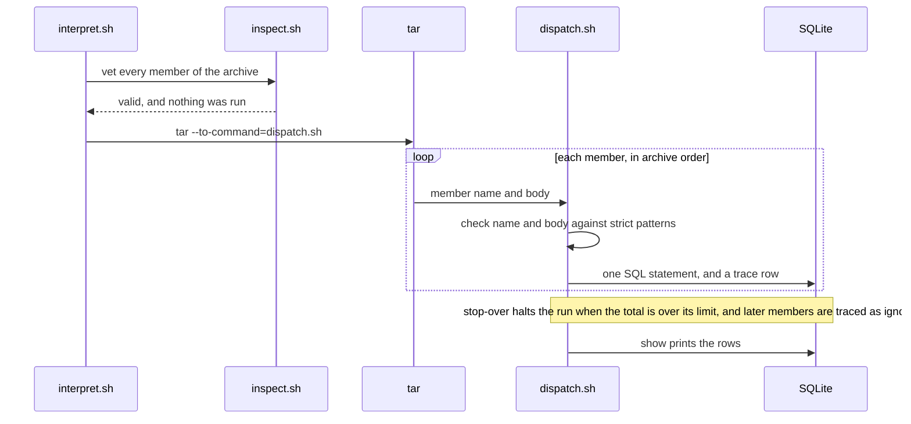
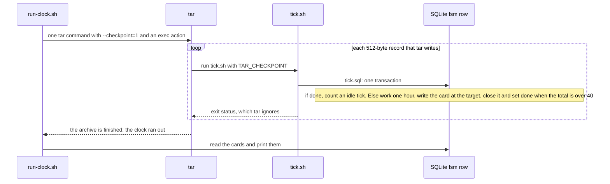

# tar

Entradas: [`src/tar-gnu`](../../src/tar-gnu/README.md) (el archivo es un programa) y [`src/tar-gnu-weird`](../../src/tar-gnu-weird/README.md) (el archivo es un reloj). `tar` ("archivo de cinta") empaqueta muchos archivos en un solo flujo de bytes. Se creó para cinta magnética, donde no puedes saltar de un lugar a otro. Por eso, un archivo es una *secuencia*: una cabecera, los bytes del archivo, la siguiente cabecera y así sucesivamente. Ese hecho explica por qué un archivo tar puede ser un programa. El orden ya forma parte del formato.

Para una ruta de lectura avanzada con trazas y experimentos, consulta la [guía de estudio de tar](../guias-de-estudio/lenguajes/tar.md).

## Qué hace especial a tar

| Característica | Qué enseña |
| --- | --- |
| Un archivo es una secuencia de bloques de 512 bytes: un bloque de cabecera, luego los bloques de datos y después la siguiente cabecera | No hay índice ni directorio. Para encontrar un miembro, lees desde el principio. Eso es un flujo, y un flujo es una cinta natural para un intérprete. |
| `tar -xf` escribe los miembros como archivos | La extracción es pasiva. Un archivo no puede hacer que tar ejecute nada. |
| GNU `--to-command=CMD` inicia `CMD` para cada miembro regular y le envía el miembro por una tubería | El *operador* conecta un intérprete. La línea de comandos lleva el poder; el archivo no. |
| `TAR_FILENAME`, `TAR_SIZE` y otras variables se establecen para cada comando | Los metadatos del miembro pasan a ser la entrada de datos del comando, junto con sus bytes. |
| tar continúa cuando falla el comando | No hay una "parada" incorporada. Una regla de control debe ser propia del intérprete. |
| `--checkpoint=N --checkpoint-action=exec=CMD` ejecuta `CMD` cada N registros | Un informe de progreso es una fuente de eventos. Puede ser un reloj. |
| `-b N` fija el tamaño del *registro* en N bloques de 512 bytes | La unidad de tiempo es un registro. El tamaño del archivo, no su contenido, determina cuántos registros hay. |

## Un programa que es un archivo

### Contempla la monstruosidad

```bash
sandbox/container/run-image.sh src/tar-gnu
```

Un archivo tar de doce archivos diminutos. Un despachador de unas 80 líneas. Sin bucle en el despachador, sin números aleatorios y sin el número 40.

### ¿Cómo demonios funciona eso?

- **Los miembros son las instrucciones.** `010.card` es "agrega una tarjeta". Su cuerpo es `category=Meetings` y `hours=13`. El nombre lleva el orden y el cuerpo lleva los operandos.
- **tar es el bucle.** Lee el siguiente miembro e inicia el despachador, hasta que termina el archivo.
- **Los dados se tiran al escribir el programa.** Un generador de archivos sortea las cinco horas con un generador con semilla y guarda la semilla en el primer miembro. La misma semilla produce los mismos bytes.
- **La regla de parada son datos.** Cada tarjeta va seguida de un miembro `011.stop-over` que contiene `limit=40`. El despachador solo sabe qué *significa* `stop-over`: detenerse si el total supera el límite.
- **Leer no es ejecutar.** `inspect.sh` lista y decodifica cada miembro con `tar -t` y `tar -xO`. `interpret.sh --execute` es el único lugar donde aparece `--to-command`.

El [README](../../src/tar-gnu/README.md#es-solo-un-archivo-tar-serialización-deserialización-y-ejecución) contiene la tabla completa de quién hace qué.

### ¿Qué acabamos de aprender?

- **La serialización, la deserialización y la ejecución son tres actos.** Puedes escribir un programa, analizarlo y ejecutarlo. La mayoría de los formatos permiten hacer los dos primeros sin el tercero. `pickle` de Python no lo permite.
- **La frontera de confianza es la línea de comandos.** Una extracción simple no ejecuta nada. Agregar `--to-command` es una decisión y le corresponde al operador.
- **Falla de forma cerrada.** El despachador rechaza un registro desconocido y luego rechaza todos los registros posteriores, porque tar no se detendrá por sí solo.
- **Cuatro formas de "lo mismo".** Los mismos bytes, la misma estructura, el mismo comportamiento y el mismo proceso en ejecución son cuatro afirmaciones distintas. Esta entrada hace las tres primeras y dice claramente que no hace la cuarta.
- **Un formato es un contrato.** `tarprog/1` no es parte de tar. Dos programas se ponen de acuerdo sobre él.

Etiquetas: `--to-command` y `--occurrence` son extensiones de GNU (**permitido por la implementación**). El formato `ustar` y el orden de los miembros están en POSIX. GNU tar 1.35 continúa hoy después de un comando fallido y el manual no lo promete. Es un comportamiento **aprovechado por accidente**. La entrada no depende de él porque escribe su propia detención.

### Haz esto en producción y estás despedido

- **Un archivo que se ejecuta es un programa que llegó como datos.** Si el operador ejecuta `--to-command` sobre un archivo de un desconocido, los registros del desconocido deciden qué ocurre. Aquí el despachador es estricto. Uno descuidado ejecuta comandos remotos.
- **Tu propio formato no tiene herramientas.** Solo una prueba mantiene al constructor y al despachador sincronizados.
- **tar no se creó para esto.** Las tareas reales de tar son la copia de seguridad, el empaquetado y el transporte.

Usos legítimos: `--to-command` como filtro, por ejemplo, para calcular la suma de comprobación de cada miembro al extraerlo. Un archivo tar como *contenedor* de datos de un programa, con un manifiesto.

### Ahora rómpelo tú

Consulta el [ejercicio B16](../exercises.md#b16-tar-read-the-program-then-run-it-verified).

## El archivo es el reloj

### Contempla la monstruosidad

```bash
sandbox/container/run-image.sh src/tar-gnu-weird
```

Un archivo tar cuya carga útil contiene solo ceros y una máquina de estados que avanza un paso cada vez que tar dice "escribí un registro". El programa no tiene bucle. tar es el bucle.

### ¿Cómo demonios funciona eso?

- **Un punto de control equivale a una hora.** `tar -b 1 --checkpoint=1 --checkpoint-action=exec=...` ejecuta un comando por cada 512 bytes que escribe. El comando es una sola transacción SQL.
- **El estado es una fila.** Contiene las horas trabajadas en la tarjeta abierta, la duración de la tarjeta, el total acumulado, la semilla del generador y una bandera `done`.
- **La disposición es el calendario.** El número de pulsos es `floor(ceil(blocks / b) / K)`. Acorta el archivo y el reloj se detiene a mitad de una tarjeta. Alárgalo y los pulsos adicionales solo cuentan como tiempo inactivo.
- **La regla de parada es una bandera, porque tar no se detiene.** Después de la tarjeta que cruza el tope, el archivo se sigue escribiendo y el comando se sigue ejecutando. Solo cuenta.
- **`check.sh` predice, no solo observa.** Una segunda máquina, escrita en awk, dice qué tarjetas deben existir para cualquier semilla y disposición. La entrada debe coincidir para 65 combinaciones.

El [README](../../src/tar-gnu-weird/README.md#cómo-funciona-el-truco) contiene la tabla de registros y la lista completa de lo que medimos.

### ¿Qué acabamos de aprender?

- **Un indicador de progreso es una fuente de eventos.** Cuando algo llama a tu código a un ritmo constante, tienes un reloj. Así funcionan los programas orientados a eventos.
- **Un reloj lógico cuenta eventos, no segundos.** Aquí los pulsos son registros escritos. Nada en la ejecución depende de cuánto dura un segundo.
- **El flujo de control puede invertirse.** El programa no llama a tar. tar llama al programa.
- **Una disposición puede marcar el ritmo además del significado.** El contenido de este archivo consta solo de ceros. Aun así, su tamaño decide cuándo ocurre todo.
- **Di qué cuenta un conteo.** Un punto de control cuenta registros. Un registro es una cantidad de bloques. El mismo archivo da 21 pulsos al crearlo, 10 al listarlo y 21 al extraerlo.

Etiquetas: `--checkpoint`, `--checkpoint-action=exec` y `TAR_CHECKPOINT` son extensiones GNU (**permitido por la implementación**), probadas en GNU tar 1.34 y 1.35. El número exacto de pulsos en modo de lista es conocimiento **aprovechado por accidente**. La entrada no lo usa.

### Haz esto en producción y estás despedido

- **Es un indicador de progreso.** Si alguien cambia el factor de bloqueo, tu calendario cambia con él.
- **Every tick starts a process.** Do not use a checkpoint as a scheduler. Use a scheduler.
- **A failing callback is silent to tar.** Look for your own errors. The entry sends them to standard error and exits 3.

Legitimate uses: progress bars for long backups, and `--checkpoint-action=wait` to pause a job for a cooperating process, as the manual shows.

### Now break it yourself

See [exercise B17](../exercises.md#b17-tar-weirder-predict-the-clock-verified).

<!-- BEGIN GENERATED program-flow:languages/tar.md -->
## How each program runs

Each picture below is the `## Program Flow` section of an entry's README, copied here by the build. It shows how that program makes the work happen: what the language, runtime or tool really does. [The introduction](../introduccion.md#what-the-challenge-does) shows what the challenge asks for and where entries differ.

### Program flow of `tar-gnu`

From [`tar-gnu`](../../src/tar-gnu/README.md) ([source section](../../src/tar-gnu/README.md#flujo-del-programa)).



**What this shows:** tar is the loop and the archive is the program. For every member, tar hands the bytes to the dispatcher, and the dispatcher decides what the name means. The order of the members is the order of execution.

**Why this mechanism matters:** reading and running are two separate steps. The inspector parses and checks everything and runs nothing. The dispatcher runs one SQL statement per member and passes no part of a member to a shell. That is the difference between data that is *serialized* and data that is *executed*.

### Program flow of `tar-gnu-weird`

From [`tar-gnu-weird`](../../src/tar-gnu-weird/README.md) ([source section](../../src/tar-gnu-weird/README.md#flujo-del-programa)).



**What this shows:** the program is a state machine in one SQLite row, and tar's checkpoint is its clock. One tick is one transaction. tar does not stop when the machine is done. It keeps ticking, and the extra ticks only count as idle.

**Why this mechanism matters:** this is an event source made from a file's layout. The number of ticks is set by the archive size, so a layout that is too short stalls the machine in the middle of a card. The ticks are callbacks that tar runs for the program. They are not events that the program waits for.
<!-- END GENERATED program-flow:languages/tar.md -->

## Computer science behind this page

<!-- BEGIN GENERATED concepts:languages/tar.md -->
The computer-science ideas behind this page: [Threat model](../informatica/01-lectura-de-un-programa-adversarial.md#threat-model), [Arbitrary code execution](../informatica/01-lectura-de-un-programa-adversarial.md#arbitrary-code-execution), [Principle of least privilege](../informatica/01-lectura-de-un-programa-adversarial.md#principle-of-least-privilege), [Capability and authority](../informatica/01-lectura-de-un-programa-adversarial.md#capability-and-authority), [Transition systems and state machines](../informatica/02-que-cuenta-como-maquina.md#transition-systems-and-state-machines), [Representing state](../informatica/02-que-cuenta-como-maquina.md#representing-state), [Invariants](../informatica/02-que-cuenta-como-maquina.md#invariants), [Observability](../informatica/02-que-cuenta-como-maquina.md#observability), [Operational semantics](../informatica/02-que-cuenta-como-maquina.md#operational-semantics), [Computation versus orchestration](../informatica/02-que-cuenta-como-maquina.md#computation-versus-orchestration), [Logical clocks and event ordering](../informatica/03-flujo-de-control-y-continuaciones.md#logical-clocks-and-event-ordering), [Parsing](../informatica/05-lenguajes-formales-como-sustratos-de-computacion.md#parsing), [Domain-specific languages](../informatica/05-lenguajes-formales-como-sustratos-de-computacion.md#domain-specific-languages), [Language-theoretic security](../informatica/05-lenguajes-formales-como-sustratos-de-computacion.md#language-theoretic-security), [Interpreters and virtual machines](../informatica/05-lenguajes-formales-como-sustratos-de-computacion.md#interpreters-and-virtual-machines), [State](../informatica/06-estado-mas-alla-de-las-variables.md#state), [Serialization, deserialization and object pickling](../informatica/06-estado-mas-alla-de-las-variables.md#serialization-deserialization-and-object-pickling), [Side effects](../informatica/07-efectos-errores-y-confirmacion.md#side-effects), [Exit status](../informatica/07-efectos-errores-y-confirmacion.md#exit-status), [Integrity constraints](../informatica/07-efectos-errores-y-confirmacion.md#integrity-constraints), [Idempotence](../informatica/07-efectos-errores-y-confirmacion.md#idempotence), [Leaky abstractions](../informatica/08-fugas-de-abstraccion-y-dependencia-de-la-implementacion.md#leaky-abstractions), [Portability](../informatica/08-fugas-de-abstraccion-y-dependencia-de-la-implementacion.md#portability), [Hyrum's law](../informatica/08-fugas-de-abstraccion-y-dependencia-de-la-implementacion.md#hyrums-law), [Reproducibility and deterministic builds](../informatica/08-fugas-de-abstraccion-y-dependencia-de-la-implementacion.md#reproducibility-and-deterministic-builds), [Event-driven programming](../informatica/10-eventos-retrollamadas-y-flujo-de-control-reactivo.md#event-driven-programming), [Callbacks](../informatica/10-eventos-retrollamadas-y-flujo-de-control-reactivo.md#callbacks).
<!-- END GENERATED concepts:languages/tar.md -->
