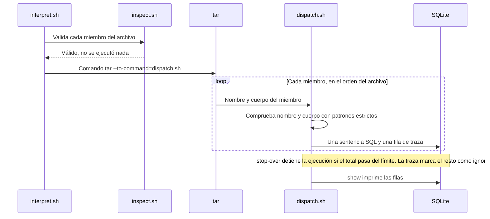
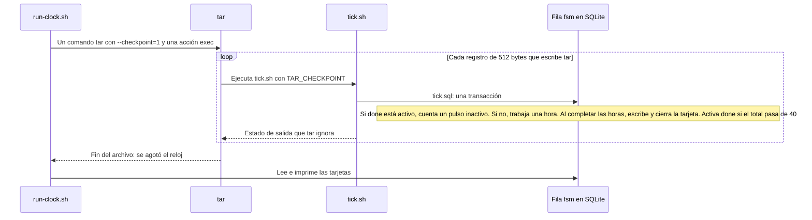

# tar

Entradas: [`src/tar-gnu`](../../src/tar-gnu/README.md) (el archivo es un programa) y [`src/tar-gnu-weird`](../../src/tar-gnu-weird/README.md) (el archivo es un reloj). `tar` ("archivo de cinta") empaqueta muchos archivos en un solo flujo de bytes. Se creó para cinta magnética, donde no puedes saltar de un lugar a otro. Por eso, un archivo es una *secuencia*: una cabecera, los bytes del archivo, la siguiente cabecera y así sucesivamente. Ese hecho explica por qué un archivo tar puede ser un programa. El orden ya forma parte del formato.

Para una ruta de lectura avanzada con trazas y experimentos, consulta la [guía de estudio de tar](../guias-de-estudio/lenguajes/tar.md).

## Qué hace especial a tar

| Característica | Qué enseña |
| --- | --- |
| Un archivo es una secuencia de bloques de 512 bytes: un bloque de cabecera, luego los bloques de datos y después la siguiente cabecera | No hay índice ni directorio. Para encontrar un miembro, lees desde el principio. Eso es un flujo, y un flujo es una cinta natural para un intérprete. |
| `tar -xf` escribe los miembros como archivos | La extracción es pasiva. Un archivo no puede hacer que tar ejecute nada. |
| GNU `--to-command=CMD` inicia `CMD` para cada miembro regular y le envía el miembro por una tubería | El *operador* conecta un intérprete. La línea de comandos lleva el poder; el archivo no. |
| `TAR_FILENAME`, `TAR_SIZE` y otras variables se establecen para cada comando | Los metadatos del miembro pasan a ser la entrada de datos del comando, junto con sus bytes. |
| tar continúa cuando falla el comando | No hay una "parada" incorporada. Una regla de control debe ser propia del intérprete. |
| `--checkpoint=N --checkpoint-action=exec=CMD` ejecuta `CMD` cada N registros | Un informe de progreso es una fuente de eventos. Puede ser un reloj. |
| `-b N` fija el tamaño del *registro* en N bloques de 512 bytes | La unidad de tiempo es un registro. El tamaño del archivo, no su contenido, determina cuántos registros hay. |

## Un programa que es un archivo

### Contempla la monstruosidad

```bash
sandbox/container/run-image.sh src/tar-gnu
```

Un archivo tar de doce archivos diminutos. Un despachador de unas 80 líneas. Sin bucle en el despachador, sin números aleatorios y sin el número 40.

### ¿Cómo demonios funciona eso?

- **Los miembros son las instrucciones.** `010.card` es "agrega una tarjeta". Su cuerpo es `category=Meetings` y `hours=13`. El nombre lleva el orden y el cuerpo lleva los operandos.
- **tar es el bucle.** Lee el siguiente miembro e inicia el despachador, hasta que termina el archivo.
- **Los dados se tiran al escribir el programa.** Un generador de archivos sortea las cinco horas con un generador con semilla y guarda la semilla en el primer miembro. La misma semilla produce los mismos bytes.
- **La regla de parada son datos.** Cada tarjeta va seguida de un miembro `011.stop-over` que contiene `limit=40`. El despachador solo sabe qué *significa* `stop-over`: detenerse si el total supera el límite.
- **Leer no es ejecutar.** `inspect.sh` lista y decodifica cada miembro con `tar -t` y `tar -xO`. `interpret.sh --execute` es el único lugar donde aparece `--to-command`.

El [README](../../src/tar-gnu/README.md#es-solo-un-archivo-tar-serialización-deserialización-y-ejecución) contiene la tabla completa de quién hace qué.

### ¿Qué acabamos de aprender?

- **La serialización, la deserialización y la ejecución son tres actos.** Puedes escribir un programa, analizarlo y ejecutarlo. La mayoría de los formatos permiten hacer los dos primeros sin el tercero. `pickle` de Python no lo permite.
- **La frontera de confianza es la línea de comandos.** Una extracción simple no ejecuta nada. Agregar `--to-command` es una decisión y le corresponde al operador.
- **Falla de forma cerrada.** El despachador rechaza un registro desconocido y luego rechaza todos los registros posteriores, porque tar no se detendrá por sí solo.
- **Cuatro formas de "lo mismo".** Los mismos bytes, la misma estructura, el mismo comportamiento y el mismo proceso en ejecución son cuatro afirmaciones distintas. Esta entrada hace las tres primeras y dice claramente que no hace la cuarta.
- **Un formato es un contrato.** `tarprog/1` no es parte de tar. Dos programas se ponen de acuerdo sobre él.

Etiquetas: `--to-command` y `--occurrence` son extensiones de GNU (**permitido por la implementación**). El formato `ustar` y el orden de los miembros están en POSIX. GNU tar 1.35 continúa hoy después de un comando fallido y el manual no lo promete. Es un comportamiento **aprovechado por accidente**. La entrada no depende de él porque escribe su propia detención.

### Haz esto en producción y estás despedido

- **Un archivo que se ejecuta es un programa que llegó como datos.** Si el operador ejecuta `--to-command` sobre un archivo de un desconocido, los registros del desconocido deciden qué ocurre. Aquí el despachador es estricto. Uno descuidado ejecuta comandos remotos.
- **Tu propio formato no tiene herramientas.** Solo una prueba mantiene al constructor y al despachador sincronizados.
- **tar no se creó para esto.** Las tareas reales de tar son la copia de seguridad, el empaquetado y el transporte.

Usos legítimos: `--to-command` como filtro, por ejemplo, para calcular la suma de comprobación de cada miembro al extraerlo. Un archivo tar como *contenedor* de datos de un programa, con un manifiesto.

### Ahora rómpelo tú

Consulta el [ejercicio B16](../exercises.md#b16-tar-lee-el-programa-y-luego-ejecútalo-verificado).

## El archivo es el reloj

### Contempla la monstruosidad

```bash
sandbox/container/run-image.sh src/tar-gnu-weird
```

Un archivo tar cuya carga útil contiene solo ceros y una máquina de estados que avanza un paso cada vez que tar dice "escribí un registro". El programa no tiene bucle. tar es el bucle.

### ¿Cómo demonios funciona eso?

- **Un punto de control equivale a una hora.** `tar -b 1 --checkpoint=1 --checkpoint-action=exec=...` ejecuta un comando por cada 512 bytes que escribe. El comando es una sola transacción SQL.
- **El estado es una fila.** Contiene las horas trabajadas en la tarjeta abierta, la duración de la tarjeta, el total acumulado, la semilla del generador y una bandera `done`.
- **La disposición es el calendario.** El número de pulsos es `floor(ceil(blocks / b) / K)`. Acorta el archivo y el reloj se detiene a mitad de una tarjeta. Alárgalo y los pulsos adicionales solo cuentan como tiempo inactivo.
- **La regla de parada es una bandera, porque tar no se detiene.** Después de la tarjeta que cruza el tope, el archivo se sigue escribiendo y el comando se sigue ejecutando. Solo cuenta.
- **`check.sh` predice, no solo observa.** Una segunda máquina, escrita en awk, dice qué tarjetas deben existir para cualquier semilla y disposición. La entrada debe coincidir para 65 combinaciones.

El [README](../../src/tar-gnu-weird/README.md#cómo-funciona-el-truco) contiene la tabla de registros y la lista completa de lo que medimos.

### ¿Qué acabamos de aprender?

- **Un indicador de progreso es una fuente de eventos.** Cuando algo llama a tu código a un ritmo constante, tienes un reloj. Así funcionan los programas orientados a eventos.
- **Un reloj lógico cuenta eventos, no segundos.** Aquí los pulsos son registros escritos. Nada en la ejecución depende de cuánto dura un segundo.
- **El flujo de control puede invertirse.** El programa no llama a tar. tar llama al programa.
- **Una disposición puede marcar el ritmo además del significado.** El contenido de este archivo consta solo de ceros. Aun así, su tamaño decide cuándo ocurre todo.
- **Di qué cuenta un conteo.** Un punto de control cuenta registros. Un registro es una cantidad de bloques. El mismo archivo da 21 pulsos al crearlo, 10 al listarlo y 21 al extraerlo.

Etiquetas: `--checkpoint`, `--checkpoint-action=exec` y `TAR_CHECKPOINT` son extensiones GNU (**permitido por la implementación**), probadas en GNU tar 1.34 y 1.35. El número exacto de pulsos en modo de lista es conocimiento **aprovechado por accidente**. La entrada no lo usa.

### Haz esto en producción y estás despedido

- **Es un indicador de progreso.** Si alguien cambia el factor de bloqueo, tu calendario cambia con él.
- **Cada pulso inicia un proceso.** No uses un punto de control como programador de tareas. Usa un programador de tareas.
- **Si falla una función de devolución de llamada, tar no lo anuncia.** Busca tus propios errores. La entrada los envía a la salida de error estándar y termina con 3.

Usos legítimos: barras de progreso para copias de seguridad largas y `--checkpoint-action=wait` para pausar una tarea para un proceso cooperante, como muestra el manual.

### Ahora rómpelo tú

Mira el [ejercicio B17](../exercises.md#b17-tar-más-raro-predice-el-reloj-verificado).

<!-- BEGIN GENERATED program-flow:languages/tar.md -->
## Cómo corre cada programa

Cada imagen de abajo es la sección `## Flujo del programa` del README de una entrada, copiada aquí por la compilación. Muestra cómo ese programa hace el trabajo: lo que el lenguaje, el entorno de ejecución o la herramienta hacen en realidad. [La introducción](../introduccion.md#qué-hace-el-reto) muestra qué pide el reto y en qué se distinguen las entradas.

### Flujo del programa de `tar-gnu`

Desde [`tar-gnu`](../../src/tar-gnu/README.md) ([sección original](../../src/tar-gnu/README.md#flujo-del-programa)).



**Qué muestra:** tar es el bucle y el archivo es el programa. Por cada miembro, tar pasa los bytes al despachador, que decide qué significa el nombre. El orden de los miembros es el orden de ejecución.

**Por qué importa este mecanismo:** leer y ejecutar son dos pasos distintos. El inspector analiza y comprueba todo sin ejecutar nada. El despachador ejecuta una sentencia SQL por miembro y no pasa ninguna parte del miembro a un intérprete de comandos. Esa es la diferencia entre datos que se *serializan* y datos que se *ejecutan*.

### Flujo del programa de `tar-gnu-weird`

Desde [`tar-gnu-weird`](../../src/tar-gnu-weird/README.md) ([sección original](../../src/tar-gnu-weird/README.md#flujo-del-programa)).



**Qué muestra:** el programa es una máquina de estados en una fila de SQLite y el punto de control de tar es su reloj. Cada pulso es una transacción. tar no se detiene cuando termina la máquina. Sigue dando pulsos y los pulsos extra solo cuentan como inactivos.

**Por qué importa este mecanismo:** la disposición de un archivo funciona como fuente de eventos. El tamaño del archivo fija el número de pulsos. Si la disposición es demasiado corta, la máquina se atasca a mitad de una tarjeta. Los pulsos son llamadas a una función de devolución de llamada (*callback*), una función que tar ejecuta para el programa. El programa no espera esos eventos.
<!-- END GENERATED program-flow:languages/tar.md -->

## La informática detrás de esta página

<!-- BEGIN GENERATED concepts:languages/tar.md -->
Las ideas de ciencias de la computación detrás de esta página: [Modelo de amenazas](../informatica/01-lectura-de-un-programa-adversarial.md#modelo-de-amenazas), [Ejecución de código arbitrario](../informatica/01-lectura-de-un-programa-adversarial.md#ejecución-de-código-arbitrario), [Principio de mínimo privilegio](../informatica/01-lectura-de-un-programa-adversarial.md#principio-de-mínimo-privilegio), [Capacidad y autoridad](../informatica/01-lectura-de-un-programa-adversarial.md#capacidad-y-autoridad), [Sistemas de transición y máquinas de estados](../informatica/02-que-cuenta-como-maquina.md#sistemas-de-transición-y-máquinas-de-estados), [Cómo representar el estado](../informatica/02-que-cuenta-como-maquina.md#cómo-representar-el-estado), [Invariantes](../informatica/02-que-cuenta-como-maquina.md#invariantes), [Observabilidad](../informatica/02-que-cuenta-como-maquina.md#observabilidad), [Semántica operacional](../informatica/02-que-cuenta-como-maquina.md#semántica-operacional), [Cálculo frente a orquestación](../informatica/02-que-cuenta-como-maquina.md#cálculo-frente-a-orquestación), [Relojes lógicos y orden de los eventos](../informatica/03-flujo-de-control-y-continuaciones.md#relojes-lógicos-y-orden-de-los-eventos), [Análisis sintáctico](../informatica/05-lenguajes-formales-como-sustratos-de-computacion.md#análisis-sintáctico), [Lenguajes específicos de dominio](../informatica/05-lenguajes-formales-como-sustratos-de-computacion.md#lenguajes-específicos-de-dominio), [Seguridad basada en teoría de lenguajes](../informatica/05-lenguajes-formales-como-sustratos-de-computacion.md#seguridad-basada-en-teoría-de-lenguajes), [Intérpretes y máquinas virtuales](../informatica/05-lenguajes-formales-como-sustratos-de-computacion.md#intérpretes-y-máquinas-virtuales), [Estado](../informatica/06-estado-mas-alla-de-las-variables.md#estado), [Serialización, deserialización y pickling de objetos](../informatica/06-estado-mas-alla-de-las-variables.md#serialización-deserialización-y-pickling-de-objetos), [Efectos secundarios](../informatica/07-efectos-errores-y-confirmacion.md#efectos-secundarios), [Estado de salida](../informatica/07-efectos-errores-y-confirmacion.md#estado-de-salida), [Restricciones de integridad](../informatica/07-efectos-errores-y-confirmacion.md#restricciones-de-integridad), [Idempotencia](../informatica/07-efectos-errores-y-confirmacion.md#idempotencia), [Abstracciones con fugas](../informatica/08-fugas-de-abstraccion-y-dependencia-de-la-implementacion.md#abstracciones-con-fugas), [Portabilidad](../informatica/08-fugas-de-abstraccion-y-dependencia-de-la-implementacion.md#portabilidad), [Ley de Hyrum](../informatica/08-fugas-de-abstraccion-y-dependencia-de-la-implementacion.md#ley-de-hyrum), [Reproducibilidad y compilaciones deterministas](../informatica/08-fugas-de-abstraccion-y-dependencia-de-la-implementacion.md#reproducibilidad-y-compilaciones-deterministas), [Programación dirigida por eventos](../informatica/10-eventos-retrollamadas-y-flujo-de-control-reactivo.md#programación-dirigida-por-eventos), [Funciones de devolución de llamada](../informatica/10-eventos-retrollamadas-y-flujo-de-control-reactivo.md#funciones-de-devolución-de-llamada).
<!-- END GENERATED concepts:languages/tar.md -->
