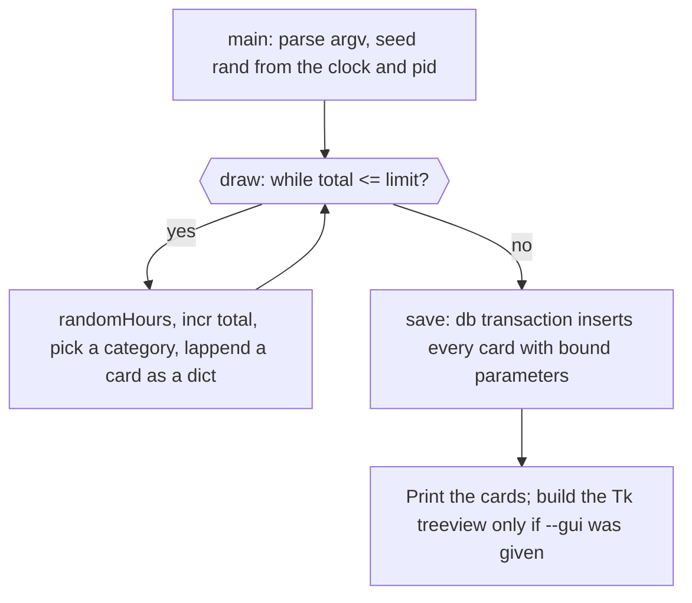
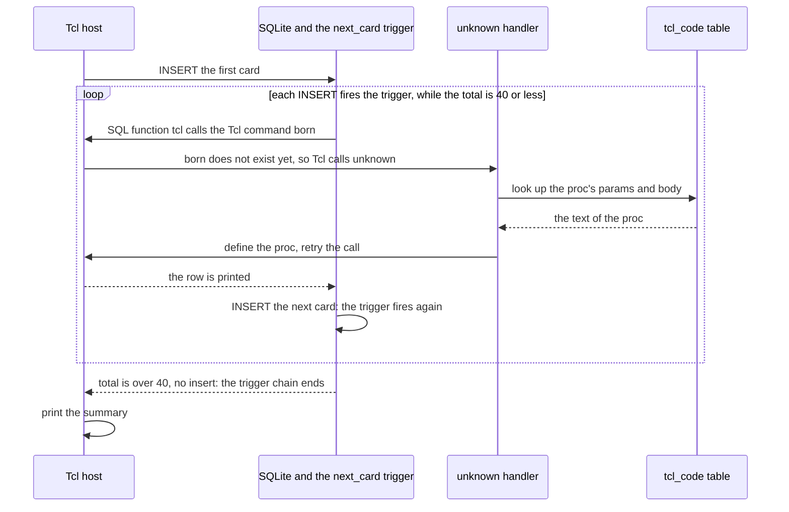

# Tcl

Entradas: [`src/tcl`](../../src/tcl/README.md) (un bucle `while`, diccionarios y una ventana Tk opcional) y [`src/tcl-weird`](../../src/tcl-weird/README.md) (el programa vive en SQLite).

Para una ruta de lectura avanzada con trazas y experimentos, consulta la [guía de estudio de Tcl](../guias-de-estudio/lenguajes/tcl.md).

## Qué hace especial a Tcl

La regla de Tcl es: "todo es un comando y cada comando recibe sus argumentos como cadenas de texto". No hay palabras clave para `while`, `proc` ni `if`: son comandos. `{...}` es solo una forma de entregar a un comando una cadena de texto sin evaluar. Esto hace que el lenguaje sea pequeño y que dos funciones sean baratas, aunque la mayoría de los lenguajes las considere exóticas: **reescribir cómo se resuelven los comandos desconocidos** y **ejecutar una cadena de texto como código en otro ámbito**.

| Característica | Dónde | Qué enseña |
| --- | --- | --- |
| Las llaves aplazan la evaluación | [`tcl/timecards.tcl` L40](../../src/tcl/timecards.tcl#L40): `while {$total <= $limit} {` | La condición es una cadena de texto entre llaves que se evalúa de nuevo en cada pasada. Escribe `while $total <= $limit` y se sustituye una sola vez y nunca cambia. La misma regla explica por qué `expr` siempre debe ir entre llaves. |
| Los diccionarios son valores | [L44](../../src/tcl/timecards.tcl#L44): `lappend cards [dict create category $category hours $hours total $total]` | Una tarjeta es un diccionario simple; no se necesita una clase. |
| `dict with` desempaqueta en variables | [L86](../../src/tcl/timecards.tcl#L86): `dict with card {` | Las claves de un diccionario se convierten en variables locales para un bloque. |
| `db eval` vincula variables de Tcl como parámetros SQL | [L87-91](../../src/tcl/timecards.tcl#L87-L91): `VALUES ($runId, $category, $hours, $total, $week, ...)` | El `$name` dentro del SQL entre llaves no se pega como texto. SQLite lo recibe como parámetro vinculado, así que las comillas nunca son un problema. |
| `try ... finally` cierra la base de datos | [L77-95](../../src/tcl/timecards.tcl#L77-L95) | La limpieza se realiza incluso si ocurre un error. |
| Tk es un paquete, no un programa | [L110](../../src/tcl/timecards.tcl#L110): `showWindow`, `--gui` y `--seconds N` | Una interfaz gráfica requiere unos pocos comandos y con Xvfb se puede probar sin pantalla. |
| Una guarda del punto de entrada | [L170](../../src/tcl/timecards.tcl#L170): `if {[info exists argv0] && [file normalize $argv0] eq [file normalize [info script]]}` | El archivo puede cargarse con `source` para probarlo sin ejecutarlo. |

## SQLite como programa

### Contempla la monstruosidad

```bash
sandbox/container/run-image.sh src/tcl-weird
```

Abre [`timecards.tcl`](../../src/tcl-weird/timecards.tcl). Se definen exactamente **dos** procedimientos en Tcl y ninguno reparte una tarjeta. El código que lo hace es *texto en una tabla de base de datos* y el bucle es un disparador SQL.

### ¿Cómo demonios funciona eso?

Tres puntos de conexión crean un programa de la nada.

**Punto de conexión 1: SQL puede llamar a Tcl.** [`db function tcl call`](../../src/tcl-weird/timecards.tcl#L28-L34) registra una función SQL `tcl(command, args...)` implementada como un procedimiento Tcl que ejecuta un comando. Desde cualquier sentencia SQL, `SELECT tcl('hours')` ejecuta el comando Tcl `hours` y devuelve su resultado.

**Punto de conexión 2: `unknown` es la ruta de biblioteca.** Cuando se le pide a Tcl ejecutar un comando inexistente, llama a un comando llamado `unknown`. La entrada [lo renombra y reemplaza](../../src/tcl-weird/timecards.tcl#L36-L49): busca el nombre en una tabla TEMP `tcl_code(name, params, body)`. Si hay una fila, define un procedimiento a partir de ella con `proc $name $params $body` y vuelve a intentarlo. Así, `hours`, `category`, `born` y los demás *nunca* se escriben como código fuente Tcl. La primera llamada a `tcl('hours')` no encuentra ese comando y consulta a `unknown`. Este encuentra la fila en SQLite, construye el procedimiento y lo ejecuta. Al final, el programa imprime qué procedimientos salieron de la base de datos:

```text
# every proc that ran was fetched from SQLite by unknown: born category hours init runid week
```

**Hook 3: the loop is a recursive trigger.** The [trigger](../../src/tcl-weird/timecards.tcl#L104-L114):

```sql
CREATE TEMP TRIGGER next_card AFTER INSERT ON main.demo_timecards
BEGIN
    SELECT tcl('born', NEW.category, NEW.hours, NEW.running_total, NEW.iso_week);
    UPDATE draw SET h = tcl('hours') WHERE NEW.running_total <= 40;
    INSERT INTO demo_timecards(...)
    SELECT NEW.run_id, tcl('category', ...), h, NEW.running_total + h, ...
    FROM draw
    WHERE NEW.running_total <= 40;
END;
```

Inserting a card fires the trigger, which prints the card (via `tcl('born', ...)`) and inserts the *next* one. That insert fires the trigger again. The `WHERE NEW.running_total <= 40` is the stop rule: when it is false the `INSERT ... SELECT` inserts nothing, so no further trigger fires. [`PRAGMA recursive_triggers = ON`](../../src/tcl-weird/timecards.tcl#L55) is required: SQLite's default is that a trigger does not fire itself. The one statement that starts everything is the `INSERT` of card 1.

**The window is data too.** With `--gui`, a TEMP table `ui(id, command)` holds eight Tk commands, run by `SELECT tcl('uplevel', '#0', command) FROM ui ORDER BY id`. `uplevel #0` evaluates each string at global level, where `.cards` and `.note` must live. Each card's `born` then adds a row to the tree view and updates the screen.

### What did we just learn?

- **Code and data are the same thing in Tcl.** A proc is created from two strings; the place the strings came from is up to you. Here it is a database row, so `UPDATE tcl_code SET body = ...` is a hot-patch.
- **A database trigger is a control-flow construct.** It is an event handler that can cause the event it handles: that is recursion.
- **Every hook point is a loop opportunity.** SQLite lets you register functions and triggers; Tcl lets you intercept lookups. Either alone is a feature, together they are a runtime.
- **Braces versus substitution** decides everything in Tcl. (Compare [Make's expansion time versus run time](make-cmake.md#gnu-make) and [m4's quoting](m4.md).)

Tags: `proc`, `unknown`, `uplevel`, `namespace`, `dict` and `try` are **guaranteed** by Tcl 8.6. `db function` and `db eval` variable binding belong to the sqlite3 Tcl package (**implementation-permitted**: the interface is stable but is not part of Tcl). Recursive triggers need `PRAGMA recursive_triggers`, a **guaranteed** SQLite feature when enabled. That each card's hours are drawn exactly once holds by construction: the hours are written into a one-row TEMP table and read from it twice, so the result does not depend on how often SQLite evaluates a function. (An earlier version used a subquery and relied on SQLite calling the function once per row, which is **accidentally exploited**: SQLite does not promise that for non-deterministic functions.)

### Do this in production and you're fired

- **Your program is not in version control.** It is in a TEMP table that exists only for this connection. The `.tcl` file holds two procs and a string.
- **`unknown` is global.** Every misspelled command now takes a database lookup before the error. If the table is writable by someone else, so is your program.
- **Triggers are invisible in stack traces**, and SQLite's recursion depth limit (`SQLITE_MAX_TRIGGER_DEPTH`, 1000 by default) is a hidden constraint.
- **Quoting is two levels deep:** the Tcl in the SQL in the Tcl. A stray brace breaks the outer string.
- **A value used twice must be drawn once.** The hours are used as the hours and inside the running total. The trigger stores them in the one-row TEMP table `draw` and reads them from it, and `check.sh` counts the calls of the `hours` procedure (one per card).
- **Tk quirk:** a `tclsh` that has loaded Tk does not exit when the script ends. The entry calls `destroy .` (a normal Tk program is waiting for events).

Legitimate uses: **loading code on demand** (Tcl's own `unknown` already calls `auto_load` to find a command's definition on disk), **SQL functions that call back into the host language** (a standard SQLite feature) and **keeping rules in a table** so they can change without a deploy. Tcl Starkits packed a whole application into one virtual-filesystem file for the same reason: code that travels with its data.

### Now break it yourself

See [exercises](../exercises.md#b12-tcl-edit-the-program-in-the-database-verified).

## Quirks

- **Triggers reject a qualified table name in `INSERT`.** Inside the trigger, `main.demo_timecards` is an error; the unqualified name is required, while the `AFTER INSERT ON main.demo_timecards` line does qualify, because a TEMP trigger watches a table in the main database.
- **`expr` without braces is both slower and a code-injection hole.** The idiomatic entry braces every `expr`.
- **`dict with` writes back**: assignments to the unpacked variables update the dict.
- **`DISPLAY=:0` under WSL hangs Tk.** Tests use `xvfb-run`; see `check.sh`.

## Weird next to boring

[`tcl`](../../src/tcl/README.md) is a namespaced `while` with dicts and bound SQL parameters: tidy, testable, unit-testable (`draw` is called 2,000 times in its check). [`tcl-weird`](../../src/tcl-weird/README.md) has the same output and none of those properties. The first is how you write Tcl; the second is what Tcl's "everything is a string command" *permits*. Compare [`haskell`](haskell.md#la-es-perezosa-como-flujo-de-control), where effects hide inside a lazy list, and [CMake](make-cmake.md#cmake), where a `while()` condition is the register machine.

## Under what circumstances would this terrible idea become reasonable?

When your code genuinely belongs with your data: a rules engine where rules are rows, a game where scripts live in the save file, a tool that must patch behavior in a running system. Using a recursive trigger as a `while` loop is a stunt; storing procs in a table is a design.

<!-- BEGIN GENERATED program-flow:languages/tcl.md -->
## How each program runs

Each picture below is the `## Program Flow` section of an entry's README, copied here by the build. It shows how that program makes the work happen: what the language, runtime or tool really does. [The introduction](../introduccion.md#what-the-challenge-does) shows what the challenge asks for and where entries differ.

### Program flow of `tcl`

From [`tcl`](../../src/tcl/README.md) ([source section](../../src/tcl/README.md#flujo-del-programa)).



**What this shows:** the conventional Tcl shape. A `while` is the loop, a dict is the card, and `db transaction` makes the save all-or-nothing. A guard around `main` lets the checks `source` the file and test `draw` in the same process.

**Why this mechanism matters:** the program draws first and saves afterwards, so the card list is complete before the database sees it. Tcl's `while` re-evaluates its test each pass, and the test comes before the draw, so the crossing card is kept. The weird sibling [`tcl-weird`](../../src/tcl-weird/README.md) moves the loop into the database.

### Program flow of `tcl-weird`

From [`tcl-weird`](../../src/tcl-weird/README.md) ([source section](../../src/tcl-weird/README.md#flujo-del-programa)).



**What this shows:** the loop is a trigger that inserts a row and so fires itself, and every number and printed line comes from Tcl code stored as text in a table. The first call of a proc takes the long way, through `unknown` and the table, and later calls find the proc defined.

**Why this mechanism matters:** the database is dispatching, but it is not an event queue. The trigger runs synchronously inside the `INSERT`, and the recursion is the loop. The `WHERE` on the trigger's insert is the stop rule. Control moves between three layers (Tcl, SQL, Tcl) on one call stack.
<!-- END GENERATED program-flow:languages/tcl.md -->

## Computer science behind this page

<!-- BEGIN GENERATED concepts:languages/tcl.md -->
The computer-science ideas behind this page: [Arbitrary code execution](../informatica/01-lectura-de-un-programa-adversarial.md#arbitrary-code-execution), [Control flow](../informatica/03-flujo-de-control-y-continuaciones.md#control-flow), [Recursion](../informatica/03-flujo-de-control-y-continuaciones.md#recursion), [Interpreters and virtual machines](../informatica/05-lenguajes-formales-como-sustratos-de-computacion.md#interpreters-and-virtual-machines), [State](../informatica/06-estado-mas-alla-de-las-variables.md#state), [Scope and binding](../informatica/06-estado-mas-alla-de-las-variables.md#scope-and-binding), [Homoiconicity: code as data](../informatica/06-estado-mas-alla-de-las-variables.md#homoiconicity-code-as-data), [Reflection and metaprogramming](../informatica/06-estado-mas-alla-de-las-variables.md#reflection-and-metaprogramming), [Database triggers](../informatica/06-estado-mas-alla-de-las-variables.md#database-triggers), [Serialization, deserialization and object pickling](../informatica/06-estado-mas-alla-de-las-variables.md#serialization-deserialization-and-object-pickling), [Transactions](../informatica/07-efectos-errores-y-confirmacion.md#transactions), [Callbacks](../informatica/10-eventos-retrollamadas-y-flujo-de-control-reactivo.md#callbacks).
<!-- END GENERATED concepts:languages/tcl.md -->
