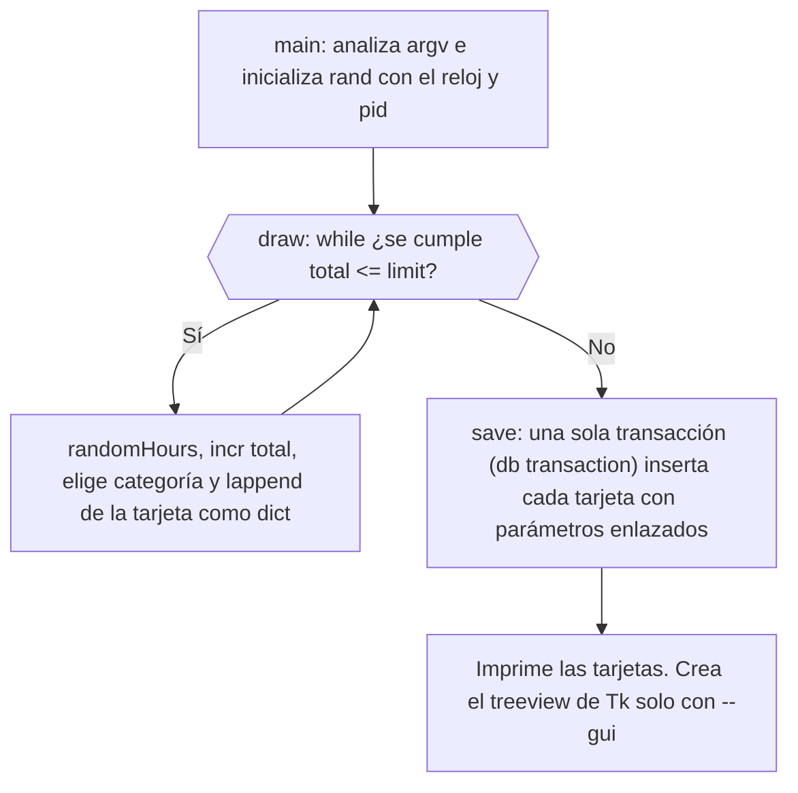
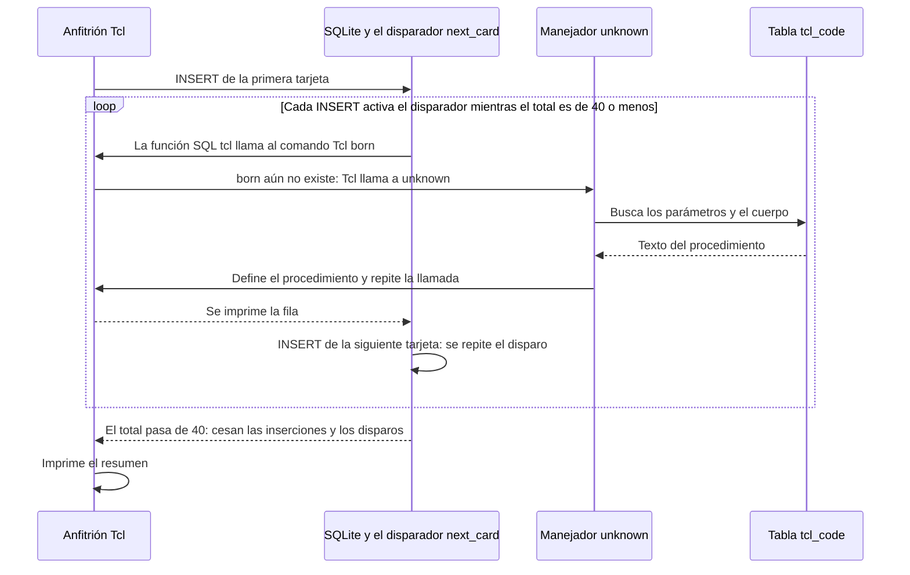

# Tcl

Entradas: [`src/tcl`](../../src/tcl/README.md) (un bucle `while`, diccionarios y una ventana Tk opcional) y [`src/tcl-weird`](../../src/tcl-weird/README.md) (el programa vive en SQLite).

Para una ruta de lectura avanzada con trazas y experimentos, consulta la [guía de estudio de Tcl](../guias-de-estudio/lenguajes/tcl.md).

## Qué hace especial a Tcl

La regla de Tcl es: "todo es un comando y cada comando recibe sus argumentos como cadenas de texto". No hay palabras clave para `while`, `proc` ni `if`: son comandos. `{...}` es solo una forma de entregar a un comando una cadena de texto sin evaluar. Esto hace que el lenguaje sea pequeño y que dos funciones sean baratas, aunque la mayoría de los lenguajes las considere exóticas: **reescribir cómo se resuelven los comandos desconocidos** y **ejecutar una cadena de texto como código en otro ámbito**.

| Característica | Dónde | Qué enseña |
| --- | --- | --- |
| Las llaves aplazan la evaluación | [`tcl/timecards.tcl` L40](../../src/tcl/timecards.tcl#L40): `while {$total <= $limit} {` | La condición es una cadena de texto entre llaves que se evalúa de nuevo en cada pasada. Escribe `while $total <= $limit` y se sustituye una sola vez y nunca cambia. La misma regla explica por qué `expr` siempre debe ir entre llaves. |
| Los diccionarios son valores | [L44](../../src/tcl/timecards.tcl#L44): `lappend cards [dict create category $category hours $hours total $total]` | Una tarjeta es un diccionario simple; no se necesita una clase. |
| `dict with` desempaqueta en variables | [L86](../../src/tcl/timecards.tcl#L86): `dict with card {` | Las claves de un diccionario se convierten en variables locales para un bloque. |
| `db eval` vincula variables de Tcl como parámetros SQL | [L87-91](../../src/tcl/timecards.tcl#L87-L91): `VALUES ($runId, $category, $hours, $total, $week, ...)` | El `$name` dentro del SQL entre llaves no se pega como texto. SQLite lo recibe como parámetro vinculado, así que las comillas nunca son un problema. |
| `try ... finally` cierra la base de datos | [L77-95](../../src/tcl/timecards.tcl#L77-L95) | La limpieza se realiza incluso si ocurre un error. |
| Tk es un paquete, no un programa | [L110](../../src/tcl/timecards.tcl#L110): `showWindow`, `--gui` y `--seconds N` | Una interfaz gráfica requiere unos pocos comandos y con Xvfb se puede probar sin pantalla. |
| Una guarda del punto de entrada | [L170](../../src/tcl/timecards.tcl#L170): `if {[info exists argv0] && [file normalize $argv0] eq [file normalize [info script]]}` | El archivo puede cargarse con `source` para probarlo sin ejecutarlo. |

## SQLite como programa

### Contempla la monstruosidad

```bash
sandbox/container/run-image.sh src/tcl-weird
```

Abre [`timecards.tcl`](../../src/tcl-weird/timecards.tcl). Se definen exactamente **dos** procedimientos en Tcl y ninguno reparte una tarjeta. El código que lo hace es *texto en una tabla de base de datos* y el bucle es un disparador SQL.

### ¿Cómo demonios funciona eso?

Tres puntos de conexión crean un programa de la nada.

**Punto de conexión 1: SQL puede llamar a Tcl.** [`db function tcl call`](../../src/tcl-weird/timecards.tcl#L28-L34) registra una función SQL `tcl(command, args...)` implementada como un procedimiento Tcl que ejecuta un comando. Desde cualquier sentencia SQL, `SELECT tcl('hours')` ejecuta el comando Tcl `hours` y devuelve su resultado.

**Punto de conexión 2: `unknown` es la ruta de biblioteca.** Cuando se le pide a Tcl ejecutar un comando inexistente, llama a un comando llamado `unknown`. La entrada [lo renombra y reemplaza](../../src/tcl-weird/timecards.tcl#L36-L49): busca el nombre en una tabla TEMP `tcl_code(name, params, body)`. Si hay una fila, define un procedimiento a partir de ella con `proc $name $params $body` y vuelve a intentarlo. Así, `hours`, `category`, `born` y los demás *nunca* se escriben como código fuente Tcl. La primera llamada a `tcl('hours')` no encuentra ese comando y consulta a `unknown`. Este encuentra la fila en SQLite, construye el procedimiento y lo ejecuta. Al final, el programa imprime qué procedimientos salieron de la base de datos:

```text
# every proc that ran was fetched from SQLite by unknown: born category hours init runid week
```

**Punto de conexión 3: el bucle es un disparador recursivo.** El [disparador](../../src/tcl-weird/timecards.tcl#L104-L114):

```sql
CREATE TEMP TRIGGER next_card AFTER INSERT ON main.demo_timecards
BEGIN
    SELECT tcl('born', NEW.category, NEW.hours, NEW.running_total, NEW.iso_week);
    UPDATE draw SET h = tcl('hours') WHERE NEW.running_total <= 40;
    INSERT INTO demo_timecards(...)
    SELECT NEW.run_id, tcl('category', ...), h, NEW.running_total + h, ...
    FROM draw
    WHERE NEW.running_total <= 40;
END;
```

Insertar una tarjeta activa el disparador, que imprime la tarjeta (mediante `tcl('born', ...)`) e inserta la *siguiente*. Esa inserción vuelve a activar el disparador. La `WHERE NEW.running_total <= 40` es la regla de parada: cuando es falsa, el `INSERT ... SELECT` no inserta nada y no se activa otro disparador. Se requiere [`PRAGMA recursive_triggers = ON`](../../src/tcl-weird/timecards.tcl#L55): por defecto, SQLite no permite que un disparador se active a sí mismo. La sentencia que inicia todo es el `INSERT` de la tarjeta 1.

**La ventana también es dato.** Con `--gui`, una tabla TEMP `ui(id, command)` contiene ocho comandos Tk que ejecuta `SELECT tcl('uplevel', '#0', command) FROM ui ORDER BY id`. `uplevel #0` evalúa cada cadena de texto en el nivel global, donde deben estar `.cards` y `.note`. Luego, el `born` de cada tarjeta añade una fila a la vista de árbol y actualiza la pantalla.

### ¿Qué acabamos de aprender?

- **El código y los datos son lo mismo en Tcl.** Un procedimiento se crea a partir de dos cadenas de texto; tú decides de dónde vienen. Aquí es una fila de la base de datos, así que `UPDATE tcl_code SET body = ...` es un parche en caliente.
- **Un disparador de base de datos es una construcción de flujo de control.** Es un manejador de eventos que puede causar el evento que maneja: eso es recursión.
- **Cada punto de conexión es una oportunidad para crear un bucle.** SQLite permite registrar funciones y disparadores; Tcl permite interceptar búsquedas. Cada uno por separado es una función; juntos forman un entorno de ejecución.
- **Las llaves frente a la sustitución** lo deciden todo en Tcl. (Compara [el tiempo de expansión frente al tiempo de ejecución de Make](make-cmake.md#gnu-make) y [el entrecomillado de m4](m4.md).)

Etiquetas: `proc`, `unknown`, `uplevel`, `namespace`, `dict` y `try` tienen la etiqueta **garantizado** en Tcl 8.6. `db function` y la vinculación de variables de `db eval` pertenecen al paquete sqlite3 de Tcl (**permitido por la implementación**: la interfaz es estable, pero no forma parte de Tcl). Los disparadores recursivos necesitan `PRAGMA recursive_triggers`, una característica de SQLite con la etiqueta **garantizado** cuando está activada. Que las horas de cada tarjeta se obtengan exactamente una vez se cumple por construcción: las horas se escriben en una tabla TEMP de una fila y se leen dos veces. Por eso, el resultado no depende de cuántas veces SQLite evalúe una función. (Una versión anterior usaba una subconsulta y dependía de que SQLite llamara a la función una vez por fila. Eso es **aprovechado por accidente**: SQLite no lo promete para funciones no deterministas.)

### Haz esto en producción y estás despedido

- **Tu programa no está en control de versiones.** Está en una tabla TEMP que existe solo para esta conexión. El archivo `.tcl` contiene dos procedimientos y una cadena de texto.
- **`unknown` es global.** Ahora cada comando mal escrito provoca una consulta a la base de datos antes del error. Si otra persona puede escribir en la tabla, también puede escribir en tu programa.
- **Los disparadores son invisibles en las trazas de pila** y el límite de profundidad de recursión de SQLite (`SQLITE_MAX_TRIGGER_DEPTH`, 1000 por defecto) es una restricción oculta.
- **El entrecomillado tiene dos niveles de profundidad:** el Tcl dentro del SQL dentro del Tcl. Una llave suelta rompe la cadena de texto exterior.
- **Un valor usado dos veces debe extraerse una sola vez.** Las horas se usan como horas y dentro del total acumulado. El disparador las guarda en la tabla TEMP `draw` de una fila y las lee de allí. `check.sh` cuenta las llamadas al procedimiento `hours` (una por tarjeta).
- **Particularidad de Tk:** un `tclsh` que ha cargado Tk no termina cuando termina el script. La entrada llama a `destroy .` (un programa Tk normal espera eventos).

Usos legítimos: **cargar código a demanda** (el propio `unknown` de Tcl ya llama a `auto_load` para encontrar en disco la definición de un comando), **funciones SQL que llaman de vuelta al lenguaje anfitrión** (una función estándar de SQLite) y **mantener reglas en una tabla** para que puedan cambiar sin un despliegue. Por la misma razón, los Starkits de Tcl empaquetaban una aplicación entera en un archivo de sistema de archivos virtual: código que viaja con sus datos.

### Ahora rómpelo tú

Mira los [ejercicios](../exercises.md#b12-tcl-edita-el-programa-en-la-base-de-datos-verificado).

## Particularidades

- **Los disparadores rechazan un nombre de tabla calificado en `INSERT`.** Dentro del disparador, `main.demo_timecards` es un error; se exige el nombre sin calificar, mientras que la línea `AFTER INSERT ON main.demo_timecards` sí lo califica, porque un disparador TEMP vigila una tabla de la base de datos principal.
- **`expr` sin llaves es más lento y además una puerta abierta a la inyección de código.** La entrada idiomática pone entre llaves cada `expr`.
- **`dict with` escribe de vuelta**: las asignaciones a las variables desempaquetadas actualizan el diccionario.
- **`DISPLAY=:0` bajo WSL cuelga Tk.** Las pruebas usan `xvfb-run`; mira `check.sh`.

## Lo raro junto a lo aburrido

[`tcl`](../../src/tcl/README.md) es un `while` con espacio de nombres, con diccionarios y parámetros SQL enlazados: ordenado, comprobable y apto para pruebas unitarias (`draw` se llama 2,000 veces en su verificación). [`tcl-weird`](../../src/tcl-weird/README.md) da la misma salida y ninguna de esas propiedades. El primero es cómo se escribe Tcl; el segundo es lo que el principio de Tcl de "todo es un comando de cadena de texto" *permite*. Compara [`haskell`](haskell.md#la-es-perezosa-como-flujo-de-control), donde los efectos se esconden dentro de una lista perezosa, y [CMake](make-cmake.md#cmake), donde una condición `while()` es la máquina de registros.

## ¿En qué circunstancias esta idea terrible se volvería razonable?

Cuando tu código pertenece de verdad a tus datos: un motor de reglas donde las reglas son filas, un juego donde los scripts viven en el archivo de guardado, una herramienta que debe parchear el comportamiento de un sistema en ejecución. Usar un disparador recursivo como bucle `while` es una acrobacia; guardar procs en una tabla es un diseño.

<!-- BEGIN GENERATED program-flow:languages/tcl.md -->
## Cómo corre cada programa

Cada imagen de abajo es la sección `## Flujo del programa` del README de una entrada, copiada aquí por la compilación. Muestra cómo ese programa hace el trabajo: lo que el lenguaje, el entorno de ejecución o la herramienta hacen en realidad. [La introducción](../introduccion.md#qué-hace-el-reto) muestra qué pide el reto y en qué se distinguen las entradas.

### Flujo del programa de `tcl`

Desde [`tcl`](../../src/tcl/README.md) ([sección original](../../src/tcl/README.md#flujo-del-programa)).



**Qué muestra:** la estructura convencional de Tcl. Un `while` es el bucle, un dict es la tarjeta y `db transaction` hace que se guarde todo o nada. Una condición de entrada en torno a `main` permite que las comprobaciones carguen el archivo con `source` y prueben `draw` en el mismo proceso.

**Por qué importa este mecanismo:** el programa primero sortea y después guarda. Así la lista de tarjetas está completa antes de que llegue a la base de datos. El `while` de Tcl vuelve a evaluar su condición en cada pasada. Como la evalúa antes de sortear, conserva la tarjeta que hace que el total supere el límite. La variante rara [`tcl-weird`](../../src/tcl-weird/README.md) traslada el bucle a la base de datos.

### Flujo del programa de `tcl-weird`

Desde [`tcl-weird`](../../src/tcl-weird/README.md) ([sección original](../../src/tcl-weird/README.md#flujo-del-programa)).



**Qué muestra:** el bucle es un disparador que inserta una fila y así vuelve a activarse. Cada número y cada línea impresa provienen de código Tcl guardado como texto en una tabla. La primera llamada a un procedimiento da un rodeo por `unknown` y la tabla. Las demás ya encuentran el procedimiento definido.

**Por qué importa este mecanismo:** la base de datos dirige las llamadas, pero no es una cola de eventos. El disparador se ejecuta de forma síncrona dentro de `INSERT`. La recursión hace de bucle. El `WHERE` de la inserción del disparador es la regla de parada. El control pasa por tres capas (Tcl, SQL, Tcl) en una sola pila de llamadas.
<!-- END GENERATED program-flow:languages/tcl.md -->

## La informática detrás de esta página

<!-- BEGIN GENERATED concepts:languages/tcl.md -->
Las ideas de ciencias de la computación detrás de esta página: [Ejecución de código arbitrario](../informatica/01-lectura-de-un-programa-adversarial.md#ejecución-de-código-arbitrario), [Flujo de control](../informatica/03-flujo-de-control-y-continuaciones.md#flujo-de-control), [Recursión](../informatica/03-flujo-de-control-y-continuaciones.md#recursión), [Intérpretes y máquinas virtuales](../informatica/05-lenguajes-formales-como-sustratos-de-computacion.md#intérpretes-y-máquinas-virtuales), [Estado](../informatica/06-estado-mas-alla-de-las-variables.md#estado), [Ámbito y enlace de nombres](../informatica/06-estado-mas-alla-de-las-variables.md#ámbito-y-enlace-de-nombres), [Homoiconicidad: código como datos](../informatica/06-estado-mas-alla-de-las-variables.md#homoiconicidad-código-como-datos), [Reflexión y metaprogramación](../informatica/06-estado-mas-alla-de-las-variables.md#reflexión-y-metaprogramación), [Disparadores de base de datos](../informatica/06-estado-mas-alla-de-las-variables.md#disparadores-de-base-de-datos), [Serialización, deserialización y pickling de objetos](../informatica/06-estado-mas-alla-de-las-variables.md#serialización-deserialización-y-pickling-de-objetos), [Transacciones](../informatica/07-efectos-errores-y-confirmacion.md#transacciones), [Funciones de devolución de llamada](../informatica/10-eventos-retrollamadas-y-flujo-de-control-reactivo.md#funciones-de-devolución-de-llamada).
<!-- END GENERATED concepts:languages/tcl.md -->
