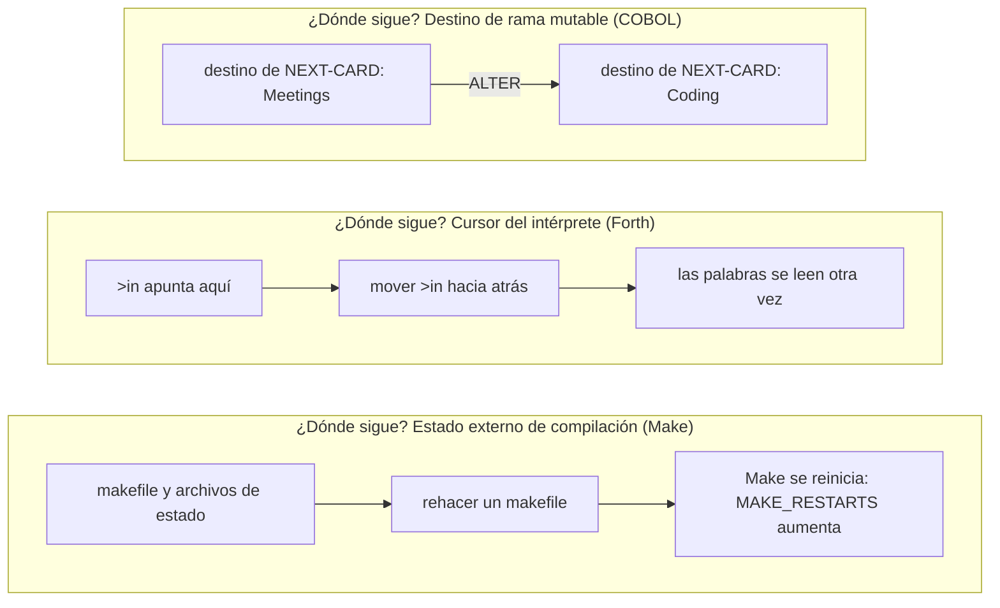
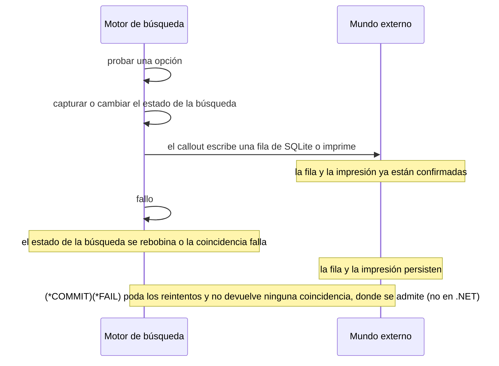
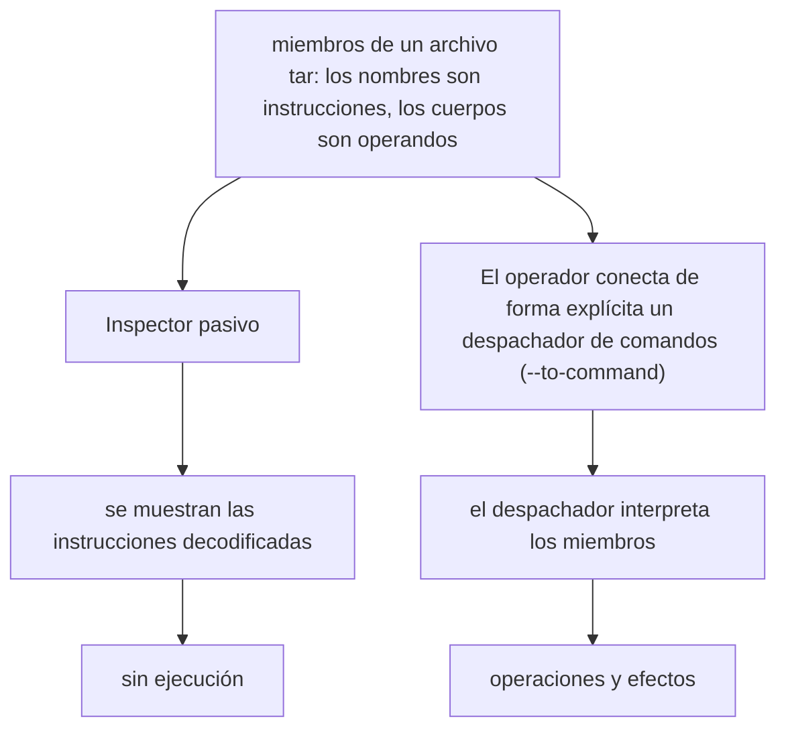

# Por patrón de solución

Las mismas ideas aparecen en lenguajes distintos. Esta página organiza las entradas por *mecanismo*, para los lectores que quieren explorar una forma desconocida de computar en vez de profundizar en un solo lenguaje.

## Lenguajes formales

Un lenguaje formal es una notación con reglas estrictas que una máquina puede procesar. La sorpresa recurrente: una notación creada para un trabajo resulta ser una computadora.

| Lenguaje formal | Para qué servía | En qué se convierte | Entrada |
| --- | --- | --- | --- |
| **RegEx** | Buscar coincidencias en texto | Una máquina de búsqueda con estado y ganchos de entrada y salida ([Perl](lenguajes/regex.md#perl-código-dentro-de-la-coincidencia), [PCRE2](lenguajes/regex.md#pcre2-los-callouts-como-conjunto-de-instrucciones)), un contador ([.NET](lenguajes/regex.md#net-grupos-de-equilibrio)), un sistema de reescritura ([sed](lenguajes/regex.md#gnu-sed)) | `regex-*` |
| **Make** | Ordenar las compilaciones | Un motor de dependencias que se reinicia a sí mismo y así forma un bucle | [`make-gnu`](../src/make-gnu/README.md) |
| **CMake** | Configurar las compilaciones | Una máquina de registros dentro de una condición `while()` | [`cmake`](../src/cmake/README.md) |
| **XAML** | Describir un árbol de interfaz | Un intérprete que ejecuta métodos mientras analiza el texto | [`xaml`](../src/xaml/README.md) |
| **Expresiones de consulta LINQ** | Consultar colecciones | Una canalización de ejecución con etapas perezosas e inmediatas y con fronteras de proveedor | [`LinqChallenge2`](../src/LinqChallenge2/README.md) |
| **m4** | Expandir plantillas de texto | Un bucle: una macro cuyo texto de reemplazo se contiene a sí mismo se lee otra vez | [`m4`](../src/m4/README.md) |
| **Disparadores de SQL** | Reaccionar a un cambio en una tabla | Un bucle recursivo cuya regla de parada es un `WHERE` que no selecciona nada, y un anfitrión para el código de otro lenguaje | [`tcl-weird`](../src/tcl-weird/README.md) |
| **Combinación de métodos de CLOS** | Combinar los métodos que se aplican a una llamada | Un bucle sobre una jerarquía de clases, detenido por `or` | [`lisp-weird`](../src/lisp-weird/README.md) |
| **Reglas de patrón y acción de AWK** | Filtrar y reorganizar registros | Un programa cuyo único bucle es la entrada de datos y cuyos condicionales son la columna de patrones | [`awk-weird`](../src/awk-weird/README.md) |

Qué te llevas:

- **Declarativo no significa inerte.** Una notación que te deja nombrar una función y sus argumentos está a un paso de ser un programa (`ObjectDataProvider`, callouts, `include`).
- **La forma más barata de averiguar qué puede hacer de verdad una notación es darle un trabajo para el que no fue diseñada**, y luego documentar dónde falla: los [problemas de bloqueo](problemas-bloqueantes.md).
- **Los precipicios de rendimiento son semántica.** El pulso de sed *usa* el retroceso catastrófico como reloj; en producción, esa misma propiedad es un bicho de denegación de servicio.

## Map/reduce y otras transformaciones

Varias entradas reemplazan el "bucle con acumulador" por una transformación de una secuencia completa.

| Idea | Dónde | En palabras sencillas |
| --- | --- | --- |
| **Suma acumulada y luego corte** | [Haskell](../src/haskell/timecards.hs#L56-L59) `span ((<= 40) . runningTotal)` sobre `scanl1 (+)` | Construye perezosamente todas las respuestas posibles y elige dónde dejar de leer |
| **Suma acumulada y luego conteo del prefijo** | [APL](../src/apl/timecards.apl#L35) `Drawn↑⍨1++/40≥+\Drawn` | Toma más que suficiente al principio y calcula el prefijo que cabe |
| **Pliegue** | [LINQ `Aggregate`](../src/LinqChallenge1/Program.cs#L45) | Un reduce que lleva el estado a lo largo de la canalización |
| **Cadena de iteradores y clausuras** | [Rust `successors`](../src/RustChallenge1/src/main.rs#L19) | Un generador cuyo "siguiente" es el programa entero |
| **Generador de secuencias** | Kotlin `generateSequence` | La secuencia termina cuando el generador produce null |
| **Reescritura hasta un punto fijo** | [sed](lenguajes/regex.md#gnu-sed) | Aplica sustituciones hasta que ya no se aplique ninguna; el texto final es la respuesta |
| **Reformar y reciclar** | [APL](../src/apl/timecards.apl#L39) `(≢Hours)⍴Categories` | Un módulo que obtienes gratis |
| **Acumular y detenerse en una sola lista de cláusulas** | [Lisp `LOOP`](../src/lisp/timecards.lisp#L42-L46) `sum ... into`, `collect`, `until` | El orden de las cláusulas es el orden de ejecución, así que `until` después de `collect` conserva la tarjeta que cruza el tope |
| **Una lista circular** | [Lector de Lisp `#1=`](../src/lisp-weird/timecards.lisp#L44-L46) | Las categorías se repiten para siempre, sin `mod` |
| **Una canalización de demanda (pull) que pide un valor a la vez** | [JavaScript raro](../src/javascript-weird/timecards.mjs) `Iterator.from(cards(...)).map(...).map(...).toArray()` | Cada valor atraviesa todas las etapas antes de pedir el siguiente. Un `reduce` suma la lista terminada, porque `reduce` no puede detenerse antes |
| **Una clausura que es la máquina de estados** | [JavaScript raro](../src/javascript-weird/core.mjs) `machine` | Una función con variables capturadas: cada llamada produce la tarjeta siguiente y una bandera avisa cuándo termina |
| **Una cadena de escuchadores de eventos** | [Eventos de JavaScript](../src/javascript-events/timecards.mjs) `on('card-created', ...)` | Cada escuchador hace un paso y emite el evento que espera el siguiente. `emit()` es una llamada sobre la pila actual, y `setImmediate()` da un turno al bucle de eventos entre tarjetas |
| **Flujo de registros, una regla por paso** | [AWK `{ t += h = 10 + RT }` ... `t > 40 { exit }`](../src/awk-weird/timecards.awk#L56-L69) | La entrada de datos aporta las iteraciones; cada regla es un paso de la canalización |

```mermaid
flowchart TB
    accTitle: Plegar todo y pedir solo un prefijo suficiente son controles distintos sobre el trabajo
    accDescr: Dos pistas paralelas sobre las mismas tarjetas de horas de 19, 19 y 19 horas, con totales acumulados de 19, 38 y 57. En el pliegue sin restricción, un reduce ordinario procesa todas las tarjetas disponibles y devuelve el acumulador final, y no tiene parada anticipada incorporada. En el flujo limitado por demanda, el consumidor calcula el total siguiente, comprueba el límite de parada, incluye la tarjeta que cruza el tope, cuyo total es 57, y nunca hace una cuarta petición.
    subgraph DEMAND["Flujo limitado por demanda"]
        D1["tarjeta 19: total 19"] --> D2["tarjeta 19: total 38"] --> D3["tarjeta 19: total 57, más de 40: se incluye la tarjeta que cruza el tope"] --> D4["dejar de pedir"] -.-> D5["petición de la tarjeta 4: nunca se hace"]
    end
    subgraph FOLD["Pliegue sin restricción: reduce"]
        F1["tarjeta 19: total 19"] --> F2["tarjeta 19: total 38"] --> F3["tarjeta 19: total 57"] --> F4["todas las tarjetas restantes"] --> F5["acumulador final: sin parada anticipada incorporada"]
    end
    classDef never stroke-dasharray: 5 3
    class D5 never
```

Las dos pistas ven las mismas tres primeras tarjetas. `reduce` no tiene parada anticipada incorporada: procesa todo lo que recibe (el código puede escribir un pliegue propio, o lanzar una excepción, para abortar, pero eso no es un cortocircuito). Un flujo guiado por demanda deja de *pedir*, así que nunca se produce la cuarta tarjeta. `span` de Haskell deja fuera de su prefijo aceptado la tarjeta que cruza el tope, así que el algoritmo completo toma esa tarjeta aparte.

La forma común: *describe la respuesta completa y di cuánto quieres de ella.* (La entrada de JavaScript lo invierte: describe cómo producir *una* respuesta y deja que el consumidor pida tantas como quiera.) Las diferencias son sobre **cuándo** ocurre el trabajo (`Aggregate` inmediato y los arreglos de APL, frente a las listas perezosas de Haskell y `Select` de LINQ) y **dónde** vive el estado. Compara cómo responden LINQ y Haskell a "¿cuándo se ejecuta?" en [C#](lenguajes/csharp-linq-xaml.md#la-ejecución-diferida-y-el-truco-de-convertir-void-en-valor) y [Haskell](lenguajes/haskell.md#la-es-perezosa-como-flujo-de-control).

## El estado de control fuera de las variables

¿Dónde vive "¿en qué parte del programa estoy?" cuando no tienes contador de bucle?

Cada pista guarda "lo que pasa después" en un lugar que no es un contador de bucle: en el destino de un salto, en la posición de un analizador sintáctico o en archivos que lee una herramienta reiniciada. La figura compara *dónde* vive el estado, y la tabla generada de abajo da la lista de los muchos otros lugares. Las páginas de cada lenguaje muestran cada programa completo.

<!-- BEGIN GENERATED control-state -->
| Lugar | Entrada |
| --- | --- |
| Arreglos y nada oculto | [apl](lenguajes/apl.md): [`apl`](../src/apl/README.md) |
| Arreglos y el texto fuente de las funciones | [apl](lenguajes/apl.md#funciones-que-se-modifican-a-sí-mismas-apl-weird): [`apl-weird`](../src/apl-weird/README.md) |
| Arreglos y variables locales de parámetro | [awk](lenguajes/awk.md): [`awk`](../src/awk/README.md) |
| El flujo de entrada de datos y el separador de registros `RS` | [awk](lenguajes/awk.md#registros-a-partir-de-un-flujo-de-bytes-aleatorios-awk-weird): [`awk-weird`](../src/awk-weird/README.md) |
| Campos de un objeto anónimo | [csharp-linq-xaml](lenguajes/csharp-linq-xaml.md#el-original-modernchallenge1): [`ModernChallenge1`](../src/ModernChallenge1/README.md) |
| `CMAKE_MATCH_1`..`5`, reconstruido en cada pasada | [make-cmake](lenguajes/make-cmake.md#cmake): [`cmake`](../src/cmake/README.md) |
| `WS-TOTAL` y su nombre de nivel 88 `OVER-FORTY` | [cobol](lenguajes/cobol.md): [`cobol`](../src/cobol/README.md) |
| El destino de un `GO TO` | [cobol](lenguajes/cobol.md#alter): [`cobol-weird`](../src/cobol-weird/README.md) |
| Variables que posee `LOOP`, como `total` | [lisp](lenguajes/lisp.md): [`lisp`](../src/lisp/README.md) |
| La lista de precedencia de clases y el valor de retorno de cada método | [lisp](lenguajes/lisp.md#combinación-de-métodos-como-flujo-de-control): [`lisp-weird`](../src/lisp-weird/README.md) |
| El búfer del editor: una línea por tarjeta y marcas (x) que se añaden al unir líneas | [editores](lenguajes/editores.md#el-búfer-es-la-máquina): [`ed-weird`](../src/ed-weird/README.md) |
| Las marcas (dónde estamos en una cinta de líneas numeradas), la primera línea del búfer (la siguiente tarjeta) y los registros a, d y n | [editores](lenguajes/editores.md#un-programa-que-puedes-editar): [`ex-weird`](../src/ex-weird/README.md) |
| Las variables `total` y `cards` junto con la pila de datos | [forth](lenguajes/forth.md): [`forth`](../src/forth/README.md) |
| La pila de datos y la posición de análisis `>in` | [forth](lenguajes/forth.md): [`forth-weird`](../src/forth-weird/README.md) |
| El camino desde el directorio de inicio hasta el directorio que se visita; su profundidad es el total acumulado | [find](lenguajes/find.md): [`find-gnu`](../src/find-gnu/README.md) |
| Qué archivos `.tc-N.mk` existen y `MAKE_RESTARTS` | [make-cmake](lenguajes/make-cmake.md#gnu-make): [`make-gnu`](../src/make-gnu/README.md) |
| Una línea de texto, reescrita hasta que ninguna regla se aplique | [regex](lenguajes/regex.md#gnu-sed): [`regex-sed`](../src/regex-sed/README.md) |
| Los miembros del archivo, que son el programa, más una fila de SQLite que indica si la ejecución se detuvo o falló | [tar](lenguajes/tar.md#un-programa-que-es-un-archivo): [`tar-gnu`](../src/tar-gnu/README.md) |
| Una fila de SQLite (los registros de la máquina) y el número de registros que tar ha escrito | [tar](lenguajes/tar.md#el-archivo-es-el-reloj): [`tar-gnu-weird`](../src/tar-gnu-weird/README.md) |
| Campos de una estructura anónima | [csharp-linq-xaml](lenguajes/csharp-linq-xaml.md#las-adaptaciones-de-una-sola-sentencia-mismo-truco-distinta-maquinaria): [`GoChallenge1`](../src/GoChallenge1/README.md) |
| Las partes sin evaluar de las listas, leídas bajo demanda | [haskell](lenguajes/haskell.md): [`haskell`](../src/haskell/README.md) |
| Thunks: qué partes de una lista se han demandado | [haskell](lenguajes/haskell.md#la-es-perezosa-como-flujo-de-control): [`haskell-weird`](../src/haskell-weird/README.md) |
| Campos de una clase anónima | [csharp-linq-xaml](lenguajes/csharp-linq-xaml.md#las-adaptaciones-de-una-sola-sentencia-mismo-truco-distinta-maquinaria): [`JavaChallenge1`](../src/JavaChallenge1/README.md) |
| Propiedades de un objeto literal | [javascript](lenguajes/javascript.md#el-for-sin-cuerpo-en-node): [`javascript`](../src/javascript/README.md) |
| El total acumulado y el número de tarjetas, guardados en un objeto que solo tocan los escuchadores de eventos | [javascript](lenguajes/javascript.md#escuchadores-de-eventos-hasta-el-fondo): [`javascript-events`](../src/javascript-events/README.md) |
| Variables capturadas por clausuras: el número del generador; de la máquina, la cantidad de tarjetas, el total y la bandera de parada | [javascript](lenguajes/javascript.md#clausuras-hasta-el-fondo): [`javascript-weird`](../src/javascript-weird/README.md) |
| Propiedades de una expresión de objeto, la semilla de la secuencia | [csharp-linq-xaml](lenguajes/csharp-linq-xaml.md#las-adaptaciones-de-una-sola-sentencia-mismo-truco-distinta-maquinaria): [`KotlinChallenge1`](../src/KotlinChallenge1/README.md) |
| Dentro de los enumeradores de las etapas y en la base de datos | [csharp-linq-xaml](lenguajes/csharp-linq-xaml.md#la-ejecución-diferida-y-el-truco-de-convertir-void-en-valor): [`LinqChallenge1`](../src/LinqChallenge1/README.md) |
| Una suma acumulada hasta el día actual recalculada en cada `where`, y la base de datos; sin variable acumuladora | [csharp-linq-xaml](lenguajes/csharp-linq-xaml.md#la-ejecución-diferida-y-el-truco-de-convertir-void-en-valor): [`LinqChallenge2`](../src/LinqChallenge2/README.md) |
| El flujo de entrada de datos: todo el texto de macros sin leer | [m4](lenguajes/m4.md#un-bucle-hecho-de-reescaneo): [`m4`](../src/m4/README.md) |
| Una struct de C que nunca retrocede | [regex](lenguajes/regex.md#pcre2-los-callouts-como-conjunto-de-instrucciones): [`regex-pcre2`](../src/regex-pcre2/README.md) |
| Filas de SQLite y el código de salida de cada callout | [regex](lenguajes/regex.md#pcre2grep-códigos-de-salida-como-flujo-de-control): [`regex-pcre2grep`](../src/regex-pcre2grep/README.md) |
| Variables `local` que se deshacen (los efectos no) | [regex](lenguajes/regex.md#perl-código-dentro-de-la-coincidencia): [`regex-perl`](../src/regex-perl/README.md) |
| La ruta desde el directorio de inicio hasta el directorio que se visita | [find](lenguajes/find.md): [`find-posix`](../src/find-posix/README.md) |
| Atributos de un objeto de estado que se pasa a la lambda | [csharp-linq-xaml](lenguajes/csharp-linq-xaml.md#las-adaptaciones-de-una-sola-sentencia-mismo-truco-distinta-maquinaria): [`PythonChallenge1`](../src/PythonChallenge1/README.md) |
| Pilas de captura con grupos de equilibrio | [regex](lenguajes/regex.md#net-grupos-de-equilibrio): [`regex-dotnet`](../src/regex-dotnet/README.md) |
| Un nuevo `DemoBatch` inmutable en cada paso; nada se muta | [csharp-linq-xaml](lenguajes/csharp-linq-xaml.md#las-adaptaciones-de-una-sola-sentencia-mismo-truco-distinta-maquinaria): [`RustChallenge1`](../src/RustChallenge1/README.md) |
| Diccionarios y variables Tcl que se guardan en un solo `db transaction` | [tcl](lenguajes/tcl.md): [`tcl`](../src/tcl/README.md) |
| Una tabla TEMP con el código fuente de los procedimientos y la profundidad de la recursión de los disparadores | [tcl](lenguajes/tcl.md#sqlite-como-programa): [`tcl-weird`](../src/tcl-weird/README.md) |
| El orden del documento y los arreglos "portadores" | [csharp-linq-xaml](lenguajes/csharp-linq-xaml.md#xaml): [`xaml`](../src/xaml/README.md) |
<!-- END GENERATED control-state -->

Un lector que llega por uno se encuentra con los demás. Ese es el punto.

## Retroceso, efectos secundarios y manejo de errores

### El retroceso como programa

Un motor de retroceso prueba una opción y, si fallan los pasos siguientes, vuelve atrás y prueba otra. Las entradas le dan la vuelta: *haz el trabajo en efectos secundarios y luego falla a propósito.*

- **Perl, PCRE2 y pcre2grep** ejecutan toda la demostración dentro de una sola coincidencia y terminan con `(*COMMIT)(*FAIL)`, de modo que la coincidencia devuelve falso después de escribir cada fila.
- **Lo que sobrevive a una rama fallida es toda la lección.** Las variables `local` de Perl se deshacen; sus `INSERT` y `print` no. La estructura C de PCRE2 no se rebobina nunca. Las sentencias de `pcre2grep` ya se confirmaron. **.NET** no puede hacerlo: un `Match` fallido descarta las capturas, así que esa entrada *debe* devolver verdadero.
- **`(*COMMIT)`** impide que el motor reintente bucles más cortos, lo que ejecutaría el finalizador más de una vez.

El motor puede abandonar una rama y rebobinar su propio estado. Una fila que un callout ya confirmó, o una línea que ya imprimió, se queda. Cuánto estado del *motor* se rebobina depende del motor: las variables `local` de Perl se deshacen, la estructura C externa de PCRE2 no, y .NET descarta las capturas de un `Match` fallido. El par `(*COMMIT)(*FAIL)` existe solo en los motores que lo admiten.

### Efectos secundarios en canalizaciones

LINQ, Haskell y XAML ponen un efecto dentro de algo que parece una descripción pura. La regla que se desprende: **si un efecto vive en una estructura perezosa, quien lee la estructura decide si el efecto ocurre y cuándo.** `evaluate (length cards)` de Haskell y el `Aggregate` final de LINQ son ambos "fuérzalo ahora".

### Los errores como flujo de control

| Técnica | Entrada |
| --- | --- |
| Una violación de restricción *es* la regla de parada: se dispara `CHECK(ok=1)` y se anuncia el error con nombre | [Make](../src/make-gnu/README.md), [CMake](../src/cmake/README.md), [pcre2grep](../src/regex-pcre2grep/README.md) |
| El desbordamiento aritmético *es* la regla de parada: `ON SIZE ERROR` | [COBOL](lenguajes/cobol.md#alter) |
| El código de salida de un programa dirige la coincidencia | [pcre2grep](lenguajes/regex.md#pcre2grep-códigos-de-salida-como-flujo-de-control) |
| Un proceso sale con 1 a propósito, y el envoltorio lo vuelve a convertir en 0 | [sed](lenguajes/regex.md#gnu-sed) |
| Un programa desbocado lo detiene un tiempo límite, no un error | [`apl-weird`](lenguajes/apl.md#funciones-que-se-modifican-a-sí-mismas-apl-weird) y [m4](lenguajes/m4.md) cuando falta una comilla |
| Un valor de retorno corta una cadena de métodos (`or`) | [Lisp raro](lenguajes/lisp.md#combinación-de-métodos-como-flujo-de-control) |
| Un patrón deja de coincidir y un `exit` termina el bucle | [AWK raro](lenguajes/awk.md#registros-a-partir-de-un-flujo-de-bytes-aleatorios-awk-weird) |
| Un `INSERT ... SELECT ... WHERE` que no selecciona nada termina un disparador recursivo | [Tcl raro](lenguajes/tcl.md#sqlite-como-programa) |
| Una guarda ausente no falla: cuenta una tarjeta fantasma (`RT` vacío) o ninguna tarjeta (mawk) | [AWK raro](lenguajes/awk.md#haz-esto-en-producción-y-estás-despedido) |
| Un código de fallo inesperado *no* es "sin coincidencia" a propósito (`PCRE2_ERROR_CALLOUT`, no `-1`) | [PCRE2](lenguajes/regex.md#pcre2-los-callouts-como-conjunto-de-instrucciones) |

Fíjate en que **`CHECK(demo_only=1)` aparece en casi todas las entradas**: una tabla que hace irrepresentable una fila que no sea de demostración, y que cada `check.sh` intenta violar. Eso es manejo de errores usado como *garantía* y no como flujo de control, y es un patrón que vale la pena conservar.

## Programas guardados como datos

Cuatro entradas guardan su programa en un lugar que no es un archivo fuente. Cada una es una respuesta distinta a "¿qué está escrito y qué lo lee?" Consulta el [capítulo comparativo](informatica/09-casos-de-estudio-comparativos.md#cómo-se-escribe-un-programa-se-vuelve-a-leer-y-se-ejecuta) para ver la promesa de ida y vuelta que hace cada una.

Los mismos bytes pueden leerse sin ejecutar nada, y un `tar -xf` ordinario solo escribe archivos. El archivo no puede conectar su propio gancho de ejecución. Lo conecta el operador. Las otras filas de la tabla son distintas: el `unknown` de Tcl puede traer código fuente y evaluarlo, Ex puede ejecutar texto de un registro, y `⎕CR` y `⎕FX` de APL pueden reescribir una función y definir la copia.

| Dónde está escrito el programa | Qué lo lee y le da significado | Entrada |
| --- | --- | --- |
| Los miembros de un archivo tar: los nombres son instrucciones y los cuerpos son operandos | GNU tar los recorre, y un despachador que conectó el *operador* les da significado (un inspector pasivo lee los mismos bytes y no ejecuta nada) | [`tar-gnu`](../src/tar-gnu/README.md), [tar](lenguajes/tar.md#un-programa-que-es-un-archivo) |
| La estructura de un archivo: cuántos registros escribe tar | Los puntos de control de tar son un reloj, y una máquina de estados da un paso por cada tic | [`tar-gnu-weird`](../src/tar-gnu-weird/README.md), [tar](lenguajes/tar.md#el-archivo-es-el-reloj) |
| Filas de una tabla de SQLite | Un `unknown` sobrescrito trae código fuente de Tcl y lo evalúa | [`tcl-weird`](../src/tcl-weird/README.md), [Tcl](lenguajes/tcl.md#sqlite-como-programa) |
| Una línea de texto en un búfer del editor, copiada a un registro | Ex ejecuta el registro, y el programa lee su instrucción siguiente de una cinta de líneas | [`ex-weird`](../src/ex-weird/README.md), [editores](lenguajes/editores.md#un-programa-que-puedes-editar) |
| El texto fuente de una función | `⎕CR` lo escribe, la función lo reescribe y `⎕FX` define la copia | [`apl-weird`](../src/apl-weird/README.md), [APL](lenguajes/apl.md#funciones-que-se-modifican-a-sí-mismas-apl-weird) |

La pregunta que los separa: *¿puedes leer el programa sin ejecutarlo?* En `tar-gnu` puedes, con el inspector, porque extraer un archivo tar no ejecuta nada. En `tcl-weird` y `ex-weird` leer y ejecutar son el mismo acto, así que no hay una forma segura de mirar salvo leer el texto tú mismo.

## Lee a continuación

[Problemas superados](problemas-superados.md), [problemas de bloqueo](problemas-bloqueantes.md), [ejercicios](exercises.md).
