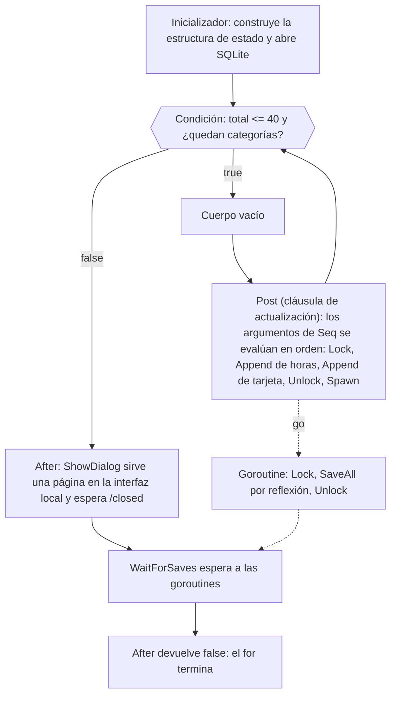

# Una sola sentencia, edición Go

Adaptación a Go, hecha por Ken, del reto en C# de Jim Lehmer. Es una de las cuatro adaptaciones hermanas, junto con [Java](../JavaChallenge1/README.md), [Kotlin](../KotlinChallenge1/README.md) y [Python](../PythonChallenge1/README.md). El README de Java explica [qué hacen todas las versiones](../JavaChallenge1/README.md#qué-hacen-todas-las-versiones) y tiene la [tabla comparativa](../JavaChallenge1/README.md#lado-a-lado) de las cuatro.

La restricción: `main` contiene exactamente una sentencia, un bucle `for` con el cuerpo vacío. Esto es una acrobacia sobre la mecánica de las expresiones, no un buen código de producción. Nada de aquí se conecta con un sistema real de registro de horas: las tarjetas están marcadas con `is_demo`.

## Ejecútalo

Necesitas la cadena de herramientas de Go (`winget install GoLang.Go`). La primera ejecución descarga un módulo.

```powershell
cd src\GoChallenge1
go run .
```

O, desde la raíz del repositorio, con Gradle: `.\gradlew.bat runGo`.

La ventana es una página en tu navegador predeterminado. Haz clic en Close en la página, o cierra la pestaña, para terminar. Los registros se guardan en `src/GoChallenge1/data/demo-timecards.db`; la ruta es relativa al directorio de trabajo, así que ejecuta el programa desde este directorio. Elimina `data` para empezar de nuevo.

Si un IDE en ejecución no detecta `go` después de instalarlo, reinicia el IDE para que tome el nuevo PATH.

## Ejecútalo en un contenedor

Requisito previo: Docker, configurado una sola vez como se describe en [`SANDBOX-SETUP.md`](../../SANDBOX-SETUP.md#docker).

```bash
sandbox/container/run-image.sh src/GoChallenge1
```

El script hace la compilación de la imagen a partir del [`Dockerfile`](Dockerfile) de esta carpeta y ejecuta el resultado sin red, con un sistema de archivos de solo lectura y con el usuario `nobody`. Después muestra la salida y una vista de solo lectura de las filas que escribió. La imagen contiene un binario estático de Go, sqlite3 (para el paso de inspección) y un `wget` diminuto. No tiene la cadena de herramientas de Go. Necesita `--online-build` (`sandbox/container/run-image.sh --online-build src/GoChallenge1`) porque la compilación descarga el módulo de SQLite. La ejecución en sí no tiene red. La página que el programa sirve en `127.0.0.1` se obtiene desde *dentro* del contenedor con `wget`, se guarda como `page.html` y luego se "cierra", así que la página se sirve sin publicar el puerto en tu máquina.

## Ejecútalo en Windows Sandbox

Requisitos previos: Windows Sandbox y la cadena de herramientas de esta entrada, instalados en tu máquina y configurados una sola vez como se describe en [`SANDBOX-SETUP.md`](../../SANDBOX-SETUP.md#windows-sandbox).

```powershell
sandbox\windows\run.ps1 src\GoChallenge1
```

Ejecuta la entrada en una máquina virtual desechable con la red desactivada, captura la ventana, le pide que se cierre e imprime lo que guardó. La página se abre en Edge dentro de la máquina virtual, y el arnés también la solicita por la interfaz local (*loopback*) y la guarda. **Aún no se ha probado en hardware real.**

## Estructura

| Archivo | Papel |
| --- | --- |
| [main.go](main.go) | `main` y su única sentencia |
| [helpers.go](helpers.go) | La entidad, el repositorio y las funciones auxiliares de expresiones |
| `go.mod`, `go.sum` | Definición del módulo |

Igual que en el original, la entidad y el tipo de acceso a datos quedan fuera de `main`. Go también necesita allí pequeñas funciones auxiliares (se explican más abajo).

## Flujo del programa



**Qué muestra:** `for` en Go tiene las mismas tres cláusulas que el original en C#, pero Go solo permite sentencias simples ahí. Por eso el trabajo pasa a funciones auxiliares, y `Seq(...)` recibe sus argumentos, que se evalúan en orden, en lugar de usar la lista separada por comas. Las aristas punteadas son la parte concurrente: cada pasada inicia una goroutine, y el programa debe esperar a todas antes de terminar.

**Por qué importa este mecanismo:** el bucle termina por su condición, no por un `break`. Con `||`, la rama falsa (el operando derecho, que se evalúa si la primera parte de la condición es falsa) hace el trabajo final (mostrar la página, esperar los guardados) y luego devuelve `false`. La ventana es una página del navegador, porque Go no tiene una biblioteca estándar para interfaces gráficas.

## Cómo funciona el truco

El trabajo se divide en tres partes: un **inicializador** que construye el estado del bucle, una **condición** que decide si se sigue adelante (y, en la última comprobación, muestra la ventana) y una **actualización** que hace una pasada de trabajo. Unos comentarios destacados en el código fuente marcan los límites entre cláusulas.

Go es el más estricto: en un `for`, la inicialización y la actualización permiten solo sentencias simples, y Go no tiene operador ternario, ni expresión con coma, ni sentencias dentro de expresiones. El bucle sigue siendo un `for i := &struct{...}{...}; condition; post { }` real de tres partes, separadas por los mismos dos puntos y coma de la adaptación a Java.

- **Inicializador.** `i := &struct{...}{...}`. Una estructura anónima guarda el estado: el fragmento de CSS, las horas, el usuario, el repositorio, las tarjetas preparadas, las categorías y un mutex.
- **Condición.** `total <= 40 && len(categories) > 0 || After(false, ShowDialog(...), WaitForSaves())`. El `||` cumple el papel del operador ternario: cuando el bucle debe terminar, la primera parte de la condición es falsa y se evalúa el operando derecho, que muestra la página, espera los guardados y da como resultado `false`.
- **Actualización.** Una sola llamada, `Seq(...)`, cuyos argumentos se evalúan de izquierda a derecha. Go evalúa en orden las llamadas a función de una lista de argumentos, así que `Seq` ocupa el lugar de la lista separada por comas: `Lock`, `Append` de horas, `Append` de una tarjeta, `Unlock`, `Spawn`.
- **El precio.** Toda operación que necesita una sentencia (`Lock`, `Append`, `Pop`, `Spawn`, `ShowDialog`) se adapta como una función pequeña que devuelve un valor, en `helpers.go`. El cuerpo de la goroutine es una sola llamada a `Seq(...)`.
- **Ventana.** Go no tiene una GUI en su biblioteca estándar, así que `ShowDialog` sirve una página en un puerto de la interfaz local y la abre en el navegador predeterminado. El pulso es un fragmento de animación CSS, igual que el original tenía un fragmento de animación. La página envía una solicitud POST a `/closed` cuando haces clic en Close o sales de ella, y eso desbloquea el bucle.
- **Guardado.** El controlador es `modernc.org/sqlite`, un controlador escrito íntegramente en Go que no necesita compilador de C. `MethodByName` de `reflect` llama a `SaveAll`. `WaitForSaves` evita que el proceso termine antes de que las goroutines acaben.

## Trampas que conviene conocer

- **Las funciones auxiliares son el precio.** Go no permite sentencias dentro de expresiones, así que cada operación que existe solo como sentencia (`Lock`, `Append`, `Pop`, `Spawn`, `ShowDialog`) se adapta como una pequeña función en `helpers.go`. Ese es el costo declarado de esta versión.
- **La ventana es una página web.** Go no tiene una interfaz gráfica (GUI) en su biblioteca estándar, así que el programa sirve una página en un puerto de la interfaz local y abre tu navegador predeterminado. Haz clic en Close en la página, o cierra la pestaña, para terminar.
- **Ejecútalo desde este directorio.** La ruta de los datos es relativa al directorio de trabajo.
- **La compilación del contenedor necesita red.** Se necesita `--online-build` porque la compilación descarga el módulo de SQLite. La ejecución en sí no tiene red.
- **El perfil de Windows Sandbox aún no se ha probado en hardware real,** y esta adaptación no tiene script de comprobación, así que la verificación automatizada del entorno aislado (*sandbox*, que limita el acceso al sistema anfitrión) todavía no la cubre.
