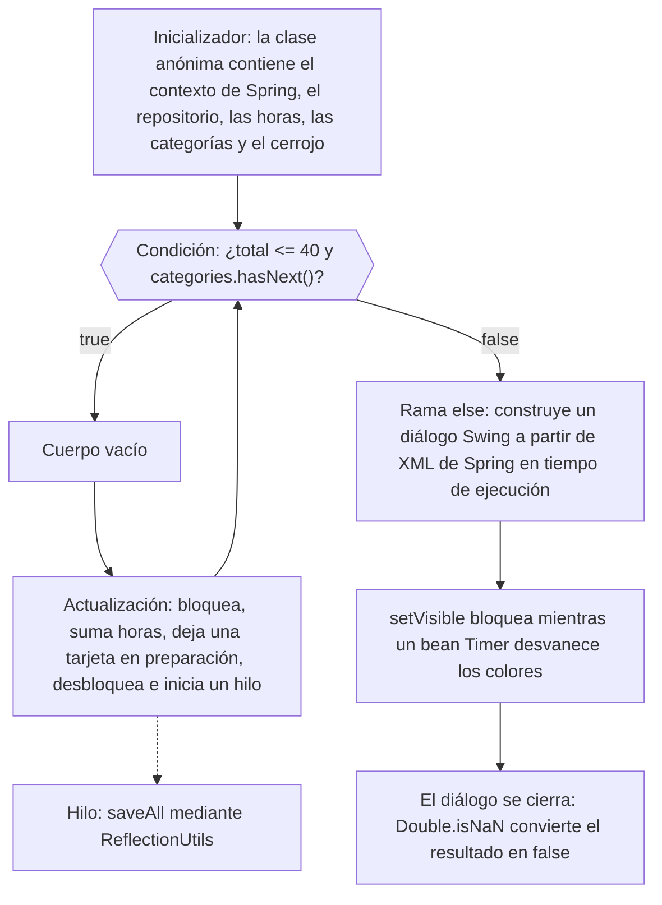

# Una sola sentencia, edición Java

Adaptación a Java del reto en C# de Jim Lehmer, hecha por Ken. Es una de las cuatro adaptaciones hermanas, junto con [Kotlin](../KotlinChallenge1/README.md), [Python](../PythonChallenge1/README.md) y [Go](../GoChallenge1/README.md), escritas para poder comparar los lenguajes. Este README también contiene la [comparación lado a lado](#lado-a-lado) de las cuatro.

La restricción: `main` contiene exactamente una sentencia, un bucle `for` con el cuerpo vacío. La cabecera del bucle hace todo el trabajo. Esto es una acrobacia con la mecánica de las expresiones. No es un patrón de arquitectura y no es buen código de producción.

## Qué hacen todas las versiones

Las cuatro versiones hacen lo mismo, en el mismo orden:

1. El programa abre una base de datos SQLite local (`demo-timecards.db`) y crea una tabla `time_cards` si no existe.
2. Después entra en un bucle. Cada pasada suma de 10 a 19 horas aleatorias, prepara una tarjeta de horas inventada con la siguiente categoría (Meetings, Coding, Debugging, Learning) e inicia un hilo en segundo plano que guarda las tarjetas preparadas.
3. El bucle se detiene cuando el total pasa de 40 o cuando se acaban las categorías. Hay cinco nombres de categoría (Meetings se repite), así que un total de exactamente 40 después de cuatro tarjetas continúa con una quinta. Son de tres a cinco pasadas.
4. Luego muestra una ventana que dice **DEMO ONLY** con el total de horas simuladas. La ventana parpadea suavemente (se desvanece y reaparece) hasta que la cierres.
5. Por último, espera a que terminen los guardados y después sale.

Las tarjetas se marcan como `is_demo`. Nada de esto se conecta con un sistema real de registro de horas. Borra la carpeta `data` para empezar de nuevo; git la ignora.

## Ejecútalo

Necesitas el JDK 25. Gradle Wrapper hace el resto. Ejecútalo desde una sesión de escritorio:

```powershell
cd src\JavaChallenge1
.\gradlew.bat runJava
```

Desde la raíz del repositorio, el mismo nombre de tarea funciona sin el `cd`: `.\gradlew.bat runJava`.

`bootRun` ejecuta el mismo programa. La ventana es un cuadro de diálogo de Swing. Los registros se guardan en `src/JavaChallenge1/data/demo-timecards.db`. La ruta de datos es relativa al directorio de trabajo, que las tareas de ejecución de Gradle fijan en este directorio. Si ejecutas el JAR desde otro lugar, `data` se crea allí.

## Ejecútalo en un contenedor

Requisito previo: Docker, configurado una sola vez como se describe en [`SANDBOX-SETUP.md`](../../SANDBOX-SETUP.md#docker).

```bash
sandbox/container/run-image.sh --online-build --out ./results src/JavaChallenge1
```

El script hace la compilación de la imagen a partir del [`Dockerfile`](Dockerfile) de esta carpeta y ejecuta el resultado sin red, con un sistema de archivos de solo lectura y con el usuario `nobody`. Gradle y OpenJDK 25 compilan un JAR de Spring Boot en una etapa de compilación; la imagen incluye solo ese JAR y un entorno JRE de OpenJDK 25 con AWT, Xvfb y una herramienta de captura de pantalla, sin JDK ni Gradle (unos 760 MB, la más grande del conjunto). La ventana se abre en una pantalla virtual (Xvfb) *dentro* del contenedor, así que no se dibuja nada en tu escritorio: la ejecución captura la ventana, la cierra e imprime las filas que escribió. Con `--out`, `results/screenshot.png` es la ventana. Se necesita `--online-build` porque la compilación descarga Gradle (desde el Gradle Wrapper de esta entrada) y las dependencias de Maven; la ejecución en sí no tiene red.

## Ejecútalo en Windows Sandbox

Requisitos previos: Windows Sandbox (un entorno aislado, o *sandbox*, donde se ejecuta código sin tocar el resto del sistema) y la cadena de herramientas de esta entrada en tu máquina, configuradas una sola vez como se describe en [`SANDBOX-SETUP.md`](../../SANDBOX-SETUP.md#windows-sandbox).

```powershell
sandbox\windows\run.ps1 src\JavaChallenge1
```

Ejecuta la entrada en una máquina virtual desechable sin red, captura la ventana, le pide que se cierre e imprime lo que guardó. **Aún no está probado en hardware real**; necesita un JDK y un directorio de usuario de Gradle (*Gradle home*) ya poblado en el anfitrión.

## Estructura

| Archivo | Papel |
| --- | --- |
| [Program.java](src/main/java/challenge1/javaversion/Program.java) | `main` y su única sentencia |
| `DemoTimeCard.java` | La entidad |
| `DemoTimeCardRepository.java` | El repositorio de Spring Data |

Como en el original, la entidad y el tipo de acceso a datos son el único código fuera de `main`.

## Flujo del programa



**Qué muestra:** el `for (init; condition; update) { }` literal de tres cláusulas. La condición decide entre "vuelve a dar otra vuelta" y "muestra la ventana y luego devuelve false". La ventana se construye a partir de definiciones de beans de Spring en XML cuando se necesita, y el diálogo modal bloquea la llamada hasta que el usuario lo cierra.

**Por qué importa este mecanismo:** esta entrada mantiene el flujo de control en el `for` y coloca la llamada bloqueante de un framework (un diálogo modal con su propio manejo de eventos) dentro de la condición. La arista punteada lleva al hilo del guardado en segundo plano del original, torpe a propósito.

## Cómo funciona el truco

Cada versión divide el trabajo en tres partes: un **inicializador** que construye el estado del bucle, una **condición** que decide si el bucle sigue (y, en la última comprobación, muestra la ventana) y una **actualización** que hace una pasada de trabajo. Unos comentarios destacados en el código fuente marcan los límites entre cláusulas.

Java usa la forma original literal: `for (init; condition; update) { }`, con los dos puntos y coma que separan las cláusulas.

- **Inicializador.** `var i = new Object() { ... }`. Una clase anónima es el contenedor del estado, porque el inicializador de `for` permite solo una declaración. `var` conserva el tipo anónimo para que sus campos sigan siendo accesibles. Campos: el contexto de Spring Boot, el repositorio, la lista de horas, un iterador de categorías, un cerrojo y un fragmento de XML.
- **Condición.** `total <= 40 && categories.hasNext() ? true : (BooleanSupplier) () -> ...`. Cuando el bucle debe terminar, la rama else construye la ventana, la muestra y convierte el resultado en `false` con `Double.isNaN(int)`, el truco del original.
- **Actualización.** La actualización es una lista separada por comas: bloquear, sumar horas, preparar una tarjeta, desbloquear y, por último, `new Thread(...).start()`.
- **Varios pasos en una expresión.** Encadénalos: `Stream.of(x).peek(...).peek(...)`.
- **Ventana.** La ventana es un `JDialog` de Swing, descrito por definiciones de beans XML de Spring que se construyen en tiempo de ejecución (`GenericXmlApplicationContext` sobre una cadena de texto). Un bean `javax.swing.Timer` desvanece los colores de las etiquetas. El diálogo modal bloquea la ejecución hasta que se cierra.
- **Guardado.** El programa guarda con Spring Data JPA `saveAll`, invocado a través del `ReflectionUtils` de Spring.

## Trampas que conviene conocer

- **Ejecútalo desde el lugar correcto.** La ruta de datos es relativa al directorio de trabajo, que las tareas de ejecución de Gradle fijan en este directorio. Si ejecutas el JAR desde otro lugar, `data` se crea allí.
- **La imagen de contenedor es la más grande del conjunto** (unos 760 MB), y se necesita `--online-build` porque la compilación descarga Gradle y las dependencias de Maven. La ejecución en sí no tiene red.
- **El perfil de Windows Sandbox aún no está probado en hardware real.** Necesita un JDK y un directorio de usuario de Gradle ya poblado en el anfitrión. Esta adaptación no tiene un script de verificación. Por eso, la verificación automatizada del entorno aislado aún no la cubre.

## Lado a lado

| | Java | Kotlin | Python | Go |
| --- | --- | --- | --- | --- |
| La única sentencia | `for (init; cond; update) {}` | `for (pass in generateSequence(seed) {...}) {}` | `for _ in iter(step, False): ...` | `for init; cond; post {}` |
| `for` real de tres partes | Sí | No | No | Sí |
| Contenedor de estado | Clase anónima en un `var` | `object { }` como semilla | `SimpleNamespace` | Estructura anónima |
| Condición | Expresión `? :` | `takeIf { if ... else ... }` | Expresión condicional | `a && b \|\| After(false, ...)` |
| Actualización (varios pasos) | Expresiones separadas por comas | Cadena de `?.also { }` | Tupla, `[-1]` | Llamada a `Seq(...)` |
| Terminar el bucle | La condición devuelve `false` | `takeIf` produce null | `step` devuelve el valor centinela `False` | La condición devuelve `false` |
| Cuerpo vacío | `{ }` | `{ }` | `...` | `{ }` |
| Ventana | Swing desde XML de Spring | Swing desde XML de Spring | Tk desde XML de ElementTree | Página del navegador en la interfaz local |
| Pulso | `javax.swing.Timer` | `javax.swing.Timer` | Temporizador `after()` de Tk | Animación CSS |
| Bloquea hasta que se cierre | `JDialog` modal | `JDialog` modal | `mainloop()` | Espera a `/closed` |
| Base de datos | Spring Data JPA, Hibernate, SQLite | Igual | `sqlite3` de la biblioteca estándar | `modernc.org/sqlite` |
| Guardado en segundo plano | `Thread` | `Thread` | `threading.Thread` | Goroutine con `Spawn` |
| Bloqueo | `ReentrantLock` | `ReentrantLock` | `threading.RLock` | `sync.Mutex` |
| "Reflexión" | Spring `ReflectionUtils` | Spring `ReflectionUtils` | `getattr` | `reflect.MethodByName` |
| Código fuera de `main` | Entidad, repositorio | Entidad, repositorio | Entidad, repositorio | Entidad, repositorio y funciones auxiliares |
| Instalación adicional | JDK 25 | JDK 25 | Ninguna | Cadena de herramientas de Go |

## Qué cambió respecto a la versión de .NET

| Versión de .NET | Java y Kotlin | Python | Go |
| --- | --- | --- | --- |
| Objeto anónimo como estado del iterador | Clase anónima o expresión de objeto | `SimpleNamespace` | Estructura anónima |
| EF Core `DbContext` y SQLite | Spring Data JPA, Hibernate y SQLite | `sqlite3` | `modernc.org/sqlite` |
| `TimeCards.Add` y después `SaveChanges` | Una lista `pending` y después `saveAll` | Una lista `pending` y después `save_all` | Un slice `pending` y después `SaveAll` |
| Ventana WPF desde `XamlReader.Load` a partir de una cadena de texto XAML en tiempo de ejecución | Ventana Swing desde `GenericXmlApplicationContext` a partir de una cadena de texto XML de Spring en tiempo de ejecución | Ventana Tk desde una cadena de texto XML mediante `ElementTree` | Página HTML construida a partir de una cadena de texto y mostrada en el navegador |
| `XElement` que contiene un `DoubleAnimation` | Fragmento XML que contiene un bean `Timer` | Fragmento XML que contiene el intervalo del temporizador | Fragmento CSS `@keyframes` |
| Animación de opacidad en el `Viewbox` | Temporizador que desvanece los colores de las etiquetas | Temporizador que mezcla los colores de las etiquetas | Animación de opacidad con CSS |
| `Application.Run` bloquea hasta que se cierra la ventana | `JDialog.setVisible(true)` modal | `Tk.mainloop()` | Espera la solicitud `/closed` de la página |
| LINQ to Objects `Sum` | `Stream` `sum` o `sum()` | `sum(...)` | Una función `Sum` pequeña |
| Archivo SQLite en `%LOCALAPPDATA%` | `data/` en la carpeta de la entrada | `data/` en la carpeta de la entrada | `data/` en la carpeta de la entrada |
| Con el nombre `Mutex` | `ReentrantLock` | `threading.RLock` | `sync.Mutex` |
| `MethodInfo.Invoke` | Spring `ReflectionUtils.invokeMethod` | `getattr` | `reflect` `MethodByName` |
| `Random.Shared` | `ThreadLocalRandom.current()` | `random.Random()` | `math/rand/v2` |
| `ISOWeek.GetWeekOfYear` | `IsoFields.WEEK_OF_WEEK_BASED_YEAR` | `date.isocalendar().week` | `time.ISOWeek()` |
| `Environment.UserName` | `System.getProperty("user.name")` | `getpass.getuser()` | variable de entorno `USERNAME` o `USER` |

## Del XAML original al marcado de cada adaptación

La versión de .NET construye su ventana a partir de una cadena de texto XAML en tiempo de ejecución con `XamlReader.Load`. XAML solo se ejecuta en .NET, así que cada adaptación construye su interfaz de usuario a partir de una cadena de texto de marcado distinta en tiempo de ejecución:

- **Java y Kotlin** usan XML estándar de beans de Spring. Spring suele usarlo para conectar servicios y aquí crea widgets de Swing.
- **Python** usa un formato XML inventado. Cada etiqueta lleva el nombre de una clase de tkinter (`<Tk>`, `<Label>`) y `getattr(tkinter, tag)` crea el widget.
- **Go** usa HTML y CSS simples, que el navegador renderiza.

| Elemento de la interfaz | XAML original (C#) | Java / Kotlin (XML de Spring) | Python (XML personalizado) | Go (HTML/CSS) |
| --- | --- | --- | --- | --- |
| Raíz del marcado | `<Viewbox>` con espacios de nombres de WPF | `<beans>` con espacios de nombres de Spring | `<ui>` (sirve cualquier nombre) | Página `<!doctype html>` |
| La ventana | Se crea en C#; el XAML se convierte en su `Content` | `<bean id="window" class="javax.swing.JDialog">` | `<Tk id="window" .../>` | La ventana del navegador |
| Título de la ventana | Se define en código C# | `<property name="title" .../>` | Atributo `title="..."` | `<title>...</title>` |
| Tamaño | `Width='520' Height='320'` en el Viewbox | propiedad `size`, `Dimension(520, 320)` | Sin definir (se ajusta al contenido) | Sin definir (lo decide el navegador) |
| Contenedor de diseño | `<Grid>` con dos `RowDefinition` | `<bean id="panel" class="javax.swing.JPanel">` con `BorderLayout` | Ninguno: cada etiqueta se apila con `pack="..."` | `<body>` con `text-align:center` |
| Color de fondo | `Background='#172033'` en el Grid | propiedad `background`, `#172033` | `bg="#172033"` en cada elemento | estilo `background:#172033` |
| Relleno y márgenes | `Margin='10'`, `Margin='28,24,28,0'`, `Margin='28'` | `createEmptyBorder(24, 28, 40, 28)` en el panel | `pack="fill=x,padx=28,pady=24"` | `padding:48px` |
| Texto del banner amarillo | `<TextBlock Foreground='#FFCE56' FontSize='18' FontWeight='Bold' .../>` | `<bean id="banner" class="javax.swing.JLabel">`, `#FFCE56`, SansSerif negrita 18 | `<Label id="banner" fg="#FFCE56" font="Helvetica 18 bold" .../>` | `<h2 style="color:#FFCE56">` |
| Texto del total de horas | Segundo `<TextBlock Grid.Row='1' FontSize='24' Foreground='White' .../>` | `<bean id="total" class="javax.swing.JLabel">`, blanco, negrita 24 | `<Label id="total" fg="#FFFFFF" font="Helvetica 24 bold" .../>` | `<h1>` |
| Texto "Saved locally" | El mismo TextBlock que el total, después de dos saltos de línea (`&#x0a;&#x0a;`) | `<bean id="saved" class="javax.swing.JLabel">` independiente, negrita 18 | `<Label id="saved" .../>` independiente, negrita 18 | `<h3>` independiente |
| Texto centrado | `TextAlignment='Center'` | Propiedad `horizontalAlignment`, `0` (centro) | `pack="fill=x"` (las etiquetas se centran por defecto) | `text-align:center` |
| Colocar los elementos hijos en el diseño | Anidar dentro de `<Grid>`, más `Grid.Row` | `MethodInvokingBean` que llama a `panel.add(label, "North" / "Center" / "South")` | Atributo `parent="window"` | Anidar dentro de `<body>` |
| Botón de cierre | Ninguno (la X de la ventana) | Ninguno (la X de la ventana) | Ninguno (la X de la ventana) | `<button onclick="done()">Close</button>` |
| Fragmento de animación, construido por separado e insertado | `XElement` que contiene `<DoubleAnimation From="1" To="0.45" Duration="0:0:1.2" AutoReverse="True" RepeatBehavior="Forever" .../>` | `xmlAnim` cadena de texto que contiene `<bean id="anim" class="javax.swing.Timer">`, con un intervalo de 40 ms | `xml_anim` cadena de texto que contiene `<timer interval="40"/>` | `animCSS` cadena de texto que contiene `@keyframes pulse { from { opacity: 1 } to { opacity: .45 } }` |
| Qué inicia la animación | `<EventTrigger RoutedEvent='FrameworkElement.Loaded'>` y un `<Storyboard>`, todo en el marcado | `init-method="start"` en el XML; el código Java atenúa las etiquetas tras cada intervalo | El código Python lee `interval` y programa los intervalos con `after()` | `animation: pulse 1.2s ease-in-out infinite alternate`, todo en CSS |
| Qué se desvanece | El `Opacity` de todo el Viewbox | El color del texto de cada etiqueta, con alfa de 100 % a 45 % | El color de cada etiqueta, mezclado con el fondo | La opacidad de `h1`, `h2` y `h3` |

El XAML y el CSS de Go describen la animación completa en el marcado. Swing y Tk no pueden declarar una animación en el marcado, así que en Java, Kotlin y Python el marcado solo declara un temporizador y el código fuera del marcado hace el desvanecimiento.
