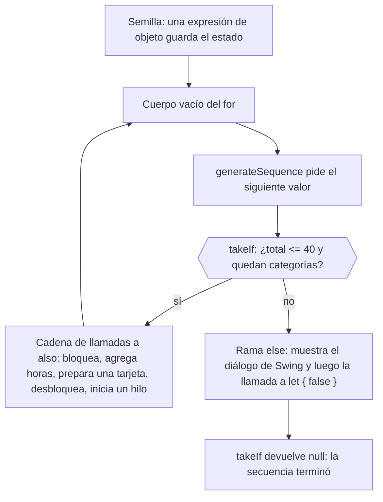

# Una sola sentencia, edición Kotlin

Esta es la adaptación a Kotlin que hizo Ken del reto en C# de Jim Lehmer. Es una de las cuatro adaptaciones hermanas, junto con [Java](../JavaChallenge1/README.md), [Python](../PythonChallenge1/README.md) y [Go](../GoChallenge1/README.md). El README de Java explica [qué hace cada versión](../JavaChallenge1/README.md#qué-hacen-todas-las-versiones) y tiene la [comparación lado a lado](../JavaChallenge1/README.md#lado-a-lado) de las cuatro.

La restricción: `main` contiene exactamente una sentencia, un bucle `for` con el cuerpo vacío. Esto es una acrobacia con la mecánica de las expresiones. No es buen código de producción. Nada de esto se conecta con un sistema real de registro de horas: las tarjetas están marcadas como `is_demo`.

## Ejecútalo

Necesitas el JDK 25. Gradle Wrapper hace el resto. Ejecútalo desde una sesión de escritorio:

```powershell
cd src\KotlinChallenge1
.\gradlew.bat runKotlin
```

Desde la raíz del repositorio, el mismo nombre de tarea funciona sin `cd`: `.\gradlew.bat runKotlin`.

`bootRun` ejecuta el mismo programa. La ventana es un diálogo de Swing. Los registros se guardan en `src/KotlinChallenge1/data/demo-timecards.db`; elimina `data` para empezar de nuevo. La ruta de los datos es relativa al directorio de trabajo, que las tareas de ejecución de Gradle fijan en esta carpeta.

## Ejecútalo en un contenedor

Requisito previo: Docker, configurado una sola vez como se describe en [`SANDBOX-SETUP.md`](../../SANDBOX-SETUP.md#docker).

```bash
sandbox/container/run-image.sh --online-build --out ./results src/KotlinChallenge1
```

El script hace la compilación de la imagen a partir del [`Dockerfile`](Dockerfile) de esta carpeta y ejecuta el resultado sin red, con un sistema de archivos de solo lectura y con el usuario `nobody`. Gradle y OpenJDK 25 compilan un solo JAR de Spring Boot en una etapa de compilación. La imagen incluye solo ese JAR y un entorno JRE de OpenJDK 25 con AWT, Xvfb y una herramienta de captura de pantalla, sin JDK, sin Gradle y sin compilador de Kotlin (unos 770 MB, la más grande del conjunto). La ventana se abre en una pantalla virtual (Xvfb) *dentro* del contenedor, así que no se dibuja nada en tu escritorio: la ejecución toma una captura de la ventana, la cierra e imprime las filas que escribió. Con `--out`, `results/screenshot.png` es la ventana. Se necesita `--online-build` porque la compilación descarga Gradle (desde el Gradle Wrapper de esta entrada) y las dependencias de Maven. La ejecución en sí no tiene red.

## Ejecútalo en Windows Sandbox

Requisitos previos: Windows Sandbox (un entorno aislado, o *sandbox*, que limita el acceso al sistema anfitrión) y la cadena de herramientas de esta entrada en tu máquina, configuradas una sola vez como se describe en [`SANDBOX-SETUP.md`](../../SANDBOX-SETUP.md#windows-sandbox).

```powershell
sandbox\windows\run.ps1 src\KotlinChallenge1
```

Ejecuta la entrada en una máquina virtual desechable sin red, captura la ventana, le pide que se cierre e imprime lo que guardó. **Aún no está probado en hardware real**; necesita un JDK y un directorio de usuario de Gradle (*Gradle home*) ya poblado en el anfitrión.

## Estructura

| Archivo | Papel |
| --- | --- |
| [Program.kt](src/main/kotlin/challenge1/kotlinversion/Program.kt) | `main` y su única sentencia |
| `DemoTimeCard.kt` | La entidad |
| `DemoTimeCardRepository.kt` | El repositorio de Spring Data |

Como en el original, la entidad y el tipo de acceso a datos son el único código fuera de `main`.

## Flujo del programa



**Qué muestra:** Kotlin no tiene un `for` de tres cláusulas, así que el bucle recorre una secuencia. La condición es `takeIf` y "detenerse" es un `null`. La actualización es la cadena de llamadas a `?.also { ... }` que se ejecuta solo cuando la condición se cumple. El cuerpo se ejecuta una vez antes de la primera prueba, lo que aquí no cambia nada porque el cuerpo está vacío.

**Por qué importa este mecanismo:** son los mismos tres trabajos que en la adaptación de Java (inicializar, probar, actualizar), pero los hace una secuencia perezosa de la que se toma un valor a la vez. Terminar la secuencia es un valor (`null`), no una sentencia.

## Cómo funciona el truco

El trabajo se divide en tres partes: un **inicializador** que construye el estado del bucle, una **condición** que decide si el bucle sigue (y, en la última comprobación, muestra la ventana) y una **actualización** que hace una pasada de trabajo. Los comentarios destacados del código fuente marcan los límites entre cláusulas.

Kotlin no tiene un `for` de tres partes ni puntos y comas, así que el bucle recorre una secuencia: `for (pass in generateSequence(seed) { ... }) { }`.

- **Inicializador.** Una expresión `object { ... }` es la semilla de la secuencia.
- **Condición.** `takeIf { if ... else ... }`. Un resultado null termina la secuencia. Cuando el bucle tiene que terminar, la rama else muestra la ventana y acaba con `.let { false }`, así que `takeIf` devuelve null.
- **Actualización.** La actualización es una cadena de llamadas a `?.also { ... }`.
- **Varios pasos en una expresión.** Encadénalos: `x.also { ... }.also { ... }`.
- **Ventana y guardado.** Los mismos Swing, Spring XML y Spring Data JPA que en la versión en Java. El XML es una sola cadena de texto sin procesar con plantillas `${...}`, en lugar de bloques de texto unidos.
- **Una diferencia de comportamiento.** El cuerpo del bucle de Kotlin se ejecuta una vez antes de la primera comprobación de la condición. Java comprueba primero. El cuerpo está vacío, así que los dos programas hacen las mismas cosas en el mismo orden.

## Trampas que conviene conocer

- **El cuerpo del bucle se ejecuta una vez antes de la primera comprobación de la condición.** Java comprueba primero. El cuerpo está vacío, así que los dos programas hacen las mismas cosas en el mismo orden.
- **Ejecuta el programa desde el lugar correcto.** La ruta de los datos es relativa al directorio de trabajo, y las tareas de ejecución de Gradle fijan ese directorio en esta carpeta.
- **La imagen de contenedor es la más grande del conjunto** (unos 770 MB), y se necesita `--online-build` porque la compilación descarga Gradle y las dependencias de Maven. La ejecución en sí no tiene red.
- **El perfil de Windows Sandbox aún no se ha probado en hardware real.** Necesita un JDK y un directorio de usuario de Gradle ya poblado en el anfitrión. Esta adaptación no tiene un script de verificación, así que la verificación automatizada del entorno aislado aún no la cubre.
