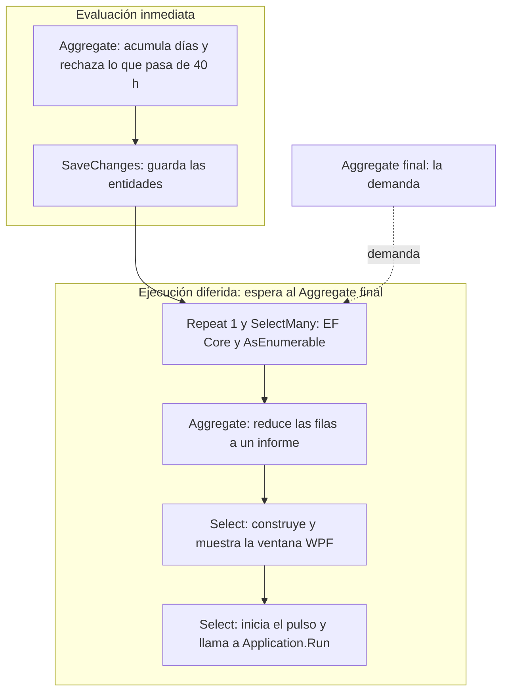

# Reto de LINQ, variante A: una sola sentencia con una cadena fluida de métodos

**Te enseña:** que una cadena de métodos de LINQ puede expresar el programa completo.

> **No es el reto compartido.** Esta entrada no genera horas al azar: su semana laboral tiene cinco días fijos de 8 horas, con un tope para que el total sea exactamente 40.0 horas y ninguna tarjeta cruce la línea. Enseña la ejecución diferida y las cadenas de métodos de LINQ, no la regla de parada "conserva la primera tarjeta que pasa de 40".

Una sola sentencia de expresión terminada en `;`, construida por completo con llamadas a métodos LINQ. Genera una tarjeta de horas fija de 40 horas, la rastrea y la guarda con EF Core y SQLite, cruza la frontera `IQueryable<T>` → `IEnumerable<T>`, y construye, muestra, hace palpitar y cierra una ventana de terminal WPF **DEMO ONLY** - todo dentro de esa sola sentencia. Ninguna función auxiliar al estilo de `RunEverything` hace el trabajo real; `Main` solo prepara el hilo STA, el `DbContext` y el `Application` antes de llamarla.

## Ejecútalo

Necesitas Windows y el SDK de .NET 10.

```powershell
cd src\LinqChallenge1
dotnet restore
dotnet run
```

Aparece una ventana pequeña con estilo de terminal, palpita tres veces y se cierra sola; después, el proceso termina por su cuenta. Los registros se guardan en `%LOCALAPPDATA%\LinqChallenge1\timecards.db`; elimina ese archivo para empezar de cero. Las filas de cada ejecución se etiquetan con un `RunId` nuevo, así que el informe de la ventana siempre muestra solo las 40.0h de esa ejecución. El archivo conserva el historial de todas las ejecuciones, como las demás entradas de este repositorio.

```powershell
.\check.ps1    # build, structural check, one end-to-end run against a throwaway DB
```

## Ejecútalo en Windows Sandbox

Requisitos previos: Windows Sandbox (un entorno aislado, o *sandbox*, que limita el acceso al sistema anfitrión) y la cadena de herramientas de esta entrada en tu máquina. Configura ambos una sola vez como se describe en [`SANDBOX-SETUP.md`](../../SANDBOX-SETUP.md#windows-sandbox).

```powershell
sandbox\windows\run.ps1 src\LinqChallenge1
```

Ejecuta la entrada en una máquina virtual (VM) desechable con la red desactivada, hace una captura de pantalla de la ventana, le pide que se cierre e imprime lo que guardó. Esta entrada tiene un `check.ps1`, así que el script ejecuta ese archivo.

## Flujo del programa



**Qué muestra:** todo el programa es una sola expresión, así que el orden del trabajo es el orden de *evaluación*. El `Aggregate` interno es inmediato y se ejecuta primero. Todo lo que viene después es una cadena perezosa de etapas `LINQ`, y el último `Aggregate` es lo que hace que se ejecuten. La arista punteada es demanda, no datos.

**Por qué importa este mecanismo:** esta es la diferencia entre una consulta como descripción y una consulta como ejecución. `Enumerable.Repeat(…, 1)` convierte un valor en una secuencia de un elemento para que cada etapa pueda seguir siendo un operador `LINQ` real. Cada llamada a un método que devuelve `void` se envuelve para que devuelva un valor, como explica el truco de `void` a valor (una sección de este README).

## Cómo funciona el truco

La semana fija de trabajo (`WorkWeek`, cinco días de 8 horas: Planning / Implementation / Review / Testing / Documentation, es decir, planificación, implementación, revisión, pruebas y documentación) y la sentencia del reto están en [`Program.cs`](Program.cs). Si la sigues de arriba abajo, la sentencia única es:

| Etapa | Operador LINQ | Qué hace |
| --- | --- | --- |
| 1 | `Aggregate` | Incorpora los días fijos en entidades `TimecardEntry` rastreadas. Rechaza cualquier día que haría pasar de 40 h el total acumulado. Es de evaluación inmediata, así que se ejecuta primero. |
| - | tupla `(…, ctx.SaveChanges())` | Los elementos de la tupla se evalúan de izquierda a derecha. Por eso `SaveChanges()` solo se ejecuta después de que todas las entidades de arriba estén rastreadas. |
| 2 | `Enumerable.Repeat(…, 1).SelectMany` | Pasa de la reducción en memoria al `IQueryable<T>` de EF Core (`Where`/`OrderBy`/`Select`: todos traducibles a SQL) y vuelve de forma explícita con `AsEnumerable()`. La secuencia externa tiene exactamente un elemento, así que la consulta se ejecuta exactamente una vez. |
| 3 | `Aggregate` | De vuelta en LINQ to Objects: reduce las filas persistidas a un informe (`Lines`, `Total`). |
| 4 | `Enumerable.Repeat(…, 1).Select` | Construye, da estilo y muestra la ventana WPF, en línea. |
| 5 | `.Select` | Inicia un pulso finito (`DoubleAnimation`, `AutoReverse`, tres repeticiones) y luego llama a `Application.Run()` para mantener en marcha el despachador de WPF hasta que el manejador de finalización cierre la ventana y termine la aplicación. |
| final | `.Aggregate(0, …)` | Obliga a que todas las etapas diferidas (de la 2 a la 5) se ejecuten de verdad. |

## El truco de `void` a valor

WPF y EF Core están llenos de métodos `void` (`Add`, `Show`, `BeginAnimation`, `Close`, `Shutdown`) y una cadena LINQ solo tiene espacio para valores. Cada efecto secundario de arriba está dentro de un `new Func<T>(() => { sideEffect(); return value; }).Invoke()` en línea, que se invoca de inmediato justo donde la cadena necesita su valor de retorno. Es un compromiso deliberado, no una recomendación: el código normal simplemente escribiría una sentencia.

## Por qué dos llamadas `Enumerable.Repeat(…, 1)` anidadas

C# solo permite unas pocas formas de expresión como sentencia de expresión en el nivel superior: invocación, creación de objeto, asignación, incremento/decremento, `await`. No permite una expresión `&&` o `is` arbitraria. Eso excluye enlazar etapas intermedias a una variable local creada con un patrón (`x is var report && …`) en el nivel superior: la sentencia debe *terminar* en una invocación. Por eso el programa no da nombre al resultado de la reducción ni al informe. En su lugar, cada uno se anida directamente como argumento del siguiente `Enumerable.Repeat(…, 1)`. Esa llamada convierte un único valor calculado otra vez en una secuencia de un elemento. Así, la siguiente etapa puede seguir siendo un operador LINQ genuino (`SelectMany`, `Select`) y no una simple llamada a un método. Toda la sentencia es un único árbol de expresiones muy anidado, cuya llamada más externa es `.Aggregate(…)`: una invocación, que está permitida.

## Qué impone `check.ps1`

`check.ps1` primero verifica que ninguna función auxiliar de orquestación oculte el flujo de trabajo: `RunEverything`, `BuildAndPersistCards`, `ShowTerminal`, `DoChallenge` y `Orchestrate` no deben aparecer en `Program.cs`. Después compila el proyecto y lo ejecuta con una carpeta de datos desechable, con un tiempo límite estricto de 15 segundos por si el despachador se atasca. El programa debe terminar con código 0 e imprimir `PERSISTED 5 rows, total=40.0h`. Las cinco filas (de 2024-01-01 a 2024-01-05, 8.0h cada una, de Planning a Documentation) deben aparecer en el informe y `timecards.db` debe existir.

## Trampas que conviene conocer

- `SaveChanges()` se llama una sola vez, de forma inmediata, en el punto en que la llamada externa a `Enumerable.Repeat(…, 1)` evalúa su argumento, antes de que empiece a enumerar cualquiera de las etapas diferidas de LINQ-to-Objects/EF. Eso sigue estando dentro de la misma sentencia. Solo que no se difiere hasta que el `Aggregate` final recorre la secuencia, como sí ocurre con las etapas `Select`/`SelectMany`. `Aggregate` es, por definición, un operador LINQ de evaluación inmediata, así que aquí cierta evaluación inmediata es inevitable.
- El estado del acumulador en ambas llamadas a `Aggregate` se modifica directamente (`list.Add(...)`) en lugar de reconstruirse de forma inmutable. Esto refleja el atajo de mutación que toma el `ModernChallenge1` original con `i.totalHours.Add(...)`. Se señala aquí por la misma razón: es un atajo pragmático, no una afirmación de pureza de LINQ.
- Se llama a `Application.Run()` (sin argumento de ventana) desde dentro de una lambda pasada a `.Select`. Eso es lo que realmente procesa los mensajes del despachador de WPF, de modo que la ventana se dibuja y la animación avanza. `ShutdownMode` se establece en `OnExplicitShutdown` para que el manejador `Completed` de la animación, y no una regla implícita de "última ventana cerrada", decida cuándo termina la aplicación (y `Run()`).
- Las llamadas a `Console.WriteLine` dentro de la etapa de creación de la ventana existen únicamente para que `check.ps1` pueda verificar el informe de los datos guardados a partir de la salida estándar, sin necesitar una herramienta de línea de comandos de SQLite en la máquina de pruebas.

Consulta [el README raíz](../../README.md#the-results-so-far) para ver cómo se compara esto con las otras entradas de una sola sentencia, y [`src/LinqChallenge2`](../LinqChallenge2/README.md) para la variante de la misma idea con expresión de consulta.
