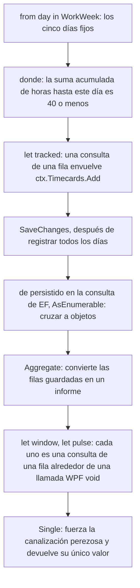

# Reto de LINQ, variante B: una sola sentencia de expresión de consulta similar a SQL

**Te enseña:** que la sintaxis de consulta de C# puede expresar el cálculo y ordenar sus efectos.

> **No es el reto compartido.** Como la Variante A, esta entrada no sortea horas aleatorias: su semana laboral son cinco días fijos de 8 horas, con un tope que deja el total en exactamente 40.0 horas y evita que alguna tarjeta cruce la línea. Enseña ejecución diferida y sintaxis de consulta, no la regla de parada "conserva la primera tarjeta que pasa de 40".

La misma demo que [`src/LinqChallenge1`](../LinqChallenge1/README.md): una tarjeta de horas fija de 40 horas, registrada y guardada con EF Core y SQLite, que cruza el límite `IQueryable<T>` → `IEnumerable<T>`, y una ventana de terminal WPF **DEMO ONLY** que se muestra, pulsa y se cierra sola. Pero está escrita de modo que casi todos los componentes, no solo la etapa principal que da forma a los datos, se expresan como una expresión de consulta de C# (`from` / `where` / `let` / `select`). Cuando un `let` debe convertir en un valor una llamada de WPF/EF que devuelve `void`, el contenedor en línea `Func<T>.Invoke()` queda anidado dentro de una consulta desechable de una sola fila. Tortugas hasta el fondo, a propósito.

## Ejecútalo

Necesitas Windows y el SDK de .NET 10.

```powershell
cd src\LinqChallenge2
dotnet restore
dotnet run
```

Mismo comportamiento que la variante A: aparece una ventana con estilo de terminal, pulsa tres veces y se cierra sola; el proceso termina por sí mismo. Los registros se guardan en `%LOCALAPPDATA%\LinqChallenge2\timecards.db`.

```powershell
.\check.ps1    # build, structural check (genuine query syntax at every layer), one end-to-end run
```

## Ejecútalo en Windows Sandbox

Requisitos previos: Windows Sandbox (un entorno aislado, *sandbox*, donde ejecutas programas sin afectar el resto de tu sistema) y la cadena de herramientas de esta entrada en tu máquina, configurados una sola vez como se describe en [`SANDBOX-SETUP.md`](../../SANDBOX-SETUP.md#windows-sandbox).

```powershell
sandbox\windows\run.ps1 src\LinqChallenge2
```

Ejecuta la entrada en una máquina virtual (VM) desechable con la red desactivada, captura una imagen de la ventana, le pide que se cierre e imprime lo que guardó. Esta entrada tiene un `check.ps1`, así que eso es lo que se ejecuta.

## Flujo del programa



**Qué muestra:** la misma ruta de datos que [`LinqChallenge1`](../LinqChallenge1/README.md), escrita con sintaxis de consulta. La cláusula `where` es la regla de parada: recalcula una suma de prefijos para cada día en lugar de mantener un total acumulado en una variable. Nada se ejecuta hasta el `Single()` final.

**Por qué importa este mecanismo:** la sintaxis de consultas es solo una forma de escribir llamadas a métodos. El compilador convierte `where`, `let` y `select` en las mismas llamadas a `Where`, `Select` y `SelectMany`, así que el motor de ejecución no cambia. La consulta de una sola fila que rodea cada llamada a `void` es una broma que demuestra hasta dónde llega la sintaxis.

## Cómo funciona el truco

La sintaxis de consultas de C# es azúcar sintáctico (una forma más amable de escribir lo mismo) sobre las mismas llamadas `Select`/`SelectMany`/`Where` que la Variante A usa directamente. No es un motor de ejecución distinto. [`Program.cs`](Program.cs) lleva ese azúcar tan lejos como se puede: en dos lugares principales y, de paso, en todo lo demás:

**Los dos lugares donde la sintaxis de consulta realmente sostiene el viaje de ida y vuelta de EF Core:**

```csharp
from day in WorkWeek                                   // FROM the real five-row work week
where (from d in WorkWeek.Take(Array.IndexOf(WorkWeek, day) + 1) select d.Hours).Sum() <= MaxWeeklyHours
let tracked = /* ctx.Timecards.Add(...), wrapped to return the entity */
select tracked
```

cierra la semana con una cláusula `where` que recalcula el total acumulado como una suma de prefijos - sin acumulador mutable - y

```csharp
from persisted in
    (
        from e in ctx.Timecards
        where e.RunId == runId
        orderby e.WorkDate
        select new { e.WorkDate, e.Hours, e.Description }
    ).AsEnumerable()
```

es una segunda cláusula `from` genuina que cruza el límite `IQueryable<T>` → `IEnumerable<T>` - exactamente la forma que pide el propio boceto del plan ("`from persisted item in DbContext.Timecards ...`"). La consulta interna no sustituye a una cadena fluida de `Where`/`OrderBy`/`Select`. El compilador convierte `where`/`orderby`/`select` en exactamente esas llamadas, así que el proveedor de SQLite de EF Core la traduce igual que traduciría la versión fluida. `AsEnumerable()` sigue siendo la única pieza que ninguna palabra clave de consulta reemplaza. Sigue siendo una llamada final, como `ToList`/`Sum`/`Single` en otras partes, y marca el límite de forma explícita.

**En todos los demás sitios, solo por diversión:** cada `let` que necesita recibir un valor de una llamada `void` de WPF/EF (`tracked`, `saved`, `line`, `window`, `pulse`) envuelve su `new Func<T>(() => {...}).Invoke()` dentro de su propia consulta `from _x in Enumerable.Repeat(0, 1) select ....Invoke()` de una fila y luego llama a `.Single()` para extraer el valor. La unión de texto de la ventana (`string.Join("\n", from l in r.Lines select l)`) es la misma idea aplicada a código que no la necesitaba en absoluto. Nada de esto hace que el programa sea más correcto; todo ello demuestra que la sintaxis de consultas *puede* llegar a casi todos los rincones, cuando dejas de preguntarte si debería.

Todo el conjunto consiste en dos expresiones de consulta anidadas, que terminan en una sola llamada a `.Single()`. Esa llamada fuerza la ejecución de la canalización perezosa y, a la vez, extrae el único valor que la pseudofila exterior siempre iba a producir. La segunda consulta entrega el informe único, ya plegado, a los `let` de ventana/pulso. Hace falta porque `Aggregate` - plegar muchas filas persistidas en un solo informe - no tiene palabra clave en la sintaxis de consulta, así que tiene que ocurrir como una llamada a método final en medio.

## Restricción importante del lenguaje

Tres cosas de este archivo no pueden ser sintaxis de consulta, porque el lenguaje simplemente no tiene una palabra clave para ellas, y un comentario señala cada una donde aparece:

- **`Aggregate`**: reducir N filas persistidas a un solo informe de `(Lines, Total)`. No existe una cláusula de consulta `fold`/`reduce`.
- **`Enumerable.Repeat` / `.Take` / `.Sum` / `.ToList` / `.Single`** - todos los lugares donde un valor necesita convertirse en una secuencia de una fila, limitarse, sumarse, forzarse o extraerse de nuevo. La sintaxis de consulta se reduce a estas mismas llamadas; nunca las reemplaza.
- **`ctx.Timecards.Add(...)`, `window.Show()`, `app.Run()`, `window.BeginAnimation(...)`, `app.Shutdown()`** - los efectos secundarios reales de WPF/EF Core. Ninguna sintaxis, ya sea de consulta o fluida, convierte un método `void` en una expresión. Para eso sirve cada envoltorio `Func<T>.Invoke()` en línea, con o sin una consulta desechable alrededor.

## Qué impone `check.ps1`

`check.ps1` hace lo mismo que la verificación de la variante A (sin ayudante de orquestación, una compilación limpia, una ejecución contra una carpeta desechable con un tiempo límite de 15 segundos, el informe de 5 filas con 40.0h y el archivo de la base de datos). También verifica que la sintaxis de consultas sea real. `Program.cs` debe contener una expresión `from day in WorkWeek ... where ... let tracked ... select tracked` genuina. También debe contener una segunda consulta, `from persisted in (from e in ctx.Timecards ... orderby e.WorkDate ...)`, y ninguna cadena fluida de `ctx.Timecards.Where(` ni de `.OrderBy(e =>`. Por último, debe tener al menos ocho cláusulas `from ... in`, contando las consultas desechables de una fila.

## Trampas que conviene conocer

- Las consultas incrustadas de una sola fila alrededor de `tracked`, `saved`, `line`, `window`, `pulse`, el paso de plegado `Lines` y la unión de texto de la ventana son gratuitos. Quitar cualquiera de ellos y llamar directamente a la expresión envuelta se comportaría igual y se leería con más claridad. Existen porque el reto pidió la máxima perversidad deliberada - "el pensamiento retorcido es buen pensamiento" - y no porque mejoren el código. En cambio, `where`/`orderby`/`select` de la fase EF no es gratuito: reemplazó una cadena fluida real de `Where`/`OrderBy`/`Select` que hacía un trabajo real.
- Aquí se aplican el mismo tope de la suma de prefijos y las mismas advertencias sobre mutación en el lugar que en el borrador anterior; consulta el [README de la Variante A](../LinqChallenge1/README.md#trampas-que-conviene-conocer) para las que se comparten (el momento de ejecución inmediata de `SaveChanges()` y la mutación de la lista en el lugar dentro de `Aggregate`).
- Las llamadas a `Console.WriteLine` dentro de `window` `let` existen solo para que `check.ps1` pueda verificar el informe guardado a partir de stdout.

Consulta [el README raíz](../../README.md#the-results-so-far) para ver cómo se compara con las otras entradas de una sola instrucción, y [`src/LinqChallenge1`](../LinqChallenge1/README.md) para la variante de cadena fluida de la misma idea.
