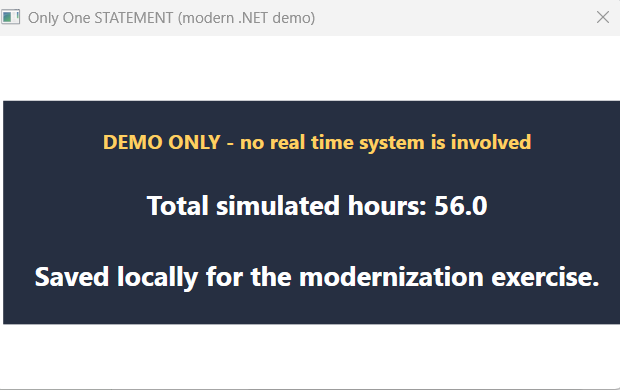
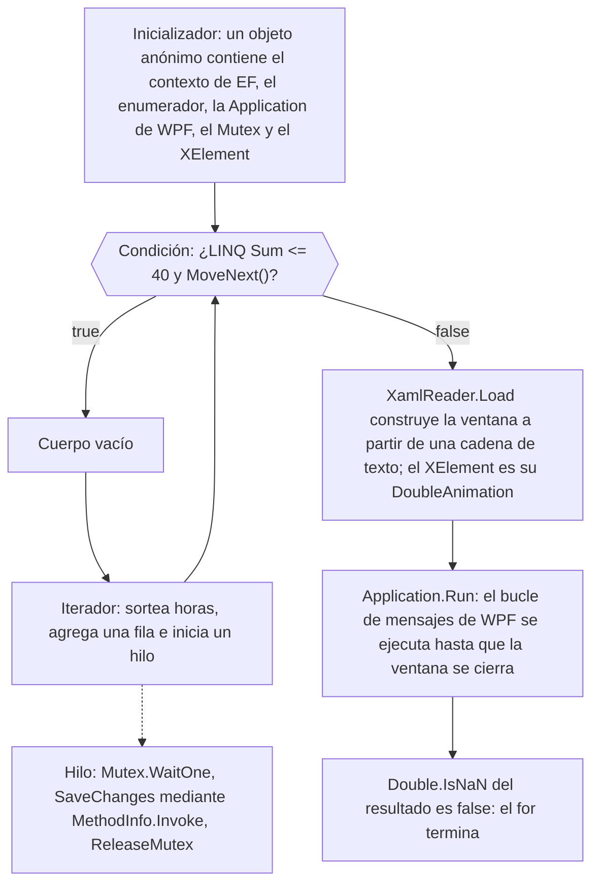

# Reto de C#: el original (modernizado)

**Te enseña:** que una instrucción `for` sin cuerpo puede controlar XAML en tiempo de ejecución, LINQ to Objects, EF Core y la animación de WPF.

Aquí empezó todo: un ejercicio de clase de 2008, mantenido vivo y reconstruido para el .NET actual. La regla es una sola instrucción de C#. `Main` contiene exactamente un bucle `for`, y el cuerpo de ese bucle está vacío (`{ /* Intentionally empty. */ }`). Todo el comportamiento - los sorteos aleatorios, el total acumulado, el guardado en la base de datos, la ventana, la animación - tiene que ocurrir dentro de las tres cláusulas del bucle, separadas por `;`: inicializador, condición, iterador.

## Ejecútalo

Necesitas Windows y el SDK de .NET 10 (WPF solo funciona en Windows).

```powershell
cd src\ModernChallenge1
dotnet restore
dotnet run
```

La ventana dice **DEMO ONLY** a propósito. Los registros van a un archivo SQLite local bajo `%LOCALAPPDATA%\ModernChallenge1`; el programa nunca se comunica con un sistema real de registro de horas.



## Ejecútalo en Windows Sandbox

Requisitos previos: Windows Sandbox y la cadena de herramientas de esta entrada en tu máquina, configuradas una sola vez como se describe en [`SANDBOX-SETUP.md`](../../SANDBOX-SETUP.md#windows-sandbox).

```powershell
sandbox\windows\run.ps1 src\ModernChallenge1
```

Ejecuta la entrada en una VM desechable con la red desactivada, toma una captura de la ventana, le pide que se cierre e imprime lo que guardó. Usa `-Seconds 30` para dejar la animación en pantalla más tiempo.

## Flujo del programa



**Qué muestra:** el truco original. Una instrucción `for` con el cuerpo vacío, en la que la condición y el iterador hacen todo el trabajo. Mientras el total no pasa de 40, la condición es verdadera. Cuando no es así, la condición crea y muestra la ventana, y la llamada bloqueante de la ventana devuelve el `false` que termina el bucle.

**Por qué importa este mecanismo:** `Application.Run` es el propio bucle de un framework de interfaz de usuario, iniciado desde dentro de la condición de un bucle. La animación desvanece la ventana por sí sola: nada en `Program.cs` se suscribe a un evento para hacerlo. Consulta [`xaml`](../xaml/README.md) para ver con más rigor qué hace ese análisis sintáctico en tiempo de ejecución.

## Cómo funciona el truco

Abre [`Program.cs`](Program.cs) y busca los dos comentarios con flecha:

```text
      *                  *
     *                  *
;    <- first semicolon *
      *                  *
```

Todo lo que hay entre esos dos puntos y coma es la sentencia `for`. Léelo como tres cláusulas:

| Cláusula | Tarea |
| --- | --- |
| **Inicializador** | Un solo `var i = new { ... }` construye todo el estado que necesita el bucle (el contexto de SQLite, la fuente de números aleatorios, un enumerador de categorías, el `Application` de WPF, un `Mutex` y un `XElement` que pasará a formar parte de un `DoubleAnimation`) como campos de un único objeto anónimo. Un inicializador de `for` permite una sola declaración, incluso cuando el bucle necesita siete tipos de estado: el objeto anónimo es el único contenedor legal. |
| **Condición** | `(from hours in i.totalHours select hours).Sum() <= 40d && i.categories!.MoveNext()`. Mientras el total acumulado no pase de 40 y quede todavía una categoría por repartir, la condición es `true` y el bucle se repite. Cuando se agota cualquiera de las dos, la condición construye y muestra en su lugar la ventana de resultado, en línea. La lista de categorías tiene cinco nombres (`Meetings` se repite), así que cuatro tarjetas de 10 horas, un total de exactamente 40, van seguidas de una quinta tarjeta en lugar de terminar la ejecución. (El original de 2008 tenía cuatro nombres y se detenía ahí.) La ventana es el *valor* que habría devuelto la comparación: `Double.IsNaN(i.app.Run(...))`. Está envuelta en `Func<bool>` para que pueda ir donde se espera `bool`. |
| **Iterator** | Sortea una cantidad aleatoria de horas, agrega una fila nueva de tarjeta de horas al contexto de EF Core e inicia un `Thread` en segundo plano que llama a `Mutex.WaitOne`, `SaveChanges` y `Mutex.ReleaseMutex` - no directamente, sino a través de `MethodInfo.Invoke`. La reflexión y el hilo no aportan nada útil; están aquí a propósito, como una cápsula del tiempo del estilo de 2008 junto al código de EF Core que reemplazó a LINQ to SQL. |

Cada prueba de condición construye una proyección LINQ diferida sobre la lista y la consume de inmediato con `Sum()`. El `for` de evaluación inmediata necesita la suma antes de poder dar el siguiente paso. La ventana también se construye desde dentro de la cláusula de condición: en tiempo de ejecución, se pasa a `XamlReader.Load` una cadena de texto con XAML sin procesar. El `XElement` creado en el inicializador se convierte en el `<DoubleAnimation>` que hace aparecer y desaparecer la ventana gradualmente hasta que se cierra.

## Qué cambió desde 2008 y qué no

El proyecto conserva a propósito la forma del original. Una reescritura moderna y limpia usaría XAML declarativo, modelos de vista, inyección de dependencias y `await SaveChangesAsync()`. Aquí omitimos todo eso a propósito, para que cada pieza anticuada tenga a su lado un equivalente actual y visible.

| Construcción original | Construcción actual | Por qué |
|---|---|---|
| Proyecto de C# 3.0 / .NET 3.x | Proyecto WPF de estilo SDK `net10.0-windows` | Destino WPF actual en Windows |
| `[STAThread]` y `Program.Main` | Se conserva tal cual | WPF sigue necesitando un punto de entrada de un solo hilo para la interfaz de usuario |
| Una instrucción `for` con cuerpo vacío | Se conserva sin cambios | La regla del reto |
| Objeto anónimo como estado del bucle | Se deja igual | Sigue siendo la única forma de empaquetar estado mixto en un solo inicializador `for` |
| `XElement` construye un `DoubleAnimation` | Se conserva tal cual | Se sigue pasando al XAML en tiempo de ejecución |
| `List<float>` + LINQ `Sum()` | `List<double>` + LINQ `Sum()` | `double` es la opción predeterminada moderna más común |
| `Environment.GetEnvironmentVariable("USERNAME")` | `Environment.UserName` | Una API directa y tipada para el mismo valor |
| LINQ to SQL / `NorthwindDataContext` | EF Core / `DemoTimeCardContext` / SQLite | LINQ to SQL ya no se distribuye; SQLite mantiene la demostración autocontenida |
| `InsertOnSubmit` / `SubmitChanges` | `TimeCards.Add` / `SaveChanges` | El equivalente actual más cercano |
| Registros `TimeCard` reales | Registros `DemoTimeCard` locales, claramente marcados | Evita que los valores generados se confundan con los reales |
| `new Random()` | `Random.Shared` | Evita crear un generador desechable en cada ejecución |
| `DayOfYear / 7` | `ISOWeek.GetWeekOfYear` | Una semana de calendario ISO definida correctamente |
| Ventana WPF en tiempo de ejecución + `XamlReader.Load` | Se mantiene tal cual | Mantiene el programa reconocible como de código primero |
| `Viewbox.Triggers` | `FrameworkElement.Triggers` | El XAML del entorno de ejecución actual acepta esta sintaxis heredada |
| Una imagen `Bliss.jpg` externa | Un panel de color liso | Elimina una dependencia de un archivo que nunca se subió al repositorio |
| Llamado `Mutex` | Se deja tal cual | Conserva la ruta de contexto compartido, torpe a propósito |
| Segundo plano `Thread` + reflexión | Se mantiene tal cual, por contraste | El código moderno usaría `Task`/`await`, no reflexión, para llamar a estos métodos |

## Trampas que conviene conocer

`DbContext` no es seguro para hilos. `Mutex` existe solo para que la forma original de hilo más reflexión siga funcionando - léelo como un artefacto histórico, no como un patrón moderno de acceso a datos.

## Por qué es raro

El porqué es simple: el original se construyó para mostrar las características de C# 3.0 y .NET 3.x que eran nuevas en ese momento, dentro de un ejercicio de clase. Esta versión mantiene ese espíritu y le da un cuerpo actual. Lo divertido es tratar las tres cláusulas de un bucle `for` como un lenguaje diminuto propio; lo que da orgullo es lograr que maquinaria real y funcional de WPF, LINQ y EF Core quepa dentro de ellas.

---

Consulta el [README raíz](../../README.md) para ver cómo se compara con las otras entradas, y [`RETO.md`](../../RETO.md) si quieres escribir la tuya.
