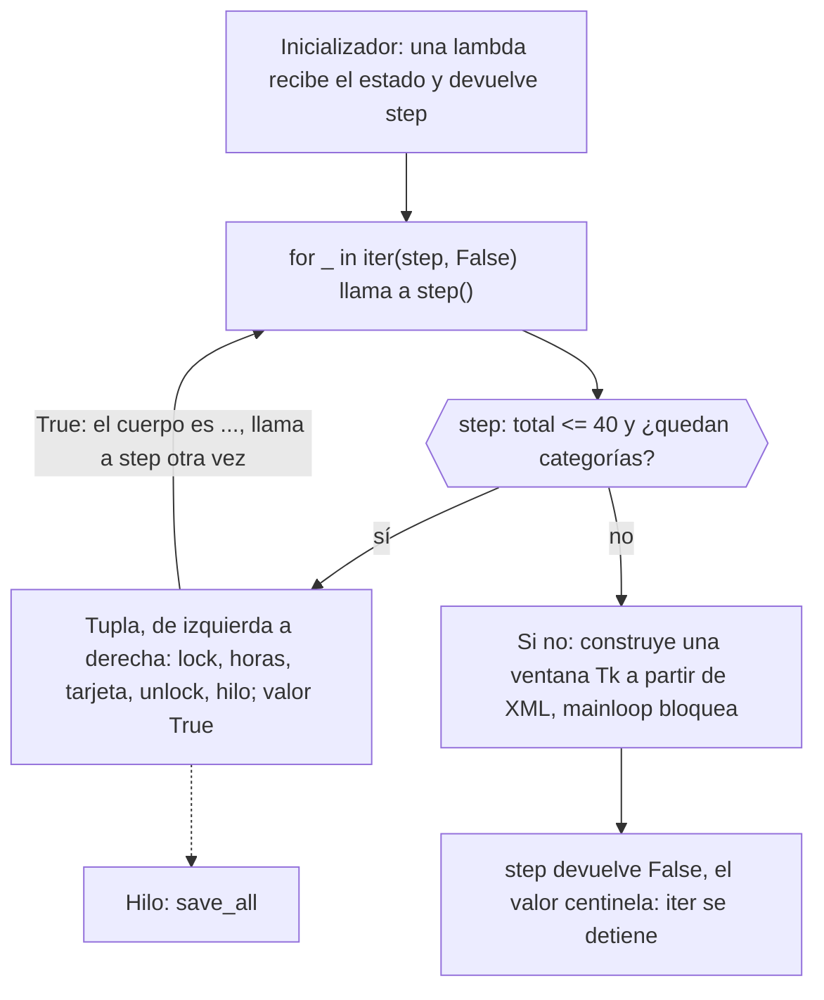

# Una sola sentencia, edición Python

Esta es la adaptación a Python que hizo Ken del reto en C# de Jim Lehmer. Es una de las cuatro adaptaciones hermanas, junto con [Java](../JavaChallenge1/README.md), [Kotlin](../KotlinChallenge1/README.md) y [Go](../GoChallenge1/README.md). El README de Java explica [qué hace cada versión](../JavaChallenge1/README.md#qué-hacen-todas-las-versiones) y tiene la [comparación lado a lado](../JavaChallenge1/README.md#lado-a-lado) de las cuatro.

La restricción: `main` contiene exactamente una sentencia, un bucle `for` con el cuerpo vacío. Es una acrobacia con la mecánica de las expresiones, no un buen código de producción. Nada de esto se conecta con un sistema real de registro de horas: las tarjetas están marcadas con `is_demo`.

## Ejecútalo

Solo necesitas Python 3: su instalación incluye `tkinter` y `sqlite3`.

```powershell
py src\PythonChallenge1\program.py
```

O, desde la raíz del repositorio, con Gradle: `.\gradlew.bat runPython`.

La interfaz se abre en una ventana de Tk. Los registros se guardan en `src/PythonChallenge1/data/demo-timecards.db`, junto a `program.py`, sin importar el directorio de trabajo. Borra `data` para empezar de nuevo.

## Ejecútalo en un contenedor

Requisito previo: Docker, configurado una sola vez como se describe en [`SANDBOX-SETUP.md`](../../SANDBOX-SETUP.md#docker).

```bash
sandbox/container/run-image.sh --out ./results src/PythonChallenge1
```

Construye el [`Dockerfile`](Dockerfile) de esta carpeta y ejecuta el resultado sin red, con un sistema de archivos de solo lectura y con el usuario `nobody`. La imagen contiene Python 3 con Tk, Xvfb y una herramienta de capturas de pantalla. No tiene pip ni compilador (unos 340 MB). La ventana se abre en una pantalla virtual (Xvfb) *dentro* del contenedor, así que no se dibuja nada en tu escritorio: la ejecución toma una captura de la ventana, la cierra e imprime las filas que escribió. Con `--out`, `results/screenshot.png` es la captura de pantalla de la ventana.

## Ejecútalo en Windows Sandbox

Requisitos previos: Windows Sandbox y la cadena de herramientas de esta entrada en tu máquina. Configura ambos una sola vez como se describe en [`SANDBOX-SETUP.md`](../../SANDBOX-SETUP.md#windows-sandbox).

```powershell
sandbox\windows\run.ps1 src\PythonChallenge1
```

Ejecuta la entrada en una máquina virtual desechable con la red desactivada, captura la ventana, le pide que se cierre e imprime lo que guardó. El perfil de Windows Sandbox ya se probó.

## Estructura

[program.py](program.py) contiene toda la adaptación. Las clases de entidad y de repositorio están en el mismo archivo, encima de `main`.

## Flujo del programa



**Qué muestra:** Python no tiene un `for` de tres cláusulas, así que el bucle es `iter(step, False)`: llama a `step` hasta que devuelva el valor centinela. Una expresión condicional es la prueba, y una tupla ocupa el lugar de la lista separada por comas. Python evalúa los elementos de la tupla en orden, y el último elemento (`True`) es el valor de la actualización.

**Por qué importa este mecanismo:** la parada es un valor de retorno que `iter` compara con el valor centinela, no una condición que `for` comprueba por su cuenta. La ventana muestra la misma idea que las otras versiones: la rama final hace el último trabajo y después devuelve el valor que termina el bucle.

## Cómo funciona el truco

El trabajo se divide en tres partes: un **inicializador** que construye el estado del bucle, una **condición** que decide si el bucle continúa (y, en la última comprobación, muestra la ventana) y una **actualización** que hace una pasada de trabajo. Los rótulos en comentarios del código fuente marcan los límites.

Python no tiene un `for` de tres partes, ni expresiones con coma, ni sentencias dentro de expresiones, así que el bucle es `for _ in iter(step, False): ...`. Llamar a `step` una y otra vez es el bucle. Se detiene cuando `step` devuelve el valor centinela `False`.

- **Inicializador.** `SimpleNamespace` guarda el estado. Se pasa a una lambda que construye `step`.
- **Condición.** Una expresión condicional, en pseudocódigo: `(update ...) if total <= 40 and categories else (show the window ...)`.
- **Actualización.** Una tupla de llamadas cuyo último elemento es `True`; `[-1]` lo elige. Las tuplas se evalúan de izquierda a derecha, y eso reemplaza la lista con comas. Bloquea, suma horas, prepara una tarjeta, desbloquea e inicia un `threading.Thread`.
- **Cuerpo vacío.** El cuerpo es `...`, una expresión constante y nada más. Un `pass` sería una segunda sentencia.
- **Ventana.** La ventana es una ventana de Tk, descrita por una cadena de texto XML que `xml.etree.ElementTree` analiza en tiempo de ejecución, con un widget por elemento mediante `getattr(tkinter, tag)`. `after()` reprograma un temporizador que acerca el color de cada etiqueta al del fondo (las etiquetas de Tk no tienen canal alfa, el valor que controla la transparencia). `mainloop()` bloquea la ejecución hasta que se cierra la ventana.
- **Guardado.** El programa usa `sqlite3` de la biblioteca estándar. `getattr(repo, "save_all")` hace el papel de la reflexión.
- **Advertencia.** `main` es exactamente una sentencia `for`, pero las lambdas y las comprensiones que contiene son solo expresiones. Las importaciones, la entidad y el repositorio quedan fuera de `main`.

## Trampas que conviene conocer

- **`main` es una sola sentencia `for`, pero no todo lo es.** Las lambdas y las comprensiones que contiene son solo expresiones. Las importaciones, la entidad y el repositorio quedan fuera de `main`.
- **El cuerpo vacío es `...`.** Un `pass` sería una segunda sentencia.
- **Los datos viven junto al programa.** Los registros se guardan en `data/`, junto a `program.py`, sin importar el directorio de trabajo.
- **Las etiquetas de Tk no tienen canal alfa.** Por eso el pulso mezcla el color de cada etiqueta hacia el color del fondo, en lugar de desvanecerla.
- **Esta adaptación no tiene script de verificación,** así que la verificación automatizada del entorno aislado (*sandbox*, que limita el acceso al sistema anfitrión) todavía no la cubre. El perfil de Windows Sandbox ya se probó.
