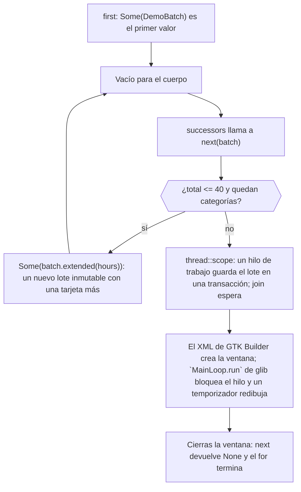

# Una sola sentencia, edición Rust

**Te enseña:** que los iteradores y las clausuras (*closures*, funciones que capturan variables de su entorno) pueden expresar el flujo de control de un programa completo en Rust.

Un complemento para WSL/GTK 4 del reto en C# de Jim Lehmer y de las versiones de Ken en [Java](../JavaChallenge1/README.md), [Kotlin](../KotlinChallenge1/README.md), [Python](../PythonChallenge1/README.md) y [Go](../GoChallenge1/README.md). El objetivo es explorar la mecánica de las expresiones mediante una restricción deliberadamente ridícula, no ofrecer una arquitectura de producción.

## Ejecútalo

Necesitas una sesión de escritorio WSLg que funcione. En Ubuntu 24.04, instala la cadena de herramientas de APT y las bibliotecas nativas:

```bash
sudo apt-get update
sudo apt-get install -y build-essential pkg-config cargo rustc rustfmt \
    libgtk-4-dev libsqlite3-dev sqlite3
cd src/RustChallenge1
cargo run --locked
```

Las dependencias bloqueadas se probaron con Rust y Cargo 1.75 de Ubuntu. Cargo necesita acceso a la red para descargar crates en la primera compilación. Si la ventana no se abre, consulta la [configuración de WSLg](https://learn.microsoft.com/en-us/windows/wsl/tutorials/gui-apps) de Microsoft.

La ventana muestra el total generado sobre un tono que cambia suavemente. Al cerrarla, termina el programa. Cada ejecución agrega registros ficticios a `$XDG_DATA_HOME/RustChallenge1/demo-timecards.db` (por defecto `~/.local/share/RustChallenge1/demo-timecards.db`), el equivalente en Linux de `%LOCALAPPDATA%\ModernChallenge1` en la versión de C#. Elimina ese directorio para empezar de cero. La base de datos es **DEMO ONLY**, sin conexión con un sistema real de reporte de horas.

## Ejecuta el programa en un contenedor

Requisito previo: Docker, configurado una sola vez como se describe en [`SANDBOX-SETUP.md`](../../SANDBOX-SETUP.md#docker).

```bash
sandbox/container/run-image.sh --online-build --out ./results src/RustChallenge1
```

Este es el hogar en Linux de esta entrada y no necesita WSLg: el [`Dockerfile`](Dockerfile) la compila con el Rust de Ubuntu en una etapa de compilación y después ejecuta el único binario sobre una base con el entorno de ejecución de GTK 4, una pantalla virtual (Xvfb) y una herramienta de capturas de pantalla, y sin Rust, encabezados ni compilador. La ventana se abre en esa pantalla virtual *dentro* del contenedor, el entrypoint le toma una captura después de unos segundos y la cierra, y la ejecución imprime las filas de SQLite que escribió. Con `--out`, `results/screenshot.png` es la ventana. Se necesita `--online-build` porque la compilación descarga los crates bloqueados (la ejecución en sí no tiene red). La imagen pesa unos 350 MB, porque GTK 4 es grande.

## Flujo del programa



**Qué muestra:** `std::iter::successors(first, next)` reúne los tres trabajos de un `for`: `first` es el inicializador, `next` es a la vez la condición y la actualización, y devolver `None` es la parada. El estado nunca se modifica. Cada paso construye un `DemoBatch` nuevo.

**Por qué importa este mecanismo:** guardar es un hilo unido y con ámbito, así que el programa nunca dice "guardado" antes de que termine la transacción. La ventana GTK ejecuta su propio bucle de eventos (`MainLoop.run`) dentro de la llamada a `next`, que es el último paso antes de que termine el bucle.

## Cómo funciona el truco

`main` es un único bucle `for` de cuerpo vacío, y nada dentro de él es una sentencia: ni `;`, ni `let`, ni `return`. `tests/one_statement.rs` revisa `src/main.rs` y falla si eso deja de cumplirse. Los tipos auxiliares de `lib.rs` se encargan de la generación y la persistencia de los datos, como lo hace `DemoTimeCardContext` en la versión de C#.

Rust no tiene un `for` de tres cláusulas separadas por `;`, pero `std::iter::successors(first, next)` cumple las mismas tres funciones:

| Sección `for` | En la versión de Rust |
| --- | --- |
| Inicializador | `first`: un `DemoBatch` inmutable |
| Condición | `next` devuelve `None` para terminar el bucle; como en C#, el programa lanza la ventana desde dentro de ella |
| Iterador | `next` devuelve `Some(batch.extended(hours))`, el lote más una tarjeta |

Dos trucos sustituyen a las sentencias que Rust usaría normalmente:

- `match value { name => ... }` es un `let` que es una expresión.
- `(a, b, c).2` es el operador coma: evalúa `a`, `b` y `c` en orden y produce el último valor.

El bucle comprueba el total acumulado antes de cada registro. Mientras el total no pasa de 40 y quedan categorías, suma de 10 a 19 horas para la siguiente categoría. Hay cinco nombres de categoría (`Meetings` se repite), así que un total de exactamente 40 después de cuatro tarjetas continúa con una quinta tarjeta. Cuando el lote termina, un hilo de trabajo con ámbito lo guarda en una sola transacción de SQLite. El hilo toma prestadas las tarjetas, así que no se clona nada. El programa une el hilo (espera a que termine) antes de que la ventana afirme que se guardó algo. Los errores terminan el programa con un mensaje, y el programa nunca informa de éxito tras un fallo. La única excepción es la función de devolución de llamada (*callback*) de dibujo de GTK: una función que GTK llama cuando necesita dibujar. Ahí se ignoran los errores de Cairo, porque un *panic* abortaría el programa al cruzar la frontera de C. El año calendario y la semana ISO coinciden con los campos separados del original. Alrededor de Año Nuevo, el año ISO basado en semanas puede diferir del año calendario.

| Original y adaptaciones de Ken | Complemento en Rust |
| --- | --- |
| C# y Java usan las tres secciones de un `for` con cuerpo vacío; Kotlin construye una secuencia | Rust construye un iterador con `successors`, también con cuerpo vacío |
| Objetos de estado anónimos y cadenas `also` de Kotlin | Un `DemoBatch` inmutable; `match x { name => ... }` vincula nombres |
| Expresiones de iterador separadas por comas | Tuplas, proyectadas con `.N` |
| En tiempo de ejecución, XAML o Spring XML construye la ventana | En tiempo de ejecución, GTK Builder XML construye la ventana; un temporizador de GLib mueve un tono suave de fondo |
| EF Core o Spring Data y SQLite | `rusqlite` y una transacción local |
| Guardado en segundo plano y llamadas a métodos por reflexión | Un hilo con ámbito (*scoped thread*) al que se hace *join*; no hace falta reflexión, ya que `()` es un valor ordinario en Rust |
| `Environment.UserName` | `$USER` y después `$LOGNAME`; ignora los valores vacíos; si no, "unknown" |

El hilo de trabajo no toca GTK. La interfaz y su bucle de eventos permanecen en el hilo principal. Esta versión espera la persistencia a propósito, a diferencia del hilo con contexto compartido del original, torpe de forma intencional. Por eso el hilo es solo un guiño al original, no una fuente de concurrencia. La aplicación es un ejercicio de lenguaje, no una recomendación para ocultar trabajo dentro de expresiones de iteradores.

## Trampas que conviene conocer

- **Una prueba impone la regla de una sola sentencia.** `tests/one_statement.rs` analiza `src/main.rs` y falla si aparece un `;`, un `let` o un `return` en `main`.
- **Necesitas una sesión de escritorio.** Fuera del contenedor, la ventana necesita WSLg. Las dependencias bloqueadas se probaron con Rust y Cargo 1.75 de Ubuntu, y Cargo necesita la red para descargar crates en la primera compilación.
- **Los errores de Cairo se ignoran en la función de devolución de llamada (*callback*, una función que se entrega a otro código para que la llame después) de dibujo,** porque un *panic* ahí abortaría al cruzar el límite con C. En todo lo demás, los errores finalizan el programa con un mensaje.
- **Alrededor de Año Nuevo, el año basado en semanas ISO puede diferir del año calendario.**
- **El hilo es un guiño al original.** El trabajador espera a la persistencia a propósito, así que no es una fuente de concurrencia.
- **No hay perfil de Windows Sandbox ni script de verificación,** así que el control de un entorno aislado (*sandbox*) que limita el acceso al sistema anfitrión todavía no cubre esta adaptación. La imagen del contenedor pesa unos 350 MB, porque GTK 4 es grande.

## Compruébalo

```bash
cargo fmt --check
cargo test --locked
cargo build --locked
```

Inspecciona la base de datos con `sqlite3 data/demo-timecards.db 'select * from demo_timecards;'`.

---

Consulta el [README principal](../../README.md#los-resultados-hasta-ahora) para ver cómo se compara con las demás entradas, y [`RETO.md`](../../RETO.md) si quieres escribir la tuya.
