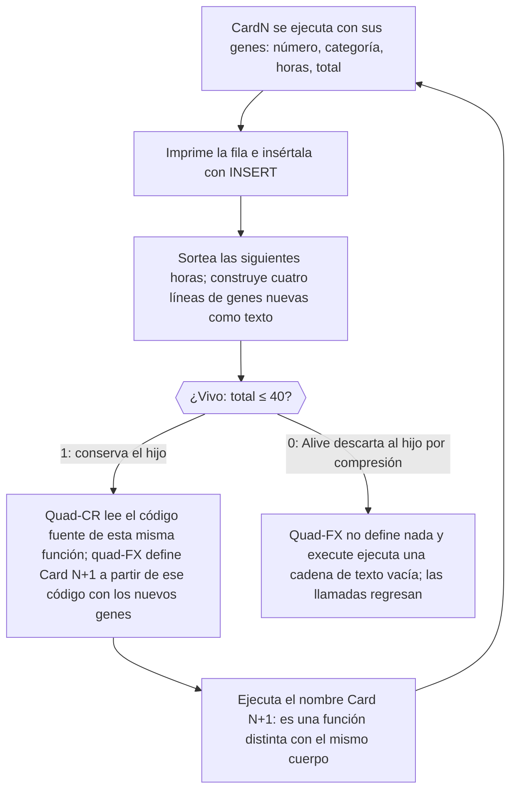

# APL, aún más raro

**Te enseña:** que `⎕CR`, `⎕FX` y la compresión vuelven opcionales el "if" y el "bucle", y que una función puede ser su propia sucesora.

> **DEMO ONLY.** Tarjetas de horas ficticias en un archivo SQLite temporal. Sin conexión con ningún sistema real de registro de horas.

Esto es raro, incluso para la gente de APL.

El anfitrión define exactamente una función, `Card0`. Cada una de las demás tarjetas es una función que **escribió** la tarjeta anterior: lee su propio código fuente, reescribe cuatro líneas, define la copia con `⎕FX` y la llama. La regla de parada es una compresión (`/`) sobre el texto fuente de la función hija. Cuando el total pasa de 40, el código fuente de la hija queda vacío, `⎕FX` no define nada y ya no queda nada que llamar. El estado del programa no está en variables; está en el texto del programa.

## Ejecútalo

Necesitas GNU APL (`apl`, de [gnu.org/software/apl](https://www.gnu.org/software/apl/)) y `sqlite3`.

```bash
cd src/apl-weird
apl --script -f timecards.apl
./check.sh                  # set APL=/path/to/apl if it is not on your PATH
```

Los registros van a `$XDG_DATA_HOME/AplWeird/demo-timecards.db` (por defecto `~/.local/share/AplWeird/`). Una ejecución se ve así:

```text
# DEMO ONLY run 2026-11-14-9-42-57-197
Reuniones	18	18	2026-W46	DEMO ONLY
Programación	12	30	2026-W46	DEMO ONLY
Depuración	15	45	2026-W46	DEMO ONLY
# Card0 ⇐ H←10+?10
# Card1 ⇐ H←12
# Card2 ⇐ H←15
# committed total=45 entries=3 DEMO ONLY
# the host wrote Card0 and nothing else; each later card was written by the one before it
```

Las tres líneas `# CardN ⇐` se vuelven a leer desde el espacio de trabajo *después* de la ejecución (`⎕NL 3` lista sus funciones). `Card1` y `Card2` existen solo porque `Card0` y `Card1` las escribieron, y sus horas son literales en su propio código fuente.

## Flujo del programa



**Qué muestra:** la recursión es una cadena de funciones distintas, no una función que se llama a sí misma. Cada función `Card` *escribe* la siguiente como texto y luego la llama. El booleano `Alive` es a la vez la regla de parada y la condición que protege la escritura, porque comprimir con `0` elimina todas las líneas de la función hija.

**Por qué importa este mecanismo:** el programa se modifica a sí mismo y su estado es texto fuente: los "genes" son cuatro líneas que cada hijo recibe con valores nuevos. Una regla de parada rota no falla. Recurre sin fin, y por eso la comprobación ejecuta el programa con un límite de tiempo.

## Cómo funciona el truco

Una función en GNU APL es un bloque de texto entre dos marcas `∇`. Su primera línea es el encabezado. Aquí está `Card0`, con las líneas numeradas como las numera `⎕CR` (que devuelve el código fuente de una función como una matriz de caracteres):

| Línea | Fuente | Papel |
| --- | --- | --- |
| 0 | `Card0;N;C;H;T;D;Alive;Kid;Genes` | Encabezado: el nombre y luego las variables locales |
| 1-4 | `N←0`, `C←0`, `H←10+?10`, `T←H` | Los **genes**: número de tarjeta, categoría, horas, total acumulado |
| 5-… | el cuerpo | Imprime la fila, la guarda y **escribe y llama a la siguiente tarjeta** |

1. **Imprimir y guardar.** El cuerpo usa los genes para imprimir una fila y `INSERT` una fila en SQLite.
2. **Dibujar la siguiente tarjeta.** `D←10+?10` son las horas de la siguiente tarjeta. `Genes←('N←',⍕N+1) ('C←',⍕4|C+1) ('H←',⍕D) ('T←',⍕T+D)` construye cuatro líneas de genes de reemplazo *como texto*: `⍕` convierte un número en caracteres, así que `N` de 1 se convierte en la línea `N←2`.
3. **La regla de parada.** `Alive←40≥T` vale 1 mientras el total no pase de 40; en otro caso vale 0.
4. **Escribir la función hija.** `Kid←⎕FX Alive/(⊂'Card',(⍕N+1),Locals),Genes,5↓⊂[1]⎕CR 'Card',⍕N`. Léelo desde la derecha:
   - `⎕CR 'Card',⍕N` es *el código fuente de esta misma función* como matriz;
   - `⊂[1]` corta esa matriz en una lista de sus filas y `5↓` descarta el encabezado y las cuatro líneas de genes para dejar el cuerpo;
   - el nuevo encabezado y las cuatro líneas de genes nuevas se ponen delante;
   - `Alive/` es la regla de parada. Un escalar 1 conserva todas las líneas y un escalar 0 no conserva ninguna: **todo el hijo desaparece por compresión**;
   - `⎕FX` "fija" (define) una función a partir de esa lista de líneas, o no hace nada con una lista vacía.
5. **Llama a la función hija.** `⍎Alive/'Card',⍕N+1`. `⍎` (ejecutar) ejecuta texto como APL; `Alive/` sobre el nombre deja el nombre o la cadena de texto vacía; ejecutar la cadena de texto vacía no hace nada. Así, el mismo booleano controla tanto la escritura como la llamada.

Por tanto, la recursión es una cadena de funciones distintas, no una función que se llama a sí misma: `Card0` llama a `Card1`, que fue *escrita por* `Card0`, que llama a `Card2` y así sucesivamente. Se necesitan como máximo cinco tarjetas (cinco tarjetas de diez horas suman 50).

### Qué se niega a usar esta versión

`check.sh` hace cumplir las reglas leyendo el código fuente: ningún `⍣` (operador de potencia), ningún `→` (rama), exactamente un bloque `∇ … ∇`, exactamente un `⎕FX`, y el número de tarjetas generadas en la salida debe ser igual al número de entradas. También ejecuta el programa con `timeout`, porque una regla de parada defectuosa no falla: se llama a sí misma sin fin (mira más abajo).

## Cómo ver los glifos

Si los símbolos de APL aparecen como cuadros vacíos, consulta [Cómo ver los glifos](../apl/README.md#cómo-ver-los-glifos) en el README de la entrada directa. (`⎕` *debe* ser un cuadro vacío.)

## Qué impone `check.sh`

`check.sh` lee primero el código fuente y hace cumplir la restricción. No hay `⍣` (el operador de potencia) ni `→` (rama) fuera de los comentarios. Hay exactamente una definición de `∇ ... ∇` (`Card0`) y exactamente un `⎕FX`, así que todas las demás tarjetas se deben escribir en tiempo de ejecución. El archivo tiene el marcador `DEMO ONLY` y ningún texto que parezca de red. Luego ejecuta el programa 25 veces. Cada ejecución debe imprimir un conjunto de registros coherente: categorías en orden, horas de 10 a 19, totales acumulados que suman correctamente, una marca `DEMO ONLY` en cada fila y una parada exactamente cuando el total pasa de 40. SQLite debe coincidir con las filas impresas. Ejecuta el programa bajo `timeout`, porque una regla de parada rota no falla: entra en recursión infinita. Las 25 ejecuciones deben ser 25 ejecuciones distintas, y las horas deben mostrar al menos seis valores distintos, para que los sorteos "aleatorios" parezcan aleatorios de verdad. Por último, intenta insertar una fila que no es de demostración y espera que SQLite la rechace, lo que prueba que `CHECK(demo_only=1)` es real.

## Trampas que conviene conocer

- **Ámbito dinámico.** Las variables locales de APL son visibles para todo lo que *se llama* desde la función, no solo para su propio texto. Cada tarjeta debe declarar `N;C;H;T;…` en su encabezado (para eso sirve `Locals`) o los genes de una tarjeta hija sobrescribirían los de su tarjeta madre.
- **Error por uno en una reescritura.** El primer borrador de este programa eliminaba cuatro líneas en lugar de cinco al copiar el cuerpo, así que cada hijo conservaba la línea de genes `T←H` de su padre y reiniciaba el total acumulado a una tarjeta. El total nunca podía pasar de 40, la regla de parada nunca se activaba y el programa recursaba hasta que lo terminaban. El código que se modifica a sí mismo falla en silencio y de forma estructural; por eso el script de comprobación tiene un límite de tiempo.
- **`⊃` frente a `↑`.** En GNU APL, `⊃` es *disclose* y `↑` es *first* (Dyalog los intercambia). El informe elige la última tarjeta con `↑⌽`.
- **`Card0` es un poco diferente.** Es la única tarjeta cuyas horas vienen de `H←10+?10` en su propio texto; las tarjetas posteriores tienen un literal. Ese es el precio honesto de tener un punto de partida.
- **Aquí no hay independencia de `⎕IO`.** La versión rara define `⎕IO←0` y depende de ello.
- **No es un patrón.** Reescribir tu propio código fuente para evitar un `while` es un truco llamativo, no una técnica.

## Ejecútalo en un contenedor

Requisito previo: Docker, configurado una sola vez como se describe en [`SANDBOX-SETUP.md`](../../SANDBOX-SETUP.md#docker).

```bash
sandbox/container/run-image.sh src/apl-weird
```

Construye el [`Dockerfile`](Dockerfile) de esta carpeta y ejecuta el resultado sin red, con un sistema de archivos de solo lectura y el usuario `nobody`. Luego imprime la salida y una vista de solo lectura de las filas que escribió. La imagen contiene GNU APL (compilado a partir del archivo *tarball* de gnu.org con versión fija, en la imagen de la cadena de herramientas) y sqlite3 sobre un Ubuntu mínimo. No tiene compilador ni gestor de paquetes.
