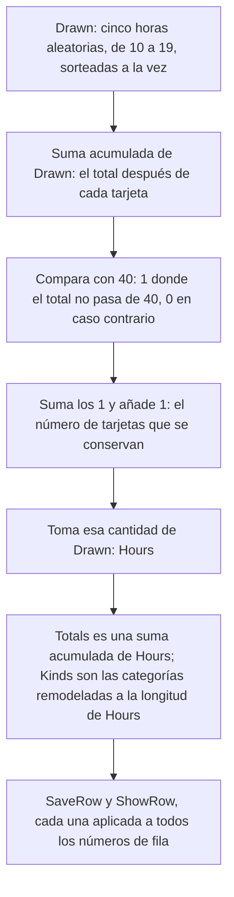

# APL

**Te enseña:** que cinco tiradas y un *take-while* pueden reemplazar un bucle.

> **DEMO ONLY.** Tarjetas de horas ficticias en un archivo SQLite temporal. Sin conexión con ningún sistema real de reporte de horas.

La selección de tarjetas del reto usa cuatro asignaciones de arreglos con nombre. `Drawn` contiene las cinco tiradas, y `Hours`, `Totals` y `Kinds` derivan de ellas las filas conservadas. No hay ningún bucle ni `if`. El resto de [`timecards.apl`](timecards.apl) trata de cómo viaja el dato: la semilla, una tubería hacia `sqlite3` y la impresión.

## Ejecútalo

Necesitas GNU APL (`apl`, compilado desde [gnu.org/software/apl](https://www.gnu.org/software/apl/)) y `sqlite3`.

```bash
cd src/apl
apl --script -f timecards.apl
./check.sh                  # set APL=/path/to/apl if it is not on your PATH
```

Los registros van a `$XDG_DATA_HOME/Apl/demo-timecards.db` (por defecto `~/.local/share/Apl/`). Una ejecución se ve así:

```text
# DEMO ONLY run 2026-11-14-9-38-27-440
Meetings	19	19	2026-W46	DEMO ONLY
Coding	17	36	2026-W46	DEMO ONLY
Debugging	16	52	2026-W46	DEMO ONLY
# committed total=52 entries=3 DEMO ONLY
```

## Flujo del programa



**Qué muestra:** el programa no saca ninguna tarjeta *después* de conocer la regla de parada. Primero saca las cinco. La regla de parada es aritmética sobre arreglos completos: una suma acumulada, una comparación y un conteo. La única repetición es `¨` ("cada uno"), que visita filas que ya estaban decididas.

**Por qué importa este mecanismo:** cinco no es un número de repeticiones del bucle. Es un límite que nunca puede quedar corto, porque cinco tarjetas de al menos 10 horas siempre pasan de 40. El programa hace su trabajo con operaciones sobre arreglos, y una operación sobre arreglos ocupa el lugar de un bucle. Compara [`apl-weird`](../apl-weird/README.md), donde el programa se escribe a sí mismo.

## Cómo funciona el truco

Lee las cuatro asignaciones bajo "The challenge" en el código fuente con este recorrido a tu lado.

1. **Sortea todo por adelantado.** `Drawn←(10-⎕IO)+?5⍴10`. `5⍴10` son cinco dieces, `?` tira cada uno (`?10` da un número entre los primeros diez enteros) y el desplazamiento `10-⎕IO` los convierte en horas de 10 a 19. ¿Por qué cinco? Cada tarjeta tiene al menos 10 horas, así que el total de cinco tarjetas es siempre al menos 50. Cinco es una *cota que nunca puede quedarse corta*, no el número de vueltas de un bucle.
2. **Aplica la regla de parada como datos.** `Hours←Drawn↑⍨1++/40≥+\Drawn`. Léela de derecha a izquierda:
   - `+\Drawn` es el total acumulado después de cada tarjeta, por ejemplo `15 26 41 51 …`;
   - `40≥` convierte eso en 1 y 0: `1 1 0 0 …`. Los totales solo crecen, así que los 1 siempre forman un prefijo;
   - `+/` cuenta los 1, que es la cantidad de tarjetas que caben bajo la línea;
   - `1+` suma la única tarjeta que la cruza, y `↑⍨` ("take, con los argumentos intercambiados") conserva esa cantidad.
3. **Deduce el resto.** `Totals←+\Hours` es de nuevo el total acumulado. `Kinds←(≢Hours)⍴Categories` usa una propiedad discreta de *reshape*: `⍴` *recicla* su argumento derecho cuando este es más corto que el destino. Así, cuatro nombres de categoría llenan tantas posiciones como tarjetas se conserven, hasta cinco. Si se conserva una quinta tarjeta, su nombre es `Meetings` otra vez. No hace falta usar módulo.

Después, `SaveRow¨⍳≢Hours` y `ShowRow¨⍳≢Hours` aplican una función pequeña (una *dfn*, `{ … }`) a cada número de fila (`¨` significa "cada uno"). Eso es `for` de APL y no es la regla de parada: solo visita las filas que ya están decididas.

### Cómo viaja el dato, en el orden en que aparece

| Pieza | Qué hace |
| --- | --- |
| `⎕RL←+/⎕TS×1 12 …` | Inicializa el generador aleatorio con el reloj. GNU APL inicia cada sesión con `⎕RL` en 16807, así que sin esto cada ejecución sacaría las mismas tarjetas "aleatorias" |
| `⎕FIO[24]` / `⎕FIO[8]` / `⎕FIO[25]` | `popen`, lee una línea, `pclose`. Se usaba para pedir a `date +%G-W%V` la semana ISO |
| `'w' ⎕FIO[24] '…sqlite3…'` | `popen` para escribir: APL envía SQL por una tubería a un `sqlite3` real |
| `⎕FIO[23]` / `⎕FIO[22]` | `fwrite` y `fprintf`. El argumento izquierdo de `⎕FIO[22]` es una cadena de texto de formato seguida de sus valores; el derecho es el identificador del archivo (`1` es la salida estándar) |
| `CHECK(demo_only=1)` | Hace imposible representar en la tabla una fila que no sea de demostración. `check.sh` intenta insertar una y espera que SQLite la rechace |
| `)OFF` | Un *comando del sistema*, no código APL. Termina el script. Sin él, `--script` se quedaría en el prompt |

## Cómo ver los glifos

APL usa símbolos que la mayoría de las fuentes no incluyen. Si el código fuente muestra filas de cuadros vacíos, tu fuente no tiene glifos de APL. Antes de empezar, ten en cuenta dos cosas:

- **`⎕` debe verse como una caja vacía.** Es el "quad" de APL, así que `⎕IO` debería verse como un pequeño cuadrado hueco seguido de `IO`. Cada otro símbolo (`⍴ ⍳ ⍵ ∇ ⍝ ⍨ ⌽ ⍕`) debería verse como una letra o una marca, no como una caja.
- **Una terminal que no use UTF-8 los mostrará mal** incluso antes de que importe la fuente. GNU APL necesita una configuración regional UTF-8.

**La solución es una fuente que tenga el rango APL.** [DejaVu Sans Mono](https://dejavu-fonts.github.io/) cubre todos los símbolos que usan estos archivos. [APL385 Unicode](https://www.dyalog.com/apl-font-keyboard.htm) es la fuente tradicional de APL y también funciona.

En **Ubuntu**, `fonts-dejavu-mono` suele estar ya instalado (`fc-list | grep -i "dejavu sans mono"` te lo dirá). Los programas de Windows no usan las fuentes instaladas *dentro de WSL*, así que en **Windows o WSL2** debes instalar la fuente en el lado de Windows:

1. Copia la fuente desde WSL o descárgala del sitio de DejaVu:

   ```bash
   mkdir -p /mnt/c/Users/<you>/Downloads/DejaVuSansMono
   cp /usr/share/fonts/truetype/dejavu/DejaVuSansMono*.ttf /mnt/c/Users/<you>/Downloads/DejaVuSansMono/
   ```

2. En el Explorador de archivos, selecciona los cuatro archivos `.ttf`, haz clic con el botón derecho, elige **Mostrar más opciones** y luego **Instalar para todos los usuarios**.
3. Cierra y vuelve a abrir tu navegador y tu editor. Un navegador recurre a cualquier fuente instalada que tenga el glifo, así que la visualización de estos archivos en GitHub normalmente empezará a funcionar sin ningún otro cambio.
4. Si un editor o una terminal sigue mostrando cuadros, indica la fuente de forma explícita:
   - VS Code: `editor.fontFamily` y `terminal.integrated.fontFamily` con el valor `'DejaVu Sans Mono'`.
   - Windows Terminal: Configuración, tu perfil, Apariencia, Tipo de letra.

Para probar, pega `⍳ ⍴ ⍵ ⎕ ∇ ⍝ ⍣ ⍸ ⌽` en cualquier parte. Deberías ver ocho símbolos con forma de letra y un cuadro vacío (el `⎕`).

## Qué impone `check.sh`

`check.sh` es el árbitro. Comprueba que `timecards.apl` lleve la marca `DEMO ONLY` y que no contenga texto que parezca de red (`http`, `socket`, `curl`, `wget`). Luego ejecuta el programa 25 veces. Cada ejecución debe imprimir un conjunto coherente de registros: categorías en orden, horas de 10 a 19, totales acumulados que cuadran, una marca `DEMO ONLY` en cada fila y una parada justo cuando el total pasa de 40. SQLite debe coincidir con las filas impresas. Las 25 ejecuciones deben ser 25 ejecuciones distintas, y las horas deben mostrar al menos seis valores distintos, para que los sorteos "aleatorios" parezcan aleatorios de verdad. Por último, intenta insertar una fila que no sea de demostración y espera que SQLite la rechace, lo que demuestra que `CHECK(demo_only=1)` es real.

## Trampas que conviene conocer

- **Origen.** `⎕IO` es el origen de índices (1 de forma predeterminada en GNU APL, 0 en algún código). El archivo nunca lo da por supuesto: `?` es la única primitiva cuyos resultados dependen de él, y el sorteo vuelve a restar `⎕IO`. `check.sh` se ejecuta con el valor predeterminado; prueba a poner `⎕IO←0` en la primera línea y comprueba que las tarjetas siguen siendo de 10 a 19 horas.
- **`⊃` no es "first".** En los intérpretes de la familia APL2 (GNU APL, APL2), `⊃` aplica *disclose* (es "mix") y `↑` es "first". Dyalog lo invierte: `⊃` es first/pick. Aquí, `⊃Kinds[⍵]` aplica *disclose* a una sola cadena de texto seleccionada para devolverla a un vector simple de caracteres.
- **`_←` es desechable.** Primitivas como `⎕FIO` devuelven un valor; una expresión sola lo imprimiría. Asignar a `_` lo descarta.
- **No existe un formateador.** No hay `gofmt` para el código fuente de GNU APL. Las reglas de formato que se aplican a mano son: una sentencia por línea (`⋄` es para el REPL), nombres en CamelCase para lo que defines y comentarios alineados en una columna.
- **Armar SQL con formato de cadenas de texto es un mal hábito.** Aquí es seguro solo porque cada valor es un número que calcula el programa o una de cuatro palabras fijas. No lo copies.

## Ejecútalo en un contenedor

Requisito previo: Docker, configurado una sola vez como se describe en [`SANDBOX-SETUP.md`](../../SANDBOX-SETUP.md#docker).

```bash
sandbox/container/run-image.sh src/apl
```

Construye el [`Dockerfile`](Dockerfile) de esta carpeta y ejecuta el resultado sin red, con un sistema de archivos de solo lectura y con el usuario `nobody`. Luego imprime la salida y una vista de solo lectura de las filas que escribió. La imagen contiene GNU APL (compilado desde el archivo *tarball* fijado de gnu.org en la imagen de la cadena de herramientas) y sqlite3 sobre un Ubuntu mínimo. No tiene compilador ni gestor de paquetes.
