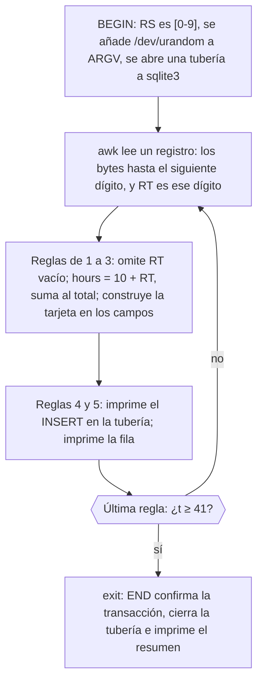

# AWK, más raro

**Te enseña:** que una expresión regular como separador de registros convierte un flujo de bytes aleatorios en dados, y que el bucle principal implícito de awk más un patrón es un programa completo.

> **DEMO ONLY.** Tarjetas de horas ficticias en un archivo SQLite temporal. Sin conexión con ningún sistema real de registro de horas.

**No hay bucle, ni `if`, ni función, ni generador de números aleatorios** en [`timecards.awk`](timecards.awk). awk lee `/dev/urandom`; el separador de registros es la expresión regular `[0-9]`, así que cada registro es un tramo de bytes aleatorios que termina en un dígito aleatorio, y gawk guarda ese dígito en `RT`. Un dígito es una tirada de dado y un registro es una tarjeta. El bucle es el propio bucle de awk que lee un registro tras otro, y la regla de parada es un solo patrón con una acción `exit`: `t > 40 { exit }`.

Sin la base de datos, todo el reto es una sola línea:

```sh
gawk 'BEGIN{RS="[0-9]"; split("Meetings Coding Debugging Learning",C)}
      {printf "%s\t%d\t%d\n", C[(NR-1)%4+1], h=10+RT, t+=h} t>40{exit}' /dev/urandom
```

La versión directa es [`awk`](../awk/README.md).

## Ejecútalo

Necesitas **GNU awk** (`gawk`, probado con 5.2.1) y `sqlite3`.

```bash
cd src/awk-weird
gawk -f timecards.awk                 # the dice come from /dev/urandom
gawk -f timecards.awk digits.txt      # ...or from any file: the digits in it ARE the dice
./check.sh                            # set GAWK=/path/to/gawk if it is not on your PATH
```

Los registros van a `$XDG_DATA_HOME/AwkWeird/demo-timecards.db` (por defecto `~/.local/share/AwkWeird/`). Una ejecución se ve así:

```text
# DEMO ONLY run 1794861177-31101
Meetings	17	17	2026-W47	DEMO ONLY
Coding	14	31	2026-W47	DEMO ONLY
Debugging	16	47	2026-W47	DEMO ONLY
# committed total=47 entries=3 DEMO ONLY
# the loop was awk's main loop over /dev/urandom, RS=[0-9] made each digit a die roll, and t > 40 { exit } stopped it
```

Como la entrada de datos es un operando de archivo, el programa es **reproducible**: `printf '5 5 5\n' > d.txt; gawk -f timecards.awk d.txt` siempre da Meetings 15/15, Coding 15/30, Debugging 15/45. Los dígitos `3 8 2 9 4 1` dan 13, 18 y 12 horas; el programa se detiene en 43. `check.sh` hace lo mismo con cientos de dígitos.

## Flujo del programa



**Qué muestra:** el bucle es el que tiene todo programa AWK: lee un registro, ejecuta todas las reglas en orden y lee el siguiente. El programa no tiene `while` ni `if`. Un separador de registros que es una expresión regular convierte los bytes aleatorios en dados, y el dígito que terminó el registro (`RT`) es el dado.

**Por qué importa este mecanismo:** la regla de parada es un patrón sin acción, `t > 40 { exit }`, que además es la última regla, así que la tarjeta que cruza el límite ya pasó por todas las reglas anteriores. La entrada de datos es `/dev/urandom`, que nunca termina, así que solo `exit` puede detener el bucle. Compara [`awk`](../awk/README.md), que usa un bucle en `BEGIN`.

## Cómo funciona el truco

Lee las reglas en orden: awk ejecuta **cada regla cuyo patrón coincide, para cada registro, de arriba abajo**.

### 1. El separador es una expresión regular; el terminador lo eliges tú

`RS = "[0-9]"`. En POSIX awk, `RS` es un solo carácter. En gawk (y en otros awk) un valor más largo es una **expresión regular**, y gawk guarda el texto que coincidió en `RT`. Lee `/dev/urandom` con esa regla y el flujo se corta después de cada byte que es un dígito. Unos 10 de cada 256 bytes son dígitos, repartidos de manera uniforme de `0` a `9`. Por eso `RT` es un dígito aleatorio uniforme y una tarjeta es la basura que hay antes de él (se ignora). `10 + RT` son horas de 10 a 19. Sin `rand()`, sin semilla, sin LCG. (Conté 20 000 registros en las configuraciones regionales C, UTF-8 y `-b`: cada dígito apareció unas 2 000 veces.)

### 2. Un registro es una tarjeta

```awk
{ t += h = 10 + RT }                                  # rule 2: the die, and the running total
{ $0 = C[n++ % 4 + 1] "," h "," t "," week }          # rule 3: the card, as a comma record
```

Una asignación es una expresión, así que `t += h = 10 + RT` asigna `h` y lo suma a `t` en una sola sentencia (ambos empiezan como "", que vale 0, así que no necesitan inicialización). Asignar a `$0` hace que awk **vuelva a dividir** el registro en campos con `FS`, que `BEGIN` fijó en una coma: `$1` es la categoría, `$2` las horas, `$3` el total y `$4` la semana.

### 3. Los mismos campos, de tres maneras

- **Regla 4:** un `INSERT` construido a partir de `$1`..`$4`, impreso en `| sql`, una tubería hacia `sqlite3`.
- **Regla 5:** `{ OFS = "\t"; $1 = $1; print $0, "DEMO ONLY" }`. `$1 = $1` parece una operación nula y es la forma famosa en AWK de forzar la reconstrucción de `$0` unidos por `OFS`. Las comas se convierten en tabulaciones, así que la fila legible para personas es el mismo registro con otro separador.
- La regla `DEMO ONLY` está en la tabla: `CHECK(demo_only=1)`.

### 4. La regla de parada es un patrón sin acción

```awk
t > 40 { exit }
```

`exit` en una regla principal termina la entrada de datos y ejecuta `END`, que confirma la transacción y cierra la tubería. La tarjeta que cruzó la línea ya pasó por las reglas de 2 a 5, así que se conserva sin ningún caso especial. Es la última regla para que la tarjeta ya se haya escrito antes de que el programa se detenga.

### 5. Sin `if`, sin bucle

- El último registro vacío de un archivo finito (el texto después del último dígito, por ejemplo un salto de línea final) tiene un **`RT` vacío**. La regla 1, `RT == "" { next }`, es un patrón con `next` que hace que no sea una tarjeta.
- La entrada de datos predeterminada se agrega en `BEGIN` con aritmética en lugar de un `if`: `ARGV[ARGC] = "/dev/urandom"; ARGC += (ARGC < 2)`. `ARGC < 2` vale 1 cuando no se nombró ningún archivo y 0 en caso contrario, así que el argumento nuevo solo cuenta cuando hace falta. awk lee los archivos nombrados en `ARGV[1..ARGC-1]`, así que editar `ARGV` en `BEGIN` es la forma en que un programa elige su propia entrada de datos.
- El directorio de la base de datos usa `?:`, una expresión y no una sentencia.

## Por qué es raro

AWK es un lenguaje en el que **el programa es el cuerpo de un bucle que tú no escribiste**. Aquí el bucle recorre un flujo aleatorio de bytes cortado por una expresión regular, y la maquinaria de registros incorporada del lenguaje ocupa el lugar de un generador de números aleatorios. La mayoría de los programadores de AWK conocen `RS` como "nueva línea, o quizá una línea vacía en el modo de párrafo", y nunca usan `RT`. Ver `RS="[0-9]"` sobre `/dev/urandom` es un verdadero momento de "espera, ¿se puede HACER eso?".

No deberías hacer esto en producción porque: es una extensión de GNU; el comportamiento del programa depende de un archivo de dispositivo; el "dígito aleatorio" queda oculto dentro de una configuración de E/S; y el flujo, no el programa, decide cuánto dura la ejecución (un archivo finito simplemente termina antes, como muestra `check.sh`).

## Qué puedes aprender

- `RS` como expresión regular, `RT` (gawk) y que **`RS` se aplica a cada lectura**, no solo a tu archivo de entrada. El primer borrador de este programa imprimió una semana vacía: `"date +%G-W%V" | getline week` leyó la salida de `date` con `RS="[0-9]"` ya definido, así que el registro terminó en el primer dígito del año. La llamada a `date` ahora va primero en `BEGIN`.
- Que cada regla se ejecuta para cada registro en orden y que `next` y `exit` son el flujo de control.
- La asignación a `$0` vuelve a dividir los campos; la asignación a un campo (`$1 = $1`) reconstruye `$0` con `OFS`. `FS` y `OFS` son independientes.
- La asignación es una expresión (`t += h = ...`) y una comparación es el número 0 o 1 (`ARGC += (ARGC < 2)`).
- Edita `ARGV`/`ARGC` en `BEGIN` para elegir los archivos de entrada.
- Que una entrada de datos finita hace del programa una *función de su entrada*: cambia el archivo y cambian los dados.

## Trampas que conviene conocer

- **Solo gawk.** Las partes específicas de GNU: `RT`, `systime()`, `PROCINFO["pid"]`. Una regex `RS` no es POSIX, pero mawk, one-true-awk y el awk de busybox aceptaron `RS="[0-9]"` en las pruebas hechas aquí. Ninguno de ellos tiene `RT`, así que no pueden ver *cuál* dígito terminó el registro, y el truco necesita justo eso. Peor aún, el fallo no es un error: con mawk, `RT` siempre está vacío, así que la regla 1 omite todos los registros y la regla de parada nunca se activa. Con `/dev/urandom`, mawk 1.3.4 sigue leyendo hasta que termina con `out of memory` (probado con un límite de 400 MB, que agotó tras unos mil registros). Con un archivo finito de dígitos, imprime un encabezado y `total=0 entries=0`. No ejecutes esto con otro awk sin un límite de memoria y un tiempo máximo. `gawk --lint` informa de las extensiones.
- **Una entrada de datos finita puede terminar antes de que el total pase de 40.** `/dev/urandom` nunca termina. Con un archivo, el programa se detiene al final de la entrada de datos e informa del total que haya acumulado (`check.sh` prueba `1 2` y obtiene 2 tarjetas, 23 horas).
- **Registro vacío final.** Un archivo que termina en un salto de línea genera un registro extra con `RT` vacío; la regla 1 se encarga de él. Sin la regla 1, ese registro contaría como una tarjeta de 10 horas.
- **El id de ejecución** son los segundos de época y el id de proceso de awk.
- **Un nombre de directorio que contiene una comilla simple** rompe las líneas de comandos de `mkdir` y `sqlite3` en esta versión (la versión recta entrecomilla bien).
- **Configuración regional.** Los bytes de los dígitos nunca forman parte de una secuencia multibyte y los recuentos de dígitos anteriores fueron uniformes en todas las configuraciones regionales probadas; no hace falta `gawk -b`.
- **Formato.** No existe ningún formateador para AWK; el diseño es manual, con una regla por grupo de líneas y un comentario encima de cada regla.

## Qué exige `check.sh`

Con los comentarios eliminados, no aparece ninguno de estos: `while for do if function switch rand srand`; `RS = "[0-9]"`; un `t > 40 { exit }` sin más; `/dev/urandom` como entrada de datos predeterminada. Después, 30 cadenas de texto de dígitos aleatorios, que se pasan en cuatro formas (sin separadores, con salto de línea final, con espacios entre los dígitos, con letras y líneas entre ellos), y cada una se compara tarjeta por tarjeta con un cálculo independiente en bash. Un flujo corto que termina en un salto de línea debe detenerse de forma limpia. Se extrae el comando de una línea del comentario de encabezado y se ejecuta con un flujo fijo de dígitos. Mover el patrón a `t > 80` debe hacer que un flujo de 5 pase de 3 tarjetas a 6, lo que demuestra que el patrón es la regla de parada. Por último, se revisa que 25 ejecuciones reales con `/dev/urandom` produzcan registros coherentes y que SQLite coincida con la salida.

## Ejecútalo en un contenedor

Requisito previo: Docker, configurado una sola vez como se describe en [`SANDBOX-SETUP.md`](../../SANDBOX-SETUP.md#docker). La imagen base `cc-rt-awk` proviene de `sandbox/container/build-bases.sh`.

```bash
sandbox/container/run-image.sh src/awk-weird
```

La imagen incluye gawk y sqlite3 sobre un Ubuntu mínimo.
