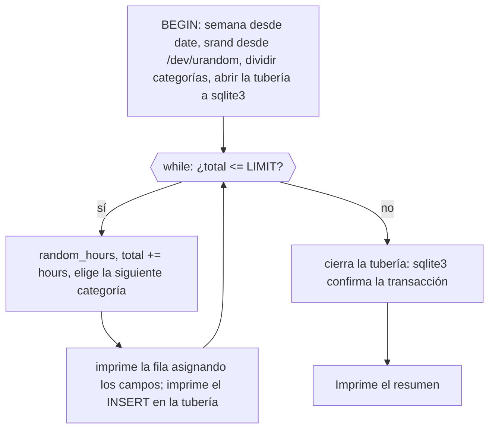

# AWK

**Te enseña:** que AWK portable puede construir registros a partir de campos y enviar su salida por una tubería, con arreglos y variables locales de parámetro para el estado.

> **DEMO ONLY.** Tarjetas de horas ficticias en un archivo SQLite temporal. Sin conexión con ningún sistema real de registro de horas.

Esta es la versión directa, la que muestra cómo AWK está *pensado* para escribirse. El reto ("suma tarjetas de 10 a 19 horas hasta que el total pase de 40") es un solo bucle `while`; todo lo demás en [`timecards.awk`](timecards.awk) es una función pequeña que hace una sola tarea. Es **awk POSIX portable**: se ejecuta sin cambios en gawk, mawk, one-true-awk (BWK awk) y busybox awk. La versión rara, que delega el bucle en el bucle principal del propio awk y lee los dados de `/dev/urandom`, es [`awk-weird`](../awk-weird/README.md).

## Ejecútalo

Necesitas cualquier `awk` compatible con POSIX, `sqlite3` y los habituales `date`, `od` y `mkdir`.

```bash
cd src/awk
awk -f timecards.awk
./check.sh                    # runs the check under every awk it finds; AWKS='gawk|mawk' ./check.sh to choose
```

Los registros van a `$XDG_DATA_HOME/Awk/demo-timecards.db` (por defecto `~/.local/share/Awk/`). Una ejecución se ve así:

```text
# DEMO ONLY run 1794861273-1655779341
Reuniones	19	19	2026-W47	DEMO ONLY
Programación	17	36	2026-W47	DEMO ONLY
Depuración	10	46	2026-W47	DEMO ONLY
# committed total=46 entries=3 DEMO ONLY
# a BEGIN-only awk program: arrays, a pipe to sqlite3, and fields rebuilding each row
```

## Qué hace

Saca tarjetas de 10 a 19 horas y recorre en ciclo Reuniones, Programación, Depuración y Aprendizaje hasta que el total acumulado pasa de 40 (se conserva la tarjeta que cruza la línea); imprime cada fila y guarda todas en SQLite en una sola transacción.

## Flujo del programa



**Qué muestra:** la forma idiomática de un generador en AWK. No hay entrada de datos, así que `BEGIN` hace todo el trabajo y un `while` ordinario es el bucle. La prueba va antes de cada extracción, así que la tarjeta que pasa de 40 es la última que se suma.

**Por qué importa este mecanismo:** la tubería es un flujo de salida con nombre. `print ... | sqlite` inicia `sqlite3` una sola vez y le envía SQL de forma continua, y `close` es lo que la vacía y devuelve su estado de salida. El programa no usa el bucle real de AWK, el que recorre los registros de entrada. El hermano raro [`awk-weird`](../awk-weird/README.md) sí lo usa.

## Cómo funciona el truco

Un programa AWK es una lista de reglas `pattern { action }` que se ejecutan una vez por registro de entrada, más las reglas `BEGIN` y `END`. Este programa **no tiene entrada de datos**, así que todo ocurre en `BEGIN`, que es la forma idiomática de un generador.

1. **Funciones con variables locales en la lista de parámetros.** AWK no tiene sintaxis para variables locales: los parámetros extra *son* las locales, y por convención se escriben después de un espacio (`function command_line(command,    line)`). Toda variable que no está en la lista es global; por eso los parámetros de una función no deben reutilizar los nombres que usa el bloque `BEGIN`. `gawk --lint` avisa de ese problema y `check.sh` ejecuta esa revisión.
2. **`command_line`: un comando como fuente de datos.** `command | getline line` ejecuta un comando del intérprete de comandos (*shell*), el programa que recibe y ejecuta comandos escritos como texto, y lee la primera línea de su salida; necesitas `close(command)` antes de poder ejecutarlo otra vez.
3. **`random_hours`.** `rand()` está en `[0, 1)`, así que `int(rand() * 10)` va de 0 a 9 y `HOURS_MIN + ...` lo deja de 10 a 19. La semilla viene de `/dev/urandom` mediante `od` y va a `srand`: sin eso, `rand()` se repite en la mayoría de las implementaciones de AWK.
4. **Arreglos.** `split("Reuniones Programación Depuración Aprendizaje", CATEGORY, " ")` llena un arreglo indexado desde **1**. `CATEGORY[cards++ % 4 + 1]` elige la siguiente tarjeta y la cuenta en la misma expresión.
5. **El reto.**
   ```awk
   while (total <= LIMIT) {
       hours = random_hours()
       total += hours
       category = CATEGORY[cards++ % 4 + 1]
       print_row(category, hours, total, week)
       print sql_insert(run, category, hours, total, week) | sqlite
   }
   ```
   La prueba ocurre antes de cada sorteo, así que la tarjeta que pasa de 40 es la última que se agrega.
6. **Los campos como constructor de registros.** `print_row` asigna `$1` a `$5`; asignar a un campo reconstruye `$0` unido con `OFS`, que `BEGIN` define como una tabulación y `print` sin argumentos lo imprime. Sin cadena de formato `printf` y sin unión manual.
7. **Una tubería como flujo de salida.** `print ... | sqlite` inicia `sqlite3` una sola vez y le envía SQL de forma continua; la misma cadena de texto de comando es la misma tubería. `close(sqlite)` la vacía y devuelve el estado de salida del comando, que el programa comprueba (consulta la trampa sobre `close` más abajo).
8. **Comillas.** `shell_quote` envuelve una ruta como una sola palabra del intérprete de comandos. Para ello usa `split` para dividir en `'` y une con `'\''`; `sql_quote` duplica las comillas de una cadena de texto. Ambas se hacen con operaciones simples con cadenas de texto, porque las cadenas de reemplazo de `gsub` tratan las barras invertidas de forma distinta en distintos awks.

## Por qué esto es idiomático

- **Funciones pequeñas** con sus variables locales declaradas y constantes escritas en mayúsculas.
- **`BEGIN` para un programa sin entrada de datos** y `ENVIRON` para el entorno.
- **Arreglos y `split`** para la tabla de consulta; `printf`/`sprintf` para texto con formato; el modismo de asignación de campos para una fila delimitada.
- **Tuberías y `close`** para comunicarse con otros programas, como hacen los programas AWK desde la década de 1970.
- **Solo funciones POSIX**: sin `strftime`, `systime`, `gensub` ni `RT` y sin arreglos de arreglos. La hora viene de `date(1)`.

## Qué puedes aprender

- Que las variables locales de AWK son parámetros adicionales y por qué eso importa al elegir nombres.
- `$0` y los campos son una sola estructura de datos: si asignas uno, AWK reconstruye el otro.
- `getline` desde un comando y `close` para reutilizarlo.
- Por qué siempre inicializas `rand()` con una semilla.
- Qué características de AWK son POSIX y cuáles son GNU: este archivo es una lista breve de las portables.

## Trampas que conviene conocer

- **Los arreglos de `split` empiezan en 1**, no en 0.
- **Las variables sin inicializar son `""` y `0` a la vez.** Aun así, el código asigna 0 a `total` y `cards`, para los lectores y para el linter.
- **`srand()` sin argumento toma la semilla de la hora del día**, y eso da los mismos números a dos ejecuciones iniciadas en el mismo segundo; de ahí la semilla `/dev/urandom`.
- **`close()` de una tubería devuelve resultados distintos en distintos awk.** Probado aquí: gawk y mawk devuelven el estado de salida del comando; busybox devuelve el estado de espera sin procesar (el estado de salida multiplicado por 256, así que sigue siendo distinto de cero si hay un fallo); la compilación de one-true-awk que se probó devuelve 0 pase lo que pase, así que allí un `sqlite3` con fallo pasaría inadvertido. La prueba de `!= 0` del programa es correcta para los tres primeros; con un cuarto awk, comprueba qué te da `close`.
- **Una ruta que contenga comillas dobles o un salto de línea** no es compatible.
- **El SQL construido con cadenas de texto** es seguro aquí solo porque cada valor es un número calculado aquí o una de cuatro palabras fijas. `sql_quote` está presente de todos modos; no copies esto para entradas de datos no confiables.
- **Formato.** No existe un formateador para AWK. `gawk --pretty-print` existe, pero reescribe la disposición y elimina la mayoría de los comentarios; por eso aquí solo se usa para comprobar el analizador sintáctico. La disposición (cuatro espacios y un comentario sobre cada función) se hace a mano.

## Qué exige `check.sh`

Está el marcador `DEMO ONLY`; no hay texto que parezca de red; el reto es un `while (total <= LIMIT)`; `gawk --lint --posix` no se queja de nada (es decir, no hay extensiones de GNU ni variables sombreadas). Después vienen 25 ejecuciones reales con **cada** awk que se encuentre (gawk, mawk, el one-true-awk y el awk de busybox si está instalado). En cada ejecución se comprueba que los registros sean coherentes (horas de 10 a 19, categorías en orden, totales acumulados correctos y parada justo cuando el total pasa de 40), y que SQLite coincida con la salida impresa.

## Ejecútalo en un contenedor

Requisito previo: Docker, que configuras una sola vez como se describe en [`SANDBOX-SETUP.md`](../../SANDBOX-SETUP.md#docker). La imagen base `cc-rt-awk` viene de `sandbox/container/build-bases.sh`.

```bash
sandbox/container/run-image.sh src/awk
```

Compila el [`Dockerfile`](Dockerfile) de esta carpeta y ejecuta el resultado (con mawk, para mostrar la portabilidad) sin red, con un sistema de archivos de solo lectura y con el usuario `nobody`. Después muestra la salida y una vista de solo lectura de las filas que escribió. La imagen incluye gawk, mawk y sqlite3 sobre un Ubuntu mínimo.
