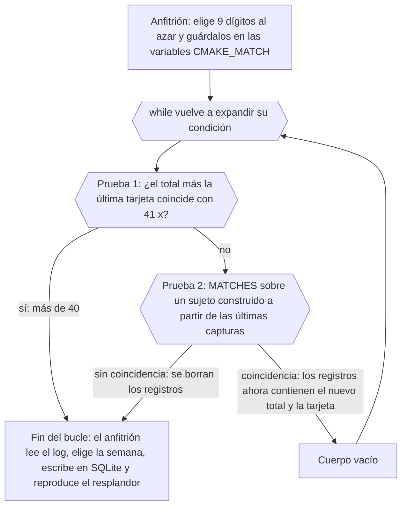

# CMake: `for (seed; test; iterate) ;`, con `while()` y una expresión regular

**Te enseña:** que `while()` y una regex pueden formar una pequeña máquina de registros.

> **DEMO ONLY.** Tarjetas de tiempo ficticias, escritas en un archivo SQLite temporal dentro de `$XDG_DATA_HOME/CmakeChallenge/`.
> Nada de esto toca el registro de horas real.

## Ejecútalo

```bash
cmake -P timecards.cmake            # one run (glows if stdout is a terminal, silent in a pipe)
cmake -DPOP=1 -P timecards.cmake    # same, in a new Windows Terminal window that closes itself
./check.sh                          # needs cmake 3.19+ on PATH (`uv tool install cmake` works without root)
```

```
# DEMO ONLY run 1
Meetings	16	16	2026-W46	DEMO ONLY
Coding	18	34	2026-W46	DEMO ONLY
Debugging	13	47	2026-W46	DEMO ONLY
Runtime error near line 4: CHECK constraint failed: stop rule fired: total exceeds 40 (19)
# committed total=47 entries=3 DEMO ONLY
# an empty while() went round 3 times, once per card
```

## Flujo del programa



**Qué muestra:** `while()` vuelve a expandir su condición en cada pasada, y `MATCHES` guarda sus capturas en variables ordinarias. Así, la condición puede construir su siguiente cadena de entrada a partir de sus últimas capturas, y la *coincidencia* es el programa. Los números son secuencias de `x`, y la regla de parada es un literal de 41 caracteres.

**Por qué importa este mecanismo:** el bucle tiene un cuerpo vacío y una máquina de registros como condición. La prueba 1 debe ejecutarse primero, porque una coincidencia fallida borra los registros y una exitosa los reescribe; por eso la coincidencia principal debe ejecutarse al final para que sus capturas sobrevivan. `AND` no se detiene en la primera prueba falsa: en la pasada final, cuando la prueba 1 ya indicó que se detenga, la prueba 2 aún se ejecuta, y eso es lo que mueve la última tarjeta al log (`CMAKE_MATCH_4`). Entonces los registros también guardan una búsqueda de horas más que nunca se informa. La documentación de CMake no promete que se evalúen ambos operandos, así que este comportamiento es aprovechado por accidente. Si intercambias las dos pruebas, obtienes una ejecución con cero tarjetas.

## Cómo funciona el truco

Una versión anterior de este archivo era un script normal: `while()`, `math(EXPR)`, `list(GET)`. Eso es `RunEverything()`
con acento de CMake, así que la descartamos. Ahora el programa es **un `while()` con el cuerpo vacío**. Todo lo que
decide algo vive en su condición:

```cmake
while(NOT "${CMAKE_MATCH_1}${CMAKE_MATCH_5}" MATCHES "^xxxxxxxxxxxxxxxxxxxxxxxxxxxxxxxxxxxxxxxxx"
      AND "${CMAKE_MATCH_1}${CMAKE_MATCH_5}|${CMAKE_MATCH_3}|${CMAKE_MATCH_4}${CMAKE_MATCH_5}-||\
0:xxxxxxxxxx|\
1:xxxxxxxxxxx|
   ...
9:xxxxxxxxxxxxxxxxxxx|"
          MATCHES "^(x*)\\|([0-9])([0-9]*)\\|([^|]*)\\|.*\\|${CMAKE_MATCH_2}:(x*)\\|")
endwhile()
```

En CMake, `if()`/`while()` `MATCHES` guarda sus grupos de captura en las variables ordinarias `CMAKE_MATCH_1..`, y un `while()` **vuelve a expandir su condición en cada pasada**. Así, la condición puede construir su cadena de texto de entrada y su patrón a partir de las capturas de la pasada anterior. Eso es una máquina de registros y la coincidencia es el programa:

| Pieza | Qué es |
|---|---|
| Estado | números son secuencias de `x`: 1 = total hasta ahora, 2 = el dígito consultado en la última pasada, 3 = el resto de la cinta de dígitos, 4 = el registro de las tarjetas terminadas, 5 = horas de la tarjeta agregada en la última pasada |
| Horas por tarjeta, de 10 a 19 | la tabla `0:xxxxxxxxxx|1:xxxxxxxxxxx|...` está *en el sujeto*; el patrón inserta el dígito de la pasada anterior (`${CMAKE_MATCH_2}:`) y captura esa fila. La escalera es la de 10 a 19 horas por tarjeta |
| Total acumulado | el siguiente sujeto empieza con `${CMAKE_MATCH_1}${CMAKE_MATCH_5}`: concatenación de cadenas de texto de números unarios |
| Regla de parada | la primera prueba: `NOT` (el total hasta ahora + la última tarjeta coincide con un **literal de 41 caracteres**). Un total de exactamente 40 continúa. Mutar el literal cambia el comportamiento (`check.sh` lo hace) |
| Control del bucle | el bucle termina cuando la coincidencia dice que no. El "no devolver ninguna coincidencia, a propósito" de las entradas de acrobacias con regex es justo lo que detiene este bucle |
| Orden de las pruebas | la prueba de parada va **primero**: una coincidencia que falla borra todos los registros y una que tiene éxito los reescribe, así que la coincidencia principal debe ejecutarse al final para que sus capturas sean las que sobrevivan |

El anfitrión es deliberadamente pequeño, como los anfitriones de las otras entradas: antes del bucle sortea una cinta de 9 dígitos aleatorios y
los pone en los registros (`set(CMAKE_MATCH_n ...)`); después del bucle lee el log (las longitudes de las ejecuciones de `x` son las
horas), elige la semana ISO, escribe en SQLite y reproduce el resplandor. `check.sh` falla si el archivo tiene un `function()`,
`macro()`, `include()` o `cmake_language()`, cualquier cosa entre `while()` y `endwhile()` o cualquier cálculo
(`math`, `list`, `foreach`, cirugía de `string`) antes del bucle.

## Qué impone `check.sh`

`check.sh` comprueba que la proeza sea real. Todo el programa debe ser exactamente un `while()` con el cuerpo vacío, sin nada entre la condición y `endwhile()`. No puede haber `function`, `macro`, `include`, `cmake_language`, `add_custom` ni `variable_watch` y nada antes del bucle puede calcular (ni manipulación con `math`, `list`, `foreach` ni `string`, salvo dibujar la cinta de dígitos). Los únicos programas que el archivo puede iniciar son `sqlite3`, `wt.exe` (para `POP`) y el propio CMake (para `-E sleep`).

Después, la prueba ejecuta el programa 25 veces en un directorio de trabajo vacío, que debe seguir vacío. Cada ejecución debe imprimir tantas filas como entradas tiene, informar que el bucle vacío dio una vuelta por entrada y mantener las reglas de siempre (horas de 10 a 19, categorías en orden, totales acumulados correctos, `DEMO ONLY` en cada fila, una parada exactamente cuando el total pasa de 40, una semana ISO que coincide con la de SQLite). El error de la regla de parada debe aparecer en stderr exactamente una vez y no puede aparecer nada más. La base de datos debe coincidir con la salida y no debe contener filas de sondeo ni archivos `.sql` temporales.

Siguen tres pruebas más. Un barrido de límites de año (con `SOURCE_DATE_EPOCH`) compara la semana ISO con `date -u`. El *glow* debe ser silencioso en una tubería. En un pseudoterminal debe dibujar 24 fotogramas en un tiempo de 1 a 3 segundos. Además, una prueba de mutación cambia a 51 el literal de parada de 41 caracteres. Esa prueba espera que algún total supere el máximo legal de 59. Eso prueba que el literal es la regla de parada. Por último, debe rechazarse una fila que no sea de demostración.

## Trampas que conviene conocer

- **La expresión regular de CMake no admite repetición contada** (`x{41}` no es compatible; la prueba consiste literalmente en 41 letras x). Tampoco tiene *lookahead*
  ni referencias inversas, así que un patrón parametrizado por un *registro* (`${CMAKE_MATCH_2}:`) es la única forma de
  hacer una búsqueda. Un tentador `(x?x?x?...)` x 40 para "como máximo 40" retrocedería de forma exponencial ante un fallo. De ahí la
  prueba literal separada.
- **Las horas se consultan con un paso de retraso.** El paso *j* observa el dígito de la tarjeta *j+1* y consulta las horas de la tarjeta
  *j* (observado en el paso *j-1*). Por eso el primer dígito forma parte de la semilla.
- **La cinta tiene 9 dígitos**, así que nunca puede agotarse (como máximo 5 tarjetas y 6 dígitos usados). Cuatro tarjetas de 10 horas suman exactamente
  40, un total que continúa, así que la categoría de la quinta tarjeta da la vuelta y vuelve a Meetings.
- **El anfitrión sigue informando.** La impresión de las filas, las escrituras en SQLite, la semana ISO y el resplandor son CMake ordinario
  después del bucle (`string(TIMESTAMP)` conoce `%V` pero no `%G`, así que el año ISO se corrige a mano a partir del mes y
  la semana). La salida no puede ocurrir dentro de una condición. Esta es la concesión del "anfitrión diminuto que informa un resultado".
- **Hora local**, como las entradas basadas en SQLite (la entrada de Make está en UTC). `check.sh` recorre los límites de año y los contrasta con
  `date -u` mediante `SOURCE_DATE_EPOCH`.
- **`message()` va a stderr**, por eso las escrituras de `/dev/stdout`. `execute_process` hereda stdout, así que el encabezado de SQLite y el error de CHECK llegan en orden.
- **`wt.exe` trata `;` como su propio separador de subcomandos**, así que la línea de comandos de `POP` no contiene ninguno (las listas de CMake se separan con
  `;`, por eso esto requiere cuidado).
- Los únicos programas que se inician son `sqlite3`, `wt.exe` (POP) y CMake (para su propio `-E sleep`); `check.sh`
  lo comprueba.

---

Consulta el [README raíz](../../README.md#los-resultados-hasta-ahora) para ver cómo se compara con las otras entradas, y [`RETO.md`](../../RETO.md) si quieres escribir el tuyo.

## Ejecuta el ejemplo en un contenedor

Requisito previo: Docker, configurado una sola vez como se describe en [`SANDBOX-SETUP.md`](../../SANDBOX-SETUP.md#docker).

```bash
sandbox/container/run-image.sh src/cmake
```

Construye el [`Dockerfile`](Dockerfile) de esta carpeta y ejecuta el resultado sin red, con un sistema de archivos de solo lectura y con el usuario `nobody`. Luego imprime la salida y una vista de solo lectura de las filas que escribió. La imagen contiene CMake y sqlite3 sobre un Ubuntu mínimo. No tiene compilador ni Make.
