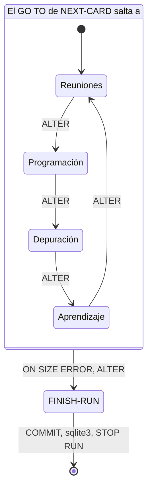

# COBOL, más raro

**Te enseña:** que un programa puede reescribir su propio flujo de control y que la programación estructurada facilita trazar esos cambios.

> **DEMO ONLY.** Tarjetas de horas ficticias en un archivo SQLite temporal. Sin conexión con ningún sistema real de registro de horas.

La [versión simple de COBOL](../cobol/README.md) hace un bucle con `PERFORM ... UNTIL`. Esta no tiene `IF`, `PERFORM`, `EVALUATE`, `UNTIL` ni `MOD` para rotar las categorías. El flujo de control es `GO TO` y **`ALTER`**, una sentencia que cambia el lugar al que salta un `GO TO` *mientras el programa se ejecuta*. `ALTER` se declaró obsoleto en 1985 y se eliminó del estándar de COBOL en 2002. GnuCOBOL aún lo ejecuta y emite cinco advertencias.

La regla de parada tampoco es una comparación. Es un número de dos dígitos que se desborda.

## Ejecútalo

Necesitas GnuCOBOL (`cobc`, versión 3.1 o posterior; `sudo apt install gnucobol` en Ubuntu) y `sqlite3`.

```bash
cd src/cobol-weird
cobc -xj timecards.cob      # compile and run; leaves a ./timecards binary (git-ignored)
./check.sh                  # set COBC=/path/to/cobc if it is not on your PATH
```

Los registros van a `$XDG_DATA_HOME/CobolWeird/demo-timecards.db` (por defecto, `~/.local/share/CobolWeird/`). Una ejecución se ve así:

```text
# DEMO ONLY run 2026111414014239-12663
Reuniones	19	19	2026-W46	DEMO ONLY
Programación	16	35	2026-W46	DEMO ONLY
Depuración	19	54	2026-W46	DEMO ONLY
# committed total=54 entries=3 DEMO ONLY
# no IF, no PERFORM: ALTER kept rewiring one GO TO, and a two-digit field overflowing pulled the plug
```

## Flujo del programa



**Qué muestra:** el estado de este programa es el destino de un solo `GO TO`. En cada tarjeta, el párrafo de categoría que indica el destino se ejecuta, reescribe el destino con `ALTER` para que apunte a la categoría siguiente y pasa a `RECORD-CARD`, que salta de nuevo a `NEXT-CARD`. El texto fuente de ese `GO TO` no cambia nunca. El salto sí cambia.

**Por qué importa este mecanismo:** no hay ninguna condición de bucle que dibujar. La salida es otra reescritura: cuando `WS-HEADROOM` se desborda, `ON SIZE ERROR` apunta el mismo `GO TO` a `FINISH-RUN`. Compara la entrada simple [`cobol`](../cobol/README.md), donde `PERFORM ... UNTIL` prueba una condición.

## Cómo funciona el truco

Los párrafos de COBOL se ejecutan en el orden en que están escritos. Pasan de uno al siguiente, a menos que un `GO TO` envíe el control a otra parte. Así, [`timecards.cob`](timecards.cob) se lee de arriba abajo: los párrafos de preparación continúan en el bucle y el bucle termina con un salto al último párrafo.

1. **La central telefónica.** El bucle es un párrafo que contiene una sentencia:

   ```cobol
   NEXT-CARD.
       GO TO MEETINGS-CARD.
   ```

   Un párrafo que es exactamente un `GO TO` es lo único que `ALTER` puede cambiar. `ALTER NEXT-CARD TO PROCEED TO CODING-CARD` reescribe el destino de ese `GO TO`, así que la próxima vez que el control llegue a `NEXT-CARD` salta a `CODING-CARD` en su lugar. El código fuente nunca cambia; lo que cambia es el salto del programa en ejecución.
2. **Las categorías rotan por reconexión.** El párrafo de cada categoría se nombra a sí mismo, usa `ALTER` para apuntar `NEXT-CARD` a la categoría siguiente y salta a `RECORD-CARD`. Reuniones lo apunta a Programación, Programación a Depuración, Depuración a Aprendizaje y Aprendizaje de vuelta a Reuniones. Nada cuenta tarjetas módulo 4. La categoría siguiente existe solo como el destino actual de un `GO TO`.
3. **`RECORD-CARD` procesa una tarjeta** (sortea las horas, las suma al total, imprime la fila, escribe `INSERT`) y termina con `GO TO NEXT-CARD`. Así que el bucle es este: `NEXT-CARD` salta a la categoría a la que apunta en ese momento, esa categoría lo vuelve a apuntar y ejecuta `RECORD-CARD`, que salta de vuelta a `NEXT-CARD`.
4. **El cable trampa es la regla de parada.** `WS-HEADROOM` es `PIC 99`, tiene dos dígitos decimales y empieza en 59. Justo antes de `GO TO NEXT-CARD`, el programa le suma las horas de cada tarjeta:

   ```cobol
   ADD WS-HOURS TO WS-HEADROOM
       ON SIZE ERROR
           ALTER NEXT-CARD TO PROCEED TO FINISH-RUN
   END-ADD
   ```

   59 + total cabe en dos dígitos mientras el total no pase de 40. La suma que lo llevaría a 100 o más es un *error de tamaño*. Entonces COBOL deja el campo sin cambios y ejecuta la cláusula `ON SIZE ERROR`, que aplica `ALTER` a `NEXT-CARD` una última vez, para `FINISH-RUN`. Lo que sigue, `GO TO NEXT-CARD`, es la misma sentencia que las veces anteriores, pero ahora termina la ejecución. Cuatro tarjetas de 10 horas suman 59 + 40 = 99, que todavía cabe, así que se saca una quinta tarjeta, exactamente como exige la regla.
5. **`FINISH-RUN`** confirma el script SQL mediante `sqlite3` e imprime el resumen.

### Qué se niega a usar esta versión y su precio real

`check.sh` elimina los comentarios y las cadenas de texto literales, y luego falla si aparece `IF`, `PERFORM`, `EVALUATE`, `UNTIL`, `VARYING`, `DEPENDING`, `SEARCH` o `WHEN`. También exige exactamente cinco `ALTER` y exactamente un `ON SIZE ERROR`. Dos lugares aún necesitaban una decisión sin `IF`:

- **`ON SIZE ERROR` es un condicional.** Es la única decisión del programa y es la propia regla de parada. Es una decisión que se activa cuando la aritmética se queda sin dígitos, no por una comparación que alguien escribió.
- **Elegir la carpeta de datos.** `$XDG_DATA_HOME` si está definida; si no, `$HOME/.local/share`. Las dos rutas van en una tabla de dos entradas y el subíndice es `1 + MIN(length of XDG_DATA_HOME, 1)`. Los datos eligen la entrada; no hay ninguna rama.
- **Cuando `sqlite3` falla, no puede omitir el resumen.** Sin `IF`, el comando del intérprete de comandos (*shell*, el programa que recibe y ejecuta comandos) hace el reporte en su lugar (`... || { echo ... >&2; exit 1; }`), y su estado de salida pasa a ser el estado de salida del programa, dividido entre 256 porque `SYSTEM` devuelve el estado de espera en bruto. Una ejecución fallida sigue imprimiendo la línea `# committed`, pero en una ejecución fallida también imprime un error en stderr y termina con 1.

### Dónde sale el programa de sí mismo

Igual que en la versión simple: `CALL "C$GETPID"` para el id de ejecución y la semilla, `CALL "SYSTEM"` una vez para `mkdir -p` y otra para ejecutar `sqlite3` sobre el script terminado y `CHECK(demo_only=1)` en la tabla, que `check.sh` prueba.

## Qué impone `check.sh`

`check.sh` revisa primero el código fuente. El archivo tiene el marcador `DEMO ONLY`, no contiene texto que parezca de red y ninguna línea pasa de la columna 72 (formato fijo). Una vez quitados los comentarios y las cadenas de texto literales, no debe aparecer ninguno de `IF`, `PERFORM`, `EVALUATE`, `UNTIL`, `VARYING`, `DEPENDING`, `SEARCH` ni `WHEN`. Debe haber exactamente cinco `ALTER` (cuatro categorías y la parada) y exactamente un `ON SIZE ERROR` (la regla de parada). Después compila el programa una vez y lo ejecuta 25 veces con las comprobaciones habituales, incluida una semana ISO que coincide con `date(1)`. SQLite debe coincidir con las filas impresas, y las ejecuciones deben diferir entre sí. Por último, intenta insertar una fila que no es de demostración y espera que SQLite la rechace, lo cual prueba que `CHECK(demo_only=1)` es real.

## Trampas que conviene conocer

- **`ALTER` solo funciona con un párrafo de un solo `GO TO`.** Por eso `NEXT-CARD` no contiene nada más. Pon un `DISPLAY` ahí dentro y el compilador rechaza el `ALTER`.
- **Parte del estado del programa está en sus saltos.** Un depurador que muestra las variables `WS-*` no puede decirte cuál es la siguiente categoría; tienes que saber a qué se alteró `NEXT-CARD` por última vez. Esta es precisamente la queja que llevó a eliminar `ALTER`: no puedes entender un párrafo leyéndolo.
- **Un error de tamaño deja el destino sin cambios.** Es el comportamiento estándar y explica por qué `WS-HEADROOM` no necesita reiniciarse. Sin una cláusula `ON SIZE ERROR`, la suma descartaría en cambio, sin avisar, el dígito inicial (99 + 1 = 00).
- **`-Wall` muestra cinco advertencias de `ALTER is obsolete`.** Son el objetivo.
- **Construir SQL con cadenas de texto es un mal hábito.** Aquí es seguro solo porque cada valor es un número que calcula el programa o una de cuatro palabras fijas. No lo copies.

## Ejecuta el programa en un contenedor

Requisito previo: Docker, configurado una sola vez como se describe en [`SANDBOX-SETUP.md`](../../SANDBOX-SETUP.md#docker).

```bash
sandbox/container/run-image.sh src/cobol-weird
```

Compila el [`Dockerfile`](Dockerfile) de esta carpeta y ejecuta el resultado sin red, con un sistema de archivos de solo lectura y el usuario `nobody`. Después imprime la salida y una vista de solo lectura de las filas que escribió. La imagen contiene el programa compilado, la biblioteca de ejecución de GnuCOBOL (libcob) y sqlite3 sobre un Ubuntu mínimo. No tiene compilador ni administrador de paquetes.
