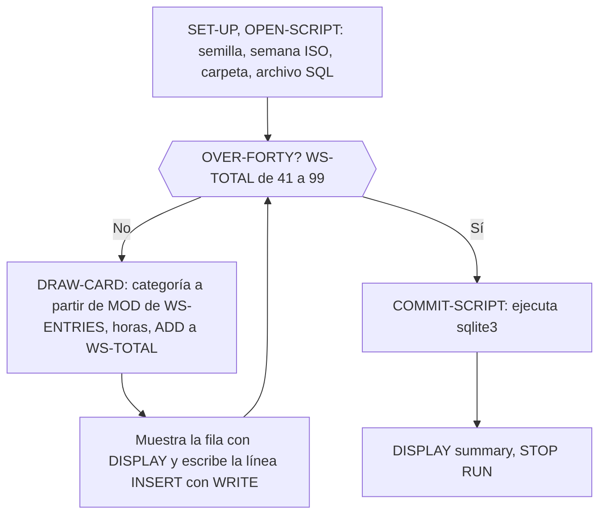

# COBOL

**Te enseña:** que una regla de parada se puede declarar como datos, y que la imagen de un número puede encargarse de tu redondeo.

> **DEMO ONLY.** Tarjetas de horas ficticias en un archivo SQLite temporal. No tienen conexión con ningún sistema real de registro de horas.

COBOL (1959) se diseñó justo para este tipo de programa: registros, totales y un informe. El reto ("suma tarjetas de 10 a 19 horas hasta que el total pase de 40") es una sola sentencia en `PROCEDURE DIVISION`, `PERFORM DRAW-CARD UNTIL OVER-FORTY`. La regla en sí no aparece en absoluto en el código de procedimiento. `OVER-FORTY` se declara en `DATA DIVISION`, sobre el total.

## Ejecútalo

Necesitas GnuCOBOL (`cobc`, versión 3.1 o posterior; `sudo apt install gnucobol` en Ubuntu) y `sqlite3`.

```bash
cd src/cobol
cobc -xj timecards.cob      # compile and run; leaves a ./timecards binary (git-ignored)
./check.sh                  # set COBC=/path/to/cobc if it is not on your PATH
```

Los registros van a `$XDG_DATA_HOME/Cobol/demo-timecards.db` (por defecto, `~/.local/share/Cobol/`). Una ejecución se ve así:

```text
# DEMO ONLY run 2026111413594869-8051
Meetings	11	11	2026-W46	DEMO ONLY
Coding	11	22	2026-W46	DEMO ONLY
Debugging	12	34	2026-W46	DEMO ONLY
Learning	15	49	2026-W46	DEMO ONLY
# committed total=49 entries=4 DEMO ONLY
# PERFORM UNTIL an 88-level: the stop rule is declared in the DATA DIVISION
```

## Flujo del programa



**Qué muestra:** un bucle estructurado convencional. `PERFORM DRAW-CARD UNTIL OVER-FORTY` evalúa la condición antes de cada pasada, así que la prueba es un nodo real y el ciclo es una arista real.

**Por qué importa este mecanismo:** la regla de parada son datos, no código. `OVER-FORTY` es un nombre de nivel 88 para los valores de 41 a 99 de `WS-TOTAL`, así que el bucle pregunta a los datos si debe continuar. El hermano raro [`cobol-weird`](../cobol-weird/README.md) no tiene esa prueba.

## Cómo funciona el truco

Un programa COBOL tiene cuatro *divisiones*, siempre en el mismo orden: `IDENTIFICATION` (su nombre), `ENVIRONMENT` (qué archivos usa), `DATA` (cada variable, con su forma exacta) y `PROCEDURE` (el código). Lee [`timecards.cob`](timecards.cob) de arriba abajo con esto al lado.

1. **La regla de parada es un dato.** En `WORKING-STORAGE SECTION`:

   ```cobol
   01  WS-TOTAL                PIC 99 VALUE 0.
       88  OVER-FORTY          VALUE 41 THRU 99.
   ```

   `PIC 99` ("picture") dice que el total tiene exactamente dos dígitos decimales. La línea `88` que va debajo es un *nombre de condición*. No almacena nada. Nombra un rango de valores de `WS-TOTAL`, y usar `OVER-FORTY` en cualquier parte pregunta si el total está ahora en ese rango. Así, el bucle, `PERFORM DRAW-CARD UNTIL OVER-FORTY`, no contiene ninguna comparación. Si cambias la regla, editas la descripción de los datos, no el código.
2. **La *picture* hace el redondeo.** `COMPUTE WS-HOURS = 10 + FUNCTION RANDOM * 10` produce un valor de 10.0 a 19.99. `WS-HOURS` es `PIC 99`, dos dígitos sin decimales, así que almacenar en él simplemente descarta la fracción. Nada llama a una función de redondeo hacia abajo: la forma del campo da de 10 a 19 horas por tarjeta. La aritmética de COBOL es decimal, no de punto flotante binario, y por eso el dinero aún funciona con ella.
3. **Una cadena de texto, vista dos veces.** Los cuatro nombres de categoría son cuatro `FILLER` de 9 caracteres en `CATEGORY-NAMES`. `CATEGORY-TABLE REDEFINES CATEGORY-NAMES` superpone una segunda descripción sobre los mismos 36 bytes: `CATEGORY ... OCCURS 4 TIMES`, un arreglo. `DRAW-CARD` elige `CATEGORY(MOD(entries, 4) + 1)`. Los subíndices de COBOL empiezan en 1.
4. **El SQL es un archivo de registros.** `SELECT SQL-SCRIPT ASSIGN TO WS-SQL-PATH ORGANIZATION IS LINE SEQUENTIAL` declara un archivo cuyo nombre está en una variable, y `FD SQL-SCRIPT` describe su registro: una línea de 400 caracteres. El programa escribe en él con `WRITE` un `CREATE TABLE`, un `BEGIN`, un `INSERT` por tarjeta y un `COMMIT`, lo cierra con `CLOSE` y solo entonces entrega todo el script a `sqlite3`. Así, cada ejecución queda en una transacción o no queda en ninguna.
5. **La semana ISO es aritmética.** COBOL tiene funciones de fecha, pero ninguna de semana ISO. `FUNCTION INTEGER-OF-DATE` cuenta los días desde 1601-01-01, que fue lunes, así que `MOD(day - 1, 7)` es 0 los lunes. Una semana ISO pertenece al año en que cae su jueves, y la semana 1 es la que contiene el primer jueves de ese año. `WORK-OUT-WEEK` expresa esos dos hechos en cuatro `COMPUTE`. Se comprobó contra `date +%G-W%V` para todos los días de 2020 a 2030, incluidos los años de 53 semanas, y `check.sh` lo compara de nuevo en cada ejecución.

### Dónde accede el programa al exterior

| Línea | Por qué |
| --- | --- |
| `CALL "C$GETPID"` | El identificador del proceso, que se suma a la marca de tiempo para formar el identificador de la ejecución, de modo que dos ejecuciones en la misma centésima de segundo sigan siendo distintas. También se mezcla en la semilla aleatoria. |
| `CALL "SYSTEM"` en `OPEN-SCRIPT` | Ejecuta `mkdir -p` en la carpeta de datos antes de abrir en ella el archivo de script |
| `CALL "SYSTEM"` en `COMMIT-SCRIPT` | Ejecuta `sqlite3 -bail db < script && rm -f script`. El script se elimina solo si `sqlite3` tuvo éxito. De lo contrario, el programa imprime dónde está y termina con código 1 |
| `CHECK(demo_only=1)` | Hace imposible representar en la tabla una fila que no sea de demostración. `check.sh` intenta insertar una y espera que SQLite la rechace |

## Qué impone `check.sh`

`check.sh` primero revisa el código fuente. El archivo tiene el marcador `DEMO ONLY`, no contiene texto con aspecto de red y ninguna línea pasa de la columna 72 (formato fijo). La regla de parada debe ser realmente el `OVER-FORTY VALUE 41 THRU 99` de nivel 88 sobre el total, y debe haber exactamente un `PERFORM DRAW-CARD UNTIL OVER-FORTY`. Compila el programa una vez (los binarios nunca se suben al repositorio) y luego lo ejecuta 25 veces, con las mismas comprobaciones en cada ejecución: categorías en orden, horas de 10 a 19, totales acumulados que suman bien, una parada exactamente cuando el total pasa de 40 y una semana ISO que coincide con `date(1)`. SQLite debe coincidir con las filas impresas, y las 25 ejecuciones deben ser 25 ejecuciones distintas con al menos seis valores de horas distintos. Al final, intenta insertar una fila que no es de demostración y espera que SQLite la rechace, lo que demuestra que `CHECK(demo_only=1)` es real.

## Trampas que conviene conocer

- **Las columnas importan.** Este es el *formato fijo*, que viene de las tarjetas perforadas: las columnas de 1 a 6 eran un número de secuencia, un `*` en la columna 7 crea un comentario, los nombres de división y de párrafo empiezan en la columna 8 ("área A"), las sentencias empiezan en la columna 12 ("área B") y **no se lee nada después de la columna 72**. Una línea larga se corta en silencio, no se rechaza. `check.sh` falla si alguna línea es más larga que 72. GnuCOBOL también acepta `cobc -free`, que elimina todo esto.
- **`STRING` no limpia su destino.** Escribe desde la izquierda y deja a la derecha lo que ya había. Por eso cada búfer que se reutiliza recibe primero `MOVE SPACES`.
- **Algunos nombres ya están ocupados.** COBOL tiene cientos de palabras reservadas. `TAB` es una de ellas en GnuCOBOL, y por eso el carácter de tabulación es `WS-TAB`.
- **`SYSTEM` devuelve el estado de espera sin procesar.** Un código de salida 3 llega como 768 (3 × 256). Este archivo solo lo compara con cero.
- **`ACCEPT ... FROM ENVIRONMENT` deja el campo en blanco cuando la variable no está definida.** No lo deja intacto, así que el `IF` que recurre a `$HOME/.local/share` comprueba si hay espacios.
- **El compilador de Ubuntu imprime una advertencia `_FORTIFY_SOURCE redefined`** en cada compilación. Aparece porque las banderas de C de `cobc` se combinan con los valores predeterminados de GCC en Ubuntu, y es inofensiva.
- **Construir SQL con cadenas de texto es un mal hábito.** Aquí es seguro solo porque cada valor es un número que calcula el programa o una de cuatro palabras fijas. No lo copies.

## Ejecuta el programa en un contenedor

Requisito previo: Docker, configurado una sola vez como se describe en [`SANDBOX-SETUP.md`](../../SANDBOX-SETUP.md#docker).

```bash
sandbox/container/run-image.sh src/cobol
```

Construye el [`Dockerfile`](Dockerfile) de esta carpeta y ejecuta el resultado sin red, con un sistema de archivos de solo lectura y el usuario `nobody`. Después imprime la salida y una vista de solo lectura de las filas que escribió. La imagen contiene el programa compilado, la biblioteca de ejecución de GnuCOBOL (libcob) y sqlite3 sobre un Ubuntu mínimo. No tiene compilador ni gestor de paquetes.
